# Microsoft Ignite 2026 — Foundry / Copilot Studio の変更まとめ

> **基準日:** 2026-11-22 / **対象:** Ignite 2026(2026-11-17〜20)の発表と、前回の調査(2026-10-14)以降に Learn・公式ブログへ出た Microsoft Foundry・Copilot Studio の変更 / **ステータスの判定:** [features 調査](../../survey/features/README.md)と同じく、本番に使えるかは「公式 GA 一覧」で決める。

**この資料のステータス表記**

| 表記 | 意味 |
| --- | --- |
| [[GA]] | 一般提供。公式 GA 一覧でも GA、またはモデル・ツールの公式ページで GA |
| [[Preview]] | プレビュー(SLA なし。本番の必須経路に置かない) |
| [[限定プレビュー]] | 申請制・招待制のプレビュー |
| [[予定]] / [[Frontier]] | 提供予定 / Microsoft の Frontier プログラム参加者向けの先行提供 |
| [[GA:発表]] [[Preview:公式 GA 一覧]] | **発表とドキュメントが食い違う。** ブログ・Book of News などの発表では GA だが、公式 GA 一覧では Preview。カッコ内が出典 |
| [[GA:発表]] [[記載なし:公式 GA 一覧]] | 発表では GA だが、公式 GA 一覧にその機能の行がない |
| [[GA]] [[Preview:一部]] | **機能の一部だけが Preview。** どの部分かを同じ行に書く |

**実測**は、2026-11-22 に Japan East の Azure で実際に組んで確かめた結果を指す(5 章)。

**公式 GA 一覧**は、Microsoft Learn の「[Feature readiness at GA](https://learn.microsoft.com/en-us/azure/foundry/concepts/general-availability)」にある表(Foundry ポータルの機能ごとに GA / Preview を示す。2026-11-17 更新)を指す。Microsoft が本番利用の可否を機能単位で示している唯一の一覧なので、これを正とする。

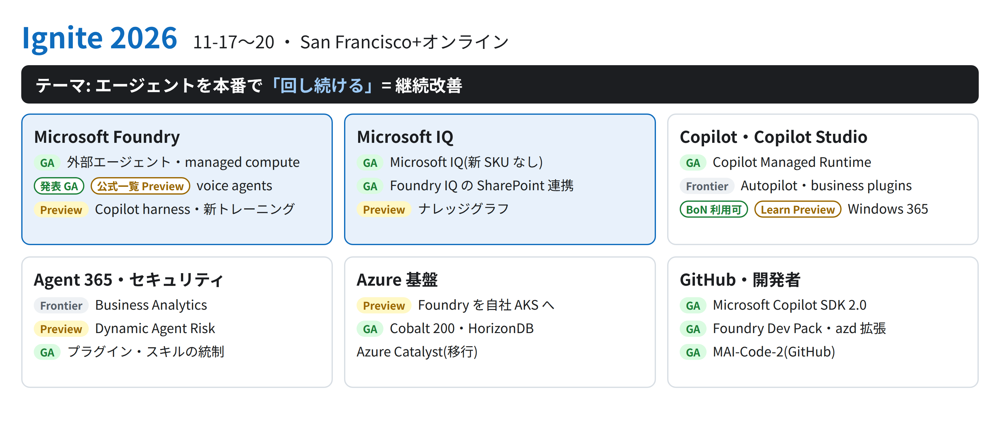

Ignite 2026 の軸は「エージェントを本番で回し続ける」継続改善だった。Foundry では観測・評価・最適化・再学習が 1 本のループになり、GA と新プレビューが同時に大量に出た。ただし公式 GA 一覧に反映された GA は一部だけで、**発表の GA をそのまま本番採用の根拠にしない**ことが今回いちばんの注意点だ。

## 1. Ignite 2026 の概要

| 項目 | 内容 |
| --- | --- |
| 開催 | 2026-11-17〜20、San Francisco+オンライン |
| テーマ | AI エージェントの本番運用と継続改善。Microsoft IQ(企業の文脈を束ねる層)を GA にし、Foundry が改善ループを担う |
| 主な柱 | Microsoft Foundry / Microsoft IQ / Microsoft Copilot・Copilot Studio・Agent 365 / Azure 基盤 / セキュリティ / GitHub |
| 一次情報 | [Book of News](https://news.microsoft.com/events/ignite/2026/book-of-news/)、[Azure ブログ「Continuous improvement comes to Microsoft Foundry」](https://azure.microsoft.com/en-us/blog/continuous-improvement-comes-to-microsoft-foundry/)、[devblogs Foundry](https://devblogs.microsoft.com/foundry/)、[Tech Community Foundry Blog](https://techcommunity.microsoft.com/category/azure-ai-foundry/blog/azure-ai-foundry-blog) |

## 2. Foundry: 何が変わったか

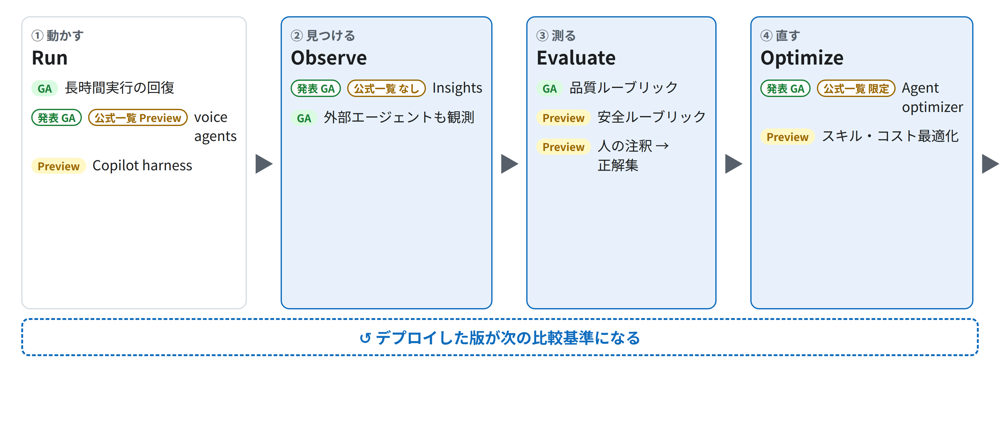

- 本番のトレースから問題を束ね(Insights)、ルーブリックと人の注釈で測り、Agent optimizer が改善案を出し、それでも足りなければモデルを再学習する。この改善の手順が製品の機能として並んだ。
- 同じ基準で版を比べ続けるのが前提なので、評価データセット(正解集)を誰が持つかを最初に決める必要がある。

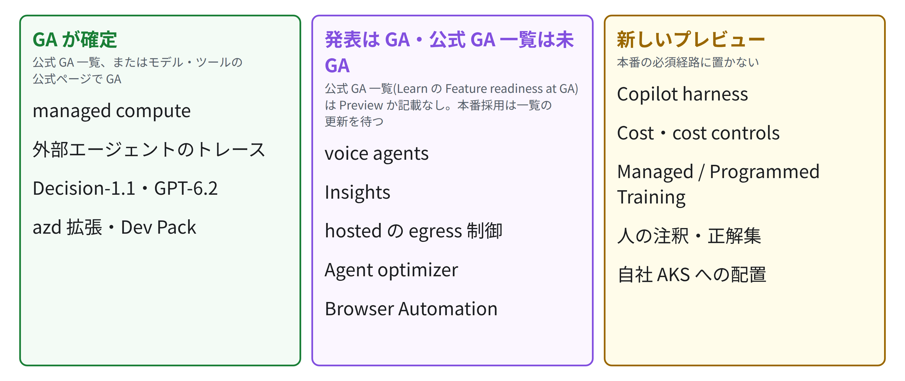

- 本番の必須経路に載せてよいのは左の列だけ。中央の列は、公式 GA 一覧が更新されれば GA になる候補として扱う。

## 3. Foundry: 領域別の詳細

### 3.1 エージェントの動かし方(Agent Service)

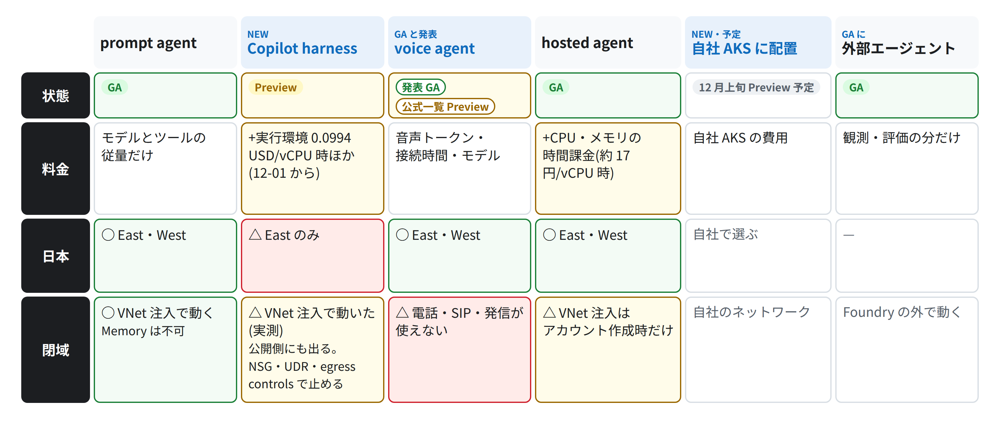

- **新しい選択肢の条件**: Copilot harness は 12-01 から実行環境(vCPU・メモリの時間)に課金が加わり、日本では Japan East だけで使える。閉域のプロジェクトでも動き、shell から公開インターネットにも出られた。止めるには、委任サブネットの NSG・UDR か RAI ポリシーの egress controls([[Preview]])を使う(5.4 の実測)。voice agent は日本の両リージョンで使えるが、閉域のプロジェクトでは電話番号チャネル・SIP・発信が使えない。hosted agent は CPU とメモリの時間課金が加わり、VNet に入れられるのはアカウントを作るときだけ。
- 料金の単価は 2026-11-22 時点の公開値。地域や契約で変わるので、見積もりでは料金ページで確かめる。

画面: [Microsoft Learn「voice-agent-observability」](https://learn.microsoft.com/en-us/azure/foundry/agents/concepts/voice-agent-observability) — voice agent の Monitor タブ。タブ列に Channels(電話などのチャネル)がある(画面はイベント前の 2026-11-11 版)

| 発表 | ステータス | SI に効く点 | 出典 |
| --- | --- | --- | --- |
| voice agents | [[GA:発表・Learn・SDK]] [[Preview:公式 GA 一覧]] [[Preview:一部]] | 公式 GA 一覧の行名は「Agents — Voice Live」。電話系(SIP・発信)・WebRTC・監視と評価は Preview。**閉域プロジェクトでは電話チャネルと発信が使えない** | [devblogs 11-18](https://devblogs.microsoft.com/foundry/whats-new-in-foundry-agent-service-at-ignite-2026/) |
| Microsoft Copilot harness(prompt agent のマネージド実行) | プレビュー | **2026-12-01 から従量課金**(0.0994 USD / vCPU 時・0.0118 USD / GiB 時。料金は地域・契約で変わり、Learn には未掲載)。Japan West・East US 2 不可、BYOM・Memory 不可 | [devblogs 10-28](https://devblogs.microsoft.com/foundry/microsoft-copilot-harness-in-foundry/) |
| hosted agents: 長時間実行の回復・サブネット IP 共有 | GA | サブネットは /24 で約 60,000 セッションの計画値(上限はセッションクォータ 2,000 / 1,000) | [devblogs 11-18](https://devblogs.microsoft.com/foundry/hosted-agents-foundry-agent-service-ignite-2026/) |
| hosted agents: egress 制御 | [[GA:発表・Learn]] [[記載なし:公式 GA 一覧]] | 公式 GA 一覧で近い行「Guardrails — Agents」は Preview。安定版 API 2026-09-01。Transform rules・シークレット注入は Preview | [Learn add-hosted-agent-guardrails](https://learn.microsoft.com/en-us/azure/foundry/agents/how-to/add-hosted-agent-guardrails) |
| hosted agents: memory snapshot・社内 CA の信頼・Azure Policy による egress 統制 | プレビュー | Policy 統制は Canada Central / Spain Central / Korea Central のみ(日本なし) | 同上 |
| 自社 AKS への配置 | 予定(public preview は 12 月上旬が目標) | GPU・リージョン・統制を自社で選べる。本番採用はまだ先 | 同上 |
| M365 / Teams への公開 | GA(Bot Service リソースが不要に) | 別途の Azure Bot Service を作らずに公開できる。受信は公衆インターネット経由で、パブリックネットワークアクセスが無効ならポータルは使えず REST だけ | [Learn publish-copilot](https://learn.microsoft.com/en-us/azure/foundry/agents/how-to/publish-copilot) |
| ビジュアル Workflows | プレビューのまま **2026-12-01 廃止** | Microsoft Agent Framework へ移行 | [Learn workflow](https://learn.microsoft.com/en-us/azure/foundry/agents/concepts/workflow) |

### 3.2 観測・評価・最適化

画面: [Microsoft Learn「agent-insights」](https://learn.microsoft.com/en-us/azure/foundry/observability/how-to/agent-insights) — Insights タブ。繰り返し起きる問題を束ね、関連トレースと修正案を示す(画面はイベント前の 2026-11-10 版で Preview 表記がある)

画面: [Microsoft Learn「register-external-agent」](https://learn.microsoft.com/en-us/azure/foundry/agents/how-to/register-external-agent) — Foundry の外で動くエージェントを「Link external agent」で登録する(画面はイベント前の 2026-11-11 版)

画面: [Microsoft Learn「trace-annotations」](https://learn.microsoft.com/en-us/azure/foundry/observability/how-to/trace-annotations) — トレースに Good / Bad とコメントを付ける注釈画面(画面はイベント前の 2026-09-30 版)

画面: [Microsoft Learn「optimize-agents-from-insights」](https://learn.microsoft.com/en-us/azure/foundry/agents/how-to/optimize-agents-from-insights) — Insights を基にした最適化の結果。候補ごとに品質とレイテンシを比べる(画面はイベント前の 2026-11-11 版)

| 発表 | ステータス | SI に効く点 | 出典 |
| --- | --- | --- | --- |
| Insights(繰り返す失敗の分析) | [[GA:発表・SDK 2.11.0]] [[記載なし:公式 GA 一覧]] | Japan East / West で使える。分析に使うモデルの料金と閲覧ロールが要り、voice agents では使えない。SDK は beta から GA への移行で破壊的変更 | [Learn agent-insights](https://learn.microsoft.com/en-us/azure/foundry/observability/how-to/agent-insights) |
| 外部エージェントの登録・観測(LangGraph / LangChain / CrewAI) | [[GA]](トレースは公式 GA 一覧でも GA) | Insights の修正案は一般的な助言だけ(Foundry がコードを持たないため)。人手評価・red teaming の対象化・イベント起動の継続評価は非対応。旧カスタムエージェントは **2027-05-07 終了** | [TC 11-18](https://techcommunity.microsoft.com/blog/azure-ai-foundry-blog/external-agents-in-microsoft-foundry-are-now-generally-available/4572630) |
| 品質ルーブリック | GA(Learn が明記。評価器一覧の見出しは preview のまま) | 業務の「良い回答」の基準を項目で書ける | [Learn continuous-scheduled-evaluation](https://learn.microsoft.com/en-us/azure/foundry/observability/how-to/continuous-scheduled-evaluation) |
| 安全・タスク単位のルーブリック | プレビュー | 安全ルーブリックは日本リージョンなし | [Learn safety-rubric](https://learn.microsoft.com/en-us/azure/foundry/concepts/evaluation-evaluators/safety-rubric-evaluators) |
| Human in the loop(トレース注釈 → 評価データセット → 正解集) | プレビュー | 注釈を付ける人と正解集の持ち主を体制に入れる | [Learn human-in-the-loop](https://learn.microsoft.com/en-us/azure/foundry/observability/how-to/human-in-the-loop) |
| Agent optimizer(Insights 連携・スキル最適化・コスト最適化) | [[GA:Book of News]] [[限定プレビュー:公式 GA 一覧]]。Insights 連携・スキル最適化・コスト最適化は [[Preview]] | 改善案は評価で比べてから採用する流れ。2026-11-22 の実測では申請なしで使えた(5.8) | [Azure ブログ 11-17](https://azure.microsoft.com/en-us/blog/continuous-improvement-comes-to-microsoft-foundry/) |
| 決定モデルを評価の判定役に | プレビュー | Learn は Decision-1 のみ対応(ブログは 1.1 も可と書く)。Decision-1 は 2027-02-04 リタイア | [Learn decision-model-judge](https://learn.microsoft.com/en-us/azure/foundry/observability/how-to/decision-model-judge) |

### 3.3 モデル

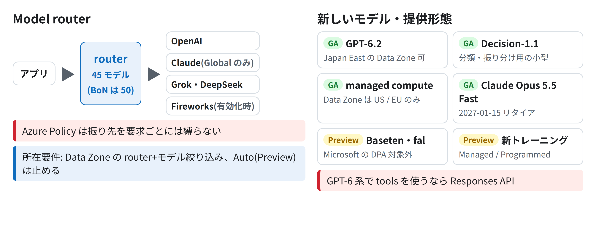

| 発表 | ステータス | SI に効く点 | 出典 |
| --- | --- | --- | --- |
| GPT-6.2 astra / sol、gpt-6.1-terra | GA | APAC Data Zone(Japan East)に対応。**GPT-6 系で tools を使うなら Responses API**(Chat Completions には制約)。GPT-6.2 は 2026-11-01 以降に提供開始したモデルなので **Modified Abuse Monitoring の対象外**になる(日付は 30 日前以上に通知) | [Learn reasoning](https://learn.microsoft.com/en-us/azure/foundry/openai/how-to/reasoning) |
| Microsoft-Decision-1.1(分類・振り分け用の小型) | GA | APAC Data Zone(Japan East / West)で使える | [TC 11-18](https://techcommunity.microsoft.com/blog/azure-ai-foundry-blog/introducing-microsoft-decision-1-1-build-faster-more-efficient-ai-applications-w/4573877) |
| Model router の大改訂(Learn は 45 モデル・Book of News は上位 50、Responses ネイティブ、AI Gateway 連携) | GA(router 本体は version 2025-11-18。Auto・Messages API・要求ごとの制御・自動モデル選択は プレビュー) | **Azure Policy は要求ごとの振り先を縛らない**。router 経由の Claude は Global のみ。所在要件があるなら Data Zone の router とモデルの絞り込み | [Learn model-router-faq](https://learn.microsoft.com/en-us/azure/foundry/openai/concepts/model-router-faq) |
| managed compute(オープンモデルの専用配置) | [[GA]](公式 GA 一覧でもプレビューの注記が消えた) | Data Zone は US / EU のみで APAC なし | [devblogs 11-20](https://devblogs.microsoft.com/foundry/managed-compute-ga/) |
| Baseten on Foundry・fal の動画モデル | プレビュー | **Microsoft の Product Terms・DPA の対象外**(Fireworks は対象) | [Book of News](https://news.microsoft.com/events/ignite/2026/book-of-news/) |
| Managed Training / Programmed Training | プレビュー | 旧 managed fine-tuning / interactive training の改称 | [TC 11-18](https://techcommunity.microsoft.com/blog/azure-ai-foundry-blog/programmed-training-you-write-the-loop-foundry-runs-the-gpus/4573299) |
| MAI-Code-2-Flash | 限定プレビュー(Foundry。GitHub では MAI-Code-2 が GA) | Foundry での本番利用はまだ | [Book of News](https://news.microsoft.com/events/ignite/2026/book-of-news/) |
| GPT-5.6 以降のプロンプトキャッシュ | GA(課金の変更) | キャッシュの書き込みが課金対象に(12 時間保持の書き込みは 2026-11-01 の利用分から) | [Learn prompt-caching](https://learn.microsoft.com/en-us/azure/foundry/openai/how-to/prompt-caching) |

### 3.4 ナレッジ・ツール

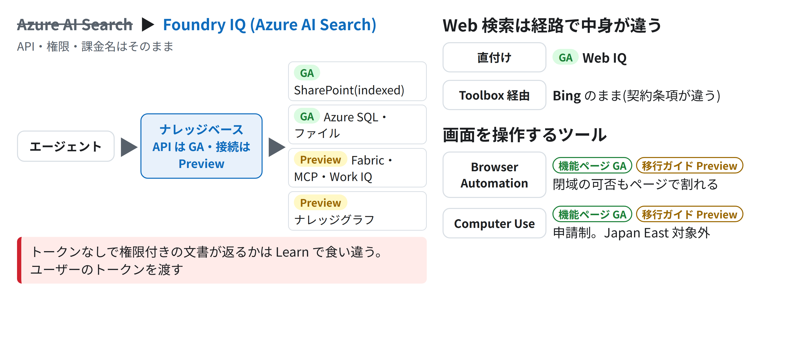

画面: [Microsoft Learn「monitor-toolbox」](https://learn.microsoft.com/en-us/azure/foundry/agents/how-to/tools/monitor-toolbox) — Toolbox の Monitor タブ。呼び出し数・成功率・エージェント別の利用(画面はイベント前の 2026-11-03 版)

| 発表 | ステータス | SI に効く点 | 出典 |
| --- | --- | --- | --- |
| Azure AI Search → Foundry IQ (Azure AI Search) | GA(名称の変更) | リソース種別・エンドポイント・API 版・RBAC・課金名は変わらない | [Learn search whats-new](https://learn.microsoft.com/en-us/azure/search/whats-new) |
| ナレッジベースの計画・回答合成、SharePoint(indexed)・Azure SQL・ファイルのソース | [[GA]] [[Preview:一部]] | API 2026-10-01 で GA。**エージェントからの接続(`RemoteTool`)は Preview**。ユーザーのトークンなしで呼んだときに権限付きの文書が返るかは、Learn のページで食い違う(下の節) | [Learn foundry-iq-connect](https://learn.microsoft.com/en-us/azure/foundry/agents/how-to/foundry-iq-connect) |
| マネージド Foundry IQ(プロジェクトに内蔵) | 限定プレビュー(12 月に全プロジェクトへ展開予定) | 課金とリージョンの条件は要確認 | [TC 11-18](https://techcommunity.microsoft.com/blog/azure-ai-foundry-blog/foundry-iq-now-managed-for-you-in-every-foundry-project/4573316) |
| ナレッジグラフ・Microsoft-Retriever-1 | プレビュー | — | [Book of News](https://news.microsoft.com/events/ignite/2026/book-of-news/) |
| Web 検索(Web IQ) | GA(prompt agent に直付け) | **Toolbox 経由は Grounding with Bing のまま**で、データ境界・DPA の条項が経路で違う | [Learn web-search](https://learn.microsoft.com/en-us/azure/foundry/agents/how-to/tools/web-search) |
| Browser Automation・Computer Use | [[GA:Learn の機能ページ]] [[Preview:Learn の移行ガイドの表]] [[記載なし:公式 GA 一覧]] | Browser Automation の閉域可否はページで割れる。Computer Use は申請制で、Japan East は対象外(Japan West は可) | [devblogs 11-18](https://devblogs.microsoft.com/foundry/browser-automation-tool-ignite/) |
| Toolbox の Monitor・VS Code 連携 | 記載なし(ステータス表記なし) | 呼び出し数・成功率・エラーをエージェント別に見られる | [Learn monitor-toolbox](https://learn.microsoft.com/en-us/azure/foundry/agents/how-to/tools/monitor-toolbox) |

### エージェントにつなぐ RAG: Foundry IQ を選ぶ条件

「汎用の RAG なら Foundry IQ」とは言えない。エージェントにつなぐ 4 つの方法を同じ観点で比べると、向く条件が分かれる(2026-11-22 時点の公式ドキュメントによる。実測はしていない)。

- **API の GA は広がったが、エージェントからつなぐ部分には Preview が残る。** Search の安定版 API 2026-10-01 で、LLM によるクエリ計画・回答合成・reasoning effort(minimal / low / medium)と、7 種のナレッジソース(検索インデックス・Blob / ADLS・OneLake・Web・ファイル・Azure SQL・SharePoint(indexed))が GA になった。一方、Agent Service からナレッジベースにつなぐ接続(`RemoteTool`)は Preview で、手順の例も Preview 版の MCP(2026-11-01-preview)を使う。GA 版(2026-04-01)の MCP は常に minimal で、抽出した結果だけを返す。公式 GA 一覧の扱いも「Partial GA(API は GA、ポータルは Preview)」のまま。Ignite で増えた Microsoft Retriever 1・ナレッジグラフ・GPT-6 系のモデルは Preview 版の API にしかない。
- **検索はある程度まで調整できるが、最終順位と前処理は Foundry IQ に任せる。** 調整できるのは、既存のインデックスを包む(セマンティック構成が必須)、保存フィルターとリクエスト時のフィルター、検索と回答への指示(`retrievalInstructions`・`answerInstructions`)、件数・時間・出力トークンの上限、minimal にして LLM の計画を省く、の範囲。スコアリングプロファイルは候補の選び方に効くだけで、最終順位は決められない。Blob・OneLake・SharePoint から自動で作るインデックスは固定のテンプレートで、埋め込みは Azure OpenAI に限られる。エージェントから使えるツールは `knowledge_base_retrieve` だけで、Agent Service は MCP の呼び出しを 100 秒で打ち切る。
- **ユーザーのトークンを渡さないときの動きが、Learn のページで食い違う。** foundry-iq-connect(11-09)は「権限付きのソースもフィルターせずに返す」と書き、retrieve とクエリ時の ACL のページ(11-06・11-09)は「ACL 付きの文書は返さない」と書く。どちらの動きでも困らないよう、ユーザーのトークンを渡す設計にし、受入試験で確かめる。
- **日本と閉域では、次の条件がつく。** Japan West では medium effort と可用性ゾーンが使えない。自動で作るインデックスを閉域で取り込むには Search を S2 / S3 / L1 / L2 にし、取り込み時の埋め込みは trusted-service bypass に頼る。SharePoint Online への通信は常に公開経路を通る。Serverless は閉域の取り込みに対応せず、ほかの tier にも移れないので、PoC を Serverless で作ると本番の閉域で作り直しになる。
- **費用は 3 つ重なる。** Search の tier 料金に、agentic retrieval のトークン(free プランは使い切ると 402 を返す)と、計画・回答合成に使う Azure OpenAI のトークンが加わる。

### Azure AI Search の改称は表示名だけ

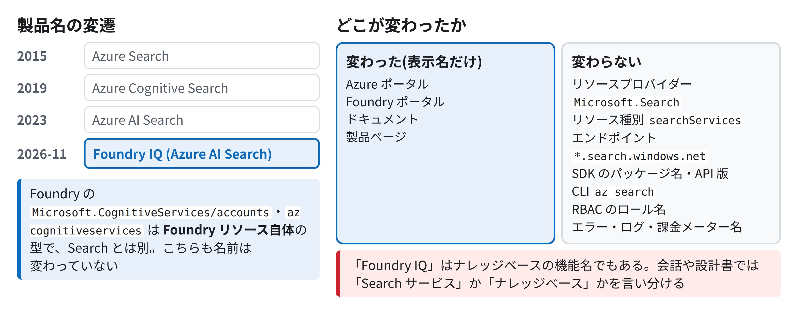

- 変わったのは Azure ポータル・Foundry ポータル・ドキュメント・製品ページの表示名だけで、Learn は「コードやアプリの変更は不要」と書く。リソースプロバイダー(`Microsoft.Search`)・エンドポイント・SDK のパッケージ名と API 版・RBAC のロール名・エラーとログ・課金メーター名は旧名のまま残る。手元の Azure CLI 2.93 でも `az search` のヘルプは「Manage Azure AI Search」のままだった。
- Foundry 側に残る「cognitive」の名前(`Microsoft.CognitiveServices/accounts`、`az cognitiveservices`)は Foundry リソース自体の型で、Search の改称とは関係がない。
- 「Foundry IQ」はナレッジベース(エージェント向けの検索の仕組み)の機能名としても使われてきた。設計書では「Search サービス」と「ナレッジベース」を言い分ける。

公式ドキュメントに画面画像がない機能: Copilot harness の prompt agent、Foundry IQ(マネージド・SharePoint)、Browser Automation。Browser Automation と Foundry IQ の接続は上の図、Copilot harness は 3.1 の図で示している。

### 3.5 管理・コスト

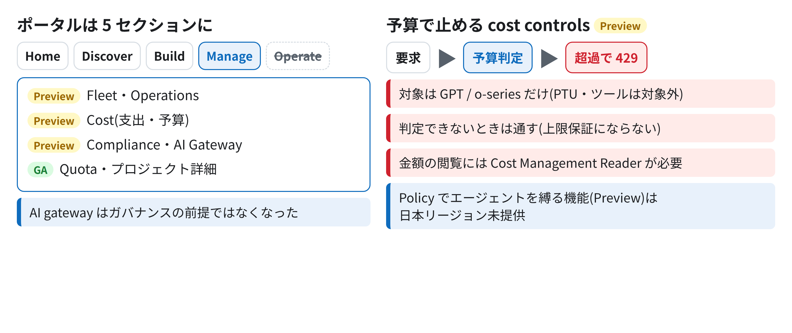

画面: [Microsoft Learn「monitor-fleet」](https://learn.microsoft.com/en-us/azure/foundry/control-plane/monitor-fleet) — Manage の Fleet overview。左ナビに Fleet・Cost・Operations・Compliance・Quota・Gateways(2026-11-18 版。上部ナビに Operate が残る統合前の画面)

画面: [Microsoft Learn「view-project-costs」](https://learn.microsoft.com/en-us/azure/foundry/how-to/view-project-costs) — プロジェクトの「Cost by agent」。エージェントごとの推定トークンコスト

画面: [Microsoft Learn「create-cost-controls」](https://learn.microsoft.com/en-us/azure/foundry/how-to/create-cost-controls) — 「Create cost control」。予算・対象・エージェント単位の配分を決める

| 発表 | ステータス | SI に効く点 | 出典 |
| --- | --- | --- | --- |
| Operate を Manage に統合(Fleet / Cost / Operations / Compliance) | プレビュー(Quota・プロジェクト詳細は GA) | ポータルは Home / Discover / Build / Manage / Docs の 5 セクション。手順書の画面説明を直す | [Feature readiness at GA](https://learn.microsoft.com/en-us/azure/foundry/concepts/general-availability) |
| Cost in Foundry・cost controls | プレビュー | 超過で HTTP 429。**対象は GPT / o-series だけ**(PTU・ツール料金・hosted の実行基盤は数えない)、判定できないと通す。**金額の閲覧には Cost Management Reader が別に要る** | [Learn cost-controls](https://learn.microsoft.com/en-us/azure/foundry/concepts/cost-controls) |
| Foundry governance(旧コントロールプレーン) | 名称の変更 | AI gateway がガバナンスの前提ではなくなった | [Learn control-plane overview](https://learn.microsoft.com/en-us/azure/foundry/control-plane/overview) |
| Azure Policy でエージェント種別・コンテナイメージ・egress を縛る | プレビュー | Canada Central / Spain Central / Korea Central のみ(日本なし) | [Learn agent-deployment-policy](https://learn.microsoft.com/en-us/azure/foundry/how-to/agent-deployment-policy) |
| Azure AI Gateway(新しいリソース種別) | [[GA:Learn・Tech Community]] [[Preview:公式 GA 一覧]] | Foundry の画面から APIM を新しく紐付けることはできなくなった | [Learn AI gateway](https://learn.microsoft.com/en-us/azure/foundry/configuration/enable-ai-api-management-gateway-portal) |

### 3.6 開発者ツール

| 発表 | ステータス | SI に効く点 | 出典 |
| --- | --- | --- | --- |
| azd の Foundry 拡張(`microsoft.foundry` 1.0 ほか) | GA(2026-11-05) | CI/CD の標準は azd。`az cognitiveservices agent` は非推奨で、2027-02-28 後の最初の CLI リリースで削除 | [Azure/azure-dev releases](https://github.com/Azure/azure-dev/releases) |
| Foundry Dev Pack | GA(2026-11-18) | チームの開発環境をワンコマンドでそろえられる | [devblogs 11-18](https://devblogs.microsoft.com/foundry/the-foundry-dev-pack-is-here-build-foundry-agents-your-way/) |
| SDK(`azure-ai-projects` 2.11.0、.NET 3.0.0) | GA | Voice Agents・Insights・External Agents が SDK 上 GA | [PyPI](https://pypi.org/project/azure-ai-projects/) |
| Microsoft Agent Framework | GA(1.26) | `azure-ai-projects` の上限は解消。**Python 3.11 以上・MCP SDK 2.x が必須**に | [Learn MAF](https://learn.microsoft.com/en-us/agent-framework/overview/) |

## 4. Copilot Studio 関連

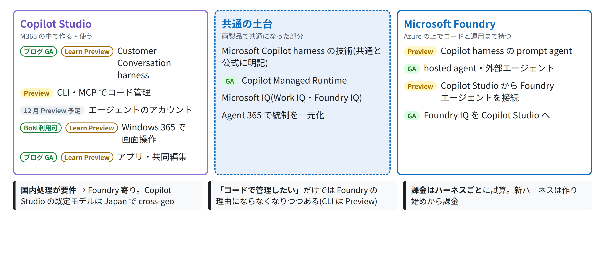

- Copilot Studio の新機能は Book of News にほとんど載らず、主な一次情報は Copilot Studio ブログの Ignite 記事(2026-11-18)だった。Learn の What's new は 10 月分までで、Ignite の項はまだない(2026-11-22 時点)。
- 発表と Learn が食い違う機能が多い点は Foundry と同じで、ブログが GA と書いても Learn や目次は Preview のままのものが多い。
- Foundry との関係で一番大きいのは、**Microsoft Copilot harness の技術が両製品で共通だと公式に書かれた**こと([Official Microsoft Blog 2026-10-28](https://blogs.microsoft.com/blog/2026/10/28/introducing-the-microsoft-copilot-harness-unlocking-the-potential-of-truly-multi-model-agentic-work/)。devblogs も「shared execution foundation」と書く)。製品としてのステータス・課金・機能は別で、エージェント定義を移せるかは書かれていない。

画面: [Microsoft Learn「agents-experience/overview」](https://learn.microsoft.com/en-us/microsoft-copilot-studio/agents-experience/overview) — 新しいハーネス(Microsoft Copilot harness)の Build タブ。右側に Model・Microsoft IQ・Skills・Tools・Knowledge・Connected agents・Memory が並ぶ(2026-11-17 版)

画面: [Microsoft Learn「authoring-add-event-trigger」](https://learn.microsoft.com/en-us/microsoft-copilot-studio/agents-experience/authoring-add-event-trigger) — イベントで自律実行するトリガー(メール受信・ファイル更新・定期実行など)(画面はイベント前の 2026-11-12 版)

画面: [Microsoft Learn「authoring-agent-account」](https://learn.microsoft.com/en-us/microsoft-copilot-studio/agents-experience/authoring-agent-account) — エージェントに専用のアカウントを持たせる「+ Agent account」(画面はイベント前の 2026-10-15 版)

| 発表 | ステータス(出典の表現) | SI に効く点 | 出典 |
| --- | --- | --- | --- |
| Copilot Managed Runtime(Copilot Code・Cowork・Copilot Studio のアプリを動かす実行基盤) | GA | Copilot Studio のエージェントとワークフローをローカルで作り、CLI で publish する機能は public preview | [TC 11-17](https://techcommunity.microsoft.com/blog/copilot-managed-runtime-blog/copilot-managed-runtime-is-now-generally-available-with-additional-new-preview-f/4571846) |
| Customer Conversation harness(コンタクトセンター向け) | [[GA:ブログ 11-18]] [[Preview:Learn What's new 10 月]] | 対応地域に Japan がない。connected agent は Foundry だけ | [Copilot Studio ブログ 11-18](https://www.microsoft.com/en-us/copilot/blog/copilot-studio/build-and-manage-business-processes-with-microsoft-copilot-studio/) |
| Microsoft Copilot harness(旧 GitHub Copilot harness) | Production-ready preview(Ignite での GA 表明なし) | 1 ターン 200 ツール呼び出し・90 分。外部エージェントの呼び出しは 5 分で切れる。トークン・ツール・ハーネスに Copilot Credits が作り始めからかかる | [Learn What's new](https://learn.microsoft.com/en-us/microsoft-copilot-studio/whats-new) |
| CLI(`msagent`)と Copilot Studio MCP | プレビュー | Git でのソース管理やコード開発ができるようになりつつあるが、本番の ALM の根拠にはまだできない | [Copilot Studio ブログ 11-18](https://www.microsoft.com/en-us/copilot/blog/copilot-studio/build-and-manage-business-processes-with-microsoft-copilot-studio/) |
| エージェントのアカウント | [[予定:ブログ 11-18 = 12 月に Preview]] [[Frontier:Learn]] | 常駐する自律エージェントに M365 の ID を持たせる | [Learn authoring-agent-account](https://learn.microsoft.com/en-us/microsoft-copilot-studio/agents-experience/authoring-agent-account) |
| Windows 365 for Agents(computer use) | [[GA:Book of News = standard harness で利用可]] [[Preview:Learn の Cloud PC pool]]。新ハーネスは 12 月に Preview、Foundry は 2027 年初めに Preview の予定 | API のない業務アプリの画面操作は、当面 Copilot Studio のほうが早く組める。Copilot Credits の対象に | [Book of News](https://news.microsoft.com/events/ignite/2026/book-of-news/) |
| エージェントの共有・Apps in Copilot Studio | [[GA:ブログ 11-18]] [[Preview:Learn のクイックスタート]]。Learn の共有ページは閲覧権限しか渡せないと書く | 複数の作成者での共同編集 | [Copilot Studio ブログ 11-18](https://www.microsoft.com/en-us/copilot/blog/copilot-studio/build-and-manage-business-processes-with-microsoft-copilot-studio/) |
| Foundry エージェントの接続 | standard harness = プレビュー / 新ハーネス = 表記なし(GA の明記もなし) | Foundry 側のエンドポイント設定には `V1Preview` ヘッダーが要る | [Learn add-agent-foundry-agent(2026-11-18 更新)](https://learn.microsoft.com/en-us/microsoft-copilot-studio/add-agent-foundry-agent) |
| Foundry IQ の接続 | GA(Copilot Studio ブログ 10-07) | 新ハーネスのエージェントだけで、1 エージェント 1 接続。Azure AI Search を使っていた構成は Foundry IQ に移す | [Learn foundry-iq-connect](https://learn.microsoft.com/en-us/microsoft-copilot-studio/agents-experience/foundry-iq-connect) |

### Copilot Studio と Foundry の使い分けで変わった点

| 観点 | Ignite 以降に確認できたこと | 使い分けへの影響 |
| --- | --- | --- |
| 国内処理 | standard harness の既定モデル(GPT Chat Latest)は Japan で「Default (cross-geo)」(11-19 版。What's new とは食い違う) | 国内処理が要件なら Foundry に寄せる根拠が強まった |
| コードでの開発・運用 | CLI・Copilot Studio MCP・ローカル開発(いずれも preview)、Managed Runtime 上の Code Agents(early access) | 「コードで管理したい」だけでは Foundry を選ぶ理由にならなくなりつつある。Code Agents と Foundry の hosted agent の使い分けは書かれていない |
| 課金の比べ方 | 新ハーネスは作り始めから Copilot Credits。M365 Copilot ライセンス保有者の扱いは新ハーネスの課金ページに記載なし | 試算の前に「どのハーネスで作るか」を決める |
| 規模の上限 | 新ハーネスは 1 ターン 200 ツール呼び出し・90 分。委任は 1 段、外部エージェントは 5 分 | 「アクション数が多いから Foundry」は standard harness だけの基準になった |
| 統制と費用 | Agent 365・Defender・Entra Agent ID に両製品のエージェントが並ぶ。費用は Copilot Credits と Foundry の Cost(preview)に分かれたまま | 「統制は Agent 365 で一元化、費用は製品ごと」と説明する |

画面は Microsoft Learn の掲載ページへのリンクで示す(画像はこのリポジトリに転載していない)。Foundry エージェントの接続・Foundry IQ の接続のページには画面画像がない。

## 5. 閉域と権限制御

Foundry を導入する企業の多くは閉域を求める。この章では公式ドキュメントの記述と、2026-11-22 に Japan East の Azure で実際に組んで確かめた結果(図の「実測」)を分けて示す。検証の手順・生ログ・費用の内訳は [labs/foundry-probes の probe 12〜15](../../../labs/foundry-probes/README.md) にある。検証に使ったリソースはすべて削除した。

### 5.1 閉域の構成パターン

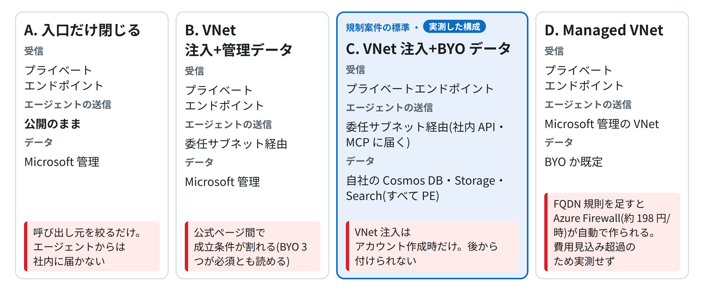

- 規制のある案件では C(VNet 注入+自社のデータ資源)が標準になる。VNet 注入はアカウントを作るときにしか付けられないので、PoC の段階から C で作る。
- 自社のデータ資源のうち Cosmos DB は Serverless で足りた(実測)。検証環境の常時課金を減らせる。
- D(Managed VNet)は、送信先の FQDN 規則を足すと Azure Firewall が自動で作られ、約 198 円/時かかり続ける。今回は費用見込み超過のため実測していない。

### 5.2 機能ごとの閉域対応

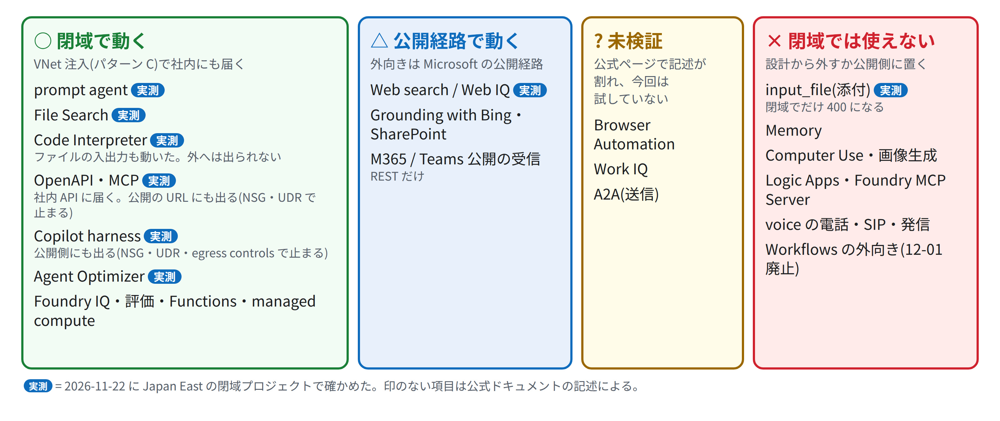

### 5.3 実測: 閉域プロジェクトで何が動いたか

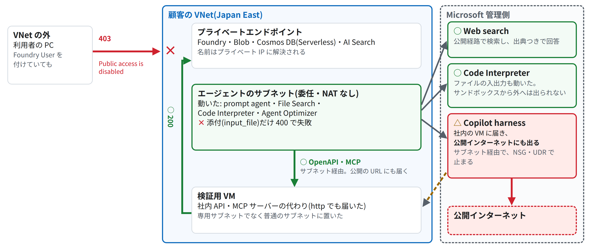

- VNet の外からは Foundry User を付けた利用者でも 403(Public access is disabled)で拒否された。VNet 内の VM からは名前がプライベート IP に解決され、200 で通った。
- エージェントのサブネットに NAT やファイアウォールがなくても、prompt agent と File Search・Code Interpreter・Web search・OpenAPI・MCP が動いた。OpenAPI と MCP の要求はエージェントのサブネットから VNet 内の VM に届き、公開の URL にも届いた(5.4)。
- **Copilot harness も閉域のプロジェクトで動き、shell から VNet 内の VM にも公開インターネットにも届いた。** NAT がなくても外に出たのは OpenAPI・MCP と同じで、委任サブネットに NSG か UDR を当てると止まった(5.4)。
- 添付ファイル(`input_file`)だけは、閉域のプロジェクトで誰が送っても 400 になった(公開側の同じ手順では 200)。閉域でファイルを渡すなら Code Interpreter か File Search を使う。
- 構築でつまずいた点: VNet 注入ありのアカウントでは、アカウント側の capability host が自動で作られ、IaC で作ろうとすると 400 / 409 になる。削除では、アカウントを完全に削除(purge)するまで委任サブネットのリンクが残り、リソースグループの削除が止まった(閉域側の purge に 22 分)。purge したアカウントと同じ名前で作り直すと、エージェントのエンドポイントだけが 70 分以上 403「Traffic is not from an approved private endpoint.」を返した(名前を変えると出なかった。原因は未確定)。

### 5.4 外向きの通信: 経路ごとの違い

Web search は検索語を Azure の境界の外(Bing)に送り、Global Standard のデプロイは国外で処理することがある。Copilot harness との違いを、宛先を誰が決めるか・何が出るか・どこを通るか・どう止めるかの 4 つの軸で比べた。2026-11-22 には閉域のプロジェクトのエージェントのサブネットに NSG と UDR を当て、どの通信が止まるかを確かめた(probe 15)。

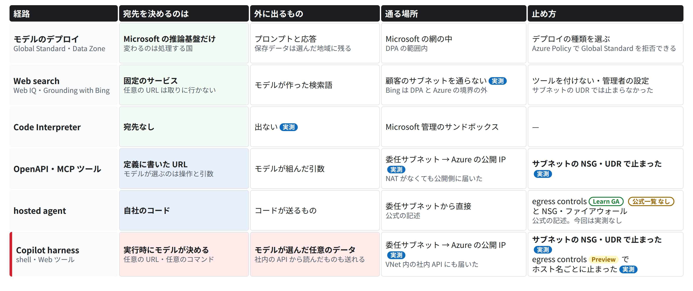

- **Copilot harness の違いは、宛先と送る中身を実行時にモデルが決めること。** shell と Web ツールで任意の URL・任意のコマンドを使えるので、VNet 内の社内 API から読んだ内容を外へ送ることもできる。通る場所と止め方は OpenAPI・MCP と同じで、委任サブネットの NSG と UDR で止まり、外すと戻った。RAI ポリシーの egress controls([[Preview]])を付けると、Deny にしたホスト名だけが 403 になり、ほかのホストには届いた。ただし egress controls を付けると、規則に当たらない VNet 内の 8080 番と公開の 22 番への接続も拒否された(原因は切り分けていない)。社内 API を harness から呼ぶなら、付けた状態で届くかを確かめる。
- **Global Standard はどの国で処理するかの話。** 宛先は Microsoft の推論基盤に限られ、プロンプトと応答は Microsoft の網の中で DPA の範囲に残る。保存データは選んだ地域に残る。国内で処理するなら Standard(リージョン)を選ぶ。ただし Japan East の Standard で使えるモデルは gpt-4.1-mini・gpt-4o・埋め込みなどに限られ、Data Zone の APAC には豪州・韓国・東南アジア・インドも入る。Azure Policy で Global Standard のデプロイを拒否できる。
- **Web search は宛先が固定のサービスで、出るのはモデルが作った検索語。** 任意の URL を取りに行く機能はない。Bing(Grounding with Bing)は DPA の対象外で、Azure のコンプライアンス境界の外に出る。顧客のサブネットは通らない(0.0.0.0/0 → None でも動いた)。止めるのはサブネットではなく管理者の設定で、サブスクリプションの機能フラグ `OpenAI.BlockedTools.web_search`、`Microsoft.Bing` の登録解除と Azure Policy、承認済みツールのポリシー([[Preview]])がある。
- **OpenAPI と MCP は宛先が定義の URL に固定され、通信は顧客の委任サブネットを通る。** NAT もファイアウォールもなく、サブネットの既定の送信を切っていても、公開の URL に届いた。宛先から見た送信元は Microsoft が管理する Azure の公開 IP(AzureCloud.japaneast。呼び出しごとに変わる)だった。OpenAPI は宛先の IP だけを拒否する NSG でも、UDR(宛先の /32 → None)でも止まり、外すと戻った。MCP は 0.0.0.0/0 → None で止まった。
- **hosted agent は自社のコードが宛先を決め、委任サブネットから直接出る**(公式の記述。今回は実測していない)。egress controls と NSG・ファイアウォールを併せて使う。
- **送信元の公開 IP では絞れない。** harness も OpenAPI も、送信元は AzureCloud.japaneast(リージョンの Azure 全体)のタグにしか入らず、プレフィックスも互いに別だった。宛先の側で harness や Foundry のツールだけを許可することはできない。
- **閉域の要件では、NAT を置かないことを「外に出ない」根拠にしない。** 委任サブネットに NSG か UDR を当て、harness を使うエージェントには egress controls でホスト名も絞る。0.0.0.0/0 → None でもツールなしの prompt agent と harness の応答は返ったので、実行基盤そのものはサブネット経由のインターネットに頼っていない。ツールの呼び出しは失敗したので、0.0.0.0/0 をファイアウォールに向けるなら、公式の許可リスト(`login.microsoftonline.com` などの Entra の宛先、または AzureActiveDirectory タグ)を入れてからツールの動作を確かめる。

### 5.5 権限: ロールごとにできること

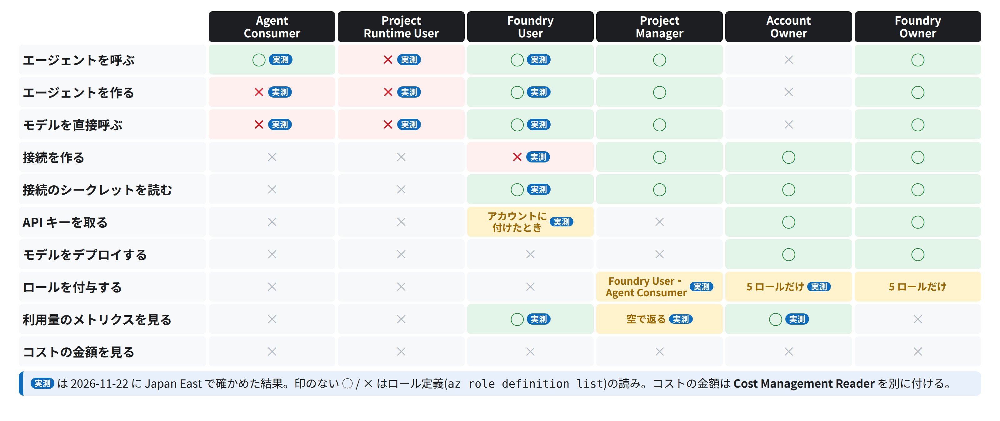

- 利用者にエージェントを使わせるだけなら、Agent Consumer をエージェント単位で付ける。呼べるのはエージェントのエンドポイントだけになる。
- Project Runtime User は、定義上は Responses を呼べるように見えるが、実測ではどの経路も 403 だった。実行専用の ID には使わない。
- 「モデルだけを呼べる」組み込みロールはない。Foundry User を付けるとエージェントも作れる。
- コストの金額はどの Foundry ロールでも見えない。Cost Management Reader を別に付ける。Project Manager では利用量のメトリクスもエラーにならずに空で返る。

### 5.6 プロジェクトの中で分けられないもの

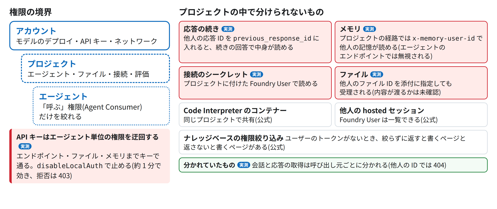

- 1 つのプロジェクトを複数の部署や顧客で共有すると、応答の続き・メモリ・接続のシークレットを通じて他人のデータに届く。分けたい単位ごとにプロジェクトを分け、利用者には Agent Consumer だけを付けてエンドポイント経由で使わせる(エンドポイントでは `x-memory-user-id` が無視された)。
- 応答 ID を利用者のブラウザーに渡す設計では、ID が漏れると他人の会話の続きが読める。応答 ID はサーバー側で利用者に紐づけて検証する。
- API キーはエージェント単位の権限を迂回する。本番では `disableLocalAuth` を有効にする。反映は約 1 分で、拒否は 401 ではなく 403 `AuthenticationTypeDisabled` になった。

### 5.7 公式の記述と実測が食い違った点

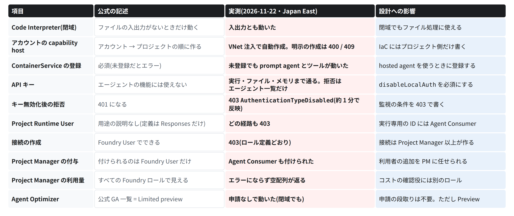

### 5.8 Agent Optimizer は申請なしで使えた

公式 GA 一覧は Agent Optimizer を「Limited preview」と書くが、Agent Optimizer の概要とクイックスタートには申請の手順がない。2026-11-22 に Japan East で、機能の登録やプレビューの申請をせずに API を呼んだ結果は次のとおり。

| 確かめたこと | 結果 |
| --- | --- |
| 費用の見積もり(ジョブを作らない) | 200。データ 3 行・候補 1 つで見積もりの上限は 0.55 USD |
| 最小のジョブ(prompt agent、データ 3 行、候補 1 つ) | 約 2 分で完了。評価のスコアは 0.833 から 0.917 に上がった。実費は数円 |
| 閉域のプロジェクト | 見積もり・ジョブとも成功(ジョブは約 3.6 分) |

申請の段取りは要らないが、GA ではないので Preview の条件(SLA なし)は変わらない。候補はエージェントの下書きの版として作られ、評価のためにエージェントが実際に呼ばれる。本番の系に書き込むツールを持つエージェントは、検証用の資源に向けてから流す。

### 5.9 実施しなかった検証と費用

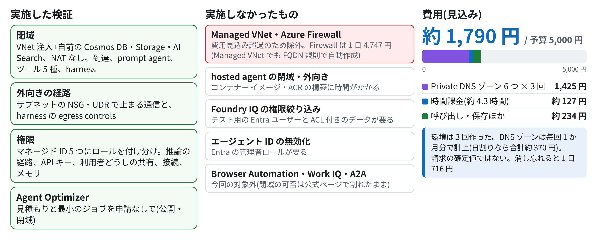

| 実施しなかったもの | 理由 | 実施した場合の概算 |
| --- | --- | --- |
| Managed VNet | **費用見込み超過のため除外。** FQDN 規則を足すと Azure Firewall Standard が自動で作られ、SKU を後から変えられない | 197.8 円/時(1 日 4,747 円) |
| hosted agent の閉域(閉域でのビルド・プライベート ACR・外向きの通信) | コンテナー イメージと ACR の構築に時間がかかるため | 0.5 vCPU・1 GiB で約 10.7 円/時+ACR Standard 105.5 円/日 |
| 0.0.0.0/0 を Azure Firewall に向けた構成 | **費用見込み超過のため除外** | 197.8 円/時 |
| egress controls を付けたときの VNet 内・22 番の拒否の切り分け | 外向きの経路を確かめる目的の外(付随して見つかった) | トークン代のみ(数円) |
| Foundry IQ の権限絞り込み | テスト用の Entra ユーザーと ACL 付きのデータソースが要るため | — |
| エージェント ID の無効化 | Entra の管理者ロールが要るため | — |
| Browser Automation・Work IQ・A2A の閉域 | 今回の対象外 | — |
| Bastion・NAT Gateway | 要らなかったため(VM の操作は run-command で済み、NAT なしで全項目が成立した) | 30.06 円/時・約 7 円/時 |

費用は予算 5,000 円に対して約 1,790 円の見込み(環境を 3 回作った)。うち 1,425 円は Private DNS ゾーン 6 つを 3 回とも 1 か月分で計上した額で、日割りなら合計は約 370 円になる。時間課金のリソース(AI Search Basic・プライベートエンドポイント・VM)は毎回テストの後すぐに削除し、稼働は合わせて約 4.3 時間だった。消し忘れると 1 日 716 円かかる構成だった。

## 6. SI への影響と期限

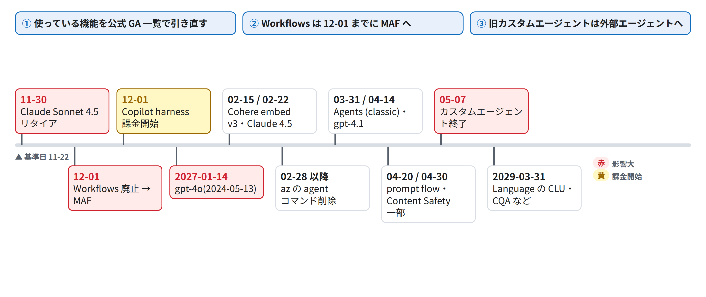

| 観点 | 判断が変わる点 |
| --- | --- |
| データ所在(日本) | GPT-6.1 / 6.2・Decision-1.1 は Japan East の Data Zone で使える。ただし 2026-11-01 以降に提供開始したモデル(GPT-6.2 など)は Modified Abuse Monitoring の対象外になる。managed compute・Policy 系のプレビュー・安全ルーブリックは日本で使えない |
| 閉域 | サブネット IP 共有が GA。egress 制御は発表では GA だが公式 GA 一覧に記載なし。voice の電話チャネルは閉域で使えない。M365 / Teams 公開の受信は公衆インターネット経由。エージェントのサブネットに NAT がなくても OpenAPI・MCP・Copilot harness は公開インターネットに出る。NSG・UDR を当てれば止まる(実測)。添付ファイルは閉域で失敗する(実測)。Browser Automation の閉域可否は要確認 |
| 課金 | Copilot harness は 12-01 から課金。プロンプトキャッシュの書き込みが課金対象に。cost controls は上限保証にならない |
| 権限 | 利用者には Agent Consumer だけを付け、分けたい単位ごとにプロジェクトを分ける。API キーは `disableLocalAuth` で止める。コストの閲覧に Cost Management Reader。ナレッジベースはユーザーのトークンを渡す設計にする |
| 期限 | Workflows(12-01)、gpt-4o 2024-05-13(2027-01-14)、カスタムエージェント(2027-05-07)、Language の CLU / CQA など(2029-03-31) |

## 7. 発表と公式ドキュメントが食い違う機能

| 機能 | GA など強い表記の出典 | 公式 GA 一覧・食い違う出典 |
| --- | --- | --- |
| voice agents | Learn・SDK・ブログ = GA | 公式 GA 一覧「Agents — Voice Live」= Preview |
| Insights | ブログ・Book of News・SDK = GA | 公式 GA 一覧に記載なし |
| hosted agent の egress 制御 | Learn・devblogs = GA | 公式 GA 一覧に記載なし(Guardrails — Agents = Preview) |
| Agent optimizer | Book of News = GA | 公式 GA 一覧 = Limited preview(実測では申請なしで使えた。5.8) |
| Browser Automation・Computer Use | Learn 本文・TOC = GA | 公式 GA 一覧に記載なし(移行表 = preview) |
| 継続評価・Agent Monitoring Dashboard | Learn = ラベルなし | 公式 GA 一覧「Monitoring」= Preview |
| multi-turn evaluation | Book of News = GA | Learn = preview |
| Azure AI Gateway | Learn・Tech Community = GA | 公式 GA 一覧「AI Gateway」= Preview |
| Foundry IQ Serverless | Search の Learn = GA | Azure ブログ = 2026-12 に GA |
| Work IQ | Learn = 標準 MCP 経路は GA | ブログ = preview |
| Model router のプール | Book of News = 上位 50 モデル | Learn = 45 モデル |
| Microsoft Copilot SDK 2.0 | Book of News = GA | PyPI の分類 = Alpha |

詳細と出典は [features 調査の「注意」欄](../../survey/features/README.md) にある。

## 出典

- Ignite 2026 [Book of News](https://news.microsoft.com/events/ignite/2026/book-of-news/)、[Microsoft Source(2026-11-17)](https://news.microsoft.com/source/2026/11/17/microsoft-ignite-2026-empowering-human-ambition-intelligence-and-trust/)
- Azure ブログ: [Continuous improvement comes to Microsoft Foundry](https://azure.microsoft.com/en-us/blog/continuous-improvement-comes-to-microsoft-foundry/)、[Introducing the new Microsoft IQ](https://azure.microsoft.com/en-us/blog/introducing-the-new-microsoft-iq-putting-your-organizations-intelligence-to-work-in-every-agent/)、[What's new in Azure at Ignite 2026](https://azure.microsoft.com/en-us/blog/microsoft-ignite-2026-whats-new-in-azure-the-platform-purpose-built-for-ai/)
- devblogs Foundry: [What's new in Foundry Agent Service at Ignite 2026](https://devblogs.microsoft.com/foundry/whats-new-in-foundry-agent-service-at-ignite-2026/)、[Hosted agents at Ignite 2026](https://devblogs.microsoft.com/foundry/hosted-agents-foundry-agent-service-ignite-2026/)、[Tools and Toolboxes](https://devblogs.microsoft.com/foundry/build-once-reuse-across-your-agent-fleet-tools-and-toolboxes-in-foundry/)、[Managed Compute GA](https://devblogs.microsoft.com/foundry/managed-compute-ga/)、[Dev Pack](https://devblogs.microsoft.com/foundry/the-foundry-dev-pack-is-here-build-foundry-agents-your-way/)
- Official Microsoft Blog: [Introducing the Microsoft Copilot harness(2026-10-28)](https://blogs.microsoft.com/blog/2026/10/28/introducing-the-microsoft-copilot-harness-unlocking-the-potential-of-truly-multi-model-agentic-work/)
- Microsoft Learn: [Feature readiness at GA](https://learn.microsoft.com/en-us/azure/foundry/concepts/general-availability)、[Model retirement schedule](https://learn.microsoft.com/en-us/azure/foundry/openai/concepts/model-retirement-schedule) ほか各表の出典欄
- Copilot Studio: [Build and manage business processes with Microsoft Copilot Studio(2026-11-18)](https://www.microsoft.com/en-us/copilot/blog/copilot-studio/build-and-manage-business-processes-with-microsoft-copilot-studio/)、[Copilot at Microsoft Ignite(2026-11-17)](https://www.microsoft.com/en-us/copilot/blog/2026/11/17/copilot-at-microsoft-ignite-expanding-whats-possible-with-intelligence-built-for-work/)、[What's new in Copilot Studio](https://learn.microsoft.com/en-us/microsoft-copilot-studio/whats-new)
- 本リポジトリ: [features 調査(2026-11-22 更新)](../../survey/features/README.md)
- 本リポジトリの実測: [labs/foundry-probes の probe 12〜15](../../../labs/foundry-probes/README.md)(閉域・権限・Agent Optimizer・外向きの経路、2026-11-22、Japan East)
