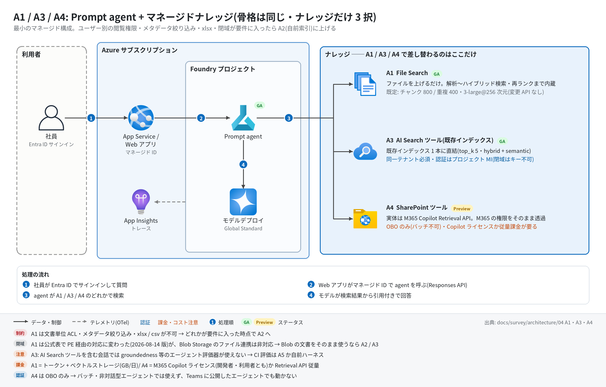
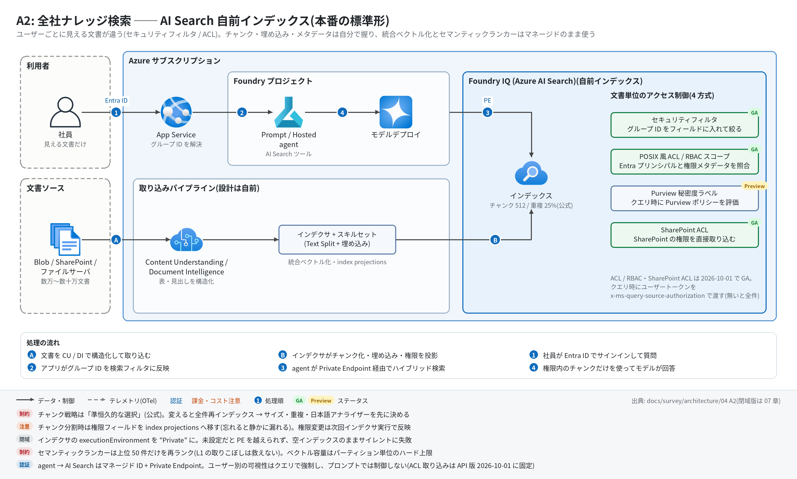
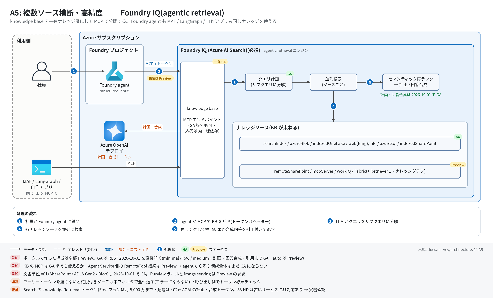

# 04. ユースケース編 A — 社内ナレッジ検索・RAG チャット

[← アーキテクチャ TOP](./README.md)

> **最終更新:** 2026-07-30(公式ドキュメントとの突合検証で訂正) / 2026-09-26(定期更新: File Search 閉域表記・S3 HD の Foundry IQ 対応・agentic retrieval 最新 preview API〈2026-08-01-preview〉・Foundry IQ のリクエスト単位ヘッダー・Work IQ の VNet/経路を一次情報で再確認) / 2026-09-29(KB の MCP エンドポイントが GA 版 `2026-04-01` でも使える〈extractive のみ〉ことを訂正反映)/ 2026-10-06(remote SharePoint の支払い方法の整理、Foundry IQ in Copilot Studio の GA〈Private Link 対応〉、`auto` reasoning effort の公表値を反映。ラボ実測から AI Search Free での agentic retrieval の動作と KB MCP 応答の API 版依存を追加) / 2026-10-14(On Your Data は本日が期限当日、Serverless / S3 HD のインデクサー実行モデル〈閉域取り込み不可・日次の累積実行時間クォータ〉、Search 管理 API の自動生成 DNS ラベル、AI Search ツールと private endpoint の Search、Foundry IQ の 401 / 502 の落とし穴、MAF の AI Search context provider、既定ストリーミングでも応答末尾がガードレール前に届きうる注記を追加) / 2026-11-22(features 差分更新〈10-14 以降+Ignite 2026〉の波及: Azure AI Search の「Foundry IQ (Azure AI Search)」への改称、Search 安定版 `2026-10-01` の GA 範囲〈LLM クエリ計画・answer synthesis・low / medium・File / indexed Azure SQL / indexed SharePoint ソース・SharePoint / ADLS Gen2 / Blob の文書レベル権限〉で旧記載「GA 構成と ACL 連携は両立しない」「GA 要件を満たすのはセキュリティフィルタだけ」を訂正、private ingestion の GA〈Dedicated のみ〉と取り込み時の trusted-service バイパス、Serverless の GA 両論とインデクサー累積実行クォータ 48 時間への訂正、KB 接続の fail-open の再明記、マネージド Foundry IQ・Microsoft Retriever 1・ナレッジグラフ〈preview〉、CU の 2,000 ページ化と入力文書の 24 時間保持、Groundedness detection の 2027-04-30 廃止、On Your Data の retired 表記、Web search の経路別の提供元、Cohere-embed-v3 の再埋め込み) / 2026-11-22 訂正(Foundry IQ: ユーザートークンを渡さないときの KB の挙動は Learn のページで食い違うので両論に。閉域取り込みの tier を S2 / S3 / L1 / L2 と明記)

Foundry 案件で最も数が多い類型。**同じ「社内文書に答えるチャット」でも、権限要件・文書の性質・鮮度要件によって取るべきアーキテクチャが 5 通りに分かれる。**本ページはその 5 パターンを、選択理由と地雷つきで整理する。

## パターン一覧(先に全体像)

| # | パターン | RAG 方式 | 想定規模 | 決め手になる要件 |
|---|---|---|---|---|
| A1 | 部門内 FAQ チャット | File Search | 〜数千ファイル | 速度優先。権限制御なし |
| A2 | 全社ナレッジ検索(本番) | AI Search 自前索引 | 数万〜数十万文書 | **ユーザーごとに見える文書が違う** |
| A3 | 既存 AI Search 資産の活用 | AI Search ツール直結 | 既存インデックス | 索引設計を自分で持ち続けたい |
| A4 | M365 / SharePoint が主データソース | SharePoint ツール / remote SharePoint KB | M365 テナント内 | 権限透過。**M365 Copilot ライセンス or Retrieval API 従量課金** |
| A5 | 複数ソース横断・高精度 | Foundry IQ(agentic retrieval) | Blob + OneLake + Web 等 | 複数エージェントで同じナレッジを共有 |

**まず読むべき公式の選択ガイダンス**(Azure AI Search の RAG 概要より):

> **agentic retrieval を使うとき:** クライアントがエージェントかチャットボット / 可能な限り高い関連性が必要 / クエリが複雑または会話的 / 引用とクエリ詳細を含む構造化レスポンスが欲しい / **新規 RAG 実装**
> **classic RAG を使うとき:** ~~**GA 機能のみが必要**~~ **ナレッジベースのオーケストレーションが要らない**(2026-11-22: ms.date 11-09 版で書き換え。planning と answer synthesis が `2026-10-01` で GA になったため) / 単純さと速度が高度な関連性より優先 / **既存のオーケストレーションコードを保持したい** / **クエリパイプラインのきめ細かい制御が必要**
> そして「**新規 RAG 実装は agentic retrieval から始めよ**」。

ただし後述のとおり **Foundry IQ / agentic retrieval は「ポータル経由だと全部プレビュー」**という重大な条件が付く。SLA 条項を書く案件ではここが分岐点になる(**2026-11-22 更新:** ポータルの agentic retrieval は what-is-foundry-iq 2026-11-04 版でも preview のままだが、**API 側は安定版 `2026-10-01` で GA 範囲が大きく広がった** → [A5](#a5-複数ソース横断・高精度-foundry-iq-agentic-retrieval))。

> **⚠ 前提が 1 つ変わった:** ~~Azure OpenAI On Your Data は非推奨で、2026-10-14 にリタイアされる~~ **リタイア済み**(use-your-data が「retired on October 14, 2026, and is no longer supported」と過去形になった — 2026-11-22 確認)。公式は「On Your Data のワークロードは **Foundry Agent Service + Foundry IQ** へ移行することを推奨する」と明記している。**「オーケストレーターを挟まず、モデルが直接データストアを読む」構成はもう選べない。**本ページの 5 パターンはいずれもオーケストレーター型(エージェントまたは自アプリ)を前提にしている。

> **2026-11-22 — Azure AI Search は「Foundry IQ (Azure AI Search)」に改称された。**Search の Learn は「The service, its features, and its capabilities are unchanged」と書き、**リソースプロバイダー `Microsoft.Search`・エンドポイント `https://{service}.search.windows.net`・REST / SDK のパッケージ名と API 版・`Search Index Data Reader` 等の RBAC ロール・課金メーター名は旧名のまま**。エージェントの「Azure AI Search ツール」も Learn・移行ガイドの対応表では「Foundry IQ (Azure AI Search)」ツールと呼ばれる(値「Yes (GA)」は不変)。本ページでは従来どおり「AI Search」と書くが、**提案書・見積書では「Foundry IQ のインデックスを直接引く構成(A2 / A3)」と「Foundry IQ のナレッジベース〈KB API〉を使う構成(A5)」を書き分ける**(同じ「Foundry IQ」でも GA の線引きとコストの出方が違う)([features 04](../features/04-tools-knowledge.md))。

---

## A1. 部門内 FAQ チャット(File Search・最小構成)

**想定:** 情シスや人事が持つ規程・マニュアル・FAQ を数百〜数千ファイル。全社員が同じ文書を見てよい。2〜4 週間で立ち上げたい。



```
 [ユーザー] ─ Entra ID 認証 ─> [App Service / Web アプリ]
                                     │ マネージド ID
                                     ▼
                          [Foundry プロジェクト]
                             ├ Prompt agent
                             ├ File Search ツール ─> vector store(Microsoft 管理 or BYO Blob+AI Search)
                             └ モデルデプロイ(Global Standard)
                                     │
                                     ▼
                          [Application Insights](トレース)
```

**なぜ File Search でよいか:** ファイルを上げるだけで、解析 → チャンク → 埋め込み → 索引 → **ハイブリッド検索 + 再ランク + クエリ書き換え**まで内蔵。引用も `url_citation` として自動生成される。ここまで自前で作ると数人月かかる。

**受け入れることになる既定値:**

| 項目 | 既定値 |
|---|---|
| チャンクサイズ | **800 トークン** |
| チャンクオーバーラップ | **400 トークン(50%)** |
| 埋め込みモデル | **text-embedding-3-large @ 256 次元** |
| コンテキストへの最大チャンク数 | 20 |

> text-embedding-3-large の完全次元は 3,072 なので、**256 次元は 1/12 に圧縮された構成。**Matryoshka 表現で精度低下は限定的とはいえ、**専門用語が密な日本語技術文書では検索精度に効く可能性がある。**この次元数を変更する API パラメータは公式ドキュメントに存在しない。

**上限:** 10,000 ファイル / ストア、**エージェントに 1 ストアのみ**(会話にも 1 ストアのみ)、最大ファイルサイズ 512MB、全アップロード合計 300GB、バッチ追加は 1 回 500 ファイルまで(2026-09-26 確認: limits ページには無いが [vector-stores 概念ページ](https://learn.microsoft.com/en-us/azure/foundry/agents/concepts/vector-stores) 2026-08-21 版に「batches of up to 500 files」と明記)。1 ファイルあたりのトークン上限は file-search ページ(2026-08-05 版)が 5,000,000、limits ページ(2026-09-07 版)が 2,000,000 と食い違う(要確認)。

**このパターンが成立しない条件(先に潰す):**

- **xlsx / csv が非対応。**対応形式はテキスト系と `.docx` `.pdf` `.pptx` などで、**表形式データが主体なら A2 以上に上げる。**
- **ドキュメントレベルのアクセス制御が原理的に不可能。**vector store に ACL の概念がない。「部署によって見える文書が違う」が要件に入った瞬間に A2 へ。
- **メタデータによるフィルタができない。**年度別・機密区分別の絞り込みが要るなら A2/A3。
- **閉域(ネットワーク分離)では Blob Storage のファイルを File Search で使えない。**公式のツール互換性表は configure-private-link 2026-08-14 版で「✅ Supported / Through private endpoint」に変わった(2026-07 時点は「Not supported / 開発中」)が、Blob Storage のファイルを File Search で使う構成は virtual-networks ページで引き続き「非対応」。Blob 上の文書をそのまま使う閉域案件では A2/A3 に倒す(→ [07 章](./07-usecase-regulated-edge.md))。
- **Italy North と Brazil South では利用不可。**
- **会話ヘルパーで作った vector store は「最終利用から 7 日」で自動失効する。**失効すると当該会話の応答生成が**失敗する。**長期に同じ会話を続ける想定なら、エージェント側の vector store を使う。

**PoC で必ずやること:** **代表的に難しい文書を 20〜30 件選んで検索品質を測る。**チャンク 800 トークン(既定)が効かないタイプ(長文契約書、条項参照が多い規程、表主体の技術文書)は早期に判明する。ここで駄目なら A2 へ切り替える。**切り替えコストは後になるほど上がる。**

**コスト構造:** モデルトークン + **File Search のベクトルストレージ(GB/日)** + App Insights 取込。Standard セットアップにすると Cosmos DB(最低 3,000 RU/s)・Storage・AI Search のコストが加わる。

---

## A2. 全社ナレッジ検索(AI Search 自前索引・本番の標準形)

**想定:** 数万〜数十万文書。**ユーザーの所属や役職によって見える文書が違う。**閉域または Private Link。長期運用。

これが **SI 案件で最も現実的な着地点**になることが多い。チャンク戦略・埋め込みモデル・メタデータ・フィルタ・ACL を完全に握りつつ、統合ベクトル化・インデクサ・セマンティックランカー・ハイブリッド検索はマネージドのまま享受できる。



```
 [文書ソース: Blob / SharePoint / ファイルサーバ]
        │
        ▼  取り込みパイプライン
 [Document Intelligence Layout / Content Understanding スキル]  ← 構造抽出(表・見出し)
        │
        ▼
 [AI Search インデクサ + スキルセット(Text Split + 埋め込み)]  ← 統合ベクトル化
        │                                    index projections でチャンク→親子投影
        ▼
 [Azure AI Search インデックス]  ← ACL / メタデータ / セマンティック構成を自分で設計
        ▲
        │ Private Endpoint
 [Foundry プロジェクト: Prompt agent or Hosted agent]
        │   └ Azure AI Search ツール(top_k / query_type / filter を指定)
        ▼
 [App Service]  ← ユーザー ID を解決し、検索フィルタまたは
        ▲          x-ms-query-source-authorization に反映
 [ユーザー]
```

### 索引設計で押さえる数値

**チャンキングの公式推奨:**

> チャンクサイズは **512 トークン(約 2,000 文字)**、オーバーラップは **25%(= 128 トークン)** から始めよ。

Text Split スキルを文字ベースで使うなら `textSplitMode: pages` / `maximumPageLength: 2000` / `pageOverlapLength: 500`。パラメータの範囲は `maximumPageLength` が最小 300・最大 50,000・既定 5,000、`pageOverlapLength` は **`maximumPageLength` の半分未満**が必須。**`defaultLanguageCode` は日本語で重要**(単語途中での分割を避ける)。

> **⚠ 注意点が 2 つ。**(1) 同一ページ内でオーバーラップ推奨が「10〜15%」と「25% から始めよ」で食い違っている。(2) **トークナイザに `o200k_base`(GPT-4o 系)が非対応**で、`cl100k_base` 等しか選べない。GPT-4o 系のトークン化と完全一致するチャンキングはできない。

**チャンク戦略は準恒久的な選択である**と公式が警告している:

> **チャンキングのアプローチは、ソリューション設計全体における準恒久的(semipermanent)な選択である。**

**セマンティックランカーの上限(効くが万能ではない):**
- BM25 / RRF の結果から **上位 50 件のみ**が再ランクに進む。
- 各文書の要約モデル入力は**最大 2,000 トークン**。フィールド別配分は **title 128 / keywords 128 / content 残り**で、超過分は切り捨て。**→ セマンティック構成のフィールド順序が意味を持つ。**
- スコア `@search.rerankerScore` は **0.00〜4.00**。ただし「インフラ条件やランキングモデル更新で分布がわずかに変動しうる。**閾値を細かくしすぎるな**」と公式が警告している。**閾値をハードコードしない。**
- **「セマンティックランカーはコーパス全体に対してクエリを再実行できない。」→ L1(BM25 / ベクトル)の再現率が悪ければリランカーでは救済できない。**

**ハイブリッド検索:** RRF の定数 **k = 60**(ベクトル検索の近傍数 k とは別物)。`maxTextRecallSize` の既定は **1,000** で全文検索はそこで打ち切られる。**セマンティックランカーを使うならベクトルクエリの `k` を 50 に設定して入力を最大化せよ**というのが公式推奨。

**ベクトルインデックスのクォータ(パーティション単位、ハードリミット):** **2024-04-03 以降に作成したサービス**の場合、Basic 5GB / S1 35GB / S2 150GB / S3 300GB(それ以前に作成したサービス、および Israel Central / Qatar Central / Spain Central / South India は旧上限のまま)。「上限超過後のインデックス試行は失敗する」。緩和策はベクトル文書削除・次元削減・パーティション追加のみ。

**埋め込みモデルのリタイアは「再埋め込み+再索引」になる(2026-11-22 追記):** リタイア表 2026-11-18 版で **Cohere-embed-v3 系は 2026-11-15 に Deprecated・2027-02-15 リタイア**。後継の Embed V5 は埋め込み空間が変わるため**ベクトルの再生成が必要**で、AI Search 側に移行ページが新設された([features 02](../features/02-models.md))。埋め込みモデルもチャンク戦略と同じく準恒久的な選択なので、**長期運用の索引は「埋め込みモデルの提供期間(GA から概ね 12〜18 か月)ごとに全件再埋め込み」の工数・Batch 費用・切替手順(新旧インデックスの並走とエイリアス切替)を最初から見積もる**(本ドキュメントの判断)。

### ドキュメントレベルアクセス制御の 4 方式

| 方式 | 仕組み | ステータス |
|---|---|---|
| **セキュリティフィルタ** | ID を文字列フィールドに入れてクエリフィルタで絞る | **GA。API 非依存・push モデルでも使える** |
| POSIX 風 ACL / RBAC スコープ | Entra プリンシパルと索引済み権限メタデータを照合 | ~~プレビュー~~ **GA(2026-10-01)**: ADLS Gen2 の ACL・コンテナ RBAC、標準 Blob のコンテナ RBAC の取り込みとクエリ時フィルタ、push API での ACL 取り込み |
| Purview 秘密度ラベル | インデクサがラベル抽出 → クエリ時に Purview ポリシー評価 | プレビュー(不変) |
| SharePoint (M365) ACL | SharePoint 権限を直接取り込み | ~~プレビュー~~ **GA(2026-10-01)**: SharePoint の ACL 取り込みとクエリ時の権限フィルタ |

(2026-11-22 更新: [search-document-level-access-overview](https://learn.microsoft.com/en-us/azure/search/search-document-level-access-overview) 2026-11 版「SharePoint ACL ingestion and query-time permission filtering, ADLS Gen2 ACL/RBAC, and standard Blob container RBAC are generally available with the 2026-10-01 data plane REST API. Push ACL ingestion is also generally available. Microsoft Purview sensitivity label enforcement remains in preview.」。同ページは OneLake のソース権限〈preview〉を 5 番目の方式として追加)

~~**GA 要件を満たせるのはセキュリティフィルタだけ。**~~ **2026-11-22 訂正: GA で組める方式はセキュリティフィルタ・ADLS Gen2 / Blob の ACL・RBAC・SharePoint ACL の 4 つになった**(GA 契約は `2026-10-01`。それより前の版・preview 版で組んだ索引は版を上げる移行が要る)。カスタム ID システムや非 Microsoft のセキュリティ基盤を使う案件、Entra 以外の ID で絞る案件は、引き続きセキュリティフィルタが公式推奨。ネイティブの権限取り込み(`ingestionPermissionOptions`)を有効にしたソースは、**特殊なパースモード(json / jsonArray / jsonLines / delimitedText / text / markdown 等)を使えず**、image serving(preview)も併用できない。

**設計上の重要な制約:**
- **権限変更はインデックスに同期されて初めて反映される。**Entra グループメンバーシップや ACL の変更は次回インデクサ実行後。
- **チャンク分割している場合、権限メタデータフィールドを indexer field mappings から index projections へ移す必要がある。**これを忘れるとチャンクレベルの参照がフィルタされない — **静かに漏れるタイプの事故。**
- Purview 秘密度ラベル方式はシングルテナントのみで、**Autocomplete / Suggest API が使えなくなる。**

### 取り込みパイプラインの選択

| 方式 | 使うとき | 注意 |
|---|---|---|
| **インデクサ + 統合ベクトル化**(pull) | ソースが Blob / Azure SQL / Cosmos DB / ADLS で、抽出と埋め込みの間に文書ごとの業務ロジックが要らない | **最小スケジュール間隔は 5 分**(全ティア) |
| **自前 push** | **5 分未満の鮮度が必要**、ソースがインデクサ非対応、接続と文書取得の完全制御が要る | **1 文書約 16MB 上限**(インデクサ経由なら S1 で 128MB、S2 以上で 256MB) |
| Logic Apps | インデクサに無いコネクタ(SharePoint / OneDrive / Azure File Storage / Service Bus 等)が要る | インデックススキーマ固定、テキスト抽出のみ、**削除検出なし(孤児の手動掃除)**、重複文書が既知のプレビュー問題 |
| Durable Functions | 文書ごとの分類・業務ロジックを挟む | 公式リファレンスあり。**埋め込み工程を Batch デプロイに回してコスト削減**が推奨されている |

**絶対ルール:** 「**AI enrichment または統合ベクトル化が要件なら、pull モデル(インデクサ)を使わなければならない。スキルセットはインデクサに紐づき単独で実行できない。**」

**文書前処理は Content Understanding が新しい既定路線:**

> このドキュメントは Document Layout skill を使う**既存パイプライン**向けである。**新しいスキルセットには Azure Content Understanding skill を使え。**

| | Document Layout skill | **Content Understanding skill** |
|---|---|---|
| 表・図の出力 | **プレーンテキスト(情報欠落)** | **Markdown** |
| ページ跨ぎの表 | 分断される | **単一単位で抽出** |
| チャンクのページ跨ぎ | 不可 | 可 |
| 無料枠 | インデクサあたり 20 文書/日 | **なし(全文書課金)** |

**タイムアウトの罠(2026-11-22 更新で両スキルを書き分け):** **Document Layout skill は処理に 5 分を超える文書がタイムアウトし、しかも課金される**(skill ページ 2026-08-08 版)。**Content Understanding skill は Search が分析完了を最大 8 分ポーリング**し、窓内に終わらなければ skill-timeout のエンリッチメントエラーで当該文書の CU 出力が空になる(ファイルサイズのしきい値ではなく、8 分は変更不可。**インデクサーの再実行・リセットは分析をやり直して再課金される**、他スキルにある無料枠は CU skill には適用されない — skill ページ ms.date 2026-11-05)。Content Understanding のセマンティックチャンキングと AI 生成の画像説明は `2026-10-01` で GA。

~~**⚠ ページ上限の逆転:** Content Understanding は **300 ページ**、Document Intelligence Layout は **2,000 ページ**。超長尺 PDF は上流で分割するか DI Layout を使う。~~ **2026-11-22 更新: 逆転は解消** — Content Understanding の非同期 PDF / TIFF 分析の既定上限が **300 → 2,000 ページ**(全 API 版。同期は 5 ページのまま。What's new「October 2026」)で、DI Layout と同じになった。ただし CU skill では上の 8 分のポーリング窓が別に効くので、**超長尺 PDF は代表ファイルで所要時間を測り、超えるなら上流で分割する**(分割時は表・ページ番号・権限メタデータを各断片に引き継ぐ)。

**CU のデータ保持が変わった(2026-11-22 追記):** CU の data-privacy(ページ日付 2026-10-21)は「**入力文書・中間表現・最終結果を Microsoft 管理ストレージに最長 24 時間保持して自動削除**(Delete Result で前倒し削除可)」に変わった(2026-09 版は「入力と中間表現は処理中のみ、出力だけ 24 時間」)。社内規程の原本を CU で前処理する構成は、**原本が最長 24 時間クラウド側に残る**前提で情報管理部門と合意する。`prebuilt-read` / `prebuilt-layout` はリクエスト単位の `processingLocation`(geography / data zone / global)で処理場所を指定できるが、それ以外の抽出は接続した LLM デプロイの種別に従う([features 07](../features/07-foundry-tools.md))。

### 閉域構成での隠れた地雷

**インデクサの `executionEnvironment` を `"Private"` にしないと、マルチテナント実行にフォールバックして Private Endpoint を越えられず、「サイレントに失敗して空インデックス」になる。**「Import data」ウィザードが生成するインデクサが該当する。**indexed knowledge source の自動生成インデクサ**は、configure-private-link(2026-08-14 版)では「private execution environment 非対応」のままだが、AI Search 側は **2026-08-01-preview で blob / indexed SharePoint / indexed Azure SQL(migrate ページは indexed OneLake も列挙)の private ingestion を追加**した(プレビュー。knowledge source 概要 2026-09-01 版は「indexed OneLake は private sync 非対応」と記載し食い違い)。**GA API(2026-04-01)では閉域取り込みは使えない**ので、Foundry IQ の自動生成パイプラインと閉域の相性が悪い点は変わらない(2026-09-26 確認: [knowledge source 概要](https://learn.microsoft.com/en-us/azure/search/agentic-knowledge-source-overview) / [migrate](https://learn.microsoft.com/en-us/azure/search/agentic-retrieval-how-to-migrate))。

**2026-11-22 更新 — private ingestion は `2026-10-01` で GA(Dedicated の S2 / S3 / L1 / L2 のみ)。ただし経路ごとに穴が残る:**

- knowledge source 概要(ms.date 11-09)「Private ingestion is generally available in REST API 2026-10-01 for **Blob and ADLS Gen2, indexed Azure SQL, and indexed OneLake** knowledge sources on **eligible Dedicated services**」。対象の tier は Blob・OneLake・Azure SQL の各 knowledge source のページが **S2 / S3 / L1 / L2** と明記している(Basic・S1 は不可。search-sku-tier〈ms.date 11-09〉も private pinning は S2 以上で S3 HD を除くと書く。2026-11-22 確認)。**Serverless は private 実行環境・送信 shared private link に非対応**(NSP は公開エンドポイントの制御で私設接続ではない)。`networkAccessMode` は作成時のみ。
- **SharePoint Online は shared private link の対象外で、ソース接続は常に公開経路**(indexed SharePoint を GA で使えても、取り込みの送信は閉じられない)。
- 私設 agentic retrieval チュートリアル(ms.date 11-04)は、**取り込み時の埋め込み呼び出しが Foundry 側の trusted-service バイパスに依存する**(`openai_account` の shared private link では運ばれず、バイパスを切ると 403「Public access is disabled」)と明記し、S3 HD / Serverless には適用不可。→ **「Foundry の公開アクセスを完全に閉じ、例外も認めない」方針の顧客では、統合ベクトル化の取り込みがそのままでは成立しない**。trusted-service の例外を認めてもらうか、埋め込みを自前の push パイプライン(VNet 内のワーカーから PE 経由で埋め込みを呼んで push)に寄せる。
- 新設の [agentic-retrieval-network-security](https://learn.microsoft.com/en-us/azure/search/agentic-retrieval-network-security)(ms.date 11-04)は、「agent → Search を私設化しても、ソースの取り込み・埋め込み・クエリ時のモデル呼び出し・リモートソース・資産ストレージの経路は保護されない」として**経路別の棚卸し**を求める(MI / RBAC はネットワーク分離ではない、NSP は Private Link ではない)。閉域の設計レビューではこの 5 経路を表にして 1 つずつ閉じ方を決める。

インデクサの最大実行時間はパブリック実行環境で **2 時間**、プライベート実行環境で **24 時間**。

**2026-10-14 追記 — Serverless / S3 HD のインデクサーは閉域取り込みができない(preview。[search-indexer-high-density-serverless-overview](https://learn.microsoft.com/en-us/azure/search/search-indexer-high-density-serverless-overview) Learn 更新 2026-10-06):** 両ティアのインデクサーは**マルチテナント実行環境のみ**で、shared private link による private 実行環境は使えない(S3 HD は NSP で受発信を制御、**Serverless は private 接続そのものが非対応**)。さらに**サービス全体で 1 日(UTC 00:00 リセット)24 時間分の累積実行時間クォータ**を全インデクサーが共有し、使い切ると実行中のインデクサーは約 5 分以内に止まり新規実行は一時エラーになる(埋め込み・GenAI Prompt・Content Understanding スキルは消費が速い)。→ **PoC を Serverless で組んで本番を閉域にする場合は、ティアの作り直し(相互移行不可)を前提にする**。大量の初回取り込みは日次クォータで何日に分かれるかを見積もる。**2026-11-22 訂正:** 累積実行時間クォータは **24 時間窓(UTC)あたり 48 時間**(search-limits ms.date 11-06 の「Cumulative indexer runtime per service」も S3 HD / Serverless = 48 hours。1 回の実行は 2 時間まで、残量は `2026-10-01` で取得可)。Serverless・S3 HD 上のインデクサー自体は `2026-10-01` で GA になったが、**閉域取り込み不可の制約は不変**。**有償の Serverless はインデクサー実行も CU 時間を消費**する(Dedicated・S3 HD・Free は対象外)ので、取り込みの多い PoC はコスト見積もりにも入れる。

**2026-10-14 追記 — Search のエンドポイントをサービス名から組み立てない:** 管理 API `2026-09-01-preview` の**自動生成 DNS ラベル**(preview)でサービスを作ると、エンドポイントが `https://<service-name>-<label>.sg.search.windows.net/` になる(ラベルの再利用スコープ `NoReuse` / `SubscriptionReuse` / `TenantReuse` は作成後変更不可。サービス名と ARM リソース ID は不変)。`https://<name>.search.windows.net` を前提にした IaC・接続作成(AI Search ツールの接続 target、KB の MCP URL)は、作成結果の `properties.endpoint` を読む形にしておく。**閉域の private DNS ゾーンへの影響は記載なし(要確認)**([features 04](../features/04-tools-knowledge.md))。

---

## A3. 既存 AI Search 資産の活用(AI Search ツール直結)

既に AI Search のインデックスがある場合、エージェントから直接つなぐのが最短。構成は A1 と同型(ナレッジが AI Search ツール直結に変わるだけ)— [A1 の統合図](./images/a1-prompt-rag-variants.png)を参照。

| パラメータ | 既定 |
|---|---|
| `top_k` | **5** |
| `query_type` | **`vector_semantic_hybrid`**(他に `simple` / `vector` / `semantic` / `vector_simple_hybrid`) |
| `filter` | エージェントの全クエリに適用される |

**制約:**
- **1 つのインデックスしかターゲットにできない。**複数インデックスを横断したいなら A5(Foundry IQ)か、自前オーケストレーション。
- AI Search リソースと Foundry エージェントは**同一テナント必須。**
- **Basic エージェントデプロイはプライベート AI Search / パブリックアクセス無効の AI Search をサポートしない。**閉域なら VNet 注入した Standard エージェントが必要。
- **2026-10-14 追記:** ai-search ツールページ(ms.date 2026-10-08)の Limitations に「**VNet 注入なしで動くエージェントは、private endpoint 付きの Search に接続できないことがある。Search 側で public network access を有効にしても接続は保証されない**」が追加された。**Search に private endpoint を付けるなら、public access を残していてもエージェントは VNet 注入つきで作る**。
- プライベート VNet では**キー認証不可**で、Entra のプロジェクトマネージド ID が必須(ただし同ページはキーレス認証の付与先を前提条件・Setup では「Foundry アカウントの system-assigned MI」、Limitations では「project managed identity」と書き分けている — 接続の認証種別に合わせて確認する)。
- **プライベート AI Search をエージェントツールに使う場合、新 Foundry ポータルで新規にエージェントを作る必要がある**(classic ポータルの旧 Agent Service では非対応)。
- **2026-11-22 追記:** ツール名は Learn・移行ガイドで「**Foundry IQ (Azure AI Search)**」ツールに改称(GA は不変)。configure-private-link のツール表でも行名が「Foundry IQ — Through private endpoint」に変わった(値は不変)。新設のツールガバナンス(Azure Policy の承認ツール+プロジェクトの `toolControls`、preview)で許可する種別の識別子は `azure_ai_search` のまま([05 B1](./05-usecase-agent-automation.md#b1-単一エージェント-基幹-api-参照系中心))。

**⚠ 評価との相性(見落とされやすい):** 公式にこう明記されている。

> `tool_call_accuracy` / `tool input accuracy` / `tool_output_utilization` / `tool_call_success` / `groundedness` の各評価器は、エージェントの会話に **Azure AI Search / Bing Grounding / Bing Custom Search / SharePoint Grounding / Code Interpreter / Fabric Data Agent / Web Search**(計 7 ツール)への呼び出しが含まれる場合は使うな。

完全サポートは **File Search / Function Tool / MCP / Knowledge-based MCP。**つまり **「Foundry Agent + AI Search ツール」はエージェント評価の自動化が弱い。**評価を CI ゲートにする要件があるなら、A5(Foundry IQ = MCP 経由)を選ぶか、評価を自前ハーネスで組む。

---

## A4. M365 / SharePoint が主データソース

構成は A1 と同型(ナレッジが SharePoint ツールに変わるだけ)— [A1 の統合図](./images/a1-prompt-rag-variants.png)を参照。**SharePoint ツール自体がプレビュー**(`sharepoint_grounding_preview`。sharepoint ページ 2026-08-21 版)。**成立条件が厳しいので、まずここを確認する:**

- **Microsoft 365 Copilot ライセンスが開発者・エンドユーザー双方に必須**(または Copilot Retrieval API の従量課金を有効化)。**ライセンス費が案件コストに乗る。**
- **2026-10-06 追記 — remote SharePoint knowledge source(Foundry IQ 経由)の支払い方法:** 問い合わせる**利用者ごとに**、Retrieval API の利用を含む **Microsoft 365 Copilot アドオンライセンス**か、**Retrieval API の従量課金(pay-as-you-go、preview)**のどちらか。従量課金の有効化には M365 管理者権限と Azure サブスクリプションの Owner / Contributor・リソースグループが要り、**テナントに Copilot ライセンスが 1 つ以上あることが有効化の前後を通じて前提**。どちらの支払い方法でも knowledge source の構成は同じ([agentic-knowledge-source-how-to-sharepoint-remote](https://learn.microsoft.com/en-us/azure/search/agentic-knowledge-source-how-to-sharepoint-remote) ms.date 2026-10-01。旧記載「Microsoft 365 と Copilot ライセンス経由で課金」から整理)。→ **見積もりは「Copilot 保有者はライセンス、非保有者は従量」の混在を前提に利用者数で分ける**
- **ユーザー ID 認証(OBO)のみ。アプリ専用(サービスプリンシパル)認証は不可。**→ **バッチ処理・非対話型エージェントでは使えない。**
- SharePoint テナントと Foundry プロジェクトは同一 Entra テナント。
- **1 エージェントに SharePoint ツールは 1 つのみ。**
- **Teams に発行したエージェントでは動作しない。**
- 画像・チャートなど非テキストコンテンツからの取得は非対応。
- 下層の Retrieval API の上限: **1 回最大 25 件・ユーザーあたり 200 リクエスト/時・クエリ 1,500 文字**。セマンティック / ハイブリッド取得の対象形式は .doc / .docx / .pptx / .pdf / .aspx / .one(2026-09-26 追記: sharepoint ページ 2026-08-21 版)。

実体は **Microsoft 365 Copilot Retrieval API** で、SharePoint 側のセマンティックインデックスと権限をそのまま使う。**「ユーザーが見える文書しか答えない」を自前で作らなくてよい**のが最大の価値。

**Work IQ(M365 のメール・会議・チャットまで含める)を足す場合の追加条件(プレビュー):** 接続は Work IQ Chat が A2A、Copilot Chat / Teams / Word / Outlook / SharePoint / OneDrive 等の個別オプションは MCP(toolbox 経由推奨)。**Entra Global Administrator によるテナント同意(一度だけ、PIM で一時昇格推奨)が必須。BYO Entra アプリ(OBO)のみ。**A2A を直接呼ぶ場合、`A2A-Version` 未指定だと v0.3 になる。**VNet:** BYO VNet アウトバウンド構成ではプロジェクト専用のデータプロキシ経由でルーティングされる(Work IQ 自体は公開 HTTPS エンドポイント `workiq.svc.cloud.microsoft`)。**データレジデンシ:** M365 側の取得はテナントの権限・レジデンシ構成に従うが、**エンドツーエンドの処理は Copilot の課金構成と Foundry プロジェクトのリージョンにも依存する**と明記された(2026-09-26 更新: [work-iq](https://learn.microsoft.com/en-us/azure/foundry/agents/how-to/tools/work-iq) 2026-09-04 版。旧記載「VNet 統合非対応」「M365 テナントの構成に従う」から変化)。

**2026-11-22 更新(Work IQ):** work-iq(ms.date 11-09)は「**標準 MCP ツール(`type: mcp`)で `https://workiq.svc.cloud.microsoft/mcp` に繋ぐ経路は GA**、組み込みの `work_iq_preview`(A2A)と retrieve ツールは preview」と書き分けた(タイトルは「(preview)」のまま、devblogs 11-18 は「Work IQ and Fabric IQ integrations, in preview」→ 両論、GA 一覧表に行なし)。**新規は MCP 経路で組み**、既存の A2A 接続(`/a2a/`)と MCP(`/mcp`)は接続先 URL が別物なので流用時にターゲットを確認する。アプリのみの認証は引き続き不可、閉域は toolbox-network-isolation で Not supported のまま([features 04](../features/04-tools-knowledge.md))。

**代替案:** ライセンスや OBO 制約が飲めない場合は、**SharePoint の文書を AI Search に取り込み(indexed SharePoint / SharePoint ACL 方式)、A2 の構成にする。**~~ただし SharePoint ACL 方式はプレビューで、~~ **親スコープ(サイト / ライブラリ / フォルダ)からの継承変更は明示的な `/resync` または `/resetdocs` が必要**という運用上の罠がある。

**2026-11-22 更新 — indexed SharePoint は GA になり、本番の SharePoint グラウンディングの起点が変わった:** Tech Community「Foundry IQ SharePoint (indexed) knowledge source is now generally available」(2026-11-18)と knowledge source の各ページ(ms.date 11-09)で、**SharePoint インデクサーと indexed SharePoint ナレッジソースが `2026-10-01` で GA**(ドキュメントライブラリ・リスト・モダンページ・サブサイト。SharePoint のユーザー / Entra グループ / サイトグループの権限をチャンクまで持ち込み、取得時にユーザーのトークンで絞る)。一方 **remote SharePoint(Retrieval API 経由)と SharePoint ツール(`sharepoint_grounding_preview`)は preview のまま**(remote はプレビュー中は同時実行数に制限、表・画像・グラフを返さない)。→ **SLA を書く本番は「indexed SharePoint(GA)+ A2 / A5」を起点にし、A4 は M365 Copilot 契約済みで権限透過を最優先する案件に限る**(本ドキュメントの判断)。設計上の注意:

- **権限はインデックス時点の値**で、既定のインデクサー実行は 24 時間ごと(`ingestionSchedule` で最短 5 分。間隔は失効の SLA ではない)。親スコープでの継承変更は上の再同期が要る。
- **SharePoint グループ権限を使う場合、1 つの生成インデックスが扱えるサイト URL は最大 5 つ**(超えると書き込み拒否)。サイト数が多いなら knowledge source を分け、KB をまたぐルーティングはアプリで持つ。
- **SharePoint Online への取り込み経路は常に公開**(shared private link の対象外)。閉域要件とは別に情報管理部門と合意する。
- `contentExtractionMode: "standard"` で Content Understanding のレイアウト解析・セマンティックチャンク・画像抽出を使える(新設 search-how-to-use-content-understanding-sharepoint)。
- ネイティブの SharePoint ナレッジソースはカスタム列(メタデータ)を取り込まない点(下の A5「実装時に当たる失敗の形」)は不変。

---

## A5. 複数ソース横断・高精度(Foundry IQ / agentic retrieval)

**想定:** Blob + OneLake + Web + SharePoint を横断。複数のエージェント / アプリで同じナレッジを共有したい。クエリが複雑・会話的。

**構造:** Knowledge base(最上位。どのソースを引くか、reasoning effort をどうするか)→ Knowledge source(indexed 型 / remote 型)→ agentic retrieval(クエリ分解 → 並列実行 → セマンティック再ランク → 統合)。



**実体は Azure AI Search の agentic retrieval であり、Azure AI Search は必須。**公称値は「従来の single-shot RAG より約 36% 高い応答品質」。

> **2026-11-22 追記 — 「検索サービスを別途作らない」形がプレビューで出たが、本番の前提は BYO のまま:** (1) **マネージド Foundry IQ(Foundry プロジェクト内蔵)= 限定プレビュー**(Tech Community 2026-11-18「Foundry IQ: now managed for you in every Foundry project」。申請制で開始し **2026-12 に全 Foundry プロジェクトへ展開予定**、Build > Knowledge で「Managed by Foundry」を選び Upload files でファイルのナレッジソースを作る)。ブログ自身が「既存インデックス・パイプラインの再利用、独自スキーマ、検索リソースの構成制御が要るなら BYO の Foundry IQ (Azure AI Search)」と使い分けを書き、**閉域・データ所在・リージョン・単価の記載がない** → 閉域案件・データ所在要件のある案件は当面 BYO を前提にする(要確認)。(2) **Microsoft Retriever 1(`microsoft-retriever-1`、preview)** — 外部 LLM を繋がずにクエリ計画を行う検索特化モデル。`2026-11-01-preview` 必須・ポータル非対応・Standard Knowledge Retrieval プラン前提で、**MR1 だけの KB は low / medium とナレッジソース選択に非対応**。(3) **ナレッジグラフ(entity graph / topic graph)・名前付き KB ツール = preview**(`2026-11-01-preview` 必須)。いずれも GA の `2026-10-01` では使えないので、**GA の KB と混ぜる場合は API 版をリソース単位で分けて扱う**([features 04](../features/04-tools-knowledge.md))。

### ⚠ 「Foundry IQ = GA」は誤り。GA / プレビューは REST API バージョンで切れている

> 一部の agentic retrieval 機能は **2026-04-01 REST API のプログラム的アクセスで一般提供されている。Azure portal と Microsoft Foundry portal は、すべての agentic retrieval 機能に対してプレビュー限定のアクセスを提供し続ける。**

(2026-09-26 確認: agentic-retrieval-overview 2026-09-16 版は「**2026-04-01 は GA ナレッジソース種別 + minimal・extractive 取得の本番ワークロード向け**。LLM クエリ計画・回答合成・minimal 以外の reasoning effort・マルチターン messages は **2026-08-01-preview**」と整理。最新プレビュー API は 2026-05-01-preview から **2026-08-01-preview** に進んだ)

つまり **ポータルで作った Foundry IQ 構成は全部プレビュー扱い。**GA 構成が要るなら REST/SDK で GA 版(2026-11-22 時点の最新安定版は **`2026-10-01`**)を直接叩く必要がある。**SLA 条項を書く案件ではここが最大の分岐点。**

**2026-11-22 更新 — 安定版 `2026-10-01` で GA の範囲が広がった:** agentic-retrieval-overview・migrate(ms.date 10-29)は「Use 2026-10-01 for the GA REST contract: **minimal, low, and medium effort; model-backed planning and answer synthesis; citations; SSE; per-request source controls and limits; activity warnings; and KB CORS**」と整理。**プレビュー専用のまま**なのは `auto` effort・`retrieveDefaults`・`neverQuerySource`・`resultsProcessing`・query hints・image serving と、新プレビュー版 `2026-11-01-preview` の Microsoft Retriever 1・名前付き KB ツール・GPT-6 系の KB モデル名・非同期ファイル取り込み。GA のモデルプロバイダーは `azureOpenAI` のみ、要求予算は `maxOutputSizeInTokens`(旧プレビューの `maxOutputSize` ではない)、minimal は messages 不可(semantic intents のみ)・low / medium はモデル必須で messages か intents の一方。migrate ガイドは「**GA 契約がユースケースを満たす場合だけ** preview から 2026-10-01 へ移せ」と注意しており、版を上げるときは定義を取り直してプレビュー専用フィールドを外す作業になる。

**ナレッジソース別の GA / プレビュー(2026-11-22 更新):**

| GA(2026-04-01 から) | GA(2026-10-01 で追加) | プレビュー |
|---|---|---|
| `searchIndex`(既存インデックスをラップ)、`azureBlob`、`indexedOneLake`、`web`(Bing 経由) | `file`、`azureSql`(indexed)、`indexedSharePoint` | `remoteSharePoint`、`fabricDataAgent`、`fabricOntology`、`mcpServer`、`workIQ` |

**GA 版で失われる機能(2026-04-01 時点の記述):** `ingestionPermissionOptions` が非サポート = **ドキュメントレベル権限を使うならプレビュー API(2026-05-01-preview 以降。2026-09-26 時点の最新は 2026-08-01-preview)が必須。「GA 構成 かつ ACL 連携」は現時点で両立しない。**さらに GA では `outputMode` / `answerInstructions` / `retrievalInstructions` / retrieval reasoning effort も削除される。→ **2026-11-22 訂正: `2026-10-01` では両立する。**indexed SharePoint の `ingestionPermissionOptions: ["userIds", "groupIds"]` による SharePoint ACL の取り込みとクエリ時フィルタ、ADLS Gen2 / Blob の ACL・RBAC が GA で、reasoning effort(minimal / low / medium)と answer synthesis も GA 契約に戻った。**preview のまま残るのは Purview 秘密度ラベル(`ingestionPermissionOptions` の `sensitivityLabel`)と image serving**(権限取り込みを有効にしたソースでは image serving を併用できない)。「GA 構成で ACL 連携」を提案するなら、API 版 `2026-10-01` の固定と、権限同期の遅れ(インデックス時点の権限で絞る)を前提条件として書く。

### Retrieval reasoning effort(コスト・レイテンシ・精度のダイヤル)

| レベル | LLM 使用 | 回答合成トークン | 備考 |
|---|---|---|---|
| `minimal` | なし | 不可 | `outputMode` は `extractiveData` 必須。web ソース不可 |
| `low`(既定) | 1 パス計画 | 5,000 | セマンティック再ランク最大 50 件 |
| `medium` | 計画 + 反復検索 | 10,000 | L3 分類器で 1 回だけ再試行。**対応リージョン限定(Japan East は対応、Japan West は一覧にない。agentic-retrieval-how-to-set-retrieval-reasoning-effort ms.date 11-09)** |
| `auto`(2026-09-26 追記) | 軽量パスで足りなければ medium まで拡張 | — | **2026-08-01-preview 必須**(旧 API は 400)、knowledge base にモデル必須、agentic retrieval 対応全リージョンで利用可。公表値(Tech Community 2026-09-30、GPT-5.4 mini で計画): **medium の証拠再現率の 97.6% を、クエリ計画トークン 46.9% 減で達成、1,000 クエリあたりコスト 34.7% 減**(ベンダー測定。ステータスは同記事でも「August 2026 preview」) |

~~`low` / `medium` / `auto` はいずれもプレビュー(GA の 2026-04-01 は minimal 相当の抽出型のみ)。~~ **2026-11-22 更新: `low` / `medium` は安定版 `2026-10-01` で GA、`auto` だけがプレビュー**(`2026-08-01-preview` 以降の preview 版が必要。GA 契約に `auto` を送ると拒否される)。`auto` は Microsoft Retriever 1 を組み合わせると「minimal → MR1 の深い検索 → 外部モデル(medium)」と段階的に上げる(`2026-11-01-preview`、初回パスに乗るのは indexed 系ソースのみ)。`minimal` は 1 knowledge base あたり knowledge source 最大 10(reasoning effort ページ 2026-08-17 版)。

**クエリ時の既定値:** `maxRuntimeInSeconds` = 90 秒、`maxOutputSizeInTokens` = 5,000 トークン。**⚠ この上限を超えた文書はサイレントに応答から落ちる**(activity ログに警告が出るだけ)。

**その他の注意:** retrieve は knowledge source のセマンティック構成は使うが、**元インデックスの scoring profile を適用しない。**

### ティアと課金

- **S3 HD の扱いが変わった(2026-09-26 更新):** search-limits 2026-08-04 版では S3 HD のナレッジソース / ナレッジベース上限が 0(= agentic retrieval 不可)だったが、**2026-09-16 版で「1 パーティションあたり 1,000 またはサービスあたり 3,000」に変更**(1 KB あたり knowledge source 10)。ただし「**一部の古い S3 HD サービスは非対応**」の脚注があり、S3 HD のインデクサ対応はプレビュー(マルチテナント実行のみ・shared private link 非対応・約 1GB 規模向け)。**既存 S3 HD で Foundry IQ を使う前に、そのサービスで knowledge base を作成できるか実機確認する**([search-limits-quotas-capacity](https://learn.microsoft.com/en-us/azure/search/search-limits-quotas-capacity))。
- **Free ティアでも agentic retrieval は動く(2026-10-06 追記):** 公式の上限表は Free を knowledge source / knowledge base 各 3・1 KB あたり 3 とし(Basic は 15〈2024-04-03 以前の作成は 5〉、S1 以上は 50〜)([search-limits-quotas-capacity](https://learn.microsoft.com/en-us/azure/search/search-limits-quotas-capacity))、**[実測] [Port 10 db-routing-iq](../../../labs/maf-ports/ports/db-routing-iq/README.md)(2026-10-06): Japan East の AI Search Free でナレッジベース作成・LLM のクエリ計画・4 問のルーティングが動いた**(小規模・同時 1 要求のみ。セマンティックランカーの無料枠・スロットリングを超えた場合は未検証)。→ **PoC は Free から始められる**。本番のティアは上限(KB・ソース数)・SLA・レプリカ(ゾーン分散は Standard 以上+レプリカ 3 — [09 §2.6](./09-operations.md#2-6-可用性ゾーンと-sla))で決める
- 課金は AI Search 側の**トークン課金**(`knowledgeRetrieval` プロパティ。**無料枠は月 5,000 万トークン**)+ Azure OpenAI 側のクエリ計画・回答合成トークン。公式試算例(2,000 リクエスト・3 サブクエリ・50 チャンク再ランク)で **約 $4.32**。**2026-11-22 追記:** Free 既定の `knowledgeRetrieval` プランは**月次トークン枠を超えると HTTP 402** になる(有償は `standard` プランへ切替 — enable-disable ページ)。PoC で枠を使い切ると retrieve が止まるので、本番前に `standard` へ切り替えておく。
- **Serverless のステータスは両論(2026-11-22 追記):** Search の What's new「November 2026」は「Serverless is now generally available alongside Dedicated pricing」、search-sku-tier(ms.date 11-09)も全 Serverless サービスに読み書き SLA があると書く一方、**Azure ブログ(2026-11-17「Introducing the new Microsoft IQ」)は「Generally available in December 2026, Foundry IQ Serverless」**と 12 月 GA と書く(GA 一覧表に行なし)。課金は 2026-09-13 から開始済み、呼称は「Serverless tier」(Developer tier 表記は消滅)、他ティアとの相互移行不可。上限はサービスあたり KB・ナレッジソース各 10,000、インデックス 10 GB、検索 50 QPS / インデックス、同時要求 4 / サービス(search-limits 11-06)。リージョンは Japan East に加え **Japan West も ✅**(search-region-support 11-03)。**閉域取り込み不可(上の「閉域構成での隠れた地雷」)は GA 後も不変**なので、閉域本番は Dedicated を選ぶ。
- **⚠ 移行時の落とし穴:** 2026-04-01 以降 `semanticSearch` と `knowledgeRetrieval` は分離され、**旧 `semanticSearch=standard` の同意は `knowledgeRetrieval` に引き継がれない。**

### エージェントからの接続と、その制約

Foundry Agent Service との接続は **MCP 経由**(`knowledge_base_retrieve` ツールのみ)。~~MCP エンドポイントはプレビュー API 必須~~ → **2026-09-29 訂正: KB の MCP エンドポイント自体は GA 版 `2026-04-01` でも使える**(agentic-retrieval-how-to-retrieve 2026-09-04 版〈Learn 更新 09-17〉:「By using 2026-04-01, retrieval is always minimal and extractive, and the connection returns grounding data only」。合成回答が要るなら `2026-08-01-preview`)。ただし **Foundry Agent Service 側の接続(`RemoteTool` 接続)はプレビュー**で、foundry-iq-connect(2026-08-07 版、2026-09-17 更新)の例は Python / REST が `2026-08-01-preview`、C# のみ `2026-05-01-preview` のまま(詳細は [features 04](../features/04-tools-knowledge.md))。2026-11-22 確認: ms.date 11-09 版の例は MCP を `2026-11-01-preview` で呼び、`RemoteTool` 接続は preview のまま。GA 版で MCP を使えるのは `2026-04-01`(常に minimal・抽出のみ)だけで、`2026-10-01` での MCP の利用は記載がない。つまり「MCP の API 版を GA に揃える」ことはできるが、「Agent Service から KB を呼ぶ構成全体を GA にする」ことはまだできない。**2026-11-22 更新:** foundry-iq-connect(ms.date 11-09)の例・トラブルシュートは KB の MCP エンドポイント `api-version=2026-11-01-preview` に更新された。`RemoteTool` 接続は preview のまま、Usage support は Python + REST のみで不変(C# 例は 2026-05-01-preview のまま)。名前付き KB ツール(preview)を Agent Service から許可する設定は同ページが `allowed_tools` に `knowledge_base_retrieve` を含める前提のままで要確認。

**ユーザー単位の権限透過(2026-09-26 更新):** 以前の版は「Foundry Agent Service は MCP ツールのリクエスト単位ヘッダーをサポートしない → remote SharePoint でユーザー単位の権限透過をやるなら Azure OpenAI Responses API を使え」と明記していたが、**foundry-iq-connect の現行版(2026-09-17 更新)ではこの制約の記述が消え、代わりに「エージェント定義で structured input を宣言し、MCP ツールのヘッダーに `{{placeholder}}` として参照すれば呼び出しごとに値を差し替えられる」手順が載った**(project connection に紐づく MCP ツールで有効)。ユーザーのトークンを `x-ms-query-source-authorization` ヘッダーで渡すと、ACL 付き indexed ソース・remote SharePoint がユーザー単位でフィルタされる。

> **⚠ 静かに漏れる罠:** foundry-iq-connect は「**トークンを渡さないと、権限が有効なソースもフィルタされずに結果を返す**」と書く。この記述どおりなら、ヘッダー未設定は「失敗」ではなく「全件返却」になるので、**呼び出し側でトークン必須チェックを入れる。**
>
> 出典: [foundry-iq-connect「Enforce permissions with per-request headers」](https://learn.microsoft.com/en-us/azure/foundry/agents/how-to/foundry-iq-connect)(query-time ACL 自体はプレビュー)
>
> **2026-11-22 更新(foundry-iq-connect ms.date 11-09):** **呼び出し主体がユーザーなら Agent Service が `x-ms-query-source-authorization` をそのユーザー文脈で自動設定**し、ユーザーを直接表さない呼び出し(サービス主体・Routines・バッチ・アプリのワークロード ID が代理で呼ぶ構成)では、アプリが structured inputs でユーザーのトークンを渡す — その上で「**トークンがないと権限付きソースはフィルターされずに結果を返す**(fail-open)」と再び書いた。
>
> **2026-11-22 訂正 — Learn のページ同士で食い違う:** Search 側の [agentic-retrieval-how-to-retrieve](https://learn.microsoft.com/en-us/azure/search/agentic-retrieval-how-to-retrieve)(ms.date 11-09)は「ネイティブの権限フィルターを有効にしたインデックスでは、`x-ms-query-source-authorization` を省くと公開の許可だけを残し、未フィルタでは返さない」、[query-time ACL のページ](https://learn.microsoft.com/en-us/azure/search/search-query-access-control-rbac-enforcement)(11-06)は「ユーザートークンを省くと ACL で保護された内容は返さない」と書く。どちらが実際の挙動かは公式から決められないので、**「GA になったから安全」とも「トークンなしなら必ず全件返る」とも決めず、トークンが届かない経路で何が返るかを受入試験で確かめる**。受入試験では (a) 利用者本人の呼び出し、(b) アプリの ID 経由、(c) Routines などの無人実行、の 3 経路それぞれで「見えてはいけない文書が返らない」ことを確認し、(c) で絞れないなら権限付きソースを KB から外すか呼び出しを拒否する。

**2026-10-14 追記 — 実装時に当たる失敗の形(Tech Community「Metadata-Aware Agentic RAG with Foundry IQ」2026-10-08。新機能・新 API 版は含まない):** (1) **ネイティブの SharePoint ナレッジソースは SharePoint のカスタム列(メタデータ)を取り込まない** → メタデータで絞るならカスタムインデックスを作って `searchIndex` ナレッジソースとして公開し、全チャンクに親文書のメタデータを持たせる(この場合 SharePoint の権限は継承されないので ACL を取り込みと検索に自分で持ち込む)。(2) キー認証を無効にした Search では、**検索サービスのマネージド ID に `Cognitive Services User` を付けないと retrieve が 401**。(3) LLM のクエリプランナーが不正なフィルター(引用符抜け・型違い)を作ると **retrieve が 502** — フィールド型と許容値をフィルター指示に明記し、アプリ側で retrieve の失敗を処理する。

**MCP 応答の形は preview API 版に結び付いている([実測] [Port 10 db-routing-iq](../../../labs/maf-ports/ports/db-routing-iq/README.md)、2026-10-06):** `2026-08-01-preview` の KB MCP 応答は参照ごとにインデックス URI と `sourceData.domain`、`_meta.agenticReasoningTokens` を返すので、**どのナレッジソースが答えたかは MCP 応答から分かる**(生成されたサブクエリは返らない)。`2026-05-01-preview` ではツール引数が `queries`、参照 URI が `mcp://searchindex/...`(インデックス名なし)だった。→ 応答を解析して出典表示・ルーティング検証をするコードは API 版を固定し、版を上げるときに回帰テストする

**逆に価値になる点:** knowledge base は **MCP 経由なので Foundry Agent Service 以外(Microsoft Agent Framework / LangGraph / 自作アプリ)からも同じナレッジを使える。**「ナレッジ層だけ Foundry IQ、オーケストレーションは自前」という組合せが成立する。**2026-10-14 追記:** MAF 側には Python の **`AzureAISearchContextProvider`**(`agent-framework-azure-ai-search`。semantic モード=既存インデックスのハイブリッド検索 / agentic モード=KB のクエリ計画)があり、`query_source_credential` に利用者の資格情報を渡すと `x-ms-query-source-authorization` で ID を転送し、トークンが取れなければ ID なしで再試行せず失敗する(**fail closed** — 上の「静かに漏れる罠」と逆の既定)。ただしパッケージは 1.0.0b261002(beta、`--pre` 必須)で、権限トリミングと agentic の合成回答は preview 版 `azure-search-documents` が前提なので、GA 部品だけで組む案件の経路にはまだならない

**2026-10-06 追記 — Copilot Studio からの接続は GA:** Tech Community「Foundry IQ in Microsoft Copilot Studio is now generally available」(2026-10-01)で、**Copilot Studio のエージェントに Foundry IQ の knowledge base をつなぐ統合が GA**になった。認証は API キー / クライアント証明書 / サービスプリンシパル / Entra ID 統合認証、**Azure AI Search の Foundry IQ サブリソースへの Private Endpoint + Power Platform の VNet サポート(委任サブネット)で、Search のパブリックアクセスを無効にしたまま接続できる**。activity トレースで取得結果を確認できる。**「対話の入口は Copilot Studio、ナレッジ層は Foundry IQ」を GA 部品で組める**(Copilot Studio → Foundry **エージェント**への接続〈プレビュー〉とは別物 — [11 §2](./11-decision-frameworks.md))。ただし Foundry IQ 側の GA / プレビューの線引き(上の REST API 版)はそのまま効くので、取得方式(minimal・extractive か LLM 計画か)とナレッジソース種別の GA 可否は別途確認する。Learn 側(Copilot Studio のドキュメント)での GA 表記は未確認。**2026-11-22 要確認:** what-is-foundry-iq(ms.date 11-04)と Copilot Studio 側ページ(updated 11-12)は、Copilot Studio からの接続を「**Microsoft Copilot harness で作ったエージェントのみ・1 エージェント 1 接続**」(Copilot Credits の従量課金)と書く。10-06 に記録した GA の範囲が新ハーネスのエージェントに限られると読めるので、既存の Copilot Studio エージェントで使う前提の提案は対象エージェントの種類を確認する( https://learn.microsoft.com/en-us/microsoft-copilot-studio/agents-experience/foundry-iq-connect )

---

## RAG 方式の比較(まとめ)

| 観点 | A1 File Search | A2 自前索引 | A3 AI Search ツール | A5 Foundry IQ |
|---|---|---|---|---|
| 立ち上がり | 最速 | 遅い | 速い(既存資産があれば) | 中 |
| チャンク・埋め込みの制御 | **不可** | 完全 | 完全 | 生成物は編集非推奨 |
| メタデータフィルタ | **不可** | 可 | 可(1 インデックス) | `filterAddOn`(searchIndex のみ) |
| ドキュメントレベル ACL | **不可** | 可(GA: セキュリティフィルタ、`2026-10-01` から SharePoint / ADLS Gen2 / Blob の ACL・RBAC も GA) | 可 | `2026-10-01` で GA(indexed SharePoint・Blob・ADLS Gen2。Purview ラベルは preview。トークン未設定は全件返却) |
| 複数ソース横断 | 不可 | 自前実装 | 1 インデックスのみ | **可** |
| 閉域(VNet) | 公式表は PE 経由で対応(2026-08-14 版〜)。**Blob 上のファイル連携は非対応** | 可(取り込みは Dedicated の private 実行環境。SharePoint Online は公開経路) | 可(Standard セットアップ) | MCP 経由で可(private ingestion は `2026-10-01` で GA、Dedicated の S2 以上のみ。埋め込みは trusted-service バイパス依存) |
| エージェント評価器 | **完全サポート** | — | **限定サポート** | **完全サポート(MCP)** |
| ポータブル性 | Foundry 固有 | 高い | 高い | AI Search 依存 |
| レイテンシ | 速い | 速い | 速い | **単一ショット検索より有意に遅い**(クエリ分解・並列実行・再ランクを行うため。公式は秒数非公表) |

**「マネージドを選んで失うもの」を一覧化しておくと提案時に説明しやすい:**

- **File Search で失うもの:** チャンク制御、埋め込みモデル・次元選択、メタデータ / フィルタ、**ドキュメントレベルアクセス制御(原理的に不可)**、ハイブリッド重み・RRF・リランク閾値、コーパスの分離、コスト可視性、ポータビリティ、表形式データ対応。
- **Foundry IQ で失うもの:** **GA 構成の自由度**(ポータル経由は全プレビュー。API は `2026-10-01` で計画・合成・low / medium・主要ソースの ACL まで GA になったが、`auto`・remote SharePoint・Fabric / MCP / Work IQ ソース・Purview ラベル・Microsoft Retriever 1 は preview — 2026-11-22 更新)、インデックススキーマ制御(自動生成物は名前変更不可・直接編集非推奨)、**ユーザー単位認可の簡便さ**(Agent Service 経由は structured input でトークンを毎回注入する実装が要り、渡し忘れたときの挙動は Learn のページで食い違う〈未フィルタ / ACL 付きは返さない〉。2026-09-26 更新)、応答の完全性(`maxOutputSizeInTokens` 超過分がサイレントに落ちる)、既存 scoring profile。
- **自前で失うもの:** 引用の配管、クエリ計画・分解(公称 36% の品質差)、クエリ書き換え、ACL 同期実装、リトライ / スロットリング制御、リランキング。**ただし「自前 = 全部自前」ではない** — インデクサ + 統合ベクトル化を使えば取り込み運用の大半はマネージドのまま残る。

---

## 要件別・決定表

| 要件 | 推奨 | 根拠 |
|---|---|---|
| PoC を最速で / 数百ファイル / 権限制御不要 | **A1 File Search(Basic セットアップ)** | 設定ゼロ、引用自動 |
| データレジデンシ / CMK / 閉域が必須 | **A2**(Standard セットアップ + 自前索引、Search は Dedicated)。Web グラウンディングは排除 | File Search は閉域で Blob 上のファイル連携が非対応(公式表記は PE 経由で対応に変更済み)、Web は DPA 対象外(2026-11-22: 直付けの web search は Web IQ〈Azure コンプライアンス境界外で処理されうる〉、toolbox 経由は Grounding with Bing〈DPA 非適用〉で、どちらの経路も境界外)。取り込み時の埋め込みが trusted-service バイパスに依存する点・SharePoint Online の取り込みが公開経路になる点を先に合意する |
| ユーザーごとに見える文書が違う | **A2 + セキュリティフィルタ(GA)**、または `2026-10-01` の ACL 取り込み(SharePoint / ADLS Gen2 / Blob、GA) | ~~GA 要件を満たす唯一の方式~~ 2026-11-22: ACL 取り込みも GA に。Entra 以外の ID・非 Microsoft のソースならセキュリティフィルタ |
| チャンク戦略を業務文書構造に合わせたい | **A2** | File Search は 800/400 が既定(変更用パラメータは公式ドキュメントに記載がない) |
| 表・帳票が主体 | **A2**(DI プリビルト or CU で前処理) | File Search は xlsx/csv 非対応 |
| SharePoint が唯一のソース / M365 Copilot 契約済 | **A4** | 権限透過が自動。ただし OBO 必須 |
| SharePoint が主ソースで SLA を書く本番(2026-11-22 追加) | **A2 / A5 + indexed SharePoint(GA)** | SharePoint ツール・remote SharePoint は preview。権限はインデックス時点の値で同期間隔ぶん遅れる |
| 複数ソース横断(Blob + OneLake + Web) | **A5**(GA ソースだけで組む) | 実用可 |
| 複雑・会話的クエリ / 最高精度 | **A5**(reasoning effort = medium) | 公称 +36%。ただし単一ショット検索より有意に遅い(公式は秒数非公表) |
| 5 分未満の鮮度が必要 | **A2 の push モデル** | インデクサ最小スケジュールが 5 分 |
| エージェント評価の自動化が要件 | **A1 または A5。A3 は避ける** | 評価器の限定サポートリスト |

---

## 品質を測る仕組み(どのパターンでも入れる)

**検索側とレスポンス側を分けて測る。**

- **検索側:** `Document Retrieval` 評価器(正解ラベルが必要、LLM 不要で NDCG / XDCG / fidelity を算出)。**検索パラメータ(検索アルゴリズム、`top_k`、チャンクサイズ)をスイープして最良値を見つける**のが公式の想定用途。Architecture Center 側は Precision@K / Recall@K / MRR を規定しており、**両者は相互参照していない**ため、ステークホルダー向けの指標は自前計算になることがある。
- **レスポンス側:** Groundedness(精度)+ Response Completeness(再現)+ Relevance + Content Safety。
- **診断の読み方(公式):** 高 completeness + 低 utilization → **top-k を下げる。**低 completeness + 高 utilization → **チャンクを大きくするか top-k を上げる。**
- **リランキングの原則:** 「**cross-encoder のスコアは相対値であり絶対値ではない。順序付けに使い、閾値判定に使うな。**」
- 「言語モデルの応答は非決定的なので、**単一の目標値ではなく目標レンジを使うことを検討せよ。**」

**実行時のガードレール(RAG 固有):** Prompt Shields の間接攻撃検出(**最大 5 文書・合計 10,000 文字**)は、top-50 の取得結果を 1 回では検査できない。**分割呼び出しかインデックス前サニタイズが必要。**Groundedness detection は**ストリーミングのみ・英語のみ・対応 4 リージョン(Central US / East US / France Central / Canada East)のみ**という制約がある。**2026-11-22 追記: Groundedness detection は 2027-04-30 に廃止予定**(Content Safety の API と Foundry ガードレールの Groundedness リスクの両方。Content Safety の preview 6 機能の一括廃止 — whats-new 2026-11-06 版)。接地性の担保は**評価(Groundedness 評価器、[09 §4](./09-operations.md))か自前の検証**で設計し、ガードレールに Groundedness を入れた既存構成は棚卸しする。**Content Safety の分類器は 2026-10 更新を段階展開中**(4 有害カテゴリと Prompt Shields の直接 / 間接攻撃。Spain Central から順次、展開中はリージョン間で結果が一時的に異なりうる)なので、間接攻撃の検出結果が急に変わったら代表データで再試験する。Content Safety の region-availability は「Foundry のガードレールはテキストの先頭 1,000 文字をモデレーションする」とも書いており、長い取得結果をそのまま検査に回す設計への影響は要確認([features 06](../features/06-safety-guardrails.md))。**2026-10-14 追記:** content-streaming(2026-10-13 公開版)は、**既定(バッファあり)のストリーミングでも応答の最後の区切り(試験では末尾約 15〜30 語)がガードレール適用前に届きうる**と注記した。社内文書の機微語をブロックリストで止める設計は、ストリーミングなら最終区切りをアプリ側で再検査するか非ストリーミングにする([06 C1](./06-usecase-customer-facing.md#プロンプトインジェクションと安全性))。
