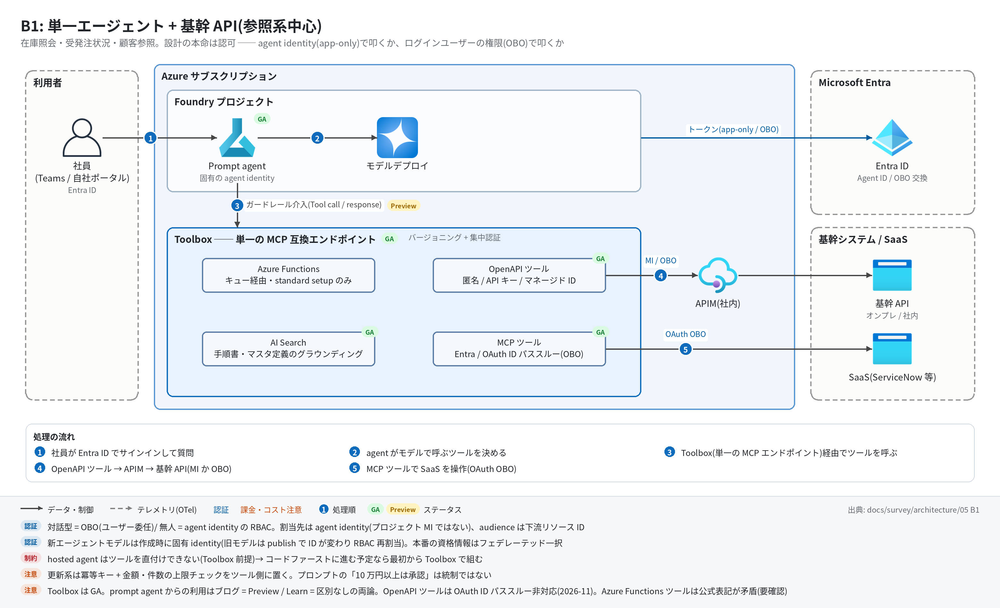
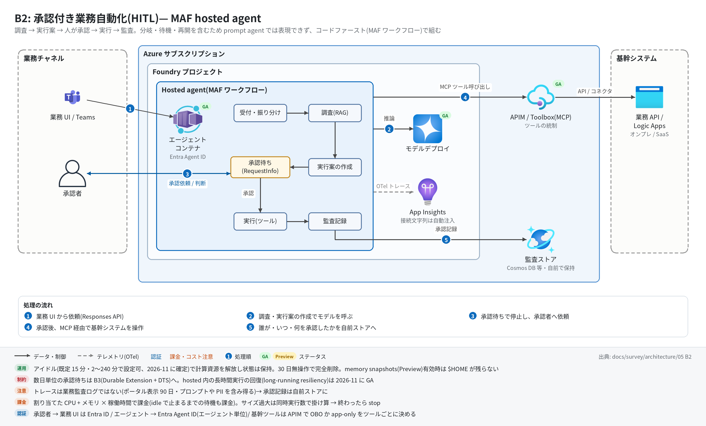
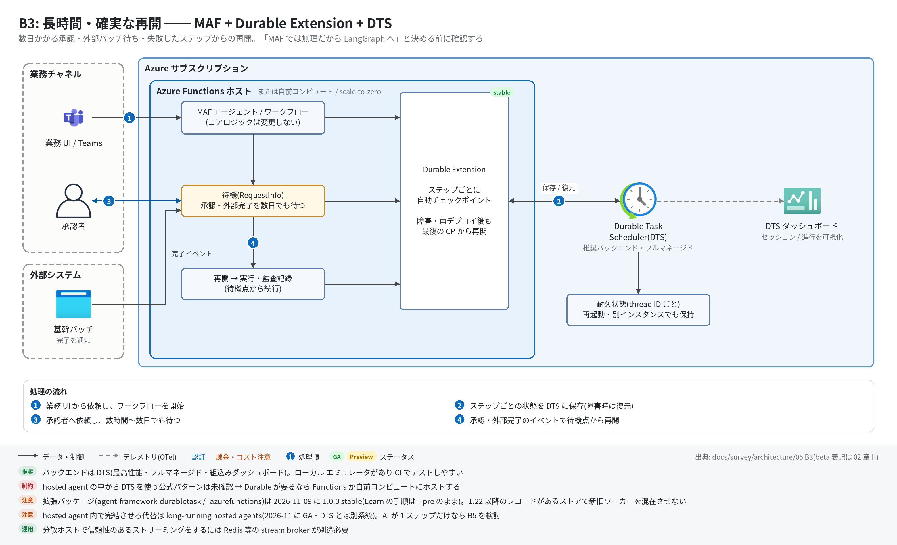
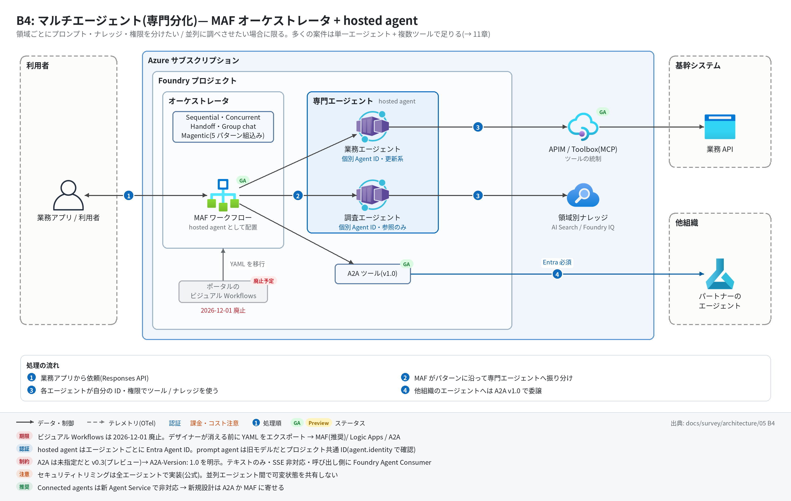
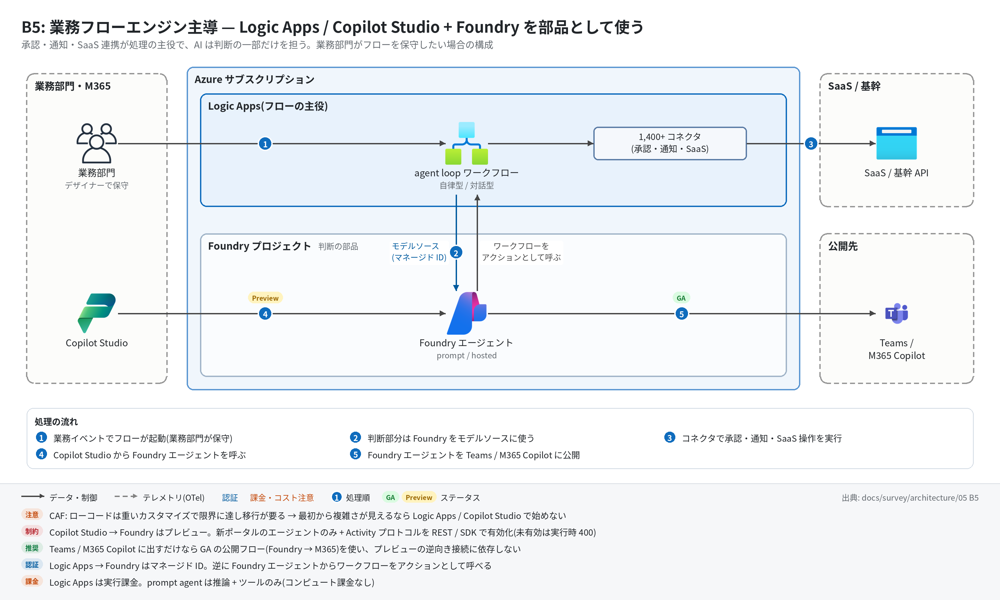

# 05. ユースケース編 B — 業務自動化・マルチエージェント・基幹システム連携

[← アーキテクチャ TOP](./README.md)

> **最終更新:** 2026-07-30(公式ドキュメントとの突合検証で訂正) / 2026-09-04(B2 に hosted agent の詰まりどころを追記) / 2026-09-26(定期更新: Routines GA・A2A v1.0 GA・hosted agent の idle timeout 可変化と長時間実行〈プレビュー〉・新エージェントオブジェクトモデルの identity・Connected Agents 非対応の明記・connector namespace 型 MCP を反映) / 2026-09-29(hosted agent の OBO トークン転送〈公式ページ新設〉を認可パターンに追記) / 2026-09-30(実装例 Port 15 をライブ済みに更新、トレースと会話継続の注意を 09 へ接続)/ 2026-10-06(ユーザー委任は toolbox 経由が公式推奨になったことと、アプリ管理 OBO との使い分けを追加。Routines の既定配信ポリシー変更〈3 回 → 5 回〉と background 実行の意味を反映) / 2026-10-06 統合(ラボ実測: agent-as-tool と handoff の崩れ方を協調パターン節に追加) / 2026-10-14(hosted agent の idle timeout 上限の両論〈REST 仕様・azd = 240 分 / Learn = 60 分〉、Routines の `api-version=v1` 省略時の 400・JS 2.8.0 の creator ID 指定と確認方法・azd 拡張 beta.9 を反映) / 2026-11-22(features 差分更新〈10-14 以降+Ignite 2026〉の波及: prompt agent の実行形態に Microsoft Copilot harness〈preview、2026-12-01 課金開始〉、hosted agent の long-running resiliency・egress controls・shared subnet IPs の GA と idle timeout 2〜240 分の確定〈両論解消〉・サンドボックス 7 段・idle 待機の課金・memory snapshots〈`$HOME` が残らない〉・session compute API・BYO-AKS〈12 月上旬 public preview 目標〉、hosted の受信 A2A は v1.0 単発のみ、会話データの 60 日保持、外部エージェント登録 GA による「自前オーケストレーションは Foundry に出ない」の緩和、MAF の前提〈Python 3.11・MCP SDK 2.x・`invoke_workflow`〉と Durable Extension の stable 化、OpenAPI ツールの OAuth パススルー非対応・MCP のゲートウェイ自動登録廃止・ツールガバナンス〈preview〉、`agents/write` で推論できる件・エージェントスコープはファイルを分離しない件、GPT-6 系の tool calling は Responses API に寄せる、エージェント ID・認可の新設ページ、autonomous agents の 3 類型、Workflows 廃止まで残り 9 日、M365 公開に Bot Service が不要に)

「検索して答える」で終わらず、**エージェントが業務システムに対して実際にアクションを起こす**類型。RAG チャットとの決定的な違いは、**誤動作が実世界に不可逆な影響を与えうる**ことで、そのため承認・監査・冪等性・権限の設計が主題になる。

WAF が明示している通り:

> Tools layer のアクションは実世界に、場合によっては**不可逆な**結果をもたらす。**高リスク操作には人間の承認ステップを追加せよ。**統合前にすべてのツールを評価し、ガバナンスをワークロード境界の外まで拡張せよ。

## パターン一覧

| # | パターン | オーケストレーション | 決め手になる要件 |
|---|---|---|---|
| B1 | 単一エージェント + 基幹 API 呼び出し | Prompt agent + Toolbox | 参照系中心。更新は限定的 |
| B2 | **承認付き業務自動化(HITL)** | **MAF hosted agent** | 「担当者が承認してから実行」 |
| B3 | 長時間・確実な再開が要る業務プロセス | **MAF + Durable Extension + DTS** | 数時間〜数日停止して再開 |
| B4 | マルチエージェント(専門分化) | MAF workflows / A2A | 領域ごとにプロンプト・権限を分けたい |
| B5 | 業務フローエンジン主導 | Logic Apps / Copilot Studio | 業務部門がビジュアルで保守 |

**まず複雑度の段階を選ぶ**(公式の AI Agent Orchestration Patterns より):

| レベル | 使う条件 |
|---|---|
| Direct model call | 分類・要約・翻訳などの単発タスク。「**プロンプトエンジニアリングで解けるならエージェントは要らない**」 |
| **Single agent with tools** | **「エンタープライズユースケースではしばしばこれが正しい既定」** |
| Multiagent orchestration | 部門横断、**エージェントごとに異なるセキュリティ境界が必要**、並列特化が有利 |

**この順序を飛ばさない。**WAF も「タスクとモデル呼び出しの間に自動的にエージェントを挟むな。エージェント層はレイテンシを増やし、攻撃面を広げ、テストを複雑にする」と警告している。

---

## B1. 単一エージェント + 基幹 API(参照系中心)

**想定:** 在庫照会、受発注状況の確認、顧客情報の参照。更新は限定的か、行っても低リスク。



```
 [ユーザー(Teams / 自社ポータル)]
        │ Entra ID
        ▼
 [Foundry: Prompt agent]
        │
        ▼
 [Toolbox]  ← 単一の MCP 互換エンドポイント。バージョニングと集中認証
    ├ OpenAPI ツール ──> 基幹 API(社内 APIM 経由)
    ├ MCP ツール ─────> SaaS(ServiceNow / Salesforce 等)
    ├ Azure Functions ─> 独自ロジック(standard セットアップ必須)
    └ AI Search ─────> 手順書・マスタ定義のグラウンディング
```

### ツール接続の選択肢と制約

| 方式 | 認証 | 制約 |
|---|---|---|
| OpenAPI ツール(GA) | anonymous / API キー / マネージド ID | API キーは 1 スキーム / ツール。**2026-11-22: OAuth identity passthrough(OAuth2 接続)に非対応と明記**(toolbox に入れても不可、toolbox 内の OpenAPI は常に project MI — openapi ms.date 11-17)→ 利用者単位の権限で叩く API は MCP サーバー化を前提にする |
| MCP ツール(GA) | キー / Entra(agent MI・project MI)/ **OAuth ID パススルー(OBO)** | 長時間実行はプレビュー。**2026-11-22: AI Gateway / APIM 経由の MCP の自動登録は廃止** — ゲートウェイ側で MCP ルートを先に作り、ゲートウェイ経由の完全な URL を Foundry のツールに入力する(Foundry はエンドポイントを書き換えない。既存ツールも個別に更新が必要、直接のエンドポイントを入れるとゲートウェイのポリシーを迂回する) |
| Azure Functions(本章初版では GA と記載。※2026-09-29: features 04 では公式ページ間で表記が矛盾し**要確認**、移行ガイドの対応表は「No」) | キュー経由 | **standard セットアップのみ(basic 不可)** |
| Logic Apps コネクタ → MCP 変換(プレビュー) | コネクタ依存 | 1 コネクタ / ツール、**OAuth 2.0 コネクタ非対応**、マネージドコネクタのみ |
| connector namespace の managed MCP サーバー(プレビュー、2026-09-26 追記) | **OAuth2 のみ**(エンドユーザーごとに初回同意) | Foundry Tools Catalog の 1,000+ コネクタを Foundry 管理の MCP サーバーとして公開。ポータルは検証済みコネクタのみ、コード(REST/SDK/azd)は制限なし。OAuth2 以外は上の Logic Apps 経路([connectors](https://learn.microsoft.com/en-us/azure/foundry/agents/how-to/tools/connectors) 2026-08-19 版) |

**公式の推奨:** 「迷ったら Microsoft Entra 認証から始めよ。」

**Toolbox を挟む理由(Toolbox は GA — GA 一覧表・devblogs 7・8 月合併号 2026-09-09 で明言。ただし Azure ブログ 2026-09-24 は「**hosted agent 向けは GA、prompt agent への拡大はパブリックプレビュー**」と書き分けており、prompt agent から使う B1 構成は GA 一覧表とブログで表記が割れる〈要確認〉。tool search は同ブログで GA〈toolbox-overview 2026-07-28 版はまだ preview 表記〉、skills はプレビュー):** ツール束を一度定義して単一の MCP 互換エンドポイントとして公開でき、バージョニング(バージョン別エンドポイントでテストしてから default に昇格)と集中認証(資格情報の注入・トークン更新・ポリシー適用)を担う。**任意の MCP 対応ランタイム(MAF / LangGraph / GitHub Copilot SDK / 自作)から同じツール群を消費できる**ため、後でオーケストレーションを載せ替えてもツール層が生き残る。**2026-11-22 更新:** devblogs 9 月号(2026-10-16)も「Hosted-agent Toolboxes remain GA; prompt-agent Toolboxes enter public preview」と表で明記し、**prompt agent 向けが preview であることはブログ 2 本で一致**(Learn・GA 一覧表は区別なし → B1 を prompt agent + Toolbox で組むなら SLA 上はプレビュー扱いで説明する)。Tool search は devblogs 9 月号・toolbox-overview(10-26 版)が GA 側に揃い揺れは解消。

> **2026-11-22 追記 — ツールを組織で縛る仕組み(ツールガバナンス、preview):** govern-tools(ms.date 11-17)は 2 つの独立した制御を示す — (1) 組み込みポリシー「[Preview]: Microsoft Foundry agents and toolboxes should only use approved tools」で**保存時**の構成を Audit / Deny(承認ツール種別・MCP エンドポイント・コネクタで指定)、(2) プロジェクトの `properties.toolControls`(`defaultAction: Deny`+`allowedTools`)で**実行時**のツール利用を制限。設計上の注意: **ポリシーが評価するのは toolbox と「Copilot harness を使わない prompt agent」だけで、hosted agent のコードは検査しない**(hosted は呼ぶ toolbox 側の準拠と `toolControls` で統制)/ 2 つは互いの設定を書き換えないので**許可リストを両方に揃え、保存と実行を別々に試験**する / `toolControls` に監査モードはない(試験プロジェクトで先に検証)/ 種別 `mcp` を許可すると全 MCP が通る(エンドポイントかコネクタで絞る)/ **ネットワークファイアウォールではない**(hosted のコードからの任意の外向き通信は egress controls・FW で統制)。AI gateway は不要。エージェント種別・コンテナイメージを縛る別のポリシー(agent-deployment-policy、preview)は **Canada Central / Spain Central / Korea Central のみで日本リージョンなし**(2026-11-22 時点)([features 01](../features/01-platform-projects.md)・[features 04](../features/04-tools-knowledge.md))。
>
> **プロジェクトの接続数は 120 が上限**(limits-quotas-regions 2026-11-18 版)。基幹・SaaS ごとに接続を作る B1 では、環境(dev / stg / prod)をプロジェクトで分けるか、接続を toolbox で束ねて数を抑える。

> **2026-11-22 追記 — tool calling を伴うなら Responses API に寄せる:** reasoning(2026-11-20 版)で、**GPT-6 Astra・6.1-sol・6.2 系は function tools が Responses API のみ**(Chat Completions で tools を含む要求は失敗)、**GPT-6 Sol・Luna・6.1-terra は Chat Completions で tools を送るなら毎回 `reasoning_effort: none` が必要**と再明記された(2026-09-11 に記録した「Astra の制約撤廃」は撤回 — [features 02](../features/02-models.md))。エージェント(Responses API ベース)は影響を受けないが、**自アプリで Chat Completions のループを回している業務自動化は、GPT-6 世代へ上げる前に Responses API へ移す**(本ドキュメントの判断)。

> **⚠ Hosted agent はツールを直付けできない。**「Adding tools directly to hosted agent's definition is not supported. We recommend using toolboxes in Foundry」と明記され、`create_version` の `tools` パラメータは削除済み。**コードファーストに進む予定があるなら、最初から Toolbox 前提で組む。**

**実行時のツール上書き:** `mcp.server_label` / `server_url` / `headers`、`file_search.vector_store_ids` などはリクエスト単位で差し替えられる。**dev/stg/prod で同じエージェント定義を使い回す、テナントごとにナレッジを切り替える**といった構成がバージョンを増やさずに組める。

### 認可の設計(このパターンの本命)

**「エージェントのマネージド ID で叩く(app-only)」か「ログインユーザーの権限で叩く(OBO)」か**で、監査要件の満たし方が変わる。

| パターン | フロー | 権限の源泉 |
|---|---|---|
| **Attended(OBO / 委任アクセス)** | ユーザーがアプリに認証 → アプリがユーザートークンを Agent Service に渡す → 「エージェント ID + ユーザーの委任権限」を持つトークンに交換 | **ユーザーが同意し認可されているリソースにしかアクセスできない** |
| **Unattended(アプリケーション専用)** | blueprint を Entra に認証 → agent identity のトークン取得 → ダウンストリーム向けスコープ付きトークン | エージェント自身の RBAC のみ。人間は不在 |

> **2026-11-22 追記 — エージェント ID・認可の新設ページ群と、3 つ目の類型:** (1) identity-access-overview ほか 6 ページ(ms.date 2026-11-18)が、認可を「管理者・開発者 → Foundry リソース」「呼び出し元 → エージェントのエンドポイント」「エージェント → 下流」の 3 境界で整理した。エンドポイント認可は **AzureRbac**(`https://ai.azure.com` 向けトークン、最小権限は Foundry Agent Consumer、プロジェクトかエージェント単位)と **AgentBlueprint**(preview。エージェントごとの blueprint 宛てトークンで、**呼び出し側に Foundry のロールが要らない**。app-only は `allowed_clients` の許可リスト必須)の併用可。**AgentBlueprint は当面 direct runtime クライアントのみで、ポータル・Routines・Bot Service 連携は Foundry 向けトークンを使い続ける**ので AzureRbac を残す(Routines の配信も AgentBlueprint 非対応と use-routines に明記)。**API キーはエージェントのエンドポイントに使えない**。下流への委任は `UserEntraToken`(受信トークンの宛先で actor が決まる。自作 / サードパーティの MCP では Foundry は actor になれない)/ **`AgentOnBehalfOfUser`(preview。常にエージェント ID が actor で、下流トークンが利用者とエージェントの両方を表し Conditional Access の対象。エンドポイントは AgentBlueprint 必須)** / `OAuth2`(接続ごとのサインイン)の 3 方式([features 03](../features/03-agent-service.md))。(2) devblogs 2026-11-19・Tech Community 11-18 は、上の 2 類型に **autonomous(agent identity+agent user account で「本人として」M365 上で動く。旧称 Autopilot)** を加えた 3 類型(assistive / background service / autonomous)で整理した。autonomous は blueprint を公開 → 管理者承認 → 各 manager が instance を hire する 1:N モデルで、**Learn の前提(Agent 365 Frontier プレビュー・publish API `2025-11-15-preview`)は未改訂、Microsoft 365 accounts for agents も preview**(Azure ブログ 11-17)→ 業務自動化の本番構成には入れず、PoC に留める。

> **2026-09-29 追記 — hosted agent での Attended は「アプリ管理の OBO+ヘッダー転送」。**新設の [Use on-behalf-of flow with hosted agents](https://learn.microsoft.com/en-us/azure/foundry/agents/how-to/use-on-behalf-of-flow)(2026-09-28 公開)は、Foundry がトークン交換するのではなく**バックエンドが OBO 交換した下流トークンを `x-client-*` ヘッダー(例 `x-client-graph-access-token`)でコンテナへ転送**し、`x-ms-user-identity` でユーザーを Foundry に伝える方式を示す。バックエンドのワークロード ID に **Foundry Agent Consumer+組み込みロールに含まれないカスタム data action `…/agents/endpoints/UserIdentityImpersonation/action`** が必要で、`Authorization`(Foundry 向けトークン)はコンテナへ転送されない。下流トークンがコンテナのコードから見えるため、**バックエンドとコンテナが同一アプリの信頼境界内にある場合だけ採用**し、ツール側で認証できるなら Toolbox の認証を、データだけ要るならバックエンドが下流 API を呼ぶ方式を優先する(公式の選択表)。トークンの更新はされないので長時間処理は分割する。**実装例: [labs/maf-ports/ports/delegated-access-hosted](../../../labs/maf-ports/ports/delegated-access-hosted/README.md)(Port 15、2026-09-30)** — 社内文書+基幹 API を利用者のロールで制御し、最終判定点を APIM と MCP サーバー自身の両方で実装して比較(2026-09-30 にライブ検証済み。両方式で権限どおりに出し分けられ、1 問の所要時間に差はなかった)。**運用上の注意: hosted agent のプラットフォーム側トレースは会話全文(ツール結果を含む)を App Insights に記録し、コンテナ側の設定では止まらない** — 利用者の権限で絞った中身が App Insights の閲覧者には見える(casebook P-O12)。App Insights を集約 / 分離 / 接続しないのどれにするかの判断基準は [09 §3.6](./09-operations.md#3-6-トレースに会話の中身を残すか-hosted-agent-の選定基準)、会話の続きが agent 単位になる制約は [09 §6.3](./09-operations.md#6-3-エージェントのバージョニングとリリース)。MAF の `ResponsesHostServer` は要求ヘッダーをツールへ渡さないため Agent Server SDK のハンドラーで要求ごとにエージェントを組む必要がある、resilient モードは転送ヘッダー(=トークン)を永続化する、等の落とし穴は同 README。

**2026-10-06 追記 — ユーザー委任は「toolbox 経由」が公式の推奨経路になった。**hosted-agents / tool-authentication / toolbox / use-toolbox-hosted-agent の 4 ページ(2026-09-29〜10-02 の更新)に「**For user delegation with MCP and other tools, connect those tools through a Foundry toolbox**」が入り、MAF の hosted agent では `FoundryToolbox`(Python)/ `AddFoundryToolboxes`(.NET)を使うよう明記された。**エージェントの資格情報だけでは利用者ごとの解決ができず**、`FoundryToolbox` が**現在の hosted リクエストの `x-agent-foundry-call-id` を toolbox プロキシへ転送**して呼び出し元の文脈を解決する(call ID のハードコード・リクエストをまたいだ使い回しは禁止)。ツール側の接続は利用者単位の認証種別(`oauth2` = 利用者が OAuth 認可を済ませた資格情報 / `user-entra-token` = 利用者の audience 別 Entra トークン)にし、利用者には下流の権限と必要な同意が要る。**OAuth identity passthrough を使うエージェントの利用者には、プロジェクトの Foundry Agent Consumer 以上が必要で、利用者の Entra テナントがプロジェクトと一致しなければならない(クロステナントのトークン交換は不可)**([tool-authentication](https://learn.microsoft.com/en-us/azure/foundry/agents/how-to/tools/tool-authentication) ms.date 2026-08-19・本文 2026-10 更新)。トラブル表には「**401 / 403 は出ないのに別の利用者の ID・権限で動く** = 呼び出し元文脈の欠落か古い文脈」が加わり、**権限の異なる 2 人の利用者で、意図したクライアント・チャネル経由で出し分けを確かめよ(呼び出しが成功しただけでは委任の正しさは証明されない)**とされた([use-toolbox-hosted-agent](https://learn.microsoft.com/en-us/azure/foundry/agents/how-to/tools/use-toolbox-hosted-agent))。

**使い分け(本ドキュメントの判断。Port 15 の実装経験と公式の記述から):**

| 観点 | toolbox 経由(OAuth identity passthrough / user Entra token) | アプリ管理 OBO + `x-client-*` 転送(Port 15) |
| --- | --- | --- |
| 公式の位置づけ | **MCP 等のツールの委任では推奨**(4 ページで明記) | 「バックエンドとコンテナが同じアプリの信頼境界内にあるときだけ」使う方式。データだけ要るならバックエンドが下流を呼ぶ方式を優先 |
| トークンの所在 | Foundry がトークンの取得・更新・利用者ごとの分離をサービス側で行い、**コンテナのコードに下流トークンが現れない** | 下流トークンがコンテナに入る → プロンプト・ツール引数・ログ・例外・トレース・永続化(resilient モード)でのマスクを自前で保証(Port 15 では 7 か所) |
| 判定点(最終的な認可) | 下流サービス(利用者の権限・秘密度ラベル)。**下流が自前の MCP サーバーなら、そのサーバーが利用者トークンを検証する判定点になる**(Port 15 の方式 B のサーバー実装がそのまま使える見込み — 2026-10-06 の設計確認、ライブ未検証)。APIM を前段に置くことも可 | **APIM・MCP サーバー自身など、自前の判定点を置ける**(Port 15 は両方を実装して比較) |
| 前提・制約 | 利用者に **Foundry Agent Consumer** 以上、**テナント一致**(B2B のゲスト・別テナントの利用者は不可)、利用者ごとの初回同意フロー(同意要求を利用者へ返して再開する作り)。接続は利用者単位の認証種別 | バックエンドのワークロード ID に Foundry Agent Consumer + カスタム data action `…/UserIdentityImpersonation/action`。トークンは更新されない(長時間処理は分割)。MAF の `ResponsesHostServer` は要求ヘッダーをツールへ渡さないので、ハンドラーで要求ごとにエージェントを組む(`agent-framework-foundry-hosting` 1.0.0b261002〈プレリリース、2026-10-02〉の [BREAKING] 変更「request-scoped agent factories」でも**書き方は変わらない** — ファクトリは引数を取らず、公開されている要求の文脈は call_id / user_id / session_id だけで `x-client-*` に届かないため。Port 15 でソース確認+オフラインテストで固定、2026-10-06) |
| MAF での実装 | 要求ごとのファクトリ+`FoundryToolbox`(foundry-hosting、プレリリース)が最短路。**エージェントを要求間で使い回すと、2 人目の要求が 1 人目の call ID で toolbox に届き、エラーなしで別人の権限になる**(Port 15 のオフラインテストで再現、2026-10-06)。`FoundryToolbox` は GA の toolbox に対しても `Foundry-Features: Toolboxes=V1Preview` を付ける | Agent Server SDK(`azure-ai-agentserver-responses`、GA)のハンドラーで要求ごとに MAF Agent を組む(Port 15、2026-09-30 ライブ済み) |
| 向く案件 | 標準的な社内向け委任。ツールを複数のエージェント・ランタイムで共有したい | 下流が OAuth / Entra の利用者委任に乗らない独自 API、APIM での細かい認可・監査を判定点に置きたい、クロステナントの利用者がいる、既存の OBO 基盤がある |

**どちらでも、利用者ごとに絞った中身はトレースに残る**(09 §3.6)。toolbox 経由でも「2 人の利用者での出し分けテスト」は受入試験に入れる。

**Entra Agent ID**(公式ページに GA / プレビューのステータス表記なし)により、プロジェクトで最初のエージェントを作った時点で既定の blueprint と agent identity がプロビジョニングされる。

> **⚠ 2026-09-26 更新 — identity モデルは「旧 Agent Application モデル」と「新エージェントオブジェクトモデル」で違う。**agent-identity(2026-08-21 版)は下記 1. の「共有 ID → publish で専用 ID」挙動を**旧 Agent Application モデルの説明**と明記し、[migrate-agent-applications](https://learn.microsoft.com/en-us/azure/foundry/agents/how-to/migrate-agent-applications) は「**新モデルで作成したエージェントは作成時点で固有の blueprint と agent identity を持つ**(`agent.identity` が null ならレガシー)」とする。レガシーエージェントをその場で固有 ID に上げる手段は無く、同じ定義で作り直す。publish-copilot(2026-09-23 版)では旧形式エージェントは Teams / M365 への新規 publish 不可。**新規案件は新モデル前提で、RBAC はエージェント作成直後の固有 identity に割り当てる。**

**⚠ 実装で詰まりやすい 3 点:**
1. **(旧 Agent Application モデル / レガシーエージェントの場合)未公開エージェントはプロジェクト内で共通の ID を共有し、publish すると専用の agent identity が作られる。**このとき `agentIdentityId` が変わるため、**RBAC を再割り当てする必要がある**(共有 ID のロールは引き継がれない)。
2. **RBAC を割り当てるべきプリンシパルは agent identity であって、プロジェクトのマネージド ID ではない。**プロジェクト MI はインフラ操作用(ACR pull 等)であってランタイム ID ではない。
3. **audience は「MCP サーバーの URL」ではなく「ダウンストリームサービスのリソース識別子」**(例: Storage なら `https://storage.azure.com`)。**間違えると RBAC が正しくても認証に失敗する。**

**エージェント単位 RBAC** も使える(スコープ URI は `.../projects/<project>/agents/<agentName>`)。ただし**現時点ではエージェントエンドポイントへのアクセスにのみ評価され**、より広いコントロールプレーン権限は付与しない。エンドユーザーには `Foundry Agent Consumer` をエージェントスコープで割り当てるのが公式のペルソナ例。

> **2026-11-22 追記 — RBAC の見落としやすい 2 点(rbac-foundry 2026-11-18 版):** (1) **`Microsoft.CognitiveServices/accounts/AIServices/agents/write` を持つ主体は、エージェントを参照しない要求も含めてプロジェクトの Responses エンドポイント経由でモデルデプロイを呼べる** → 「エージェントを作る権限だけ渡したつもりが推論権限も渡している」。推論させたくない運用担当・CI の ID には agents の data action を与えない。(2) **エージェントスコープの割り当てはプロジェクトのファイルを分離しない** — ファイルはプロジェクトのリソースで file ID に呼び出し元単位のアクセス制御がなく、**prompt agent を呼べる主体はプロジェクト内の任意の file ID を `input_file` で参照できる**。部門・取引先ごとに見せてはいけないファイルを扱うなら、エージェント単位 RBAC ではなく**プロジェクトを信頼境界として分ける**([features 01](../features/01-platform-projects.md))。

**本番の資格情報:** blueprint の資格情報はクライアントシークレット / 証明書 / **フェデレーテッド資格情報(マネージド ID)** の 3 種で、**本番はフェデレーテッド一択**(シークレットを保存しない、Azure が自動ローテーション)。公式も「本番でクライアントシークレットを blueprint の資格情報に使うな」と明示的に警告している。

### 更新系を入れるときの必須事項

- **冪等性。**エージェントはリトライされうるし、非決定的に同じツールを 2 回呼ぶこともある。**更新系 API には冪等キーを持たせる。**
- **金額・権限・件数の上限チェックをツール側に置く。**プロンプトで「10 万円以上は承認を取れ」と書くのは統制ではない。
- **ガードレールの Tool call / Tool response 介入点**を設定する(**プレビュー**)。**エージェントに明示割当したガードレールは基盤モデル側の設定を完全に上書きする**ため、Tool 系のコントロールを置き忘れるとその経路が未スキャンになる。**2026-11-22 追記:** ガードレール(RAI ポリシー)を **toolbox のバージョンにも割り当てられる**ようになった(`policies.rai_config.rai_policy_name`。toolbox 層でツールの入出力を検査し、モデル側のフィルターとは独立。ステータス表記は要確認 — [features 06](../features/06-safety-guardrails.md))。複数のエージェント・ランタイムが同じ toolbox を使う B1 では、ツール経路の検査を toolbox 側に寄せると置き忘れを減らせる。

---

## B2. 承認付き業務自動化(HITL)

**想定:** 「エージェントが調査して実行案を提示 → 担当者が承認 → 実行 → 監査ログ」。SI で最頻出のパターン。

**この要件が入った時点で Prompt agent では足りない。**分岐・承認待ち・再開の明示制御が要るため、コードファーストに上がる。



```
 [業務画面 / Teams]
        │
        ▼
 [Foundry Hosted agent(MAF、Responses プロトコル)]
   ┌──────────────────────────────────────────┐
   │ MAF Workflow(グラフ)                     │
   │   [トリアージ] → [調査(RAG)] → [実行案生成] │
   │                        │                  │
   │                 [RequestInfoExecutor]     │ ← HITL。外部への問い合わせで停止
   │                        │                  │
   │                 承認 ──┴── 却下 → 終了     │
   │                        ▼                  │
   │                   [実行(ツール)] → [監査記録] │
   └──────────────────────────────────────────┘
        │ Toolbox(MCP)
        ▼
 [基幹システム / Logic Apps コネクタ / 社内 MCP(APIM 経由)]
```

**MAF が提供するもの:**
- **Type Safety** — メッセージ型の検証で実行時エラーを防ぐ
- **Flexible Control Flow** — executors と edges のグラフ。条件ルーティング、並列処理、動的パス
- **External Integration** — request/response パターンで外部 API 連携と **HITL**(`RequestInfoExecutor` / `ctx.request_info()`)
- **Checkpointing** — 「チェックポイントでワークフロー状態を保存し、長時間プロセスの回復と再開を可能にする」(Graph API では **superstep 境界**でチェックポイント)
- **Multi-Agent Orchestration** — sequential / concurrent / hand-off / magentic の組込みパターン

**API は 2 種類ある。**Graph API(`WorkflowBuilder`)が「完全サポート」で、Functional API(`@workflow`、Python)は **experimental** と明記されている。**本番は Graph API。**

> **2026-11-22 追記 — MAF の前提バージョンが変わった([features 08](../features/08-developer-experience.md)):** `agent-framework-foundry` 1.16.2 で **`azure-ai-projects<2.8.0` の上限が `<3` に緩和**され、Insights・External Agents 等の新しい SDK(2.11.0)と同じ環境に入れられるようになった。代わりに **Python 3.11 以上が必須(MAF 1.25.0)・MCP SDK 2.x が必須(1.23.0。hosting は `mcp>=2.2.0,<3`)**、1.25.0 で**ワークフローのスパン名が OpenTelemetry GenAI 規約の `invoke_workflow` に変わった**(`workflow.run` で絞り込む KQL・アラート・ダッシュボードは要修正)、フレームワーク所有の MCP 要求に既定 30 秒のタイムアウト。旧メモリ API(`MemoryContextProvider` 等)は 2026-12-31 以降に削除予定。**成熟度はパッケージ単位**で、hosted agent 用の `agent-framework-foundry-hosting` は 1.0.0b261112(beta)、.NET の Foundry.Hosting も preview のまま(コアは stable)。CI のランタイムと依存の固定は MAF の版上げごとに見直す。

**ホスティングの選択:** Hosted agent(Foundry が実行 — GA、2026-07-09 発表)か Container Apps / AKS(自分で実行)か。**Hosted agent はセッション単位のスケールで、アイドル timeout(既定 15 分、エージェントバージョンごとに ~~2〜60 分~~ **2〜240 分**で構成可)で計算をデプロビジョンし状態は保持、30 日無活動で恒久削除。**(~~2026-10-14 両論: REST 仕様・azd は上限 240 分、Learn は 60 分~~ → **2026-11-22 解消:** hosted-agents〈ms.date 2026-11-16〉が「2 through 240 minutes (4 hours)」に改訂、devblogs 11-18 も「Configurable idle timeout … 2 minutes to 4 hours … Generally available」と明記し、**上限 240 分で確定**)課金はアクティブな全セッションの CPU + メモリ合計で、~~サイズは 0.5vCPU/1GiB・1vCPU/2GiB・2vCPU/4GiB の 3 種のみ~~ **サンドボックスは 0.25 vCPU / 0.5 GiB 〜 16 vCPU / 32 GiB の 7 段**(2026-11-22 更新。`$HOME` の永続ストレージは CPU 段と変換後イメージサイズで決まり最大 100 GiB)。**オーバーサイジングは同時実行数の倍率でコストに効く。**

> **2026-11-22 追記 — hosted agent の課金と起動まわり(hosted-agents 2026-11-16・limits-quotas-regions 2026-11-18・devblogs 11-18):** (1) 課金は使用率ではなく**割り当てた CPU / メモリ × compute の稼働時間**で、**idle timeout に達して停止するまでの待機時間も課金対象**(`stop` で止まる)→ idle を 240 分に伸ばすと承認待ちの間ずっと課金される。**処理が終わったら idle を待たずにセッションを止める**のが公式の推奨で、承認待ちは下の long-running の suspend か B3 で扱う。(2) **memory snapshots(preview)** は起動を速くするが、**有効にしたセッションは idle で中断・再開すると `$HOME`・ローカルファイル・プロセスメモリが残らない**(復元されるのは版の起動時点の状態)→ `$HOME` に途中状態を置く HITL エージェントでは有効にせず、状態は state store 等の外部に置く。(3) **session compute API(preview)** でセッションの compute を API から起動・停止・idle 変更・ログのストリーム・シェル実行(`:exec`)・ポート公開ができる — 運用の自動化には便利だが、`exec` 権限は本番データに触れる経路になるので RBAC を分ける(本ドキュメントの判断)。(4) **顧客の AKS へのデプロイ(BYO-AKS)** は限定プレビュー受付中で **public preview は 2026-12 上旬が目標**(Learn に専用ページなし)— 「Foundry の API・azd・エンドポイントはそのままにランタイムを自社 AKS で」が要件なら、当面は Container Apps / AKS への自前ホストで組み、BYO-AKS は preview として評価する。(5) 同時セッションの既定上限 2,000 / 1,000(サブスクリプション × リージョン)は不変([06](./06-usecase-customer-facing.md))。

**⚠ Hosted agent を選んだ場合の可観測性の利点:** App Insights の接続文字列が自動注入され、プロトコルライブラリが **OpenTelemetry トレースを既定で出力する。**逆に自前オーケストレーション(App Service / ACA)にすると、**エージェントのメトリクスは Foundry のダッシュボードに出ない**(Foundry はマネージドエージェントしか見えない)。**2026-11-22 緩和:** **外部エージェント登録(external agents)が GA**(Tech Community 2026-11-18・`azure-ai-projects` 2.11.0。GA 一覧表の Tracing 行も「GA for prompt, hosted, and external agents」)— Foundry の外(ACA・AKS・他クラウド)で動く LangGraph / LangChain / CrewAI / 自作のエージェントを、トップレベルの `invoke_agent` スパンの `gen_ai.agent.id` で登録すれば、接続済み App Insights のトレースで **trace view・Insights・トレース評価・スケジュール評価**を使える(Foundry はランタイムをホスト・中継しない)。ただし**人手評価と AI red teaming のターゲット化は非対応、イベント起動の継続評価も使えない**(スケジュール型のトレース評価で代替)。自前オーケストレーションでも観測・評価は Foundry に寄せられるようになったが、**ランタイム・ID・ネットワークは自分持ちのまま**([09](./09-operations.md))。

> **⚠ hosted agent の運用で詰まりやすい点(索引は [casebook 02 §A](../casebook/02-pitfalls-index.md#a-hosted-agent)):** ①**project → App Insights 接続がないと `APPLICATIONINSIGHTS_CONNECTION_STRING` は注入されない**([probe 10](../../../labs/foundry-probes/probes/10-hosted-version-continuity/NOTES.md) で確認)。自前の送信設定も書いていなければコンテナ内部ログはどこにも届かない(→ [10 章 A13](./10-migration-antipatterns.md#a13-project-app-insights-接続なしで-hosted-agent-を運用する))②MAF 用の公式ホスティングライブラリ `agent-framework-foundry-hosting` はプレリリース版のみで、フレームワーク非依存のプロトコルライブラリ `azure-ai-agentserver-responses` は stable(PyPI。[features 08](../features/08-developer-experience.md) の注記 12)。GA の部品だけで組むなら後者+自前オーケストレーションになる。

**承認の「待ち時間」が問題になる場合:** Hosted agent のアイドル timeout は**計算のデプロビジョンであって状態の消失ではない**が、承認が数日にわたるなら B3(Durable)に上げる(2026-11-22: hosted 内の long-running HITL が GA になり、hosted 内で完結させる選択肢も GA 部品で組める — 次の注記。idle を最大 240 分に伸ばして待つのは待機中も課金されるので避ける)。

> **2026-09-26 追記 — hosted agent 内で完結する長時間 HITL(プレビュー):** 2026-08 に「long-running hosted agents」の一連の how-to が追加された。AgentServer SDK の `@multi_turn_task` チェーンは承認待ちで suspend し、同じ `task_id` の次の入力で再開する(**数分〜数日の待機・コンテナ再起動をまたいで継続**)。クラッシュ時はリースベースで同じ入力から handler を再入(決定的リプレイではないので、**副作用の重複防止と進捗チェックポイントはアプリ責務**)。フレームワークのチェックポイント保存先として **durable state store(プレビュー、hosted agent 専用の KV ストア、ユーザー単位パーティション可)** も用意された。**いずれもプレビュー**なので、プレビュー不可の案件では引き続き B3(Durable)を選ぶ(出典: [add-human-in-the-loop](https://learn.microsoft.com/en-us/azure/foundry/agents/how-to/add-human-in-the-loop) 2026-08-05 版 / [long-running-agent-resilience](https://learn.microsoft.com/en-us/azure/foundry/agents/concepts/long-running-agent-resilience) / [agent-state-store](https://learn.microsoft.com/en-us/azure/foundry/agents/concepts/agent-state-store) 2026-08-24 版)。
>
> **2026-11-22 更新 — long-running resiliency は GA:** devblogs 2026-10-28・11-18「Long-running resilient execution — Generally available」と、Learn の long-running 系 10 ページ(ms.date 2026-10-14、11-02 更新)から preview 定型文が消え、long-running-agent-reference が GA の最小版(Python `azure-ai-agentserver-core ≥ 2.0.0` / `-responses ≥ 2.0.0` / `-invocations ≥ 1.0.0`、**.NET も `≥ 1.0.0`**)を挙げた(GA 一覧表に該当行なし)。**hosted agent 内で完結する長時間 HITL を GA 部品で組めるようになった**ので、上の「プレビュー不可なら B3」は「**hosted 内で完結させるか、Durable で持つか**」の選択に変わる。変わらない前提: Responses での回復対象は **`store=true` かつ `background=true` の保存済みバックグラウンド応答だけ**(フォアグラウンドはクラッシュで failed)、回復はハンドラの先頭からの再実行で決定的リプレイではない(**副作用の重複防止と進捗の保存はアプリ責務**)。durable state store の概念ページ(ms.date 11-18)はライフサイクル表記なし(hosted 本体は GA)— standard 構成ではプロジェクトの Cosmos DB に `<workspaceId>-state-storage-v1` コンテナが初回アクセス時に作られるので、BYO Cosmos DB の RU・バックアップ設計に入れる。MAF の `ResponsesHostServer` で `steerable_conversations` が一時利用不可だった件(10-14 記録)の解消は未確認。Ignite 記事はワークフロー全体の耐久実行について Temporal との連携(public preview は 2027 年初め予定)にも触れている([features 03](../features/03-agent-service.md))。

### 監査ログの設計

Foundry の Tracing だけに依存しない。理由は 3 つ。

1. **Tracing のネットワーク分離はプレビュー**(GA 一覧表で「Tracing VNet = Preview」。configure-private-link 2026-08-14 版の制限表からは Traces 行が消えたが、GA 一覧表の rollout pitfalls は「Traces は完全にはネットワーク分離に対応していない」と記載。2026-09-26 確認)。
2. ポータルで見られるのは**直近 90 日**。それ以上は App Insights / Log Analytics の保持設定に従う。
3. トレースは**プロンプト・出力・ツール引数を含みうる**ため、そのまま法定監査ログにすると機微情報の扱いが問題になる(公式も「テレメトリ到達前にマスクせよ」と推奨している)。

**業務監査ログはアプリ側に別途持つ**(誰が・いつ・何を承認し・どのパラメータで実行されたか)。MAF のミドルウェアで実行パイプラインに差し込むのが自然。

**会話データ自体も 60 日で消える(2026-11-22 追記、limits-quotas-regions 2026-11-18 版):** basic 構成は Microsoft 管理の Cosmos DB に conversations / items / responses を **60 日**保存して自動削除(期限切れの会話は 404)、standard 構成も自前 Cosmos DB の `run-state-v1` コンテナの**既定 TTL 60 日**(変更可)。削除後は復元できない。**「承認の経緯を会話履歴で後から確認する」前提は成り立たない**ので、監査に要る入出力はアプリ側に写しを持つか、standard 構成で TTL を延ばす(対象は会話データで、ファイル・vector store は別)。

---

## B3. 長時間・確実な再開が要る業務プロセス

**想定:** 承認が数時間〜数日かかる、外部システムのバッチ完了を待つ、途中で失敗したステップだけ再開したい。

**「MAF では長時間処理が無理だから LangGraph へ」と結論する前に、Durable Extension を確認する。**



**Durable Extension for MAF** はエージェント / マルチエージェントオーケストレーション / MAF workflows に**耐久実行**を付与する。エージェントセッションの永続化、進捗チェックポイント、障害回復、分散ホスト間スケールを、**コアのエージェントロジックを変更せずに**適用できる。MAF workflows については「グラフの各ステップを自動的にチェックポイントし、**ワークフロー定義を変更せずに**障害から回復する」と明記されている。

**ホスティングモデルは 2 つ:**

| モデル | 内容 |
|---|---|
| **Azure Functions** | マネージド・サーバーレス。スケールアウトと scale-to-zero、Functions のトリガー / バインディング、HTTP エンドポイント自動生成、**MCP server trigger** |
| **Bring-your-own-compute** | 自前ワーカープロセス、サービス、コンテナ、Kubernetes、既存アプリ基盤 |

**2026-11-22 更新 — Durable Extension のパッケージが stable に:** Python `agent-framework-azurefunctions`(Python 3.13 以上)/ `agent-framework-durabletask`、.NET `Microsoft.Agents.AI.Hosting.AzureFunctions` / `Microsoft.Agents.AI.DurableTask` が **2026-11-09 に stable(1.0.0 / 1.16.0)**。Learn のページは hosting/azure-functions から **hosting/durable-extension へ移設(301)**し、Azure Functions と自前コンピュート(DTS)の 2 方式と schema-v2 の状態移行手順を載せたが、導入手順は `--pre` / `--prerelease` のまま(ページ 11-06 更新)。**1.22 以降の形式のレコードがあるストアで新旧のワーカーを混在させない**(移行手順に従って一斉に上げる)([features 08](../features/08-developer-experience.md))。

**バックエンドは Durable Task Scheduler (DTS) が推奨**(最高性能、フルマネージド、**UI ダッシュボードによる組込みの可観測性**)。DTS ダッシュボードでは agent session insights(会話履歴)と orchestration insights を可視化でき、**ローカル開発用のエミュレータもある**ため CI でのテストがしやすい。

**ステートフルなエージェントスレッド:** thread ID ごとに会話履歴全体を耐久ストレージに保持し、プロセス再起動や別インスタンスでの再開でも保持される。

**注意:** 分散ホストで**信頼性のあるストリーミング**を行うには Redis 等の reliable stream broker が別途必要。また、**Hosted agent の中から DTS を使う公式パターンは本調査では確認できなかった**(2026-09-26 再確認でも同じ) — Durable を使うなら Functions か自前コンピュートにホストする構成が確実。hosted agent 内で完結させたい場合の公式手段は、B2 に追記した **long-running hosted agents(resilient execution・stream replay・state store)** で、DTS とは別系統(~~いずれもプレビュー~~ **2026-11-22: long-running resiliency は GA**、state store はページにライフサイクル表記なし)。

**代替案としての Logic Apps / Durable Functions 単体:** 「AI は業務フローの 1 ステップにすぎず、承認・長時間待機・既存業務フロー統合が主役」ならこちら(→ B5)。

---

## B4. マルチエージェント(専門分化)

**まず「本当に必要か」を問う。**多くの案件は単一エージェント + 複数ツールで足りる。マルチエージェントが要るのは「担当領域ごとにプロンプト・ナレッジ・**権限**を分けたい」「並列に調査させたい」場合。



### ⚠ ポータルのビジュアル Workflows は選択肢から外れた

**2026-12-01 に廃止(2026-11-22 時点で残り 9 日。GA 一覧表 11-17 版も「retiring workflows on December 1, 2026」で日付不変)。**「デザイナーとポータル内でのワークフロー実行はサポートされなくなるが、**YAML ベースのワークフロー定義は hosted agent としてデプロイすれば実行を継続する**」。さらに GA 一覧の rollout pitfalls に「**Workflows に新しい本番依存を作ること**」が明記されている。

**移行先は 3 つ:**

| やりたいこと | 移行先 |
|---|---|
| コードファーストに移す | **Microsoft Agent Framework(推奨)。**エクスポートした YAML を宣言的ワークフローとしてほぼそのまま持ち込める |
| ビジュアルデザイナーを維持したい | **Azure Logic Apps。**決定論的ステップと Foundry エージェントの確率的推論を同一実行内で混在させられる |
| 1 エージェントが別エージェントを呼ぶだけ | **A2A** |

**廃止前にやるべきこと:** **YAML ビューに切り替えて定義をエクスポートする**(デザイナーが消える前に)。

**Connected agents について:** 移行ガイド([migrate](https://learn.microsoft.com/en-us/azure/foundry/agents/how-to/migrate) 2026-09-11 版)の機能対応表で **classic = Public Preview / 新 Agent Service = 非対応(推奨: A2A ツール)** と明記された(2026-09-26 更新。旧記載は「位置づけが不明瞭」)。**新規設計では A2A か MAF に寄せる。**

### 5 つのオーケストレーションパターン

| パターン | ルーティング | 適する対象 | 注意点 |
|---|---|---|---|
| Sequential | 決定的・事前定義順 | 段階的な品質向上、明確な依存関係 | 前段の失敗が伝播、並列性なし |
| Concurrent | 決定的 or 動的選択 | 複数視点の独立分析、レイテンシ重視 | 結果矛盾時の解決が必要、リソース消費大 |
| Group chat | chat manager がターン制御 | 合意形成、maker-checker 検証 | 会話ループ、多数エージェントで制御困難 |
| Handoff | エージェントが移譲を判断 | 適切な専門家が処理中に判明する場合 | **無限 handoff ループ**、経路が予測不能 |
| Magentic | manager が task ledger を動的に構築 | 解法が事前に定まらない open-ended 問題 | 収束が遅い、曖昧なゴールで停滞 |

**2026-10-06 追記(ラボ実測 — 協調パターンの判断に効くもの):** ①**agent-as-tool(相談型)は必須の相談の発生を保証しない**(必須 12 件中 5 件のみ発生、禁止ペアは 0 — [Port 13 services-agency](../../../labs/maf-ports/ports/services-agency/README.md))→ 必ず通すべき相談・確認はグラフで固定する ②**handoff は順序が正しくても成果物が欠けうる**(担当が本文を書かず handoff ツールだけを呼び、節が欠けたまま「完成」扱い — [Port 7 game-design-team](../../../labs/maf-ports/ports/game-design-team/README.md))→ 終了条件に成果物の完全性を入れる。判断基準は [11 §6](./11-decision-frameworks.md#6-本リポジトリの既存指標との対照)。

**MAF は 5 パターンすべてを組込みでサポートする。**一方 Foundry Agent Service は「ワークフローが主に非決定的で、**完全に実装できるパターンの範囲が限られる**」と明記されている。

**アンチパターン(公式列挙):** 単純な sequential / concurrent で足りるのに複雑なパターンを使う / 意味ある特化のないエージェント追加 / 多段ホップのレイテンシ軽視 / **並列エージェント間で可変状態を共有(トランザクション不整合)** / **本質的に非決定的なワークフローに決定的パターンを使う(およびその逆)** / コンテキストウィンドウ肥大によるモデルリソースの過剰消費。

### セキュリティ上の必須事項

> エージェントは全ユーザーの要求を扱うためナレッジストアへの広いアクセスを持たざるを得ないが、**ユーザーがアクセスできないデータを返してはならない。セキュリティトリミングはパターン内のすべてのエージェントで実装しなければならない。**

**1 プロジェクト内の全 prompt agent はプロジェクト共通の agent identity(サービスプリンシパル)を共有する**(プロジェクトのマネージド ID とは別物)。アクセスパターンが異なるならプロジェクトを分ける。**hosted agent は個別の Entra Agent ID を持つ**ので、プロジェクトを分けずに per-agent の権限と監査ができる — **マルチエージェントで権限を分けたいなら hosted agent が有利。**

> ※2026-09-26 注記: 上の「prompt agent は共有 ID」はベースライン記事(2026-06-17 版)と旧 Agent Application モデルの記述。**新エージェントオブジェクトモデルでは prompt agent も作成時に固有の agent identity を持つ**(B1 の注記参照)。自案件のエージェントが新旧どちらか(`agent.identity` が null か)を確認してから権限設計する。

### A2A を使う場合の制約(**v1.0 は GA / v0.3 はプレビュー** — 2026-09-26 更新)

- **ステータス:** incoming A2A と A2A ツールは **A2A プロトコル v1.0 が GA**(ツール型は GA の `a2a`。旧 `a2a_preview` 型と v0.3 はプレビューで本番非推奨。Azure ブログ [2026-09-24](https://azure.microsoft.com/en-us/blog/ship-agents-faster-with-expanded-model-choice-voice-agents-and-continuous-optimization/) でも A2A の GA を発表)。出典: [enable-agent-to-agent-endpoint](https://learn.microsoft.com/en-us/azure/foundry/agents/how-to/enable-agent-to-agent-endpoint) / [tools/agent-to-agent](https://learn.microsoft.com/en-us/azure/foundry/agents/how-to/tools/agent-to-agent)(いずれも 2026-09-11 版)。azd の toolbox フローは現状 `a2a_preview`(v0.3)しか作らないので、GA 型は SDK / REST で作る。
- **Prompt agent は既定で A2A エンドポイントを公開できる。Hosted agent は Responses プロトコルを実装している場合のみ。**
- **2026-11-22 追記 — hosted agent の受信 A2A はさらに狭い:** hosted-agents(ms.date 2026-11-16)は、hosted の A2A エンドポイントを **v1.0 のみ・`contextId` / `taskId` を付けない単発の `SendMessage` のみ・`GetTask` 不可**とした(違反は `HOSTED_AGENT_NOT_SUPPORTED`。版を指定しない要求は v0.3 扱いになるので要求ごとに `A2A-Version: 1.0`)。**hosted agent を A2A の受け手にしてタスクの継続・状態照会をさせる設計は成り立たない** → 継続が要る委譲は Responses の `previous_response_id` か、受け手を prompt agent にする。prompt agent の受信 A2A(v1.0 GA / v0.3 preview・既定 v0.3)は不変。azd `azure.ai.agents` 1.1.0 で `azd ai agent invoke --context-id`(A2A 会話の再開)が追加。
- プロトコル v1.0 と v0.3 の両方をサポートし、**バージョン未指定時は既定で v0.3(プレビュー)。本番は `A2A-Version: 1.0` ヘッダー / `?a2a-version=1.0` / v1.0 agent card(`…/agentCard/v1.0`)で明示的に v1.0 を選ぶ。**両方指定して値が食い違うと 400。A2A のタスク・コンテキストは最終書き込みから 60 日保持。
- **incoming A2A エンドポイントの有効化はポータル未対応**(REST または Python SDK のみ)。A2A ツール接続の作成はポータルで可能。agent card 設定は Python SDK `agents.update_details()` / JS `patchAgentObject()` でも可(2026-08-26 版で REST 限定が解消。バージョン未指定時の既定は v0.3)。
- **Entra ID 認証必須**(キー認証・匿名アクセス不可)。呼び出し側に `Foundry Agent Consumer` ロール以上が必要。
- **制限が厳しい:** テキストモダリティのみ(ファイル等不可)、**ストリーミング(SSE)非対応**、v1.0 は JSONRPC のみ(HTTP+JSON が要るなら v0.3)、gRPC 非対応。**本番非推奨なのは v0.3**(v1.0 は GA)。

**→ A2A は「組織をまたぐ疎結合な委譲」には筋が良い(v1.0 GA で本番採用も可能になった)が、リッチな入出力やストリーミングが要るなら現時点では使えない。**

### エージェント数が多い場合

エージェントが数十〜数百になるなら、公式のソリューションアイデア「Dynamic AI Agents at Scale」が参考になる。AKS 上のオーケストレータ + **AI Search をセマンティックキャッシュとして使い、ベクトル類似検索で候補エージェントを絞る**(単一エージェントが信頼度閾値を超えれば orchestrator の LLM をバイパスして直接呼ぶ)+ Azure Managed Redis で会話コンテキストを TTL 管理、という構成。**ただし「エージェントが 5 未満なら使うな」と明記されている。**

---

## B5. 業務フローエンジン主導(Logic Apps / Copilot Studio)

**想定:** 業務部門がフローを保守したい。承認・通知・既存 SaaS 連携が処理の主役で、AI は判断の一部を担う。



**Logic Apps の agent loop** は 2 形態ある:
- **Autonomous agentic workflows** — agent loop と LLM で反復的に判断・実行、人間の介入なし
- **Conversational agentic workflows** — 対話型

**Foundry Agent Service をモデルソースとして選択でき**(マネージド ID 認証)、逆に **Foundry エージェントから Logic Apps のワークフローをアクションとして呼ぶ**こともできる。**1,400+ のコネクタ**をそのまま使えるのが最大の価値。

**Copilot Studio との棲み分け:** CAF は SaaS(Copilot Studio)vs PaaS(Foundry)として整理し、ハイブリッド運用も推奨している。ただし **Copilot Studio から Foundry エージェントへの接続はプレビュー**(新 Foundry ポータルで作成されたエージェントのみ接続可。2026-09-26 追記: **Foundry エージェント側で Activity プロトコルエンドポイントを REST / Python SDK で有効化しておく前提**が追加 — 新規エージェントは既定で Responses と A2A のみ公開で、未有効だと実行時 400。ポータルの Endpoints 表示には有効化後も出ない。[add-agent-foundry-agent](https://learn.microsoft.com/en-us/microsoft-copilot-studio/add-agent-foundry-agent) 2026-08-26 版)。逆方向の **Foundry エージェントを M365 Copilot / Teams に publish するフローは GA。**(2026-11-22: GA 一覧表の行名は「Publish agents to Microsoft Copilot and Teams」に変わり、publish-copilot 2026-11-12 版で**別途の Azure Bot Service リソースが不要**になった — REST は `performBotRegistration: true`。Bot Service の作成権限を前提にした手順書は改訂する。Copilot Studio からの Foundry IQ 接続は Copilot harness のエージェントのみと読める記述がある点は [04 A5](./04-usecase-chat-rag.md#a5-複数ソース横断・高精度-foundry-iq-agentic-retrieval))

**採用モデルとしての位置づけ(CAF):** 「Low-code SaaS 開発は業務部門に開発を開放できるが、**重いカスタマイズは限界に達しマネージドプラットフォームへの移行が必要になる**」。**最初から複雑さが見えているなら Logic Apps / Copilot Studio で始めない。**

---

## オーケストレーション方式の比較

| 軸 | Prompt agent | Hosted agent + MAF | MAF + Durable | Logic Apps | 自アプリ + Responses API |
|---|---|---|---|---|---|
| ステータス | GA(Copilot harness 実行は preview) | GA(**旧プレビュー基盤は 2026-08-20 でサポート終了済み**) | GA(拡張パッケージは 2026-11-09 に stable。Learn の導入手順は `--pre` のまま) | GA | GA |
| 状態管理 | サービスが完全管理 | Responses ならプラットフォーム管理 | **thread ID 単位で耐久ストレージに全履歴** | ワークフロー実行状態を保持 | **完全に自前** |
| HITL | ツール承認中心 | `RequestInfoExecutor` を自コードで | **HITL が組込みパターン** | 承認アクション多数 | 自前実装 |
| 長時間実行 | `background: true` + ポーリング | セッション最大 30 日。**アイドル timeout(既定 15 分、2〜240 分で確定 — 2026-11-22)で計算停止**(状態は保持、停止までの待機も課金)。resilient execution / HITL 再開は **GA**(2026-11) | **チェックポイント・障害回復・分散スケール** | Logic Apps ランタイム | 自前 |
| テスト容易性 | Playground 中心 | **azd の Foundry 拡張でローカル実行・呼び出し可**(コマンド列挙は公式ページ間で揺れあり: init/run/invoke/doctor と init/show/monitor/invoke/files。devblogs 7・8 月号〈2026-09-09〉の基準は azd 1.32.0+・`azure.ai.agents` 1.0.0-beta.13 で init/run/invoke/deploy/delete。**2026-11-22: azd の Foundry 拡張群が 2026-11-05 に GA**〈`microsoft.foundry` 1.0・`azure.ai.agents` 1.2.0、azd 1.37.0 以上〉。preview 機能は `AZD_ALPHA_ENABLE_AGENTS_*` の個別 opt-in、評価は `azd ai eval` へ移動) | **DTS エミュレータでローカル完結** | デザイナー / テストキャンバス | 容易 |
| 可搬性 | Foundry 固有 | **コードは可搬**(ホスティングブリッジのみ Foundry 固有) | Durable Task 依存 | Logic Apps 固有 | 最も高い |
| ネットワーク分離 | private networking 対応 | **BYO VNet(アカウント作成時のみ注入可)。ただしエンドポイント自体は公開のまま**(2026-11-22: この根拠の記述は virtual-networks 11-17 版の書き直しで消え、現状は要確認)。宛先 FQDN 単位の egress controls は **GA**(2026-11、安定版 API `2026-09-01`。Transform・secret 参照・Azure Policy 統制は preview)。サブネット IP 共有も GA | 自前 VNet で完全制御 | ISE / VNet 統合 | 自アプリ側で制御 |
| 可観測性 | Foundry Tracing(GA) | App Insights 自動注入 + OTel 既定出力 | **DTS ダッシュボード** | Logic Apps 実行履歴 | ~~Foundry には出ない~~ **external agents として登録すればトレース・Insights・トレース評価は Foundry で見られる**(2026-11 GA。人手評価・red teaming・イベント起動の継続評価は非対応) |
| コスト構造 | 推論 + ツールのみ(**コンピュート課金なし**。ただし Copilot harness で動かす場合は 2026-12-01 からサンドボックスの CPU・メモリ課金) | + セッション単位の CPU/メモリ(割り当て量 × 稼働時間、idle 停止までの待機を含む) | Functions / DTS 課金 | Logic Apps 実行課金 | インフラ課金 |

> **2026-11-22 追記 — prompt agent に「Microsoft Copilot harness」という実行形態が加わった(public preview):** prompt agent の実行ランタイムを Microsoft が運用するエージェントループと実行サンドボックスに切り替える選択肢で、組み込みのハーネスツール(ファイル読み書き・Shell・Web 取得・Subagents)と skills で、会話ごとのワークスペースでのファイル処理・コマンド実行・サブエージェントへの委任を**コードを書かずに**行える(devblogs 2026-10-28・11-18、use-tools-skills-copilot-harness)。エージェントの種別は **prompt(既定)/ prompt + Copilot harness / voice / hosted** の 4 通りで考える。業務自動化で効く制約(limits-quotas-regions 2026-11-18):
>
> - **課金は 2026-12-01 開始**(サンドボックス 0.0994 USD / vCPU 時・0.0118 USD / GiB 時 — ブログ。Learn の料金ページへの掲載は要確認)。「prompt agent はコンピュート課金なし」の前提が harness では崩れる。
> - **対応 22 リージョンで Japan East は可、Japan West・East US 2 は不可**。BYOM 不可・Foundry Memory 不可、harness は作成時のみ選択可(既存エージェントの切り替え不可)。
> - **呼び出しはエージェントのエンドポイント限定**(プロジェクトの `/openai/responses` に agent reference を付けると 400)、毎要求で conversation 必須(`store: false`・`previous_response_id` 不可)、`temperature`・`max_output_tokens`・`tool_choice` 等は指定不可でエラー、function tool の `strict: true` 不可。
> - **生成ファイルを返すにはエージェント ID(`instance_identity.principal_id`)にプロジェクトの Foundry User を別途付与**(未付与だとモデル呼び出し・シェルは成功してアップロードだけ 403)。
> - **Shell を有効にすると、他のハーネスツールを OFF にしてもセキュリティ境界にならない**と明記。ハーネスツールの承認ポリシーはサービス管理で、`require_approval` が効くのは自前の MCP ツールだけ → **更新系の業務 API を harness から呼ばせる構成は、承認を MCP ツール側か下流に置く**。egress controls(RAI ポリシーの Network ルール)は harness の実行環境にも適用できるが、Azure Policy による egress 統制とツールガバナンスのポリシー評価は harness の対象外。
>
> **本ドキュメントの判断:** preview かつ 12 月から課金が始まるため、B1〜B4 の本番構成の既定にはしない。「調査・資料作成のようにファイルとシェルを使う単発タスクを、コードを書かずに試す」PoC で評価する。Microsoft Copilot SDK 2.0(Book of News = GA / PyPI 分類 = Alpha)は自前アプリに組み込む SDK で、この harness とは別物([features 03](../features/03-agent-service.md))。

---

## 決定表

| 状況 | 選ぶもの |
|---|---|
| PoC / 社内ツール / 独自オーケストレーション不要 | **Prompt agent**(GA、コンピュート課金なし、最速) |
| 業務ロジックをコードで書きたい / 既存フレームワーク資産あり | **MAF でコードを書き Hosted agent としてデプロイ。**Workflows 廃止の公式移行先で、Microsoft が最も投資している経路 |
| 数時間〜数日の長時間プロセス、確実な再開が要件 | **MAF + Durable Extension + Durable Task Scheduler** |
| ビジュアルデザイナーが業務要件(業務部門が触る) | **Logic Apps**。Copilot Studio は M365 業務エージェント向け |
| LLM 生成コード / 顧客提供コードを実行 | **ACA Dynamic Sessions**(Hyper-V 分離)。Foundry 内で完結させるなら Custom Code Interpreter(プレビュー) |
| マルチクラウド / ロックイン回避が要件 | **自アプリ + Responses API**、または MAF を Container Apps で自己ホスト。観測・評価だけ Foundry に寄せるなら external agents として登録(2026-11 GA) |
| ファイル処理・シェル実行・サブエージェント委任をコードなしで試したい(2026-11-22 追加) | **prompt agent + Microsoft Copilot harness**(preview、2026-12-01 から課金、Japan West 不可)。本番は hosted agent で同等の処理をコードで持つ |

**現時点で最も安全な既定解**は「**Foundry には GA 済みの土台(ホスティング・ID・ツールゲートウェイ・可観測性)だけを任せ、オーケストレーションは GA 済みの MAF コードで持つ**」構成。Foundry 側でプレビューのまま動いている機能(Workflows / Memory)に業務ロジックの中核を預けずに済む(2026-09-26 更新: Routines は 2026-09-24 に GA。ただし reminder ツールはプレビュー)。

```
 [クライアント / Teams / M365 Copilot]
        │ Responses または Activity プロトコル
        ▼
 [Foundry Hosted agent]  ← MAF or LangGraph のコンテナ(Python / C#)
   ├ モデル: Responses API(プロジェクトエンドポイント)
   ├ ツール: Foundry Toolbox(単一 MCP エンドポイント / 集中認証 / バージョニング)
   │    └ 背後: AI Search / OpenAPI / Azure Functions / 社内 MCP(APIM 経由)
   ├ 長時間処理: Durable Extension + DTS(別ワーカー or Functions)
   ├ 非信頼コード実行: ACA Dynamic Sessions
   └ 可観測性: 自動注入の App Insights + OTel(GenAI セマンティック規約)
```

---

## 定期実行・イベント駆動をどうするか

| 選択肢 | 適する場面 | 制約 |
|---|---|---|
| **Routines**(**GA**、2026-09-24) | 「いつこのエージェントを走らせるか」だけを解きたい | **1 トリガー + 1 アクション。**トリガーは timer / recurring(cron 風、**最小間隔 5 分**)/ event(`github_issue` と **Teams チャネルの新規メッセージ**)。対象は prompt / hosted agent(**workflow agent 非対応、マルチエージェント非対応**)。**UK West / Switzerland West / Japan West / UAE North / Norway East では利用不可**(Japan East は可)。VNet 保護プロジェクト対応、**CMK 非対応**。下流呼び出しは 1 試行 30 秒タイムアウト・**既定 5 回配信**(一過性の失敗に対し 5 秒から最大 60 秒の指数バックオフ。2026-09-24 版で 3 回〈1〜5 秒〉から変更)。**Responses API アクションは background 実行で、30 秒タイムアウトは「受付」までを指し、エージェントの処理完了ではない** |
| Logic Apps | 既存の業務トリガーと統合したい | Logic Apps の課金と運用 |
| Azure Functions / Durable | 独自のトリガーロジックが要る | 自前実装 |

Routines の位置づけは公式に明快で、「**Routines がなければ、チームはスケジューラ・Logic Apps・Azure Functions・キュー・カスタムストレージ・認証コードを組み合わせてこのトリガー層を自作することになる**」。実行履歴(入力・出力・ステータス・トレースへのリンク)を Foundry プロジェクト内に保持する点も運用上の利点。

**2026-09-26 更新(GA 化):** Routines は 2026-09-24 に GA([devblogs](https://devblogs.microsoft.com/foundry/from-chatbots-to-automated-assistants-routines-in-microsoft-foundry-are-now-generally-available/)、GA 一覧表「Build > Routines = GA」)。GA 版の設計上の論点は次の 3 つ:

- **呼び出し ID:** 既定は agent identity。委任アクセスが要るツール(OAuth 等)を使うなら作成時に **creator identity**(= ルーティンを作成したプリンシパル本人。任意のエンドユーザーは指定不可)を明示選択。**作成後は切替不可**(削除・再作成)。
- **CMK 必須のワークロードでは使えない。**その場合は Logic Apps / Functions で代替する。
- **SDK の成熟度差:** Python は `azure-ai-projects>=2.4.0` だがサンプルは `project.beta.routines`、.NET は 2.1.0-beta.4 系のプレビューパッケージが必要(stable 2.0.1 に routines なし)、azd は `azure.ai.routines` 拡張。REST は `api-version=v1`(旧 `Routines=V1Preview` ヘッダーの記載は現行 use-routines に無い)。**2026-10-14 更新(use-routines ms.date 2026-10-06 版):** `api-version=v1` を**省略すると HTTP 400** とトラブル表に明記(REST 例のパスもすべて `?api-version=v1` 付き)。**JS `@azure/ai-projects` 2.8.0 で creator identity を `authorization: { identity: "creator" }` で指定できる**ようになった(Python の検証済み版は 2.6.1、.NET 3.0.0-beta.3 は引き続き不可で REST)。ただし JS 2.8.0 のデシリアライズ結果は保存済みでも `authorization` を落とすので、**どの ID で作られたかの確認は生の REST GET で行う**(SDK の戻り値で「agent」に見えても信用しない)。azd 拡張 `azure.ai.routines` は 1.0.0-beta.9(2026-10-08)で、同時期の `azure.ai.agents` beta.19 と同じくプロパティ名の camelCase 化を含む破壊的変更が入っているので、CI では拡張の版を固定する

出典: [concepts/routines](https://learn.microsoft.com/en-us/azure/foundry/agents/concepts/routines) / [use-routines](https://learn.microsoft.com/en-us/azure/foundry/agents/how-to/use-routines)(いずれも ms.date 2026-09-24、2026-10-02 反映)。**2026-10-06 注記:** 既定の配信が最大 5 回になったので、**下流のエージェント・ツールは同じトリガーで複数回呼ばれうる前提(冪等キー)で作る**。Responses アクションの成否はルーティンの run 状態ではなく応答側(background の完了)で確認する。**[実測] [Port 11 hn-briefing-hosted](../../../labs/maf-ports/ports/hn-briefing-hosted/README.md)(2026-10-06):** ヘッダーなしの PUT で作成でき(GA)、既定は `authorization.identity: "agent"`。`:dispatch_async` の受付は 8 秒(コールドスタート込み)、処理はその約 6 秒後に完了。手動発火でも `trigger_type` は `schedule`。**Routine が作った応答を開発者の ID で GET すると 403 `session_not_accessible`**(agent identity のセッションのため)→ 完了の確認は応答の GET ではなくトレースで行う設計にする。hosted agent が自分で再起動を予約する **reminder ツール(`reminder_preview`)はプレビューのまま**。**2026-11-22 再確認(use-routines 2026-11-17 更新):** GA・除外 5 リージョン・CMK 非対応・配信 5 回は不変。追記は 1 点 — **ルーチンの配信はプレビューの AgentBlueprint エンドポイント認可に対応しない**ので、ルーチンが呼ぶエージェントには AzureRbac スキームを残す(B1 の ID・認可の注記)。azd 拡張 `azure.ai.routines` は 1.0.0(Beta 表記なし)に到達。voice agent の通話終了後の配信先にルーチンを指定し、別エージェントに分析させる構成も公式に示された(preview)。

---

## このパターン特有のチェックリスト

- [ ] 更新系ツールに**冪等キー**を持たせたか
- [ ] 金額 / 権限 / 件数の上限チェックを**ツール側**(プロンプトではなく)に置いたか
- [ ] 高リスク操作に**人間の承認ステップ**を入れたか
- [ ] app-only と OBO のどちらで基幹を叩くか決め、監査要件と整合するか確認したか
- [ ] 委任アクセスを toolbox 経由(公式推奨。Foundry Agent Consumer・テナント一致・同意フロー)とアプリ管理 OBO(自前の判定点・トークン露出面のマスク)のどちらで組むか決め、**権限の異なる 2 人の利用者で出し分けを確認する受入試験**を入れたか(`FoundryToolbox` は `x-agent-foundry-call-id` を転送。call ID の使い回し禁止)
- [ ] **agent identity に RBAC を割り当てたか**(プロジェクト MI ではなく)
- [ ] publish 時に `agentIdentityId` が変わることを運用手順に入れたか(旧 Agent Application モデル / レガシーエージェントの場合。新モデルは作成時から固有 identity)
- [ ] **ガードレールの Tool call / Tool response 介入点**を設定したか(未設定だとその経路が未スキャン)
- [ ] Hosted agent の**セッションサイズをオーバーサイジングしていないか**(同時実行数の倍率でコストに効く)
- [ ] **2026-08-20 の hosted agent 旧基盤 EOS**(期限到来済み)への対応が済んでいるか — 旧基盤のデプロイは自動移行されないので、未移行なら新モデルで再デプロイ([10 章](./10-migration-antipatterns.md))
- [ ] **2026-12-01 の Workflows 廃止**(2026-11-22 時点で残り 9 日)を前提にした構成か。ポータルで組んだワークフローの YAML をエクスポート済みか
- [ ] hosted agent の **idle 停止までの待機も課金される**ことを踏まえ、処理完了後にセッションを `stop` する運用にしたか。memory snapshots を有効にするなら `$HOME` に途中状態を置いていないか(2026-11-22 追加)
- [ ] `agents/write` を持つ ID が**エージェントなしで推論できる**ことを踏まえて CI・運用の ID の権限を絞ったか。部門ごとに見せてはいけないファイルを、エージェント単位 RBAC ではなくプロジェクト分割で隔てたか(2026-11-22 追加)
- [ ] ツールガバナンス(Azure Policy + `toolControls`、preview)を使うなら、**hosted agent のコードと Copilot harness が評価対象外**であることを踏まえ、許可リストを両方に揃えて保存時・実行時を別々に試験したか(2026-11-22 追加)
- [ ] Copilot harness(preview)を試すなら、**2026-12-01 からの課金**・Japan West 非対応・生成ファイル用の Foundry User 付与を織り込んだか(2026-11-22 追加)
- [ ] 監査・紛争対応に要る会話の入出力を、**60 日で消える会話データ**とは別にアプリ側へ保存したか(2026-11-22 追加)
- [ ] 業務監査ログを Foundry の Tracing とは別にアプリ側で持ったか
- [ ] マルチエージェントなら**すべてのエージェント**にセキュリティトリミングを実装したか
- [ ] AI Red Teaming で **Prohibited actions / Sensitive data leakage / Task adherence** を検証したか(**Function tool 呼び出し・Connected Agent・Computer Use・Browser Automation・workflow agent は Red Teaming 非対応**な点も認識。prompt / hosted〈container〉agent は対応 — ai-red-teaming-agent 2026-08-19 版。2026-11-22: external agents も red teaming のターゲットにできない)
