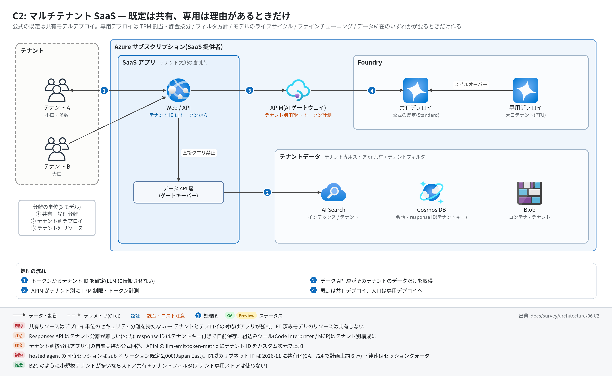

# 06. ユースケース編 C — 顧客向け公開・マルチテナント SaaS・大規模トラフィック

[← アーキテクチャ TOP](./README.md)

> **最終更新:** 2026-07-30(公式ドキュメントとの突合検証で訂正) / 2026-09-26(定期更新: hosted agent の同時セッション既定上限とサブネット換算表・ユーザー単位分離〈`x-ms-user-identity`〉・S3 HD の Foundry IQ 対応・Secure Multitenant RAG 記事の改訂・AI Gateway の閉域要件を反映) / 2026-10-14(既定ストリーミングでも応答末尾がガードレール適用前に届きうる注記をガードレールとチェックリストに、hosted agent のユーザー分離ページの整理〈新機能ではない〉・Foundry User の全セッション管理・MAF 既定ストアの分割と旧データ非互換を ③〜⑤ に追加、On Your Data は本日が期限当日) / 2026-11-22(features 差分更新〈10-14 以降+Ignite 2026〉の波及: Cost in Foundry・cost controls〈preview、HTTP 429 で予算超過を止められるが GPT / o-series のみ・PTU 等は数えない・fail-open、コスト閲覧に Cost Management Reader〉で旧記載「ハードリミットが存在しない」を限定、Azure AI Gateway〈新リソース型〉と Foundry UI からの APIM 紐付けの縮小・トークン上限の読み取り専用化、Model router の Policy が要求時に効かない件、hosted のサブネット IP 共有 GA で閉域の上限表を差し替え〈同時セッション上限 2,000 / 1,000 は不変〉、content filter の入力側 Off、分類器 2026-10 更新の段階展開、Modified Abuse Monitoring の縮小、テキスト透かし、Baseten / fal の DPA 対象外、`agents/write` とエージェントスコープの限界〈ファイルは分離されない〉、On Your Data の retired 表記)

社内利用と外部公開の間には、**アーキテクチャ上の断絶**がある。社内なら「Entra ID で認証すれば概ね安全」が成り立つが、外部公開では (1) 不特定多数からの攻撃、(2) テナント間のデータ分離、(3) 一部利用者による資源の占有、(4) 利用量に応じた課金按分 — の 4 つが同時に効いてくる。

## パターン一覧

| # | パターン | 主題 | 決め手になる要件 |
|---|---|---|---|
| C1 | 一般顧客向けチャット(単一テナント) | 攻撃面の防御とコスト暴走の抑制 | 不特定多数が使う |
| C2 | マルチテナント SaaS | テナント分離とノイジーネイバー対策 | 複数顧客に販売する |
| C3 | 大規模トラフィック / 複数部門への払い出し | キャパシティとチャージバック | 月間数百万リクエスト、部門別按分 |

---

## C1. 一般顧客向けチャット(単一テナント)

```
 [インターネット]
      │
      ▼
 [Azure Front Door]  ← グローバル分散が要る場合。X_AZURE_FDID ヘッダー検証を実装
      │
      ▼
 [Azure DDoS Protection] + [Application Gateway + WAF]
      │   ← ネットワーク観点でインターネットに露出する唯一のリソース
      ▼
 [App Service / Container Apps(チャット UI + BFF)]
      │   ← ここでユーザー認証・会話所有権の検証・レート制限
      │ Private Endpoint
      ▼
 [APIM(AI ゲートウェイ)]  ← トークンレート制限、セマンティックキャッシュ、Content Safety
      │
      ▼
 [Foundry(Agent Service / モデルデプロイ)]
      └ Private Endpoint 経由で Cosmos DB / AI Search / Storage
```

**Front Door を前段に置く場合のベストプラクティス(Front Door 一般ドキュメント):** ゲートウェイインスタンスを **Private Endpoint 経由でのみ到達可能にし、ゲートウェイ実装側で `X_AZURE_FDID` HTTP ヘッダーの検証を追加する。**これをやらないと Application Gateway に直接アクセスされて Front Door の WAF を迂回される。なおこの手法の出典はベースライン(チャット参照アーキテクチャ)記事ではなく **Front Door の一般ドキュメント**である(ベースライン記事は Front Door に言及せず、「Application Gateway がインターネットに露出する唯一のリソース」とする構成)。

### ⚠ WAF チューニングは必須作業として工数に入れる

公式ベースラインに専用の節が立っているほど確実に踏む問題。

> チャットアプリはコード片・SQL 文・HTML 断片を含むため、**WAF マネージドルールの誤検知を頻発させる。**リモートコード実行、ローカルファイルインクルード、脅威インテリジェンスなど複数のルールグループにまたがる。**マルチターン会話では OWASP anomaly score がメッセージ間で累積し、会話が長くなるとある時点で突然 HTTP 403 でブロックされる。**

**対策(公式):**
- チャットメッセージを運ぶ**リクエストボディフィールドにスコープした除外(exclusion)**を作る
- ルールをグローバルに無効化せず、**影響を受けるルールグループにスコープする**
- **リクエストボディ検査サイズ上限**がチャットの典型ペイロードを収容できるか確認する

**日本の金融機関などで「全ルール有効・除外禁止」が WAF の標準ポリシーになっている場合、正面衝突する。**設計初期に例外承認プロセスを織り込む。

### ⚠ 会話 ID の認可(BOLA 脆弱性)

**これは Foundry が守ってくれない領域で、外部公開では致命的になる。**

> **Foundry Agent Service は会話に対するユーザー単位の認可を強制しない。**アプリケーションサーバーの ID はプロジェクトレベルの資格情報を持ち、**ID さえ渡せば任意の会話を読み書きできる。**チャット UI がクライアント提供の conversation ID を検証せずに Agent Service に渡すと、**Broken Object Level Authorization (BOLA) 脆弱性**になる。

**必須の実装:** BFF 層で「この conversation ID はこのログインユーザーのものか」を**リクエストごとに検証する。**会話 ID とユーザー ID の対応表を自分で持つ。

> **2026-09-26 追記 — hosted agent のユーザー単位分離と、その適用条件:** ベースライン記事(2026-08-18 更新)に「hosted agent はユーザー単位のセッション分離モデルを持つが、**適用されるかはトポロジー次第**」という節が追加された。Web アプリが自分のワークロード ID で全ユーザー分を呼ぶ構成では、プラットフォームから見て呼び出し元は 1 つなので**上の BOLA 対策は依然として必須**。分離が効くのは、(a) エンドユーザーが自分の Entra トークンで直接呼ぶ場合、または (b) アプリサーバーが **`x-ms-user-identity` ヘッダーでエンドユーザーの安定 ID を渡す**場合(呼び出し側に `.../agents/endpoints/UserIdentityImpersonation/action` を含む**カスタムロール**が必要。組み込みロールには無い。無ければ 403)。ただし (b) の委任では「**委任ユーザー同士はプラットフォームが隔離しない**」と明記されており、ユーザーごとにセッション ID を分けるのはアプリ責務のまま(出典: [baseline-microsoft-foundry-chat](https://learn.microsoft.com/en-us/azure/architecture/ai-ml/architecture/baseline-microsoft-foundry-chat)「Conversation isolation」/ [isolate-sessions-per-user](https://learn.microsoft.com/en-us/azure/foundry/agents/how-to/isolate-sessions-per-user) 2026-07-21 版・2026-09-21 更新)。

**関連する制約として、旧 Agent Application モデルが `/conversations` にアクセスできないのも同じ理由**である(「Foundry Agent Service はマネージドな会話履歴をサポートするが、同一プロジェクト内の会話についてエンドユーザー間の分離をまだ強制していない」)。恒久仕様ではなく修正作業中と明記されているが、**現時点では設計で埋める。**(※2026-09-26 注記: Agent Application 自体がレガシーモデル扱いになり、新エージェントオブジェクトモデルへの移行が案内されている — [migrate-agent-applications](https://learn.microsoft.com/en-us/azure/foundry/agents/how-to/migrate-agent-applications))

### プロンプトインジェクションと安全性

外部公開では入力が完全に非信頼になる。

- **Prompt Shields**(直接攻撃 = jailbreak、間接攻撃 = ドキュメント埋め込み)を有効にする。既定ポリシーでは jailbreak がプロンプト側で有効。
- **ガードレールの介入点を 4 つとも設計する:** User input / **Tool call(プレビュー)** / **Tool response(プレビュー)** / Output。エージェントに明示割当したガードレールはモデル側の設定を**完全に上書きする**ため、Tool 系を置き忘れるとその経路が未スキャンになる。
- **⚠ フェイルオープンに注意:** 「**コンテンツフィルタリングシステムが利用不能な場合、リクエストはフィルタリングなしで完了する(HTTP 200)。**」判別は `content_filter_results` 内のエラーオブジェクト(`code: "content_filter_error"`)でしかできない。**公式のベストプラクティスは「常に `finish_reason` を確認し、`content_filter_results` にエラーが無い(= フィルターが実行された)ことを検証せよ」。**規制業種ではこの検証を必須実装にする。
- **⚠ ストリーミングの末尾はガードレール適用前に届きうる(2026-10-14 追加):** content-streaming(2026-10-13 公開版)は、**既定(バッファあり)のストリーミングでも応答の最後の区切りはフィルター適用前に返ることがある**と注記した。試験では gpt-4o+補完側のブロック型カスタムブロックリストで、**末尾の約 15〜30 語**に入った禁止語が `finish_reason: "stop"` のまま届いた(同じ応答は `stream: false` ならブロック、後ろに文が続けばストリーム途中でブロック)。公式は「ポリシー違反の内容が利用者に届くことを許容できないなら、**非ストリーミングにするか、ストリームの最終区切りに自前のフィルターをかけよ**」と書く(同ページの「既定は返す前に完全に検査済み」という記述とは食い違う)。不特定多数に見せる画面で禁止語・個人情報の流出が許されないなら、どちらかを実装範囲に入れる。Asynchronous Filter はもともと遅れて検査するので同じ対策がより強く要る
- **分類器の更新でブロック結果が変わりうる(2026-11-22 追加):** Content Safety の What's new「October 2026 Content Safety Model Update」で、テキストの 4 有害カテゴリと Prompt Shields(直接 / 間接攻撃)の分類器が更新され、**Spain Central を最初のリージョンとして段階展開中**(展開中はリージョン間で結果が一時的に異なりうる、完了時期・日本リージョンへの到達時期は未記載)。PII・Task adherence・ブロックリスト・保護素材・画像は対象外。**外部公開の画面では誤ブロック・すり抜けが利用者に直接見えるので、代表的な入力・攻撃文のセットを固定し、判定が急に変わったら再試験する手順をリリース運用に入れる**([09](./09-operations.md))。
- **ブロッキングレベルの読み方(2026-11-22 訂正):** guardrails-overview の表は名前が「Severity levels」→「**Blocking levels**」になり、**Low = High のみブロック(最も緩い)/ Medium = Medium 以上 / High = Low 以上をブロック(最も厳しい)**と定義し直された。「Off」は**出力側だけが承認制(Modified Guardrails)で、入力側の Off は全顧客が選べる**(旧記載は入出力とも承認制と読めた — [features 06](../features/06-safety-guardrails.md))。外部公開で入力側を Off にする設計は取らないが、社内向けに入力側を緩めた設定を顧客向けに流用しないよう、環境ごとにガードレールを分ける。
- **Claude を使う場合は Foundry の組込みフィルターが効かない。**APIM の `llm-content-safety` ポリシーでゲートウェイ層から Content Safety を噛ませるか、アプリ層で直接呼ぶ。
- **AI Red Teaming** を「purple environment」(本番相当リソースの非本番環境)で回す。ただし ASR の判定は生成モデルが行うため**非決定的で偽陽性がありうる**ので、対処前に必ずレビューする。
- **生成テキストの透かし(2026-11-22 追加):** GPT の出力にも機械検出用の透かしを入れられるようになった(対応は gpt-6.2-sol / -astra、ほかのモデルは対応予定)。**デプロイ単位の `properties.textWatermarking`**(`Disabled` が既定 / `RequestControlled` = ヘッダー `x-ms-oai-enable-text-watermark: true` の要求だけ / `AlwaysEnabled`)で、**同じリソースの別デプロイ・フェイルオーバー先・ロールバック用デプロイには自動で広がらない**。一般向けに生成文を出すサービスで透明性の義務(EU AI Act の行動規範等)を説明するなら、APIM のバックエンドプールに入る全デプロイに同じ設定を入れ、`RequestControlled` ならゲートウェイ・リトライ経路がヘッダーを落とさないか試験する([features 06](../features/06-safety-guardrails.md))。

### コスト暴走の抑制

外部公開で最も怖いのは、悪意または無自覚な大量利用によるトークンコストの暴走。

**⚠ Azure OpenAI にはハードリミットが存在しない。**「OpenAI にはハードリミットがあるが、Azure OpenAI には現状その機能がない」と明記されている。予算超過での自動停止が要件なら、**予算アラートのアクショングループから起動する自動化を自作する。**

> **2026-11-22 更新 — Foundry に予算で止める仕組み(cost controls、preview)が出たが、ハードリミットの代わりにはならない:** Foundry リソースかプロジェクトに予算(米ドルかトークン)を置き、しきい値で **Send alert / Block usage** を選べる([cost-controls](https://learn.microsoft.com/en-us/azure/foundry/concepts/cost-controls) ms.date 2026-11-18)。ブロックされた要求は **HTTP 429+ヘッダー `x-ms-budget-cause: budget_exceeded`**(ゲートウェイのトークン上限の 429 / 403 とはヘッダーで区別できる)。ただし外部公開の「コスト暴走の止め」として使うには穴が多い:
>
> - **数えるのは GPT と o-series だけ**(Claude・DeepSeek 等は非対象)、**PTU・ツール料金(web search 等)・hosted agent のコンピュートは数えない**、model router は完全には数えられない、新しい GPT モデルは価格が入るまで約 1 週間計上されない。
> - 変更の反映は最大 15 分、しきい値をまたぐ要求自体は完了しうる、**時間内に判定できなければ要求は通る(fail-open)**。Spending は定価等のスナップショットで値付けする推定で、請求と突合しない。
> - プロジェクトの cost control は数えるだけでブロックしない(ブロックはリソースの cost control)。**cost control を持つプロジェクトは削除できない**、終了日が必須。
> - **コストの閲覧は Foundry のロールに含まれない** — Manage > Cost・Fleet のコストを見るには RG / サブスクリプションに **Cost Management Reader** 等を別に付与する(サブスクリプションに付けると Foundry 以外の支出も見える)。コストは利用の 8〜24 時間後に出る。
>
> → **外部公開では「最後の安全弁」として cost controls(Block)を置きつつ、主の抑止は従来どおり下の多層防御(アプリ層・APIM 層)で持つ**(本ドキュメントの判断)。Cost in Foundry(Manage > Cost / プロジェクトの Monitor > Cost)のエージェント別内訳は `agent.name` タグ付きの課金だけで、タグは 2026-11 以降の利用分から([features 01](../features/01-platform-projects.md))。

現実的な多層防御:
1. **アプリ層** — ユーザー単位のリクエスト数 / 日次トークン上限
2. **APIM 層** — `llm-token-limit` で TPM 上限とトークンクォータ。**`estimate-prompt-tokens=true` にすると上限超過プロンプトをバックエンド到達前に遮断できる**(公式は「不要なバックエンドリクエストを削減できる」と記載。課金抑止の明記はない。なおストリーミング時は設定にかかわらず常にプロンプトが推定される)
3. **Foundry 層** — デプロイ単位のクォータ、Control Plane のプロジェクト単位トークン制限(**TPM 超過は 429、総トークンクォータ超過は 403**。2026-11-22: この上限は Foundry 側では**読み取り専用**になり、変更は APIM のポリシー XML を Azure portal かコードで編集 — enforce-limits-models 2026-11-06 版)、cost controls の Block(preview、上の注記)
4. **モデル層** — Model router の Cost モード、小型モデルへの振り分け、Batch への切り出し

**セマンティックキャッシュ**(APIM `llm-semantic-cache-store` / `-lookup`、RediSearch モジュール有効の Azure Managed Redis 必須。**モジュールは新規キャッシュ作成時のみ有効化可**)は、FAQ 的な問い合わせが多い外部向けチャットで効果が大きい。**バックエンド呼び出し自体を削減する**ため、レイテンシとコストの両方に効く。

**⚠ キャッシュキーの設計に注意。**WAF が明記している通り、キャッシュキーには **tenant/user identity、policy context、model version、prompt version** を含める。「**多くの状況で単一ユーザー向けのキャッシュはするな。**」

---

## C2. マルチテナント SaaS



### テナント分離の 3 モデル

| モデル | 分離単位 | 向く条件 | コスト・運用 |
|---|---|---|---|
| **共有デプロイ + 論理分離** | アプリ層でテナント ID を管理 | テナント数が多く 1 テナントあたりの利用量が小さい | 最安。**ノイジーネイバーとデータ混在のリスクを自前で潰す必要** |
| **テナントごとにデプロイ** | モデルデプロイを分ける | 大口テナントに SLA を約束する | **1 リソースあたりモデルデプロイ 32 個**の壁 |
| **テナントごとにリソース / サブスクリプション** | Foundry リソースを分ける | 規制要件やデータレジデンシがテナントごとに違う | 最も高コスト。**1 リージョン / サブスクリプションあたり Foundry リソース 100 個** |

**CAF の AI Platform Sharing ガイダンスがそのまま効く:** 本番では「ワークロードごとに 1 インスタンス」が既定で、同居は 5 条件すべてを満たす**文書化された例外**として扱う。SaaS のテナントを「ワークロード」と読み替えると、**規制スコープ・データ分類・レジデンシー要件が同一のテナント群だけを同居させられる**ということになる。

### 公式の 4 方式比較(Multitenancy and Azure OpenAI より)

Azure Architecture Center のマルチテナンシーガイダンスに、より粒度の細かい比較表がある。**選択の判断軸は 4 つ**とされている: ①テナント数 ②ネットワーク / インフラ分離のコンプライアンス要件 ③テナント自身のデータでのファインチューニング要否 ④テナントごとに異なるモデルバージョン / ライフサイクル要否。

| 観点 | 専用インスタンス | 共有インスタンス + テナント専用モデルデプロイ | 共有インスタンス + 共有モデルデプロイ | テナント提供インスタンス |
|---|---|---|---|---|
| データ分離 | High | Medium | **Low** | High |
| 性能分離 | High | High | **Low〜Medium**(テナント毎の TPM 使用量次第) | High |
| デプロイ複雑度 | Low〜Medium | Medium | Low | 顧客管理 |
| 運用複雑度 | Low | Medium | **High** | プロバイダーは Low、テナントは Medium〜High |

**公式の既定は「共有」:** 「**可能なら共有モデルデプロイを使い、テナントが特定の機能を必要とする場合にのみ専用デプロイを作れ。**」

**テナント専用モデルデプロイを作る正当化理由は 5 つ**と明示されている: (1) **TPM クォータをテナント別に割り当て、トークン使用量を追跡して正確にコスト配賦する**(PTU なら特定顧客に割り当て、他は別の課金モデルにできる)、(2) **コンテンツフィルターポリシーはモデルデプロイ単位**なのでテナント別ブロックリスト等が要る場合、(3) モデル種別・バージョンの独立したライフサイクル管理、(4) テナント固有のファインチューニング、(5) データレジデンシ(一部テナントはリージョナル、他はグローバル)。

> **2026-11-22 追記 — (5) を Model router で済ませる場合の落とし穴:** model router の FAQ・model-router-policy は「**Azure Policy は作成・更新時の評価だけで、要求時のルーティング先は絞らない**」と明記した。承認モデルに限るにはデプロイの **model subset** と Auto(preview)の `properties.instant.routing.models` を併用する。さらに **Auto(preview)は常に Global Standard で処理**、**router 経由の Claude は Global Standard の version 1(Anthropic 基盤)だけが対象で、Data Zone の router は Claude に流さない**、Fireworks のモデルは有効化したサブスクリプションでのみプールに入る。→ **データ所在要件のあるテナントは「Data Zone の router + subset」に限定し、Auto は使わない**。課金はルーティング料+選ばれたモデルの利用料(自前 PTU が応答した場合はルーティング料のみ)([features 02](../features/02-models.md))。

### ⚠ 公式が明示している 3 つの落とし穴(そのまま提案書のリスク欄に使える)

> **共有された Azure OpenAI リソースは、モデルデプロイごとのセキュリティ分離を提供しない。テナントが、使う権限のないモデルを使えてしまう可能性がある。ファインチューン済みモデルを使うときは Azure OpenAI インスタンスを共有するな。**機微情報が露出し、テナント固有のデータやリソースへの不正アクセスを許す可能性がある。

> 共有インスタンスは **noisy neighbor** 問題も引き起こし、一部テナントのレイテンシを悪化させる。**アプリケーションコードをマルチテナンシー対応にしなければならない。例えば共有インスタンスの消費分を顧客に課金するには、アプリケーション内でテナントごとのトークン使用量を追跡するロジックを実装する。**

> **Azure OpenAI はモデルデプロイごとのアクセス制御を強制しない。テナントとデプロイのアクセス規則はアプリケーションが強制しなければならない。**

**→ チャージバックは「アプリケーション層で自前実装せよ」が公式回答。**プラットフォーム側のテナント別メータリング機能は提示されていない。前述の APIM `llm-emit-token-metric` は、この自前実装を軽くするための現実解という位置づけになる。

### ⚠ Responses API はテナント分離が難しいと公式に書かれている

> Responses API は、**すべてのツールと機能にテナント識別子を付与できないため、テナント間のデータ分離を困難にする。**

具体的な対処として挙げられているもの:

- **会話履歴は response ID で連結される** → 「**response ID をテナントスコープのキーとともにアプリケーションに保存し、同じテナントに紐づく response ID しか参照できないようにせよ。**」
- **Function calling は自アプリが実行するのでテナント ID を伝搬できるが、組み込みツール(Code Interpreter、リモート MCP サーバー)はモデル基盤側が実行するためテナントコンテキストを注入できない** → 「**テナントごとに専用のコンテナまたは別のツール構成を使え。**」
- File search / RAG: 共有インデックスなら全クエリにテナントフィルタ、テナント別インデックスならリクエスト→インデックスのマッピングを持つ。
- Background mode: タスク ID にテナントコンテキストを保存し、ポーリング時に検証する。
- 「**テナント情報の伝搬を言語モデルに依存するな。**」

**Batch デプロイのマルチテナント:** クォータは TPM ではなく **enqueued tokens** を制限する。テナント別にバッチデプロイを分ければトークン割当で独占を防ぎコスト按分もできる。共有する場合は、**バッチはジョブ単位でしか管理できず「バッチ内の個別リクエストをキャンセルまたは削除できない」**ため、**テナントごとにジョブを分ける**のが公式の推奨。

### RAG のマルチテナント分離(Secure Multitenant RAG)

**⚠ 前提が変わった:** この記事は以前、冒頭で「**Azure OpenAI On Your Data は非推奨で、リタイアが近づいている。**On Your Data のワークロードは **Foundry Agent Service + Foundry IQ** へ移行することを推奨する」と明記していた。**「オーケストレーターを挟まずモデルが直接データを読む」構成は事実上終わっている**(On Your Data は 2026-10-14 リタイア — use-your-data 2026-09-10 版。~~2026-10-14 = 本日が期限当日で、出典の表記は未来形のまま~~ **2026-11-22: 出典は「retired on October 14, 2026, and is no longer supported」の過去形になった**)。

> **2026-09-26 更新:** [Secure Multitenant RAG](https://learn.microsoft.com/en-us/azure/architecture/ai-ml/guide/secure-multitenant-rag)(2026-08-19 版、2026-09-21 更新)は On Your Data への言及を削除し、単一テナント構成の変種として「**Responses API の file search ツール**」版を追加した。アプリが認証済みリクエストからテナント文脈と認可ルールを導出し、**許可された vector store と file-attribute フィルタを file search ツールに設定**してから Responses API を呼ぶ形。ただし記事自身が「アプリ制御の取得(AI Search を直接クエリ)より、索引・取得・テナントルーティング・認可強制の制御が弱い」と明記しているので、マルチテナントでは下記の API 層パターンが本筋のまま。

ストア分離は 3 モデル(組み合わせ可): **テナント専用ストア / マルチテナントストア(テナント判別子付きクエリ)/ 全テナント共有ストア**。

- **テナント専用ストア:** データ分離と性能分離が得られ、「**ストア 1 つ分のコストを単一テナントに帰属できるのでコスト配賦が単純になる**」。ただし「**多数の小規模テナントがいる場合、例えば B2C シナリオでは、このアプローチを使うべきではない。**」サービス上限にも到達しうる。
- **マルチテナントストア:** コスト最適で多数テナントを収容できるが、**データ分離が最重要課題**になり、ノイジーネイバーとコスト按分が難しい。テナントごとのインデックス再構築スケジュールの差が運用を複雑にする。
- **プラットフォーム機能への注意:**(2026-08-19 版では同趣旨の記述は 1 箇所に整理された)Cosmos DB のパーティションキー、Azure SQL / PostgreSQL の行レベルセキュリティは使えるが、「**これらの機能を使う前提でソリューション全体を設計しなければならないため、マルチテナントソリューションでは通常使われない。**」

**中核の推奨は「データアクセスを API 層にカプセル化せよ」:**

> **使用するストレージ機構の前に API を置くことを推奨する。API はゲートキーパーとして機能する。**
> **テナントデータにアクセスする必要があるコードが、バックエンドのストアを直接クエリできてはならない。データへのすべての要求は API 層を通るべきである。**この API 層が、テナントデータの上に**単一のガバナンス / セキュリティのポイント**を提供する。このアプローチにより、テナントとユーザーのデータアクセス認可ロジックがアプリケーションの他の領域に漏れ出すのを防ぐ。……このカプセル化により、ソリューションの検証とテストが容易になる。

API 層の責務として公式に列挙されているのは、テナント専用ストアへのルーティング、マルチテナントストアでの当該テナントデータの選択、**プラットフォーム側の認可を効かせるための適切なユーザー ID の使用**、カスタムのセキュリティトリミング、そして **監査目的でのグラウンディング情報アクセスログの保存。**

### AI/ML マルチテナンシー一般の注意

- **学習と推論の要件を分けて考える。**モデル分離は「テナント固有モデル / 共有モデル / チューニング済み共有モデル」の 3 方式。
- **データ主権に関する明示的な警告:** 「テナントのデータから共有モデルを学習するなら、**テナントがそのデータ利用を理解し同意していることを確認せよ。識別情報が除去されていることを確認せよ。****あるテナントが、自分のデータが別のテナントに提供されるモデルの学習に使われることに反対した場合にどうするかを検討せよ。**例えばそのテナントのデータを学習データセットから除外する必要があるかもしれない。」
- 「**モデルは、それを学習させた生データと同程度の機密性で扱え。**」
- **顧客データを Microsoft 側に保存させない前提は、新しいモデルでは崩れる(2026-11-22 追加):** abuse-monitoring・data-privacy・limited-access の 3 ページに「What's changing with Modified Abuse Monitoring」が追加され、**2026-11-01 以降に提供開始したモデルは、今後告知される日付(モデルごとに 30 日前以上に通知)から Modified Abuse Monitoring の対象外**になる(既存の承認があっても Microsoft の新しいデータ保持・アクセス・安全監視の方式に従う。2026-11-01 より前のモデルは不変)。2026-11-17 公開の gpt-6.2-sol / -astra が該当。新方式の中身(保存期間・人手レビューの有無)は未公表 → **テナントとの契約で「プロンプトを Microsoft に保存させない」と約束している SaaS は、採用モデルの提供開始日を確認し、新しいモデルへの切り替えを契約上の変更として扱う**([features 06](../features/06-safety-guardrails.md))。
- **Microsoft の DPA が効かないモデル提供元がある(2026-11-22 追加):** Foundry のカタログから使える **Baseten / fal(いずれも preview)は Microsoft Product Terms・DPA の対象外**(Fireworks は DPA 適用だが EU Data Boundary 対象外、推論は Microsoft 施設外)。Baseten の pay-per-token はリタイア予告が 30 日。**テナントのデータを流す経路にこれらを入れない**か、テナントに提供元ごとの条件を開示する([features 02](../features/02-models.md))。
- **Foundry Tools のスケール上限:** 「多くの API が秒あたりの最大リクエスト数をサポートする。**単一の Foundry tool リソースをテナント間で共有してデプロイしている場合、テナント数の増加に応じて複数リソースへスケールする必要があるかもしれない。**」
- **アンチパターン 2 つ:** 「**分離要件を考慮しない**」(法的・契約要件の違反に加え、**性質の大きく異なる複数テナントのデータで学習するとモデル精度が落ちる**)、「**ノイジーネイバー**」(大規模テナントのモデル学習が計算リソースを食い尽くして小規模テナントを枯渇させないよう、**リソースガバナンスと監視で緩和せよ**)。

### 分離設計で必ず潰す点

**① 会話・スレッドの分離** — 前述の BOLA 対策に加え、**basic セットアップでは会話が Microsoft 管理ストレージにあり所在と保持を細かく制御できない。**SaaS なら standard セットアップ(BYO Cosmos DB)か自前セッションストアを選ぶ。

**② ベクトルストア / インデックスの分離** — テナントごとにインデックスを分けるか、単一インデックス + セキュリティフィルタか(2026-11-22: Azure AI Search は「Foundry IQ (Azure AI Search)」に改称。リソース型・エンドポイント・課金名は不変。Entra ID ベースの ACL 取り込みは `2026-10-01` で GA になったが、テナントの ID 基盤が Entra 以外の SaaS ではセキュリティフィルタが本筋 — [04 A2](./04-usecase-chat-rag.md#a2-全社ナレッジ検索-ai-search-自前索引・本番の標準形))。**⚠ AI Search の S3 HD ティアと agentic retrieval(Foundry IQ):** search-limits 2026-08-04 版では S3 HD のナレッジソース / ナレッジベース上限が 0(= Foundry IQ 不可)だったが、**2026-09-16 版で「1 パーティション 1,000 / サービス 3,000」に変わった**。ただし「一部の古い S3 HD サービスは非対応」の脚注付きで、S3 HD のインデクサはプレビュー(マルチテナント実行のみ・shared private link 非対応)。「マルチテナントだから S3 HD」を選ぶなら、**対象サービスで knowledge base を作れるかを先に実機確認**する(2026-09-26 更新)。

File Search を使うなら、**`structured_inputs` で `vector_store_ids` をリクエスト単位に上書きできる**ため、エージェント定義を増やさずにテナント別コーパスを切り替えられる。ただし **hosted agent から Toolbox 経由で Code Interpreter / File Search を使うとユーザー分離がない**点に注意(Code Interpreter は同一プロジェクトの全ユーザーが同じコンテナ文脈を共有、File Search はツール構成・実行時に渡した vector store に全ユーザーがアクセス可能 — code-interpreter / file-search 各ページ 2026-08-05 版で 2026-09-26 再確認)。

**③ hosted agent のセッション多重化** — コンテナプロトコル 2.0.0 では **1 セッション内で複数ユーザーを安全に多重化できる**が、**1.0.0 は非サポートでリクエストがブロックされる。**マルチテナントで hosted agent を使うなら 2.0.0 が前提。**2026-09-26 更新:** 中間層が送るのは **`x-ms-user-identity` ヘッダー**(エンドユーザーの安定 ID、1〜256 文字)で、`x-agent-user-id` は**送ってはいけない**(プラットフォームがユーザー解決後にコンテナ側のリクエスト文脈として設定する)。中間層 ID には `UserIdentityImpersonation/action` を含むカスタムロールが必要。コンテナ側 SDK は azure-ai-agentserver-core 2.0.0b7+ / Azure.AI.AgentServer.Core 1.0.0-beta.26+(出典: [multiplex-session-users](https://learn.microsoft.com/en-us/azure/foundry/agents/how-to/multiplex-session-users) 2026-07-21 版)。**2026-10-14 注記:** ユーザー分離の 4 ページ(isolate-sessions-per-user / multiplex-session-users / pass-isolation-keys / invoke-hosted-agent)が ms.date 2026-10-13 に改訂されたが、**分離モデルは変わっていない文書の整理**(差分は azd の `--user-identity` の追記。旧 isolation key 方式は「プロトコル 1.0.0 用の履歴資料」扱い)。改めて明記された点: **ヘッダーを付けない要求は中間層自身の ID のセッション**になる / **委任された利用者どうしはプラットフォームが隔てない**(境界は「委任あり / なし」の間だけ) / multiplex では他人の `previous_response_id` での継続は失敗し `context.get_history()` も要求者の履歴だけを返すが、**コンテナ側の保存データは分かれない**(次の ④)。azd で試験するときは、azd がセッション / 会話 ID を利用者単位でなく**エージェント単位で保存する**ので、`--user-identity` を切り替えるたびに `--new-session --new-conversation` を付ける(付けないと別の利用者で同じセッションを使い回し、分離の試験にならない)。

**④ セッションプールでのデータ混在** — 同時エージェントセッション上限(後述)を踏まえてセッションをプールする場合、**プラットフォームは会話状態を分離するが、エージェントコンテナー自身が保存するデータ(ファイル・DB 行・キャッシュ)は自動分割されない。**アプリ側で **agent session とエンドユーザー ID の両方でキー付け**しないと、同一プールセッション内のユーザーが互いのデータを読める。**2026-10-14 追記:** MAF のホスティング(agent-framework の foundry-hosted-agent、ms.date 2026-10-08)を使う場合、Foundry 上の既定の Python ストアは最初から**プラットフォームのユーザー ID × サンドボックスのセッション ID** で状態を分けて保存し(最終書き込みから 30 日で期限切れ)、状態操作ごとにプラットフォームの call ID を要求する。ただし**分割済みストアは旧来の分割なしデータを読まない**ので、MAF ホスティングの更新後は古い `previous_response_id` や会話 ID を使い回さず新しい会話から始める(利用者に「続きから」を約束している画面は移行時の扱いを決めておく)。自作の保存先(ファイル・DB)には引き続き自分でキーを付ける。

**⑤ プロジェクト RBAC の限界** — 「Foundry プロジェクトに `Foundry User` ロールを持つプリンシパルは、**そのプロジェクト内のすべてのエージェントと対話できる。**」テナント別のアクセス制御を Foundry の RBAC で表現するのは無理で、**アプリの認証認可層が担う。****2026-11-22 追記(rbac-foundry 2026-11-18 版):** エージェントスコープで `Foundry Agent Consumer` を割り当てても、**プロジェクトのファイルは分離されない** — file ID に呼び出し元単位のアクセス制御がなく、**prompt agent を呼べる主体はプロジェクト内の任意の file ID を `input_file` で参照できる**。テナントがファイルを上げる SaaS で「テナントごとにエージェントを分けたから安全」とはならないので、**テナント間でファイルを共有させないならプロジェクト(またはリソース)を信頼境界として分ける**。また `…/agents/write` を持つ主体はエージェントを介さずプロジェクトの Responses エンドポイントでモデルを呼べる(テナント向けのエージェント作成 API を公開する SaaS は、この権限をテナントに渡さない)。**2026-10-14 追記:** ユーザー分離のページは、プロジェクトの **Foundry User** を持つ管理者・自動化が**利用者を問わず全セッションを一覧・管理できる**と明記した(セッションのファイルや会話内容の読み取りまで含むかは記載なし)。開発者に普通に付けるロールなので、**本番プロジェクトでは開発者に Foundry User を付けない**(開発・検証プロジェクトとリソースごと分ける)前提で権限を設計する(本ドキュメントの判断)。

### ⚠ 同時エージェントセッションの上限が設計制約になる

**2026-09-26 更新 — 上限は 2 段で効く:**

1. **サブスクリプション × リージョン単位の同時 hosted agent セッション既定上限:** **2,000**(Canada Central / East US 2 / **Japan East** / North Central US / South Africa North / Southeast Asia / Sweden Central)、**それ以外の hosted agent 対応リージョンは 1,000**。同一サブスクリプション・リージョンの全 Foundry アカウント・プロジェクトの合算で、プロビジョニング中・実行中のセッションだけが数えられる(idle / 停止中は数えないが、再開にはクォータが要る)。超過は 429 `session_quota_exceeded`、リージョン容量不足は 429 `regional_session_quota_exceeded`。引き上げはサポート申請(出典: [limits-quotas-regions](https://learn.microsoft.com/en-us/azure/foundry/agents/concepts/limits-quotas-regions) 2026-09-07 版。2026-07-20 版には記載なし)。**2026-11-22 再確認: 2,000 / 1,000 は 2026-11-18 版でも不変**(Ignite の shared subnet IPs はクォータ増ではない)。セッションは hosted agent のコンピュートと保存ファイル状態の単位で、会話の数ではない(deep-dive 11-09 版)。
2. **閉域(BYO VNet)ではサブネットの使用可能 IP:** ~~既定で同時セッションと使用可能 IP が 1:1。サポート申請で 1 IP あたり 10 セッション(1:10)まで拡大可。~~ **2026-11-22 更新: hosted agent のセッションがサブネットの IP を共有する方式(shared subnet IPs)が GA**(devblogs 2026-11-18「Shared subnet IPs — Generally available」。全員に既定で有効、申請不要。各セッションは引き続き VM 分離のサンドボックス)。IP 枯渇は引き続き 429 `subnet_exhausted`、データプロキシの 5xx、新規プロジェクト作成の失敗で現れる(ポータルでは IP 使用率を監視できず、事前警告もない)。

旧版の「同時セッションは既定で約 50 が上限(`/26` が maximum supported)」は、[agents-networking-deep-dive](https://learn.microsoft.com/en-us/azure/foundry/agents/concepts/agents-networking-deep-dive) 2026-09-07 版で**サブネット換算表(`/21` で約 2,000 まで)に置き換わり**、さらに **2026-11-09 版で IP 共有前提の計画値(`/24` で 60,000)に置き換わった**。**大規模 SaaS でサブスクリプション / リージョン分割が要るか**は、**ほぼ 1. のクォータで決まる**ようになった(Ignite の「より多くのセッション」はサブネット側の制約緩和で、クォータ増ではない。サブネットを大きくしてもクォータは自動で増えない)。

関連する実効上限(閉域構成の場合、agents-networking-deep-dive 2026-11-09 版・networking-options 2026-10-28 版):

| 項目 | 値 |
|---|---|
| Hosted agent | セッションはサブネットの IP を共有し、各セッションは VM 分離のサンドボックス(旧版の「セッションごとに Micro VM = 1 IP 消費」から変更)。プラットフォーム更新時は新旧並走で一時的に IP 消費が増える |
| Prompt agent | **バージョンは IP を消費しない**。プロジェクト単位のネットワーク部品(データプロキシ)は IP を消費。networking-options は「プロジェクトあたり最大約 10 IP の静的プール」と書く(deep-dive には数値なし)。プロンプトエージェント数のハード上限なし。下の計画値の対象外 |
| IP 計画の単位 | **同時セッション数・プロジェクト単位のネットワーク部品・運用の余裕(更新・スケール時)で計画する**。容量はサブネットを共有する**全プロジェクトの合計**で、サブネット構成は Foundry アカウント単位 |
| `/27` | 計画上 約 **7,500** 同時セッション(最小サイズ。本番は `/24` 以上) |
| `/26` / `/25` | 約 15,000 / 30,000 |
| `/24` / `/23` / `/22` / `/21` / `/20` | 約 **60,000** / 120,000 / 240,000 / 480,000 / 960,000(保証値ではない計画値。実際は 1. のクォータで頭打ち — 例: クォータ 1,000 なら `/24` でも 1,000) |
| Foundry インスタンスあたりプロジェクト数 | 低負荷時 約 250、**高負荷時 約 25 まで低下**(IP 枯渇時は新規プロジェクトの作成が失敗) |
| Foundry インスタンスあたり hosted agent | 旧版の「約 200」は現行版に記載なし(要確認) |
| 推奨稼働率 | 旧版の「サブネット使用率 80% 未満」は 2026-11-09 版に数値なし(「更新・スケール時の余裕を見よ」のみ) |

(2026-09-07 版の IP 換算表〈`/27` 約 20・`/24` 約 250〉と 1:10 の申請は、IP 共有の GA で役目を終えた。サブネットのサイズは割り当て後に変更できない点、**ネットワーク構成は最初の hosted agent 作成時に確定し後から変えられない**点、**hosted agent では private endpoint を `192.168.0.0/24` に置かない**(サンドボックス内部のネットワークと重なる)点は新たに明記された)

**→ 閉域マルチテナントで hosted agent を使うなら、委任サブネットは `/24` 以上を確保する**(公式は本番の最小を `/24`。IP 共有で同時セッションの制約はクォータ側に移ったが、プロジェクト数の上限と更新時の並走があるので `/24` を割らない)。

### テナント別の計測と課金按分

**Foundry の標準機能だけでは足りない。**

- Foundry の `project` タグによるコスト配賦は**プレビューで、かつ Models sold by Azure のみ対応**(Marketplace 経由のモデルは未対応)。
- Estimated cost は**割引や契約価格を反映せず、Provisioned(PTU)も含まない。**しかも **prompt agent と非 Foundry エージェントのコストは Overview の概算に含まれない。**
- 課金イベントが Cost Analysis に現れるまで、**取り込みタイミングにより遅延がある**(公式は具体的な時間を示していない。分単位で比較せずトレンドで照合せよと記載)。**2026-11-22 追記:** 新設の Cost in Foundry(preview)の各ページは「**コストは利用の 8〜24 時間後**(利用量は数分)」と明記。
- **2026-11-22 追記 — Cost in Foundry(preview)でもテナント別は取れない:** Manage > Cost / プロジェクトの Monitor > Cost はプロジェクト・エージェント・デプロイ別の内訳を出すが、**内訳はタグ付きの課金だけ**(合計より小さくなる)、**エージェント名のタグ(`agent.name`)は 2026-11 以降の利用分から**、別リソースのデプロイを呼んだ分はそのリソース側に計上。要求単位の独自タグでコストを分ける **caller attribution は private preview**(Tech Community 2026-11-19、Azure OpenAI から開始)。閲覧には Foundry ロールとは別に **Cost Management Reader** が要る。→ テナント別のチャージバックは引き続き下の APIM で取る。

**→ テナント別のメータリングは APIM で取る。**`llm-emit-token-metric` の**既定ディメンションは API ID / Operation ID / Product ID / User ID / Subscription ID / Location / Gateway ID / Backend ID の8種**(Tenant ID や Client IP は既定に含まれない。テナント ID はポリシー式による**カスタムディメンション〈最大5個〉**として追加する)。これを App Insights に送れば、Foundry が提供しない粒度でチャージバックできる。**SaaS 案件では APIM が事実上必須。**

### ノイジーネイバー対策

- **APIM の `llm-token-limit` の `counter-key` をテナント ID にする。**TPM 上限と、時間 / 日 / 週 / 月 / 年のトークンクォータをテナント別に設定できる。
- **大口テナントには専用の PTU デプロイ**を割り当て、共有テナントは Standard に載せる。APIM の backend pool を **priority-based** にして PTU を優先度高に設定する。
- **Spillover** で PTU 枯渇時に Standard へ逃がす。

---

## C3. 大規模トラフィック・複数部門への払い出し

### キャパシティ設計の骨格

**「PTU でベースライン + Standard でスパイク」が推奨形。**トラフィックに合わせて PTU を上下させる運用は非推奨(コストで Reservation に劣り、スケールアップ時にキャパシティが無い可能性がある)。

**エンタープライズ PTU プールパターン(公式):**
- 単一の Data Zone PTU デプロイを全社共通プールとし、APIM でアプリ別のスループット制限・優先度・フェイルオーバーを制御する。
- **エンタープライズ PTU プールは、プライマリの Standard デプロイとは別リージョンに配置する**(同時被災回避)。
- ワークロード専用 PTU が必要なら、さらに別リージョンに。
- **フェイルオーバーチェーン:** ワークロード専用 PTU → エンタープライズ PTU プール → Standard デプロイ。**PTU 間で溢れる限りレイテンシ SLA が維持される。**

**PTU サイジングでは必ずキャッシュ率を織り込む。**公式例では 50% キャッシュで必要 PTU が 110 → 80(**約 27% 削減**)。システムプロンプトとツール定義を**プロンプト先頭に固定配置**する設計だけでここが決まる。**※2026-10-06: この「キャッシュ分は PTU 使用率から全額控除」は GPT-5.x 以前の規則。**GPT-6 Astra / Sol / 6.1 Sol は normalized token accounting で、キャッシュ済み入力やキャッシュ書き込みも重みに応じて PTU 容量を消費する(provisioned-throughput-sizing 2026-10-02 版)ため、削減幅は小さくなる。算出手順は [09 §1.3](./09-operations.md) を参照。

**Usage tiers の存在を忘れない:** テナント全体の月間トークンが一定量を超えると**レイテンシが 2 倍以上に振れうる**と明記されている(Batch と Provisioned には適用されない)。大規模利用では PTU への移行判断材料になる。

### ゲートウェイを入れるかどうか

**入れる前に読むべき留保:**

> 大半のワークロードは、この問題(スロットリング)を **Global および Data Zone デプロイで解決すべきである。Global / Data Zone デプロイ自体がゲートウェイ実装である。**

**「入れるな」の 3 条件:** 合意済み SLO を満たせなくなる / 機密性・完全性・可用性を守れなくなる / 交渉済みの性能目標が達成不能になる。

**それでもゲートウェイが要る典型:** 複数チーム / 複数テナントへの払い出し、トークン課金の可視化、リージョン跨ぎ冗長、モデルデプロイ単位の ID スコープ分離(**Foundry のデータプレーン認証はリソースまたはプロジェクト単位で、個別モデルデプロイ単位ではない**)、blue-green / canary。

**Foundry ネイティブの AI Gateway(プレビュー)の制約:**
- 既存 APIM を使うには **Foundry と同一 Entra テナント・同一サブスクリプション**、利用者が APIM に API Management Service Contributor 以上、**APIM が v2 ティア**であること。
- **Foundry リソースレベルで有効化**され、そのリソース内の全プロジェクトが同じゲートウェイを共有する。**プロジェクトを別ゲートウェイに分けたいなら Foundry リソース自体を分けるしかない。**
- 「**単一の Foundry リソースへの ingress をサポートする設計で、複数リソースにまたがらない。**」複数バックエンドが要るならスタンドアロン APIM。
- **⚠ Foundry がパブリックアクセス無効でも、新ポータルから作った AI Gateway は自動的にパブリックになる。**データプレーン操作を完結させるには Azure portal でゲートウェイのネットワーク分離を別途設定する必要がある。**閉域 Foundry と組み合わせる APIM は Standard v2 / Premium v2 + Private Endpoint、または VNet 注入の Premium v2**(ポータルの「Create new」は Basic v2 を作るので本番・閉域には既存 APIM を使う)。
- 新規プロジェクトは既定で AI Gateway が有効、既存プロジェクトは手動追加。プロジェクトごとにトークン上限を設定できる(2026-09-26 追記: [enable-ai-api-management-gateway-portal](https://learn.microsoft.com/en-us/azure/foundry/configuration/enable-ai-api-management-gateway-portal) 2026-08-03 版。MCP ツールを AI Gateway 経由にする機能は別途プレビュー)。

> **2026-11-22 更新 — ゲートウェイが 2 系統に再編され、Foundry UI からの APIM 連携は縮小した**(enable-ai-api-management-gateway-portal 2026-11-09 版・enforce-limits-models 2026-11-06 版・[Azure AI Gateway overview](https://learn.microsoft.com/en-us/azure/ai-gateway/overview) 2026-10-23 版):
>
> - Foundry が使えるゲートウェイは **Azure AI Gateway(APIM とは別の新リソース型 `Microsoft.ApiManagement/aigateways`、`az aigateway`)**と従来の APIM の 2 系統。AI Gateway はハブのゲートウェイが承認済みモデルを安定したエイリアスで公開し、各プロジェクトが connected models として使う hub-and-spoke。Foundry ポータルの Manage > Gateways の連携 UI は段階展開中。
> - **既存 APIM はそのまま動き移行も不要**だが、**新しい APIM の紐付けは Foundry から作れない**、**プロジェクト単位のトークン上限は Foundry では読み取り専用**(変更は APIM のポリシー XML)、**カスタム MCP エンドポイントの APIM 自動登録は廃止**(ゲートウェイ経由の URL を手で指定。直接のエンドポイントを使うとゲートウェイのポリシーを迂回する)。
> - 公式は「**Foundry 自身の統制(アクセス制御・デプロイポリシー・クォータ・コンテンツフィルター・トレース・評価・コストの可視化)にゲートウェイは不要**」と明記した(Control Plane も「Foundry governance」に改称し、AI gateway は前提でなくなった)。**C3 でゲートウェイを入れる理由は従来どおり、テナント別のレート制限・メータリング・複数バックエンドの負荷分散**に絞って説明する。
> - **ステータスは両論:** GA 一覧表は Manage > AI Gateway = **Preview**(11-17 版でも不変)、cost の概要ページ(manage-costs 2026-11-09 版)は「AI gateway token limits: Manage > Gateways = GA」、Azure AI Gateway 製品ページにはライフサイクル表記なし(要確認)。本書は GA 一覧表を正として**プレビュー扱い**を維持する。BYOM(ゲートウェイ越しのモデルを Agent Service で使う)は Copilot harness では非対応([features 01](../features/01-platform-projects.md))。
> - AI Gateway の **automatic model selection**(エイリアス配下を model router がランク付け、preview)はルーティング料の無料期間中([features 02](../features/02-models.md))。

**APIM をゲートウェイにする場合の設計ルール**([09 章](./09-operations.md#2-4-apim-をゲートウェイに置く場合の設計ルール-公式))を参照。特に「**ラウンドロビン / フェイルオーバー先は必ず同一モデル・同一バージョン**」「**ステートフル API はバックエンドをピン留めし、切替不能なら 429 を返す**」の 2 点は外部公開で効いてくる。

### モデルデプロイの冗長化

- 同一サブスクリプション内にプライマリ / セカンダリ 2 リージョンのリソースを配置し、**各リージョンで利用可能クォータを全量 1 デプロイに割り当てる**(分割より高スループット)。
- **Standard モデルデプロイは単一リージョンで AZ 非対応。**マルチデータセンター可用性を得るには Global または Data Zone デプロイが必須。
- **Foundry はモデルデプロイに対するラウンドロビンやサーキットブレーカーを提供しない。**リージョン内の粒度細かい冗長性には APIM が要る。
- **⚠ サブスクリプション単位クォータ管理への移行に注意。**Global Standard は同一モデル・バージョンで全リージョン共通の単一プールになる。「リージョンを増やせばクォータが増える」という旧来の前提が崩れている場合がある。ポータルの Quota ページの `Scope` 列で確認する。

---

## このパターン特有のチェックリスト

**セキュリティ**
- [ ] Front Door を使うなら `X_AZURE_FDID` 検証を実装したか
- [ ] **WAF の exclusion 設計と例外承認**を工数・スケジュールに入れたか
- [ ] **conversation ID の所有権検証**をリクエストごとに実装したか(BOLA 対策)
- [ ] ガードレールの 4 介入点を設計したか(Tool 系はプレビュー)
- [ ] **`content_filter_results` のエラー検出**を実装したか(フェイルオープン対策)
- [ ] ストリーミング応答の**末尾(約 15〜30 語)がガードレール適用前に届きうる**ことを前提に、流出が許されない画面は非ストリーミングにするか最終区切りをアプリ側で再検査したか(2026-10-14 追加)
- [ ] Claude を使うなら Content Safety を自前で噛ませたか
- [ ] Content Safety の**分類器更新(2026-10 更新を段階展開中)**でブロック結果が変わったときの再試験用に、代表的な入力・攻撃文のセットを固定したか(2026-11-22 追加)
- [ ] AI Red Teaming を purple environment で回したか

**マルチテナント**
- [ ] テナント分離モデルを決め、CAF の同居例外条件と照合したか
- [ ] ベクトルストア / インデックスの分離方式を決めたか(**S3 HD で Foundry IQ を使うなら対象サービスで knowledge base を作れるか実機確認** — 2026-09 に上限 0 から変更、古い S3 HD は非対応)
- [ ] hosted agent を使うなら**コンテナプロトコル 2.0.0**か(中間層は `x-ms-user-identity` を送り、カスタムロールで `UserIdentityImpersonation/action` を付与。委任された利用者どうしは隔てられないので、利用者ごとのセッション ID 割り当てはアプリが持つ)
- [ ] 本番プロジェクトで **Foundry User** を持つ ID(全利用者のセッションを一覧・管理できる)を限定したか(2026-10-14 追加)
- [ ] セッションプールでの**エージェント自身の保存データ**をユーザー ID でキー付けしたか
- [ ] **同時 hosted agent セッションのサブスクリプション × リージョン既定上限(1,000、Japan East 等は 2,000)**と、閉域ならサブネット IP の両方に対する設計を持っているか(2026-11-22: サブネット IP 共有の GA で `/24` の計画値は 6 万セッションになり、実質の上限はクォータ側。サブネットを広げてもクォータは増えない)
- [ ] 閉域なら委任サブネットを `/24` 確保したか(hosted agent では private endpoint を `192.168.0.0/24` に置かない)
- [ ] テナントがファイルを上げるなら、**エージェントスコープの RBAC ではファイルが分離されない**ことを踏まえてプロジェクトを分けたか(2026-11-22 追加)

**キャパシティとコスト**
- [ ] PTU サイジングにキャッシュ率を織り込んだか
- [ ] PTU + Spillover + Standard のフェイルオーバーチェーンを組んだか
- [ ] **APIM でテナント別トークンメトリクス**を取る設計にしたか(Foundry 単体では粒度不足)
- [ ] `llm-token-limit` の `counter-key` をテナント ID にしたか
- [ ] **ハードリミットが存在しない**ことを踏まえた予算超過時の自動化を用意したか(2026-11-22: cost controls〈preview〉の Block は GPT / o-series のみ・PTU / ツール / hosted コンピュートを数えない・判定遅延時は fail-open なので、最後の安全弁として置き、アプリ層・APIM 層の上限を主にする。コスト閲覧用に Cost Management Reader を付与したか)
- [ ] Model router をテナントのデータ所在要件に使うなら、**Data Zone の router + model subset** に限定し Auto(常に Global Standard)を止めたか(Azure Policy は要求時のルーティング先を絞らない — 2026-11-22 追加)
- [ ] 「Microsoft にプロンプトを保存させない」と契約している場合、**2026-11-01 以降に提供開始したモデルは Modified Abuse Monitoring の対象外になる**ことを確認したか。Baseten / fal(DPA 対象外)をテナントデータの経路に入れていないか(2026-11-22 追加)
- [ ] セマンティックキャッシュのキーに tenant / user / model version / prompt version を含めたか
