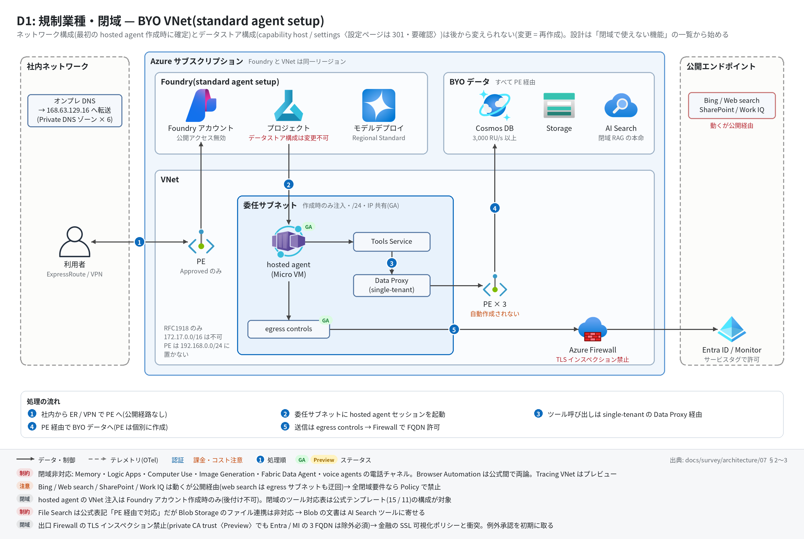
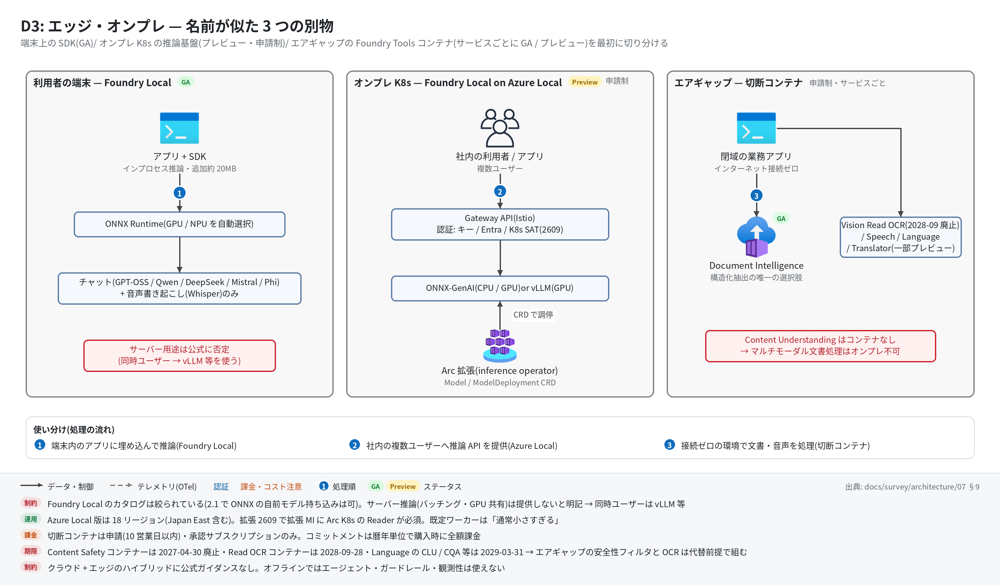

# 07. ユースケース編 D — 規制業種・閉域・データ主権・エッジ

[← アーキテクチャ TOP](./README.md)

> **最終更新:** 2026-07-30(公式ドキュメントとの突合検証で訂正) / 2026-09-04(§3 のツール表を configure-private-link 2026-08-14 版で改訂)/ 2026-09-26(四半期更新: 委任サブネットのアドレス範囲・Class A・同時セッション既定値、hosted agent の egress controls〈preview〉、データ処理範囲の定義変更、Azure Policy 適格性 GA、CMK の対象範囲、評価リージョン、Azure Government、Foundry Local on Azure Local 2607/2609 を一次情報で更新)/ 2026-10-06(hosted agent → Agent 365 の送信先〈FQDN `agent365.svc.cloud.microsoft` と `a365LoggingEnabled`〉、サービスタグの広さ、任意エンドポイントを遮断したときの影響表、voice agents のサブエージェントの VNet 非対応、トレース本文の保護テーブル、Anomaly Detector のサービス終了を反映) / 2026-10-14(差分更新: virtual-networks の本文改訂〈Firewall の許可 FQDN の具体化・プロビジョニング ID の経路別の区別〉、capability settings 設定ページの 301〈要確認〉、Browser Automation の GA 表明と閉域非対応の併存、Teams / M365 公開時の受信経路〈公衆インターネット・送信元 IP 照合〉、invocations のモデレーション設定の `textField` 必須化、Model router の既定プールへの Fireworks 3 モデル追加、Claude Haiku 5.5 / Grok 4.7 のデプロイ範囲、トレース本文の閲覧ロールの付与先、Voice Live の処理スコープ表記を反映) / 2026-11-22(features 差分更新〈10-14 以降+Ignite 2026〉の波及: **hosted agent の network egress controls が GA**〈安定版 api-version `2026-09-01`。Transform・`secretRef`・Azure Policy 統制は preview で日本リージョンなし〉、**サブネット IP 共有 GA**〈/24 で計画上 6 万セッション、実効上限は同時セッションクォータ〉・PE を `192.168.0.0/24` に置かない・ネットワーク構成は最初の hosted agent 作成時に確定、private CA trust〈preview〉と TLS 検査の関係、閉域プロジェクトでは voice agents の電話チャネルと発信が不可、Browser Automation の閉域対応が公式間で割れた、Foundry IQ (Azure AI Search) への改称と KB の fail-open・取り込みの trusted-service バイパス、Web search の経路別条項、hosted エンドポイント公開の記述消失〈要確認〉、CMK の Responses API 行、エージェント種別・イメージ・ツール・egress の Azure Policy〈preview、日本なし〉、Model router の Policy は要求時に効かない件、GPT-6.x の APAC Data Zone・managed compute に APAC なし・Baseten / fal の DPA 対象外、**Modified Abuse Monitoring の縮小**、Purview 画面の移動、red teaming の 4 リージョン統一、Content Safety コンテナー 2027-04-30・Read OCR コンテナー 2028-09-28 の廃止、Foundry Local 2.1 の BYOM) / 2026-11-22 訂正(Foundry IQ: ユーザートークンを渡さないときの KB の挙動は Learn のページで食い違うので両論に。閉域取り込みの tier を S2 / S3 / L1 / L2 と明記)

金融・公共・医療など、**ネットワーク分離とデータ所在を先に決めなければ設計が始まらない**類型。このページの内容は [03. 選定ガイド](./03-decision-guide.md) の G1(データ・規制ゲート)と G2(ネットワークゲート)の詳細版にあたる。

## この章で最初に伝えるべき 3 つの事実

1. **ネットワーク構成は Foundry アカウント作成時にしか決められない。**後付け不可、委任サブネットの変更も不可。変更したければ**再デプロイ**。「PoC は basic で始めて本番で standard + VNet に切り替える」という計画は**アカウント再作成を必須とする。**(2026-11-22: networking-options〈ms.date 2026-10-28〉は加えて「**ネットワーク構成は最初の hosted agent 作成時に確定し、以後ネットワーク注入は変更できない。別構成にするには新しいプロジェクトを作る**」と明記)
2. **閉域を選ぶと使えなくなる Foundry 機能がかなりある。**特に **Memory・Logic Apps・Computer Use・Image Generation・Fabric Data Agent** は非対応、**Tracing VNet と Workflow Agents の outbound は未対応 / プレビュー**。File Search は公式表記が「対応」に変わったが、Blob Storage のファイル連携は非対応(§3)。**Browser Automation は 2026-11 に configure-private-link の表で「Supported」に変わったが toolbox-network-isolation は Not supported のままで割れている**(§3)。**voice agents の電話チャネル(Teams Phone / Twilio / SIP)と発信も閉域プロジェクトでは不可**(2026-11-22)。設計は「使える機能の一覧」から始める。
3. **「日本国内処理」を保証できるのは `Standard` または `ProvisionedManaged`(Regional Provisioned)だけ。****APAC Data Zone は日本以外(豪・韓・星・印)も含むため、多くの日本の規制要件では不十分。**(2026-09-26 注: deployment-types 2026-08-06 版は両者の処理範囲を「顧客指定の Azure ジオグラフィ内」に書き換えた。日本ジオ内=東日本/西日本間の処理はありうる → §5)

---

## 1. 最上位の分岐 — 3 つの egress モデル

Foundry のネットワーク設計は「**egress(送信)モデルを先に決める**」のが公式の意思決定順序。egress の選択が inbound の選択肢を決める。

| Egress モデル | Inbound の選択肢 | 適する場面 |
|---|---|---|
| **Public egress** | パブリック(IP 制限可)/ VNet 内 Private Endpoint | egress 分離なし。PE を付けても**呼び出し元制限だけ**でエージェントの送信は公開網 |
| **BYO Virtual Network**(サブネット注入) | VNet 内 Private Endpoint | 完全分離。IP レンジ・ピアリング・ルーティングを自社統制 |
| **Managed Virtual Network**(Microsoft 管理) | VNet 内 Private Endpoint | 完全分離だが IP 管理をしたくない / IP レンジが重複する場合 |

### BYO VNet と Managed VNet の公式比較

| 観点 | Managed network | Custom (BYO) network |
|---|---|---|
| メリット | Microsoft がサブネットレンジ・IP 選択・委任を処理 | **フルコントロール:** 自前 firewall、UDR、ピアリング、サブネット委任 |
| 制約 | approved-outbound で**自前 firewall を持ち込めない。**オンプレ接続は Application Gateway 必須。**outbound ログ未対応** | セットアップが複雑。RFC1918 必須、最小 `/27` |

**Managed VNet を規制案件で選びにくい理由:**
- **Azure Portal UI での作成が未対応**(Bicep / Terraform / `az rest` のみ)。
- **自前 Azure Firewall を持ち込めない。**`AllowOnlyApprovedOutbound` + FQDN ルールで**マネージド Firewall が自動作成され課金される**(既定 SKU = Standard。高度な機能が不要なら Basic も選択可。**デプロイ後に SKU 変更不可**。**マネージド Firewall は Foundry アカウントごとに 1 つ作られ、複数アカウントで共有できない**。FQDN ルールはポート 80 / 443 のみ — managed-virtual-network 2026-08-18 版、2026-09-26 確認)。
- **outbound トラフィックのログ機能が未対応**と比較表に明記。
- マネージド Private Endpoint は**顧客サブスクリプションに NIC として現れない**(可視性なし)。
- モードは一方向。`AllowInternetOutbound` → `Disabled` 不可、`AllowOnlyApprovedOutbound` → `AllowInternetOutbound` 不可。**有効化後の無効化も不可。BYO VNet からの移行パスもない。**

> **「出口通信のログを保全できない」「Firewall が自分のテナントにない」の 2 点は、通信ログ保全を求める規制要件に対する説明が難しい。**IP 空間重複という運用上の事情がない限り、**BYO VNet + 自前 Azure Firewall(ログを Log Analytics に集約)が説明性の面で有利**というのが本ドキュメントの判断(公式にこの優劣の記述はない)。

**Managed VNet の対応リージョンには Japan East が含まれる。**

---

## 2. BYO VNet(Standard agent setup)の設計

### 委任サブネット要件

| 項目 | 値 |
|---|---|
| 委任先 | `Microsoft.App/environments` |
| 最小サイズ | **`/27`**(後から変更不可) |
| 推奨サイズ | **`/24`**(hosted agent がある本番)。deep dive は「本番で `/27` を使うな」、networking-options は「prompt agent 中心なら `/27` でも本番可」と書き分けが揺れる |
| サブネットと同時セッション | ~~既定は **usable IP : セッション = 1:1**。`/27` ≈ 20、`/26` ≈ 50、`/25` ≈ 100、`/24` ≈ 250、`/22` ≈ 1,000 セッション(ピークは usable IP の 80% 未満で計画)。サポート申請で最大 1:10 まで引き上げ可~~ → **2026-11-22 更新: hosted agent のセッションがサブネット IP を共有する方式が GA**(各セッションは VM 分離のサンドボックスのまま。申請不要で全員に適用 — devblogs 2026-11-18)。計画上の容量は **`/27` ≈ 7,500・`/26` ≈ 15,000・`/25` ≈ 30,000・`/24` ≈ 60,000 セッション**(〜`/20` ≈ 960,000。アカウント内の全プロジェクト合計で保証値ではない。agents-networking-deep-dive 2026-11-09 版 / networking-options 2026-10-28 版)。**実効の上限は下の同時セッションクォータ**になり、見積もりは「1 セッション 1 IP」から「クォータ律速」に変わる。本番は引き続き `/24` 以上を推奨(基盤のアップグレード時に新旧が並走して一時的に IP を余分に使う)。プロジェクト単位のネットワーク部品は IP を消費し、**IP が尽きると新規プロジェクトのプロビジョニング・データプロキシのスケール・hosted セッションの作成 / 再開が失敗**(兆候はデータプロキシの 5xx と `429 subnet_exhausted`。ポータルでサブネットの IP 使用率は見られない)。prompt agent はバージョンごとに IP を消費せず、プロジェクトあたり最大約 10 IP の固定プール |
| 共有可否 | **Foundry リソースごとに専用サブネット必須**(VNet は共有可)。アカウント内の全プロジェクトが同じサブネットを共有 |
| アドレス範囲 | **RFC1918(`10/8`・`172.16/12`・`192.168/16`)。**パブリック IP レンジ(`44.x.x.x` 等)は不可。**CGNAT(RFC 6598 `100.64.0.0/10`、`100.100.0.0/17` 等を除く)は公式間で揺れ**: virtual-networks(2026-08-27 更新)・networking-options(2026-09-09 更新)は「使用可」、agents-networking-deep-dive(2026-09-07 版)は「非対応・ルーティング障害」 → **RFC1918 に留めるのが安全**(2026-10-14 再確認でも不変。virtual-networks 自身も制限節は RFC 6598 可なのに、トラブル表の「不正な IP 範囲」エラーは「Valid RFC1918 ranges include …」とだけ書くページ内の不整合がある。**2026-11-22: 3 ページとも改訂されたが矛盾は解消されず**〈networking-options 10-28・virtual-networks 11-17 = RFC 6598 可 / agents-networking-deep-dive 11-09 = 「RFC 1918 only」「CGNAT … cause routing failures」〉、devblogs 2026-11-21 の閉域チェックも RFC 1918 のみを挙げる) |
| Class A(`10.x`) | **Agent Service の全提供リージョンで対応**(virtual-networks 2026-08-27 更新版。limits-quotas-regions の「Private VNet」列も全リージョン Yes) |
| リージョン | **Foundry リソースと VNet は同一リージョン必須**(Cosmos DB / AI Search / Storage は別リージョン可。越境コストに注意) |

> **日本リージョン(2026-09-26 更新):** 前版の「Japan East は Class A 対応、Japan West は非対応」は解消。limits-quotas-regions(ms.date 2026-09-07、2026-09-25 更新)で **Japan West も Private VNet = Yes**、virtual-networks も「Agent Service の全リージョンで Class A 対応」に変わった。国内 DR で West を使う場合も `10.x` を割り当てられる。

**ピアリング先 VNet も含めて、予約レンジ(`169.254.0.0/16`、`172.30.0.0/16`、`172.31.0.0/16`、`192.0.2.0/24`、`0.0.0.0/8`、`127.0.0.0/8`、`100.100.0.0/17`、`100.100.192.0/19`、`100.100.224.0/19`)と重複してはならない**(virtual-networks 2026-08-27 更新版。前版の「`100.64.0.0/11`」は現行の列挙に無い)。ピアリング VNet は一意で重複しない IP レンジが必須で、重複が避けられない場合は Managed VNet を使えと明記されている。

**同時セッションのクォータ(サブネットとは別枠):** hosted agent の同時セッションは**サブスクリプション × リージョン単位**(全アカウント・プロジェクト合算。idle / stopped は数えない)で、既定は **Japan East を含む 7 リージョンが 2,000、その他(Japan West を含む)が 1,000**(limits-quotas-regions 2026-09-07 版)。超過は `429 session_quota_exceeded`、リージョン容量不足は `429 regional_session_quota_exceeded`、サブネット IP 枯渇は `429 subnet_exhausted`。サブネットを大きくしてもこのクォータは増えない。**2026-11-22: サブネット IP 共有の GA で、ピーク見積もりの律速はサブネットではなくこのクォータになった**(Ignite の「より多くの同時セッション」はクォータ増ではない。既定値 2,000 / 1,000 は limits-quotas-regions 2026-11-18 版でも不変)。

### BYO 必須リソースと Cosmos DB の RU/s

Standard setup は **Storage / AI Search / Cosmos DB の 3 つすべて**を渡さないと capability host 作成が失敗する。

**Cosmos DB はアカウント合計 3,000 RU/s 以上が必須**(コンテナーは 3〜5 個 × 各 1,000 RU/s。基本 3 個+Responses API 利用エージェントの初回起動で 2 個が追加作成される。排他ではなく追加関係で、Responses 利用時はプロジェクトあたり実質 5,000 RU/s)。**複数プロジェクトならプロジェクト数分を乗算する。**RU/s 不足は capability host プロビジョニング失敗の直接原因。

| コンテナー | 用途 | ランタイム |
|---|---|---|
| `thread-message-store` | エンドユーザー会話 | Classic |
| `system-thread-message-store` | 内部システムメッセージ | Classic |
| `agent-entity-store` | エージェントメタデータ | Classic |
| `agent-definitions-v1` | エージェントメタデータ + バージョン | **New** |
| `run-state-v1` | 内部メッセージ + 会話 | **New** |

> **⚠ capability host は作成後に更新できない。**構成変更には capability host の削除・再作成が必要(プロジェクト削除は不要。ただし削除で既存エージェントの会話・ファイルへのアクセスは失われる)。**IaC の冪等更新が効かない最大のポイント。**
>
> **2026-09-26 追記 — 後継の「capability settings」(プレビュー):** アカウント / プロジェクトの `capabilitySettings`(`documentStore` = Cosmos DB、`vectorStore` = Cosmos DB または AI Search、`blobStore` = Storage)でデータストアを宣言する方式が追加され、capability-hosts ページは「参考として保持」扱いになった(configure-capability-settings ms.date 2026-09-22 / capability-hosts 2026-09-25 更新)。ただし **API `2026-07-15-preview`、提供は UK South / Canada Central のみの段階展開**で、日本リージョンの案件は当面 capability host(後方互換フロー)のまま。capability settings でも**既存プロジェクトへの追加・更新は不可(プロジェクトの削除・再作成)**、ネットワーク注入と同時に作成時設定が前提なので、「作り直し前提」の性質は変わらない。プロビジョニング ID が呼び出し元(CI/CD の SP 等。Storage Blob Data Contributor / Cosmos DB Operator が必要)に変わる点は権限設計に効く。
>
> **2026-10-14 更新:** (1) **要確認 — capability settings の設定ページ(configure-capability-settings)は 301 で agents/environment-setup に転送され、転送先に capability settings の記述がない**。capability-hosts・standard-agent-setup・virtual-networks は旧 URL を参照したまま capability settings を前提に書かれており、取り下げか移設中かは判断できない(展開リージョンも再確認不能)。日本リージョンの案件は引き続き capability host 前提で設計する。(2) virtual-networks の現行版(en-us の updated_at は 2026-08-27 のまま本文が改訂。ja-jp は 10-08 更新)は**プロビジョニングの ID を経路で区別**した — **ARM REST / Bicep で capability settings を送る場合は呼び出し元 ID**(対話ユーザー・CI/CD のサービスプリンシパル・ワークロード ID)が Storage Blob Data Contributor と Cosmos DB Operator を要し、**ポータルと旧 capability host REST の経路は引き続きプロジェクト MI がプロビジョニング**する(公式の閉域 Standard の Bicep サンプルも capability host 方式+プロジェクト MI)。**実行時に Cosmos DB / AI Search / Storage へ届くのはどちらの経路でもプロジェクト MI** で、呼び出し元のロールはその代わりにならない。トラブル表も「既存プロジェクトの capability settings は更新できないので削除→再作成」「汎用エラーは経路別に権限を確認」と改訂。→ CI/CD のサービスプリンシパルに BYO リソースのデータロールを付けるかは経路で決まるので、IaC の経路を先に決めてから権限表を作る

**なお BYO VNet でもデータリソースは「platform-managed」を選べる**(テンプレート `11-private-network-basic-vnet`)。**「閉域にしたいがデータストアの運用は持ちたくない」場合の選択肢**として覚えておく。BYO データリソースが要るなら `15-private-network-standard-agent-setup`。

### Private Link のサブリソースと DNS ゾーン

| リソース | サブリソース(group ID) | Private DNS ゾーン |
|---|---|---|
| **Foundry** | `account` | `privatelink.cognitiveservices.azure.com` / `privatelink.openai.azure.com` / `privatelink.services.ai.azure.com` |
| Foundry IQ (Azure AI Search)(2026-11 に Azure AI Search から改称。リソースプロバイダー `Microsoft.Search`・`*.search.windows.net`・RBAC・課金メーター名は不変) | `searchService` | `privatelink.search.windows.net` |
| Azure Cosmos DB | `Sql` | `privatelink.documents.azure.com` |
| Azure Storage | `blob` | `privatelink.blob.core.windows.net` |
| Container Registry(hosted agent) | `registry` | `privatelink.azurecr.io` |
| Application Insights | AMPLS 経由 | `privatelink.monitor.azure.com` ほか 3 種 |

**落とし穴:** Foundry リソースをデプロイしても、**AI Search / Storage / Cosmos DB の Private Endpoint は自動作成されない。**各リソース側で別途作成が必要。

**オンプレ DNS を使う場合:** `privatelink` サブドメインを VNet の Private DNS ゾーンに委任するか、条件付きフォワーダーを **Azure DNS 仮想サーバー `168.63.129.16`** に向ける。

**Private Endpoint 側の制限:** VNet と**同一リージョン・同一サブスクリプション**に配置必須。**Approved 状態の PE のみトラフィックを通す。**VNet に **`172.17.0.0/16` は使用不可**(Docker bridge 予約)。**2026-11-22 追加: プライベートエンドポイントを `192.168.0.0/24` に置かない** — hosted agent のサンドボックス内部ネットワークと重なり、DNS は引けても接続が `EHOSTUNREACH` になる(回避は PE を範囲外へ移して private DNS を更新。virtual-networks 2026-11-17 版)。既存の閉域環境で PE を `192.168.0.x` に置いている顧客は、hosted agent 導入前にアドレス計画を見直す。

### トラフィックフロー

- **Hosted agent:** Client → Foundry endpoint → 委任サブネット内の **Micro VM** → Tools Service → **Data Proxy** → PE 経由で顧客リソース
- **Prompt agent:** Client → Foundry endpoint → Tools Service → Data Proxy → PE 経由(Micro VM を経由しない)

Micro VM は専用 NIC を持ち自身の送信は直接出るが、**ツール呼び出しは必ず single-tenant data proxy を経由する。**data proxy はプロジェクトごとに 1 つの専用インスタンス。

### Firewall / NSG / UDR

**許可が必要な FQDN / サービスタグ:**

| シナリオ | FQDN / タグ |
|---|---|
| Agents | `*.identity.azure.net`、`login.microsoftonline.com`、`*.login.microsoftonline.com`、`*.login.microsoft.com` または **`AzureActiveDirectory` サービスタグ** |
| Evaluations & Traces | `settings.sdk.monitor.azure.com`、`*.livediagnostics.monitor.azure.com`、`*.in.applicationinsights.azure.com`、`AzureMachineLearning` タグ |
| Fine-tuning | `raw.githubusercontent.com`(ポータルでキュレート済みサンプルデータセットを選ぶ場合) |
| Hosted agents → Agent 365 | **`agent365.svc.cloud.microsoft`(FQDN)または `AzureFrontDoor.Frontend` サービスタグ(TCP 443)**。hosted agent から A365 の可観測性 / トレースエンドポイントへ(configure-private-link 2026-09-29 版。2026-08-14 版はサービスタグのみ)。**任意 — 下の「任意エンドポイントを遮断したときの影響」参照** |
| hosted agent のソースコード(ZIP)デプロイ | `mcr.microsoft.com`、`*.login.microsoft.com`(deploy-hosted-agent-code、2026-09-21 更新) |
| Managed VNet 追加分 | `mcr.microsoft.com`(managed-virtual-network では Agents 行に含まれる) |

**2026-10-14 追記 — BYO VNet の Azure Firewall で許可する宛先(virtual-networks の本文改訂):** エージェントの委任サブネットからの送信を Azure Firewall に通す場合の許可先として、**`control-{region}.identity.azure.net`・`{region}.login.microsoft.com`・`login.microsoftonline.com`**(`{region}` はエージェントのリージョン)が明記され、加えて Managed Identity 用 FQDN 一覧または `AzureActiveDirectory` サービスタグ、NSG にも同等の送信許可を、と具体化された(旧版は「Managed Identity の FQDN か `AzureActiveDirectory` タグ」のみ)。上表 Agents 行のワイルドカード(`*.identity.azure.net` 等)を FQDN で絞りたい Firewall では、この 3 つを最低限の明示リストとして使える。en-us の updated_at は 2026-08-27 のまま本文が変わっており(Web アーカイブの 2026-09-19 版との比較)、**改訂時期は 09-19〜10-14 の間としか言えない** — Firewall の許可リストは updated_at に頼らず本文で突き合わせる

**2026-10-06 追記 — サービスタグの広さと、任意エンドポイントを遮断したときの影響(configure-private-link 2026-09-29 版):**

- **サービスタグは Azure サービス全体の IP 範囲で、テナント・サブスクリプション・リソースに絞れない。**`AzureFrontDoor.Frontend` は Azure Front Door 宛ての全通信を含むので、狭く許可したいなら FQDN(`agent365.svc.cloud.microsoft`)で許可する。サービスタグ非対応の FQDN フィルタ型 Firewall でも FQDN を使う
- 公式は「特定機能にしか要らないエンドポイント」を遮断したときの影響を表にした:

| FQDN | 遮断した場合 | 通信自体を止める方法 |
| --- | --- | --- |
| `agent365.svc.cloud.microsoft` | hosted agent は動き続け応答もするが、**トレースが Agent 365 に送られず、Firewall に拒否ログが溜まり続ける**(セッション実行中は接続を繰り返す) | Foundry リソースの **`a365LoggingEnabled=false`**。変更後に開始したセッションから接続しなくなる(既存セッションは終了まで試行を続ける) |
| `raw.githubusercontent.com` | ポータルのファインチューニングで用意済みのサンプルデータセットを選べない(自前の学習データは影響なし) | サンプルデータセットを選ばない |

- **なぜ Agent 365 宛てが出るか:** hosting ライブラリ(`azure-ai-agentserver-core` / `agent-framework-foundry-hosting`)で作った hosted agent は、`a365LoggingEnabled` が `true` なら Agent 365 へトレースを自動で送る(configure-agent-365-data-collection 2026-09-29 版。旧版は「Agent 365 SDK を組み込まない限り流れない」)。**Agent 365 が有効なテナントでは既定 `true`**(リソース単位、Azure Policy で一括拒否可)。送り先の保存場所は **Entra テナントの所在地(ジオ)基準**で、Foundry のリージョン基準とは別になる(agent-365-integration 2026-08-26 版。同ページは hosted agent の送出を「明示的な構成が必要」のままとしており公式間で食い違う)。**データ主権要件のある案件では、Firewall で遮断するより先に `a365LoggingEnabled=false` を IaC で明示する**(本ドキュメントの判断。拒否ログの雑音と、許可漏れの別環境で送出が始まる事故を両方防ぐ)。トレースの中身の扱いは [09 §3.6](./09-operations.md#3-6-トレースに会話の中身を残すか-hosted-agent-の選定基準)

加えて **Azure Container Apps 側の Managed Identity 系 FQDN** も許可が必要。評価については `AzureMachineLearning` タグの代わりに `*.dataproxy.{region}.api.azureml.ms` と `{region}.api.azureml.ms`(評価実行リージョン)を許可する方式も案内されている。

> **⚠ TLS インスペクション禁止(最重要):** 「Firewall で TLS インスペクションが行われ自己署名証明書が付加されないことを確認せよ」と明記され、Architecture Center 側でも「**このトラフィックに Azure Firewall の TLS インスペクションを適用するな。検査時の証明書がエージェントの接続を壊す。**」と明言されている。
>
> **多くの日本の金融機関で標準になっている「出口 Firewall での SSL 可視化」ポリシーと正面衝突する。**設計初期に例外承認を取る必要がある。
>
> **2026-11-22 追記 — private CA trust(preview)を入れても、この禁止は解けない:** hosted agent / データプロキシ経由のツールが自社 CA の証明書を信頼できる **private CA trust**(パブリックプレビュー。[private-certificate-authority](https://learn.microsoft.com/en-us/azure/foundry/agents/how-to/private-certificate-authority) ms.date 2026-11-18)が出たが、公式は「**プラットフォーム自身の Entra ID / マネージド ID 通信には効かない。Firewall がそれを TLS 検査すると、Firewall の CA を登録してもエージェント一覧・会話の取得がタイムアウトする**」と明記し、**`login.microsoftonline.com`・`{region}.login.microsoft.com`・`control-{region}.identity.azure.net` を TLS 検査の対象から外せ**としている(devblogs 2026-11-21「Hosted agents in your own virtual network: five checks…」も再現試験で同じ結論)。virtual-networks(2026-11-17 版)の「Firewall で TLS 検査が行われないことを確認せよ」も残っている。→ **例外承認の範囲は「エージェントサブネットの通信全体の TLS 検査除外」が既定で、最低でも上記 3 FQDN の除外は必須**(本ドキュメントの判断。private CA trust は社内 CA の API・MCP サーバー・モデルゲートウェイへ証明書検証を有効にしたまま繋ぐための機能で、TLS 検査を許すための機能ではない)。private CA trust 自体の前提は **BYO VNet の閉域プロジェクト(ツール・toolbox・BYOM の経路)・ポータル非対応(CLI / Bicep / Terraform、アカウント API `2026-07-15-preview`)・CA 証明書は Key Vault のシークレットに版固定で置き Foundry リソースの MI が読む・mTLS とリモートビルドは非対応**

**サブネット別の統制**は [01 章の Baseline アーキテクチャ](./01-official-baselines.md#b-baseline-本番の出発点-waf-が-ai-ワークロードの推奨アーキテクチャ-と名指し)の表を参照。公式の追加推奨として、**強制トンネリングをサポートする全サブネットに適用する**(egress を想定しないサブネットにも多層防御として)、**Azure Firewall はリージョン内の全可用性ゾーンにデプロイする**(egress の単一障害点であるため)、**高い同時 outbound 接続数がある場合は複数パブリック IP を構成して SNAT ポート枯渇を回避する**、が挙げられている。

---

## 3. 閉域で使えない機能の一覧(設計の出発点)

### エージェントツールの互換性

| ツール | 状況 | トラフィック経路 |
|---|---|---|
| MCP Tool(Private MCP) | 対応 | **自 VNet サブネット経由** |
| Azure AI Search(2026-11 の表では「Foundry IQ」行に改称) | 対応 | **Private Endpoint 経由** |
| OpenAPI tool / Azure Functions / A2A | 対応 | 自 VNet サブネット経由 |
| Function Calling | 対応 | Microsoft バックボーン |
| Foundry IQ(ツール表では「(preview)」表記) | 対応 | MCP 経由。GA 一覧は Partial GA(API GA・ポータル Preview)で表記が割れる |
| **Code Interpreter** | **部分** | **ファイルの上り下りを伴わないシナリオのみ動作。**回避策は SDK でコンテナーを作り `container_id` を渡す(**ポータル UI では不可**)。configure-private-link 2026-08-14 版は「✅ Microsoft backbone」表記だが、virtual-networks ページは BYO 構成でのファイル I/O 不可を維持 |
| **Bing Grounding / Websearch / SharePoint Grounding** | 動くが**パブリックエンドポイント経由** | ↓ 下記の警告 |
| Fabric IQ | 部分 | Fabric アイテム種別依存(Power BI セマンティックモデルは**パブリックアクセスのみ**) |
| **Fabric Data Agent** | **非対応** | Fabric 側でパブリックネットワークアクセス有効が必須 |
| **Logic Apps** | **非対応** | 開発中 |
| **File Search** | **表記変更あり(要注意)** | configure-private-link 2026-08-14 版で「✅ Through private endpoint」に変更(2026-07 時点は Not supported)。**Blob Storage のファイルを File Search で使う構成は非対応のまま**(virtual-networks) |
| **Browser Automation** | ~~**非対応**~~ → **公式間で割れる(2026-11-22)** | ~~開発中~~ → **configure-private-link(ms.date 2026-09-29 のまま 11-17 に本文改訂)は「✅ Supported / Through your VNet subnet in Playwright Workspaces」**、**toolbox-network-isolation(ms.date 08-03、11-17 更新)は Not supported のまま**、ツールの概要ページ・devblogs は private website(Playwright Workspace に委任サブネットを紐付ける VNet 注入)を preview と書く。ステータス自体もページ本文・TOC = GA / 移行ガイドの表 = preview。**閉域では「toolbox 経由は不可、直付けは Playwright Workspaces の VNet 注入〈preview〉前提」と読み、実測で確かめるまで提案の必須経路に置かない**(本ドキュメントの判断)。prompt agent に Key Vault の資格情報を渡すとモデルが値を参照できる、とツールページが注記している点も規制案件では確認する |
| **Computer Use** | **非対応** | 開発中(2026-11: ツール自体は Learn 本文・devblogs で GA を表明したが、閉域の表は Under development のまま) |
| **Image Generation** | **非対応** | 開発中 |

**2026-11-22 注記(configure-private-link の表の適用範囲):** 表は「**テンプレート 15(Standard)と 11(Basic+BYO VNet)で作った閉域構成**の、新 Responses API エージェント」が対象と明記され、閉域でのツール実行サンプルとしてテンプレート 19(hybrid-private-resources)が案内された。同ページには「VNet 経由でツールを呼ぶ前に**プロジェクトレベルの capability host** を用意せよ(アカウントレベルだけでは名前解決エラーで失敗)」の Important もある(2026-11-22 取得版で確認。追加時期は未確認)。

> **金融・公共での決定的な論点:** Bing Grounding / Websearch / SharePoint Grounding は「動く」が**パブリックインターネット経由である**とドキュメント自身が明記している。「すべての通信をプライベート網に閉じる」要件があるなら、これらは**要件を満たさない。**ブロック手段として **Azure Policy による利用禁止**が公式に案内されている。
>
> さらに Architecture Center 側では「**web search ツールは `api.bing.microsoft.com` を呼ぶが、Agent Service が内部機構で呼ぶため egress サブネットを完全にバイパスする**」と明記。「443 を許可すれば Firewall を通るだろう」という想定が成り立たない。**全ツールを実測で検証せよ**と書かれている。
>
> **2026-11-22 追記 — Web search は経路でデータ境界の条項が違う:** web-search(ms.date 2026-11-10)で、prompt agent / Responses API に**直付けした general web search は Web IQ**(Web IQ の利用条件に従い Azure コンプライアンス境界外で処理されうる)、**toolbox に入れた web search は従来どおり Grounding with Bing Search**になった。**「DPA 非適用・コンプライアンス / 地理境界外への転送・GCC 等の高度なコミットメントの放棄」の明記は Grounding with Bing 側(toolbox 経由・Custom search)の注記**で、直付けか toolbox 経由かで適用条項が変わる。`external_web_access` は「常に false として扱い、true にしてもライブのインターネットアクセスは有効にならない」と明記。閉域の扱い(「Web grounding tools don't respect VPN or private endpoints」)は不変 → 規制案件では経路ごとに条項を法務と照合するか、管理者の無効化設定(`OpenAI.BlockedTools.web_search`)か Azure Policy で両経路とも止める

**File Search は公式表記が「対応」に変わったが、Blob Storage のファイルを File Search で使うことは別途「非対応」と明記されている。**Blob 上の文書を閉域で使うなら **Azure AI Search ツール(PE 経由・対応)** に寄せる(→ [04 章の A2/A3](./04-usecase-chat-rag.md))。ただし **閉域のツール対応表は公式テンプレート(15-private-network-standard-agent-setup / 11-private-network-basic-vnet)で作った構成が対象**で、AI Search ツールのページも「**VNet 注入なしのエージェントは private endpoint 付きの Search に接続できないことがある**」「Basic エージェントデプロイはパブリックアクセス無効の Search をサポートしない」と明記している(→ [04 章 A3 の制約](./04-usecase-chat-rag.md#a3-既存-ai-search-資産の活用-ai-search-ツール直結))。

**2026-11-22 追記 — Foundry IQ(knowledge base)を閉域で使うときの 3 つの穴:**

- **権限トリミングは fail-open の可能性がある:** KB 接続は、呼び出し主体がユーザーなら Agent Service が `x-ms-query-source-authorization` をユーザー文脈で自動設定する。**ユーザートークンがないときの挙動は Learn のページで食い違う** — [foundry-iq-connect](https://learn.microsoft.com/en-us/azure/foundry/agents/how-to/foundry-iq-connect)(ms.date 2026-11-09)は「権限付きソースをフィルターせずに結果を返す」、[agentic-retrieval-how-to-retrieve](https://learn.microsoft.com/en-us/azure/search/agentic-retrieval-how-to-retrieve)(11-09)と [query-time ACL](https://learn.microsoft.com/en-us/azure/search/search-query-access-control-rbac-enforcement)(11-06)は「ACL 付きの文書は返さない」と書く(2026-11-22 確認。features/04)。foundry-iq-connect の記述どおりなら、アプリ ID で呼ぶ構成・バッチ・ルーチン起動では「全員に全文書が見える」になりうる → ユーザーを表さない呼び出しでは structured inputs でユーザートークンを渡すか、権限付きソースを KB に入れない
- **取り込みの埋め込み呼び出しは trusted-service バイパス頼み:** 私設 agentic retrieval のチュートリアル(ms.date 2026-11-04)は、取り込み時の埋め込み呼び出しが Foundry の trusted-service バイパスに依存し(`openai_account` の shared private link では運ばれない)、**バイパスを切ると 403「Public access is disabled」**になると明記。S3 HD / Serverless には適用不可。新設の agentic-retrieval-network-security(11-04)は経路別(取り込み・埋め込み・クエリ時モデル・リモートソース・資産ストレージ)の確認を求める → 「trusted services バイパス全面禁止」ポリシーの顧客では、CMK の Key Vault(§5)と同じく例外承認の対象になる
- **indexed ナレッジソースの自動生成インデクサーは private 実行環境に非対応**(configure-private-link の 11-17 版。インデクサーを `executionEnvironment: "Private"` にできないので、PE の向こうのデータソースは「サイレントに空インデックス」になりうる — 下の「その他の運用上の制約」の最後の項目と同じ穴)。SharePoint (indexed) ナレッジソースの private ingestion は Dedicated 層のみで GA、Serverless 層は private ingestion 不可 → 閉域本番の Foundry IQ は Dedicated 層前提([04](./04-usecase-chat-rag.md))

### 機能レベルの非対応

| 機能 | 状況 |
|---|---|
| **Traces** | トレース本体は prompt / hosted agent で GA、**Tracing VNet は Preview**(GA 一覧 2026-08-14 版)。閉域の監査主系には置かず、自前 OTel + App Insights(AMPLS)を主系にする |
| **Memory** | **VNet 非対応** |
| **Work IQ**(2026-11-22: work-iq ms.date 11-09 は「標準 MCP ツールで Work IQ MCP エンドポイントに繋ぐ経路は GA、組み込み `work_iq_preview` は preview」と書き分け / devblogs 11-18 は preview の両論) | 前版の「VNet 統合非対応」は更新: BYO VNet outbound 構成では**プロジェクトの single-tenant data proxy 経由**でルーティングされ顧客のネットワーク制御が効くが、**宛先は公開 HTTPS(`workiq.svc.cloud.microsoft`)のまま**で、リクエストは Azure コンプライアンス境界の外で処理されうると明記(work-iq 2026-09-04 版、2026-09-26 確認)。Bing / SharePoint と同じ「動くがプライベートではない」扱い |
| Evaluations の Synthetic Data Generation | **非対応**(自前データを持ち込んで評価する)。※出典の evaluation-regions-limits-virtual-network は `concepts/` 配下へ移動し(2026-08-18 更新)、VNet 節が見当たらなくなった → **現行の可否は要確認** |
| **Workflow Agents** | inbound は対応。**VNet 注入による outbound は非対応** |
| **AI Gateway(APIM)** | 新ポータルからプライベート Foundry に対して作れるが**自動的にパブリックになる。**Azure portal でゲートウェイ側のネットワーク分離を別途設定する必要 |
| **Foundry MCP Server** | ネットワーク分離未対応(Private Link 裏のリソース不可) |
| Teams / M365 への公開 | 可能だが**パブリックネットワーク無効プロジェクトではポータル不可・REST のみ**。**2026-10-14 追記(publish-copilot-virtual-network 2026-10-06 版):** 公開時の受信経路は、Microsoft 365 / Teams のチャネル基盤が**公衆インターネット経由で Activity Protocol ルートに到達**し、Foundry が送信元 IP を Bot Service / Microsoft 365 の範囲で照合 → チャネルトークン検証 → 認可、の順。**送信元 IP の範囲は複数テナントで共用されうるので IP 制限は多層防御の 1 つにすぎない**と明記。`enable_m365_public_endpoint` は受信側だけを変え、エージェントの送信は閉域の egress 規則に従う。PNA 無効でポータル公開が 403 になる場合は、ZIP 取得 API で作ったアプリパッケージを M365 管理センターでアップロードする代替がある。ゲストユーザーは呼び出せない → **「受信経路にインターネットを含めない」要件とは両立しない**([08 E5](./08-usecase-specialized.md#e5-m365-teams-連携))。**2026-11-22 追記(publish-copilot / publish-copilot-virtual-network ms.date 2026-11-12):** 公開に**別途の Azure Bot Service リソースは不要**になった(REST は `performBotRegistration: true` でエージェント ID と Activity Protocol エンドポイントを Teams Graph に直接登録)。制限事項の表に「**M365 / Teams のチャネルトラフィックは Private Link を使わない**」が明記され、上の受信経路の結論は変わらない |
| **voice agents(kind: voice)の電話チャネル(2026-11-22 追加)** | **閉域プロジェクト(VNet 注入、または Foundry リソースの公衆ネットワークアクセス無効)では、電話番号チャネル(Teams Phone extensibility / Twilio / SIP)と発信・outbound campaigns が非対応**と voice 系の各ページに明記(voice-agent-telephony-channels ms.date 2026-11-19 ほか)。voice agents 自体は Learn・SDK・ブログで GA、GA 一覧表「Agents — Voice Live」は Preview の両論([08 E1](./08-usecase-specialized.md#e1-音声エージェント-コンタクトセンター))。閉域が前提の案件で電話窓口を作るなら、**電話系だけ非閉域の別プロジェクトに分ける**か、**Voice Live API+ACS を自社ミドル層で使う**設計になる(本ドキュメントの判断)。post-call delivery(preview)は**プライベートエンドポイント専用の Event Grid トピックに送れない** |
| **voice agents(kind: voice)のサブエージェント** | ~~**VNet 分離プロジェクトでは非対応**(既存のテキストエージェントを専門サブエージェントとして呼ぶ構成が組めない。migrate-from-voice-live 2026-09-30 版。2026-10-06 追加)~~ → **2026-11-22 要確認:** delegate subagent は GA(同一プロジェクトのみ。concepts/voice-agent-subagents・use-delegate-subagent-voice-agent ms.date 2026-11-10)になり、**現行の migrate-from-voice-live(ms.date 2026-11-11)からは「VNet 分離プロジェクトでは非対応」の記述が消えた**(「Model, region, network, and transport restrictions still apply」の一般表現のみ)。新設の subagent ページにもネットワークの制約記述がない → 解消か記述の移動かは判断できないので、閉域では実機で確認するまで非対応前提で設計する |
| **hosted agents** | GA(2026-07-09 GA 告知。devblogs 7・8 月号 2026-09-09 で再明言)。公式は「既存のネットワークテンプレートで作った private Foundry に hosted agent をデプロイできる」とし、アウトバウンドの VNet 注入は prompt / hosted の両方に同じく適用される(configure-private-link)。**hosted agent の VNet 注入は Foundry アカウントの作成時にしか入れられない**(既存アカウントへの後付けは非対応 — virtual-networks)。private ACR は 2026-06-25 以降作成プロジェクトのみ(configure-private-link / virtual-networks とも 2026-09-26 時点で同文)。virtual-networks ページ(2026-08-27 更新)には azd 経路の「The agent endpoint stays public in this preview」が残存。**アウトバウンド先の制御は network egress controls(preview)で追加可** → 下記。**2026-11-22 更新:** (1) egress controls は **GA**(下記)。(2) **「エンドポイントは公開のまま」の記述は virtual-networks(ms.date 2026-11-17)の azd 節の書き直しで消えた** — 現行は「AI Services アカウントのデータプレーンは PE、プロジェクトはアカウントのネットワーク姿勢を継承」「Private networking and session isolation address different requirements」と書き、networking-options も「egress を VNet に閉じる構成では Foundry エンドポイントへのインバウンドも PE 経由」とする。**明示の否定もないので要確認** — 閉域要件の案件では、公開側から hosted agent のエンドポイントに到達しないことを受入試験で確かめる。(3) 閉域の切り分け用に troubleshoot-hosted-agent-networking(2026-11-09 新設。DNS → TCP → TLS → HTTP の層別診断)と devblogs 2026-11-21 の 5 項目チェック(`properties.networkInjections` でサブネット特定・「Listing agents timed out」は BYO Cosmos DB の private DNS か Entra 経路・TLS 検査除外・ハブ VNet の DNS リンク・削除済みアカウントの `DelegatedSubnetInUse`)が出た。(4) 顧客 AKS への配置(BYO-AKS)は coming soon(public preview は 12 月上旬目標)で、**egress controls と private CA trust の記述はマネージド hosted agent が対象**(BYO-AKS は顧客側のネットワーク制御を使う) |

### hosted agent の network egress controls(2026-09 プレビュー追加 → 2026-11 GA)

hosted agent の**送信先を FQDN ルールで制御する**機能が 2026-09-24 に紹介され(devblogs「Control where your hosted agent connects with network egress」)、**2026-11-18 に GA**になった(Learn の add-hosted-agent-guardrails ms.date 2026-11-11「Network egress controls are generally available for hosted agents, except for Transform rules, which remain in preview」、devblogs 2026-11-18「Hosted agents in Foundry Agent Service at Ignite 2026」)。**GA 一覧表(2026-11-17 版)には egress の個別行がなく、Guardrails — Agents / Controls and intervention は Preview のまま**なので、features と同じく両論併記で扱う。

| 項目 | 内容 |
|---|---|
| ステータス | ~~プレビュー(SLA なし・本番利用非推奨と明記)~~ → **GA(Transform ルールを除く)**。**preview のまま:** Transform ルール・シークレット参照 `secretRef`・Azure Policy による egress ガバナンス・Copilot harness の prompt agent への適用。対象は **hosted agent と、Microsoft Copilot harness(preview)を使う prompt agent**(それ以外の prompt agent・モデルデプロイには効かない) |
| 設定場所 | ガードレール(RAI policy)の `egressPolicy`。**API は安定版 `2026-09-01`**(旧 `2026-05-15-preview`。Bicep も `accounts@2026-09-01` / `raiPolicies@2026-09-01`)。ポータルはガードレールの Network コントロール、azd(Bicep)/ REST / Python SDK(`RaiConfig`)で agent version に付与 |
| ルール | 順序付き・先勝ち。Allow / Deny / **Rewrite**(宛先書き換え、GA)/ **Transform**(ヘッダー付与・置換、preview)。**ホストに加えてパスでも一致可**(例 `/public/*`)、ホストのワイルドカード可。既定アクション Deny / Allow。**モードは Audit(拒否相当をログのみ)→ Enforced** の順に移行(Audit でも Transform / Rewrite は実行される)。1 ポリシー最大 480 ルール |
| 強制点 | ~~Foundry 管理のエージェント sandbox 内のプロキシ~~ → **エージェントのサンドボックスの外**のプロキシで、送信先に届く前に強制(11-11 版の表現)。拒否時はエージェントに HTTP 403。判定は App Insights / トレースの「Network egress decision」スパンで確認。評価不能時は fail-closed。**実行中のセッションは開始時のポリシーのまま**なので、Enforced に切り替えたら新しいエージェント版をデプロイする |
| TLS | HTTPS を検査するため**ランタイムがプロキシの CA を sandbox の信頼ストアに注入**(約 30 日でローテーション。ピン留め・イメージへのコピー禁止)。顧客の社内 CA の信頼は別機能の private CA trust(preview。§2) |
| ヘッダー注入 | Transform(preview)の値ソースは Static・マネージド ID 値参照(デプロイ済みエージェントの ID に宛先側 RBAC が必要)・**シークレット参照 `secretRef`(preview。Canada Central / Spain Central のみ、プロジェクトのシステム割当て MI に Key Vault の読み取り権限、Key Vault のパブリックエンドポイントが必須で Private Endpoint・顧客 VNet 経由は不可)**。静的値に資格情報を入れるなと明記 |
| 組織統制 | **Azure Policy による egress ガバナンス(preview)= Canada Central / Spain Central / Korea Central のみ(日本リージョンなし)**。組み込み定義 4 本(制御プレーン 3 本 = RAI policy の基準〈Enforced・既定 Deny・許可先〉/ Rewrite 先 / ヘッダーと資格情報、データプレーン 1 本 = hosted agent の版が参照する egress 設定)。データプレーンの割当て変更は**反映まで 30〜60 分**、既存の版・稼働中セッションは非準拠と報告されるだけで止まらない([govern-hosted-agent-egress-azure-policy](https://learn.microsoft.com/en-us/azure/foundry/agents/how-to/govern-hosted-agent-egress-azure-policy) ms.date 2026-11-11) |
| IaC の落とし穴 | **`az group export` 等で `egressPolicy` を持たない古い api-version(例 `2026-07-01`)の RAI policy を書き出すと、コンテンツフィルターは残るが egress ルールが消える** → IaC は `2026-09-01` で定義し、稼働中の `egressPolicy` を GET して写す。egress だけのポリシーでも `contentFilters` は必須(ないと HTTP 400)。エージェント版は RAI policy の ID を参照するだけなので**ポリシーを先にデプロイ**。**RAI policy への書込み権限はそれを使うエージェントの更新権限と同等に扱え**と明記 |
| 旧版の制限で消えたもの | 「ホスト名マッチのみ」(パス一致が入った)・「Secret 参照ヘッダーは不可」(`secretRef` が preview で入った)。「サービスタグ・IP レンジ・MCP ツールポリシー・PII / DLP 検査は今後」の予定記述は 11-11 版から消えた(提供予定として提案に書かない) |

> **同ページのガードレール側の落とし穴(規制案件で必ず確認):** hosted agent に付けた RAI policy は、**invocations プロトコルでは `invocations_moderation`(`azure-ai-projects` 2.7.0 以降)でテキストの位置を宣言しないと無効(素通り)**で、デプロイも HTTP 200 も成功するため気づきにくい。また**存在しないポリシー ID を参照するとエラーなく fail-open**(フィルタなしで active になる)。デプロイ後にポリシー存在確認と遮断テストを必須にする。**2026-10-14 追記:** azd 拡張 `azure.ai.agents` 1.0.0-beta.19(2026-10-08)は invocations のモデレーション設定で **`textField` を必須化**した(CHANGELOG は「未指定だと出力のスクリーニングが黙って飛ばされていた不具合の修正」と説明)— 上の「素通り」と同じ穴が azd 経路にもあったことになるので、beta.19 より前の azd で作った invocations の hosted agent は設定を見直す。**2026-11-22 追記(add-hosted-agent-guardrails 11-11 版・新設の概念ページ hosted-agent-guardrails):** invocations で `response_mode` に**宣言していない形の成功応答は HTTP 502 で拒否**(モデレーションを飛ばさない)になり、activity プロトコル(M365 公開向け)は `rai_policy_name` だけで M365 への送信アクティビティまで検査される。エージェント境界のガードレール(Hosted agent content safety)は preview で、出力モデレーションは **Default(同期で保留して検査済みだけ返す)/ Asynchronous filter(先に流して後から止める)** を選ぶ — 規制案件は Default を既定にし、Asynchronous を選ぶならストリーム出力を暫定扱いにする。azd は `invocationsModeration` の構造は検査するが、パスが実際の本文に合っているかは検査しないので、遮断テストは引き続き必須。

> **位置づけ:** 公式は「Azure Firewall 等の自社ネットワーク制御を**置き換えるものではなく補完**」と明記している。規制案件では**主統制は BYO VNet + 自前 Firewall(ログ保全)**のまま、egress controls は「エージェント単位の宛先ホワイトリストを定義として版管理できる」追加層として扱う。Firewall 側の TLS インスペクション禁止(§2)とは別の話で、こちらはプラットフォーム内部で完結する検査である点に注意。**2026-11-22 追記:** GA 後も「補完」の位置づけは変わらない(11-11 版も同旨)。GA で変わるのは「本番の追加層として提案に入れられる」点で、**日本リージョンでは Azure Policy による組織的な強制(preview)が使えず、シークレット注入も Canada Central / Spain Central 限定**なので、日本の案件では「エージェント単位の許可リスト(GA)+ BYO VNet の Firewall(主統制)+ IaC レビューでの RAI policy の差分確認」で組む(本ドキュメントの判断)

> **Tracing VNet が Preview のままなのは監査要件に直撃する。**可観測性が要る規制ワークロードで、トレースだけパブリック Application Insights になる構成をどう説明するかが課題になる。**監査ログ設計を Purview Audit / Defender アラート / APIM ログ / アプリ独自の監査ログの組み合わせで再設計する**必要がある。
>
> **2026-10-06 追記:** トレースに入る会話の中身(GenAI の機微属性 7 種)は、公式では 2026-09-30 以降、専用テーブル `AppGenAIContent` に振り分けられ、Protected + Privileged Monitoring Data Reader で読み手を絞れる(preview)。ただし **2026-10-06 の実測(feature flag 未登録、japaneast)では本文が従来テーブル `AppDependencies` と `AppGenAIContent` に二重書きされ、従来テーブル側は通常の Log Analytics Reader で読めた** — フラグ登録または移行完了・Protected 化・ロール限定・`gen_ai.*` 以外に本文を書く計装(MAF のメッセージイベント等)の停止の 4 点をそろえ、従来テーブルに本文が残っていないことを KQL で確認してからでないと成立しない。「運用担当にトレースは見せるが中身は見せない」という規制案件の要件はこれで設計できる見込みだが、**記録そのものは止まらない**ので「中身を残さない」要件は App Insights を接続しない構成になる([09 §3.6](./09-operations.md#3-6-トレースに会話の中身を残すか-hosted-agent-の選定基準))。

### その他の運用上の制約

- **ACR のプライベート化は 2026-06-25 以降に作成したプロジェクトのみ。**それ以前のプロジェクトは ACR にパブリックエンドポイントが必要。
- **VNet 化後は公開インターネット上の端末から `azd up` / `azd deploy` ができない**(データプレーン呼び出しが 403)。**VNet 内のセルフホスト GitHub Actions runner / Azure DevOps agent が推奨パターン**で、CI/CD 基盤の追加コストになる。
- **ポータルアクセス:** パブリックアクセス無効の場合、Foundry ポータルのプロジェクトレベル機能はすべてネットワークアクセスを要する。開発者は jump box / ピアリング VNet / ExpressRoute / S2S VPN 経由でアクセスする(Azure Bastion → jump box → PE が公式パターン)。
- **削除順序:** Foundry リソースと VNet は最後に削除する。VNet 削除前に Foundry リソースを削除し **purge** する。失敗すると `serviceAssociationLinks` エラーで VNet が消せなくなる。
- **AI Search のインデクサは `executionEnvironment` を `"Private"` にしないと PE を越えられず「サイレントに失敗して空インデックス」になる。**

---

## 4. Network Security Perimeter という代替(Private Link とは排他)

Foundry リソースは **NSP に関連付けできる。**PaaS リソース群を論理境界でまとめ、inbound/outbound アクセスルールを適用し、アクセス判断を集中ログ化する。

| 項目 | 内容 |
|---|---|
| アクセスモード | **Learning**(ログ観測のみ)→ **Enforced**(ルール適用)の順で移行 |
| `publicNetworkAccess` との関係 | **Enforced では NSP ルールが優先し PNA を実質上書き** |
| Inbound ルール | IP レンジ(CIDR)またはサブスクリプション(マネージド ID)スコープ |
| Outbound ルール | FQDN 宛先 |
| ログ | 診断設定で `NspAccessLogs` テーブルへ |

**重大な注意点:**
- NSP は**データプレーントラフィックを統制する。コントロールプレーン操作は別途制限しない限り通る場合がある。**
- **Enforced モードでも、診断ログ出力先への送信が NSP ルールでフィルタされるのは Microsoft Entra ID 認証を使う場合のみ。**API キー認証のリクエストは NSP perimeter claim を持たないため**ログトラフィックが NSP でブロックされない。**完全な NSP 準拠には Entra ID 認証が必須。
- **Private Endpoint / UDR を使う構成とは併用できない。**Baseline アーキテクチャは「PE と UDR を使うため NSP 機能をサポートしない」と明記。

> **NSP と Private Link は排他的な二択。**NSP は「PaaS 群の論理境界 + 集中ログ」が主眼で、VNet を持たない / 持ちたくない構成向け。**エージェントの egress をサブネットに落として Firewall で見たいなら Private Link + BYO VNet 一択。**

---

## 5. データ主権とデータ所在

### デプロイ種別と処理範囲

**全デプロイ種別共通で、保存時データは指定した Azure ジオグラフィに留まる。**異なるのは**推論時の処理場所。**

| データゾーン | 処理範囲 |
|---|---|
| **United States** | 米国内 |
| **European Union** | **Azure EU Data Boundary** 内(仏・独・伊・蘭・諾・波・西・瑞・スイス)。**事前通知なくリージョンが追加されうる** |
| **Asia Pacific (APAC)** | **オーストラリア、日本、韓国、シンガポール、インド。**事前通知なくリージョンが追加されうる(現行 deployment-types は構成国を列挙せず「複数の APAC リージョン」とのみ記載。region-availability 2026-09-03 版の Data Zone Standard 表で australiaeast / japaneast / koreacentral / southeastasia / southindia を確認) |
| (参考)**Standard / Regional Provisioned** | deployment-types 2026-08-06 版: 「**顧客指定の Azure ジオグラフィ内**で処理し、運用目的で**ジオ内のリージョン間**で処理されうる」。一方 region-availability 2026-09-03 版は「デプロイのリージョンで処理」のままで**公式間で表現が揺れる** |

> **日本の金融 / 公共における決定的論点:** **「日本国内のみで処理」を保証できるのは `Standard` または `ProvisionedManaged`(Regional Provisioned)だけ。**ただし deployment-types の現行定義は「Azure ジオグラフィ内(ジオ内リージョン間の処理あり)」なので、**「Japan East の単一リージョンでしか処理しない」までは保証されない**(日本ジオ=東日本・西日本)。「国内」要件なら満たすが、「特定リージョン限定」要件がある場合は Microsoft に確認する。**APAC Data Zone は日本を含むが豪・韓・星・印も含む**ため「国内処理」にはならない。
>
> ただし Standard / Regional は「モデル可用性とスループットが限定されうる」「高い継続的ボリュームでは遅延のばらつきが大きくなりうる」と明記されており、**モデル選択肢とスループットを犠牲にする**トレードオフになる。

**⚠ 公式ドキュメント間の不整合:** `foundry/concepts/architecture` は「data zone は US または EU 内に留まる」と書いており **APAC に触れていない**(2026-09-24 更新版でも同じ。2026-09-26 確認)。`deployment-types` 側(US/EU/APAC を明記)が正。**この記述だけを読むと誤った提案になる。**

**価格面の追加論点(2026-09-26 追記):** Microsoft Community Hub の「Microsoft Foundry Model Deployment Pricing Update」( https://techcommunity.microsoft.com/blog/azure-ai-foundry-blog/microsoft-foundry-model-deployment-pricing-update/4535385 )で、**2026-09-01 以降に投入されたモデルから Data Zone / 米国外 Regional に Global 比のプレミアム**が付く改定が告知された(2026-07-09 公開、2026-09-26 に生 HTML で確認)。Global 比で **APAC Data Zone +20%(新設)**・EU Data Zone +20%(9% 引き上げ)・US Data Zone / Regional US +10%(据え置き)・**日本 Regional +35%**(米国外 Regional は国により +25〜50%、引き上げ幅 7〜16%)。従量課金は 2026-09-01 以降に投入されたモデルのみ、PTU は既存も対象。「国内処理=Standard」を選ぶ場合、新モデルほど単価差が広がる前提で見積もる。

**Azure Policy でデプロイ種別を制限できる**(`Microsoft.CognitiveServices/accounts/deployments` の `sku.name` を対象にしたポリシールール)。「Global Standard を作らせない」を組織的に強制できる。

**Claude のデプロイ種別:** Global Standard(全 Claude モデル)と **Data Zone Standard (US) のみ**(Azure ホスト版の一部モデル)。**EU / APAC の Data Zone デプロイは提供されていない。**(2026-10-14: 2026-10-08 GA の `claude-haiku-5-5` も Global Standard〈US 8 リージョン+Sweden Central〉と Data Zone Standard (US) のみで APAC リージョンなし)

**非 OpenAI の新モデルで日本リージョンを選べるもの(2026-10-14 追記):** `grok-4.7`(2026-10-06 GA)は **Global Standard の 31 リージョンに Japan East / Japan West を含む**が、Data Zone は US のみで PTU の行はない。Japan East に置けるのは**デプロイ先**であって**処理範囲**ではない(Global Standard)ので、「国内処理」要件は満たさない。加えて Grok は「GA モデルは Grok 4.7 以降、最低 6 か月提供」で提供期間の下限が短い([10 §1](./10-migration-antipatterns.md#1-確定済み廃止スケジュールと設計への影響))

**2026-11-22 追記 — 日本のデータ所在で選べるモデル・経路の変化(features/02・07):**

| 論点 | 事実 | 設計への効き方 |
| --- | --- | --- |
| **GPT-6 世代の APAC Data Zone** | **`gpt-6.1-sol`・`gpt-6.1-terra`(10-26 GA)・`gpt-6.2-astra`・`gpt-6.2-sol`(11-17 GA)の 4 モデル**が Data Zone Standard の APAC(Japan East を含む)に載る。いずれも Standard のみで、APAC の Data Zone Provisioned は gpt-5.2 / gpt-5.6-sol だけ。gpt-6-astra / sol / luna は APAC なし | 「APAC 内処理で可」の案件は GPT-6 世代を選べる(+20% プレミアム)。**「国内処理」には引き続き Regional Standard が要り、GPT-6 系は Regional なし**。gpt-6.2 系は Modified Abuse Monitoring の対象外になる側(上の不正使用監視節) |
| **tool calling と API** | reasoning(2026-11-20 版)で **Astra・6.1-sol・6.2 系の function tools は Responses API のみ**、Sol・Luna・6.1-terra は Chat Completions で tools を送るなら毎回 `reasoning_effort: none`(2026-09-11 の「制約撤廃」の記録は撤回) | APAC Data Zone の GPT-6 系でツールを使うアプリは Responses API に寄せる |
| **Microsoft-Decision-1.1(GA)** | APAC Data Zone(japaneast / japanwest を含む 6 リージョン)に対応 | 日本の所在要件下で使える判定モデル。ただし評価の決定モデル judge は Learn が Decision-1 のみ対応と書く([09](./09-operations.md)) |
| **Model router の Data Zone** | Japan East / West で Data Zone Standard の router を選べるが、APAC の router が流すのはその地域で提供されるプールモデルだけで Claude には流れない。Auto(preview)は常に Global Standard | 所在要件では Data Zone router+subset、Auto は止める(§6) |
| **Managed compute(2026-11-20 GA)** | Global 31 リージョン(Japan East 含む)+ **Data Zone は US / EU のみ(APAC なし)**。組み込み Content Safety はデータ経路にないまま | 日本で OSS を managed compute に置くと **Global 処理しか選べない**。ガードレールはアプリ側で Content Safety を呼ぶ |
| **Microsoft 施設外で推論する経路** | **Fireworks** = Product Terms・DPA 適用(US のみ・EU Data Boundary 対象外)/ **Baseten・fal(いずれも preview)= Microsoft の Product Terms・DPA の対象外**(データ所在・SLA・Copyright Commitment も約束の外)/ **Claude の Hosted on Anthropic** = Anthropic の DPA | 規制案件では Baseten / fal を候補から外す。同じモデル名が Direct / managed compute / Fireworks / Baseten の複数経路で出るので、提案書には「どの経路のどの deployment type か」まで書く |
| **Voice Live の新モデル** | `gpt-6.1-sol`(Pro)・`gpt-6-luna`(Lite)は Japan East / West とも **Global** 処理、`microsoft-realtime-flash-1`(preview)は日本リージョンなし(Foundry Models 側の 6.1-sol は APAC DZ があるが Voice Live のマネージド提供は Global) | 「音声も国内処理」の候補は従来どおり gpt-4o(Regional)系の組合せ([08 E1](./08-usecase-specialized.md#日本リージョンの制約が構成を決める)) |
| **Fast transcription** | Voice Live を使わない Fast transcription(標準モデル・LLM Speech・MAI-Transcribe-2)は「**Speech リソースのリージョンまたはデータゾーン内で処理**」と data-privacy-security(2026-11-20)に明記。ただし LLM Speech と MAI-Transcribe は日本リージョンに未提供で、Japan East で使えるのは標準モデル | 録音ファイルの文字起こしは Voice Live より国内処理の説明がしやすい |

### Foundry が保存するもの・保持

**処理されるデータ:** プロンプトと生成コンテンツ / アップロードデータ(Files API・vector store)/ **ステートフルエンティティのデータ(Responses API、Threads、Stored completions)** / 学習・検証データ。

**明示的なコミットメント:** プロンプト・完了・埋め込み・学習データは、他の顧客に提供されず、**モデル提供者(OpenAI 等)にも提供されず**、モデル改善に使われず、**許可・指示なしに基盤モデルの学習に使われない。**モデルはステートレスで、プロンプトも完了もモデル内に保存されない。

保存されるデータは Foundry リソース(顧客の Azure テナント内)に**リソースと同一ジオグラフィで**保存され、**既定で常に AES-256 で暗号化**され、**顧客がいつでも削除できる。**

**Agent Service のデータ所在:** 「Foundry Agent Service のエンドポイントはリージョナルで、データはエンドポイントと同じリージョンに保存される。」

**会話データの保持期間(2026-11-22 追加、limits-quotas-regions 2026-11-18 版で新記載):** basic 構成は Microsoft 管理の Cosmos DB に conversations / items / responses を **60 日**保存して自動削除(期限切れの会話は 404)、standard 構成は自前 Cosmos DB の `run-state-v1` コンテナで既定 TTL 60 日(変更可)。法定保存や「会話を残さない」要件は、standard の TTL 設定か自前セッションストア([02 L3](./02-building-blocks.md#l3-会話状態-スレッド-セッション))で満たす。Content Understanding は 2026-10 に**入力文書・中間表現・最終結果を最長 24 時間保持**に変わった(旧: 入力は処理中のみ。[08 E2](./08-usecase-specialized.md#e2-文書処理・idp-intelligent-document-processing))。

### 不正使用監視と人間によるレビュー(規制案件での説明対象)

濫用の指標が検出されると、**顧客のプロンプトと完了のサンプルがレビュー対象として選択されうる。**レビューは既定で自動手段(LLM を含む)、必要に応じて**人間レビュー**が追加される。人間レビュー用のデータストアは顧客リソース単位で論理分離され、**顧客のプロンプト / 生成物は Foundry リソースがデプロイされた Azure ジオグラフィに保存される。**認可された Microsoft 従業員が、request ID によるポイントクエリ、Secure Access Workstations、マネージャー承認の Just-In-Time 経由でアクセスする。

**Modified abuse monitoring(データ保存と人間レビューの停止)** をマネージド顧客は申請できる(Limited Access レビュー)。承認されると上記のデータ保存と人間レビューは行われない(**自動レビューは継続されうる**)。

> **⚠ 2026-11-22 追加 — 新しいモデルでは Modified Abuse Monitoring が使えなくなる:** abuse-monitoring・data-privacy・limited-access の 3 ページに「What's changing with Modified Abuse Monitoring」節が追加された(Ignite 期間中の追加)。**2026-11-01 より前に提供開始したモデルは既存承認のまま不変**だが、**2026-11-01 以降に提供開始したモデルは「今後告知する日付」から対象外**になり、既存承認のある顧客も Microsoft の新しいデータ保持・アクセス・安全監視の方式に従う(モデルごとに**少なくとも 30 日前に通知**)。新方式の中身(保存期間・人手レビューの有無)は未公表。**2026-11-17 公開の `gpt-6.2-sol` / `gpt-6.2-astra` はこの線の後ろに入る**( https://learn.microsoft.com/en-us/azure/foundry/openai/concepts/abuse-monitoring )。→ 「Microsoft 側にプロンプトを保存させない」前提の規制案件は、**採用モデルの提供開始日を設計書に書き**、2026-11-01 以降のモデルを選ぶなら対象外になる日付の告知を監視して、旧モデルに留めるか要件を見直すかを先に決めておく(features/06)。

> **⚠ 監査エビデンスの取り方:** Azure portal の Foundry リソース Overview → **JSON View**、または `az cognitiveservices account show` で、**Capabilities リストに `{"name":"ContentLogging","value":"false"}` が現れるのは abuse monitoring 用データ保存がオフのときだけ。**オフでない場合このプロパティは出力に現れない。**「申請したから大丈夫」ではなく、この値で確認する。**

**プレビュー機能の例外:** 「Azure Preview 機能(プレビュー中の Models sold by Azure を含む)は、**abuse monitoring を含めて異なるプライバシー慣行を採用する場合がある。**」

### CMK(顧客管理キー)

**適用範囲:** Foundry リソースに関連付けられたストレージに保存される保存時データ(**プロジェクト成果物・アップロードファイル・評価データを含む**)。

**機能別の対象範囲(2026-08 に新設された概念ページ customer-managed-keys、ms.date 2026-08-24 で確認):**

| 機能 | Foundry 管理ストレージで CMK | 顧客管理ストレージ(BYO)で CMK |
|---|---|---|
| **Responses API の直接呼び出し(2026-11-22 追加)** | **対応**(保存されるプロンプト・メッセージ履歴等は Foundry 管理ストレージのまま CMK で保護。「You don't need to bring your own Azure Cosmos DB or Azure Blob Storage resource for this Responses API storage path」) | —(BYO ストレージは N/A) |
| Prompt agents | **非対応**(basic setup は Microsoft 管理キー) | 対応(Cosmos DB / Storage / AI Search 側で個別に CMK 設定) |
| **Hosted agents** | **非対応** | **部分対応**: 各セッションの永続 `$HOME` は**プラットフォーム管理ストレージで CMK 非対応・無効化不可**。アイドル後も**セッション削除まで 30 日保持** |
| Fine-tuning / Batch / Evaluations / Language | 対応 | Batch・Evaluations・Language は対応(FT は BYO ストレージなし) |
| Speech | 非対応 | 対応 |
| Content Understanding | — | 対応(**BYO ストレージ必須**) |

> **規制案件での含意:** 「エージェントの会話も含め全データを CMK で」という要件は **standard setup(BYO Cosmos DB / Storage / AI Search)が前提**で、**hosted agent は `$HOME` が CMK の対象外**になる。hosted agent を使うなら、機微データを `$HOME` に書かない実装規約と、不要セッションの明示削除を運用に入れる。
>
> **2026-11-22 追記(customer-managed-keys ms.date 2026-11-05 版):** 表の先頭に Responses API 行が加わり、**「Agent Service の prompt agent」と「アプリから Responses API を直接呼ぶ構成」で CMK の要件が分かれた** — 後者は BYO なしで CMK を満たせるが、prompt agent は引き続き BYO が必要。「CMK 必須だが BYO データストアの運用は持ちたくない」案件は、オーケストレーションを自アプリに置いて Responses API を直接呼ぶ構成が選択肢になる(本ドキュメントの判断)。hosted agent の実行層は「サンドボックスのルートディスクは最長 24 時間、`$HOME` は Microsoft 管理ストレージで CMK・BYO 不可、セッション削除まで 30 日保持」で不変。**キー失効時の挙動**も明記された: 暗号化された FT 資産の取得・新規 FT・FT モデルのデプロイは失敗するが、**デプロイ済みの FT モデルは推論を続ける**(「キーを失効させれば止まる」前提の手順書は直す)。CMK の提供リージョンは「Foundry IQ (Azure AI Search) の容量制約で一部のみ」のまま

| 項目 | 要件 |
|---|---|
| キーストア | Azure Key Vault または Azure Managed HSM |
| リージョン | **キーストアと Foundry リソースは同一リージョン** |
| キー保護 | **論理削除(soft delete)と purge protection が必須** |
| マネージド ID | Foundry リソースの**システム割当 + ユーザー割当の両方**が前提 |
| ロール | Key Vault Crypto User(Azure RBAC 推奨) |
| キー種別 | **RSA、最小 2048 bit** |

**⚠ リージョン制限:** 「基盤の Azure AI Search インフラのキャパシティ制約により、**CMK 暗号化は現時点で一部のリージョンでのみ利用可能。**」対応リージョンは Azure AI Search のリージョンサポートページを参照する必要がある。**日本リージョンでの可否は案件着手時に必ず個別確認する。**

**⚠ プライベートネットワーク時のキーストア構成は 2 択しかない:**
1. **Private Link endpoint + 「信頼された Microsoft サービスを許可」有効**(推奨構成)
2. 「信頼された Microsoft サービスを許可」のみ(PE なし)

つまり **「Key Vault を完全にプライベート化し、trusted services バイパスも切る」構成は Foundry の CMK ではサポートされない。**「バイパス全面禁止」ポリシーとの調整が必要。

**不可逆性:** プロジェクトは Microsoft 管理キーから CMK に更新できるが**逆は不可。**プロジェクト CMK は同一キーストア内のキーにしか更新できない。**キーを失効 / 削除すると、そのキーで暗号化されたデータはキーが復元されるまでアクセス不能。**また**一部のプレビュー機能は CMK 非対応。**

---

## 6. コンプライアンス統制

### Azure Policy(モデルデプロイ)

| ポリシー | 目的 | ステータス |
|---|---|---|
| **Foundry model deployments should only use approved models** | 承認済みモデル / パブリッシャーのリストに限定 | **GA** |
| **Foundry model deployments should meet eligibility requirements** | `onlyAllowDirectFromAzure` / **`denyPreviewModels`** で属性ベース制御 | **GA**(model-deployment-policy 2026-08-18 版で「Generally available」。前版のプレビューから昇格) |
| Foundry Tools resources should have key access disabled | ローカル認証(API キー)を無効化 | — |
| **[Preview]: Microsoft Foundry agents should not use denied agent kinds(2026-11 新設)** | エージェント種別(`kind`)の**拒否リスト**(`deniedAgentKinds`、完全一致) | **プレビュー。Canada Central / Spain Central / Korea Central のみ(日本なし)** |
| **[Preview]: Microsoft Foundry hosted agents should only use allowed container images(2026-11 新設)** | hosted agent のコンテナイメージの**許可リスト**(レジストリのホスト名とリポジトリを含む完全参照、ワイルドカードは 1 エントリ 1 個まで。特定成果物は digest で) | 同上。**署名検証・脆弱性スキャンはしない**、空リストで Deny にすると全イメージ拒否 |
| ツールのガバナンス(Azure Policy+プロジェクトの `toolControls`、2026-11 新設) | 使ってよいツールの統制 | プレビュー。Policy は Audit / Deny だが **`toolControls`(実行時)は監査モードなし**、**hosted agent のコードと Copilot harness の prompt agent は Policy の検査対象外** |
| hosted agent の egress ガバナンス(組み込み 4 定義、2026-11 新設) | egress 設定の基準(Enforced・既定 Deny・許可先・ヘッダーの扱い) | プレビュー。Canada Central / Spain Central / Korea Central のみ(§3 の egress 節) |

**`denyPreviewModels=true` は「プレビューモデルを本番に持ち込まない」統制をプラットフォームレベルで実装できる。**本番サブスクリプションには入れておく。

**2026-11-22 追記 — エージェント側を縛るポリシーは日本リージョンでまだ使えない:** 上表の新設 4 系統(エージェント種別・コンテナイメージ・ツール・egress。[agent-deployment-policy](https://learn.microsoft.com/en-us/azure/foundry/how-to/agent-deployment-policy) ms.date 2026-11-10 ほか)はいずれも preview で、展開は **Canada Central / Spain Central / Korea Central のみ**。データプレーンの割当て(`Microsoft.CognitiveServices.Data` モード)は反映に 30〜60 分かかり、既存エージェントは止めも消しもしない。**日本リージョンの規制案件で「ポリシーで強制する」設計はまだ組めない**ので、当面はモデルデプロイ側のポリシー(GA)+ RBAC + IaC レビューで統制し、プレビュー展開が日本に来たら Audit から入れる(本ドキュメントの判断)。

**⚠ asset ID はプレフィックスマッチ。**末尾スラッシュなしの `azureml://registries/azure-openai/models/gpt-5` は **GPT-5.2 や GPT-5.4 にもマッチしてしまう。**特定モデルに限定するには**末尾にスラッシュ**を付ける。

**⚠ model router を使う場合:** パブリッシャー許可リストに `Microsoft` を含める必要がある(Microsoft が model router のパブリッシャー)。**Claude にルーティングするなら `Anthropic` も追加。**ポリシーは model router が選択する配下モデルにも適用され、ARM / CLI では非準拠モデルが 1 つでも含まれるとデプロイ全体が失敗する(ポータルは準拠サブセットだけをデプロイ可)。加えて **model router 専用の組み込みポリシー(デプロイリージョン・必須ルーティングルール・ログ構成)がパブリックプレビュー**で追加されている(2026-08-18 版)。**2026-10-14 追記:** 2026-10 に router の既定プールへ **Fireworks の `FW-GLM-5.3` / `FW-GLM-5.3-Flash` / `FW-Kimi-K3`** と `grok-4.6` が入った(事前デプロイが要るのは Claude だけ — whats-new-model-router 2026-10-06 版)。Fireworks の推論は Microsoft 施設外の Fireworks GPU・US のみ。**パブリッシャー許可リストを Microsoft / OpenAI / Anthropic などに絞っている環境では、既定プールのまま ARM / CLI で router をデプロイすると非準拠モデルを含むとして失敗しうる**(本ドキュメントの推論。要確認)。データ所在の観点でも、router は **custom subset で配下モデルを明示的に絞る**のが規制案件の既定。**2026-11-22 更新(model-router-policy ms.date 2026-11-20 版):** (1) model router は**通常のモデルデプロイと同じ「承認済みモデル」ポリシー(GA)で統制**するとページが書き直され、上の「model router 専用の組み込みポリシー(public preview)」の記述は現行版に見当たらない(取り下げか旧記載の読み違いかは判別できず要確認)。ポータルのサブセット選択では未承認モデルが選べず、REST / CLI / ARM は未承認モデルを含むデプロイを拒否する。(2) **Azure Policy は作成・更新時の評価だけで、要求時のルーティング先は絞らない**(FAQ・model-router-policy)。(3) **デプロイなしの Auto(preview)はデプロイ時チェックの対象外で常に Global Standard 処理** — リソース設定 `properties.instant.routing.models`(ARM `2026-01-15-preview`)で承認済みモデルに絞るか、Auto を無効化する。(4) **router 経由の Claude は Global Standard の version 1(Hosted on Anthropic infrastructure)だけ**で、Data Zone の router は Claude に流さない(「Hosted on Azure にしたから Azure 内」は router を挟むと崩れる)。Fireworks には**有効化したサブスクリプションでだけ**流れる(10-14 の要確認は解消)。プールは 45 モデル(Book of News は 50 と書く)。→ **所在要件のある案件は Data Zone の router+model subset、Auto は止める**の 3 点を IaC で固定する

**適用タイミング:** ポリシー割当は即時反映されない。**最低 15 分待つ。**コンプライアンスダッシュボードへの反映は評価サイクル(通常最大 24 時間)。Foundry ポータルへの反映は最大 30 分。

**その他:** プレビュー機能の抑止はタグ `AZML_DISABLE_PREVIEW_FEATURE=true`(サブスク / RG / リソース単位)でポータルのプレビュー UI を非表示化でき、カスタム RBAC(`notDataActions` / `notActions`)で API レベルのブロックもできる。

### API キーの無効化(`disableLocalAuth`)

**Agent Service と Evaluations は API キーでは動かない**(Entra ID 必須)ので、エージェント基盤を採る時点で Entra は前提。加えて `disableLocalAuth` でキーを完全に殺す。

> **⚠ 伝播遅延(見落としがち):** コントロールプレーンには即座に反映されるが、**認証を強制する共有ゲートウェイはキャッシュ更新まで既存キーを受け付け続ける。**通常は数分だが、**リージョン・負荷・ゲートウェイキャッシュ状態によっては数時間かかりうる。**「即座の遮断」を前提にしたセキュリティ運用はできない。**古いキーでデータプレーン要求を投げて HTTP 401 が返ることを確認してから完了とみなす。**
>
> **鍵漏洩時の手順書に「止めたと宣言できるまで数時間の窓が開く可能性」を明記する。**

### Microsoft Purview 統合(プレビュー)— 規制案件での期待値調整

サポートされるのは DSPM for AI / Auditing / Data classification / Sensitivity labels / DLP / Insider Risk Management / Communication compliance / eDiscovery / Data Lifecycle Management / Compliance Manager。**Encryption without sensitivity labels は非対応。**

**⚠ 決定的な制約が 4 つある:**

1. **Data Security Policies は、Entra ID の「ユーザーコンテキストトークン」を使う API 呼び出しにしか適用されない。**それ以外の認証シナリオでは、ユーザー相互作用は Purview Audit と Activity Explorer の分類にしか現れず、**ポリシーによる強制は行われない。**
2. **Purview 統合に Foundry エージェントのデータが含まれるかは公式間で記載が揺れる。**Defender ドキュメントは「Foundry エージェント統合のサポートは現時点で提供されていない」、一方 Foundry 側の how-to-manage-compliance-security(2026-08-04 更新)は「サブスクリプション内の**全アプリケーションとエージェント**の AI インタラクションデータが Purview に流れる」と書く(2026-09-26 確認)。エージェント案件では要確認として扱う。
3. **Purview 統合は現時点でネットワーク分離をサポートしない。**(2026-11-22: Foundry 側ページは「Monitor AI governance and compliance in Microsoft Foundry」〈how-to-manage-compliance-security、ms.date 2026-11-08〉に全面改訂され、**旧版にあった「ネットワーク分離未対応」の記述が見当たらない** — 解消か記述の移動かは未確認なので、閉域案件では引き続き未対応前提で確認する。Purview の有効化・確認は **Manage > Compliance > Data security and governance** タブに移った〈GA 一覧表 Manage > Compliance = Preview〉。同ページは「**カバレッジ指標は可視化であって全インタラクションに保護ポリシーが効いている保証ではない。監査の可視性とデータセキュリティポリシーの強制を同一視するな**」と明記)
4. **課金:** データセキュリティポリシーは pay-as-you-go メーター**または Agent 365 サブスクリプション**。**どちらも無いと Purview Audit 統合しかサポートされない**(how-to-manage-compliance-security 2026-08-04 更新版。Audit は Purview ライセンスに含まれる)。

> **3(と 2 の揺れ)の組合せが致命的:** 「ネットワーク分離した Foundry でエージェントを動かす」という規制業界の標準構成では、**Purview による DLP / 分類は現時点でほぼ機能しない。DSPM for AI を前提としたコンプライアンス説明はできない。**

### Microsoft Defender for Cloud(AI services プラン)

3 コンポーネント: **Suspicious prompt evidence**(疑わしいプロンプト / 応答をアラートエビデンスとして受信。機密データは自動リダクト)/ **Data security for AI interactions**(Purview 側の有償機能で、Defender プランには含まれない)/ **AI model security**(Azure ML Registries のモデルをスキャン)。

検出対象は「Foundry のマネージド推論エンドポイント上に構築された AI ワークロード」で、**jailbreak およびユーザー入力攻撃を検出**する。**Azure Government / 21Vianet は非対応。**

### Azure Security Baseline での注意点

MCSB v1.0 ベースで「古いガイダンスを含む可能性がある」と警告付きだが、**Customer Lockbox が非対応**と記載されている点は金融 / 公共で問い合わせが来る典型項目。**最新状況は Microsoft に個別確認する。**(DLP・機微データ検出が "False" になっているのは Purview 統合が後から追加されたことによる表の陳腐化の可能性が高い。)

---

## 7. 評価とレッドチーミングのリージョン制約(日本案件で必ず効く)

| 機能 | 対応リージョン |
|---|---|
| バッチ評価 | 広範(**Japan East / Japan West を含む**) |
| **リスク・安全性評価器** | **22 リージョンに拡大**(米州 11: Brazil South / Canada Central / Canada East / Central US / East US / East US 2 / North Central US / South Central US / West Central US / West US / West US 3、欧州 10: France Central / Germany West Central / Italy North / Norway East / Poland Central / Spain Central / Sweden Central / Switzerland North / Switzerland West / West Europe、APAC は **Australia East のみ**)。**日本は依然非対応**(旧記載の 6 リージョンから拡大) |
| Groundedness Pro | East US 2 / Sweden Central のみ |
| Protected material | **East US 2 のみ** |
| **AI Red Teaming** | ~~公式2ページ間で記載が揺れる(evaluation-regions ページは East US 2 / North Central US の2つ、ai-red-teaming-agent ページ〈2026-08-19 版〉は +France Central / Sweden Central / Switzerland West の5つ)~~ → **2026-11-22: 両ページとも East US 2 / France Central / North Central US / Sweden Central の 4 リージョンで一致**(概念ページから Switzerland West が消え、リージョン表に France Central・Sweden Central が加わった。いずれも updated_at 2026-11-17)。**日本・APAC 非対応は不変** |
| **safety rubric 評価器(preview、2026-11 新設)** | **Americas 11・Europe 10 のみで日本は対象外**(Australia East は既存・手動作成の safety rubric での評価のみ) |
| Insights(2026-11 に Azure ブログ・Book of News・SDK で GA。GA 一覧表に行なし) | 31 リージョンで **Japan East / Japan West を含む** |
| 合成データ生成 / トレース→データセット生成 | 広範(**Japan East を含む**。Japan West は含まない。2026-10-01 に一度 Japan West が追加されたが、11-17 更新のリージョン表では再び消えている — features/05) |

出典: https://learn.microsoft.com/en-us/azure/foundry/concepts/evaluation-regions-limits-virtual-network (ms.date 2026-04-03 / 2026-08-18 更新、2026-09-26 確認。`how-to/` 配下の同名パスは 404)

> **本番推論は Japan East、安全性評価と Red Teaming は別リージョンの評価専用プロジェクト**という分離構成になる。**プロンプト・応答が評価のために国外に渡る**ため、法務確認が必須。評価だけなら Agent 用のフル構成(Cosmos DB / AI Search / capability host)は不要で、**評価専用の Bicep テンプレート**が用意されている。
>
> 加えて **Guardrails の Task adherence は「データが指定 Geo 外(US/EU)で処理される可能性」が明記されている。**

---

## 8. ソブリンクラウド(Azure Government)

| 項目 | 内容 |
|---|---|
| ポータル | **[https://ai.azure.us/nextgen](https://ai.azure.us/nextgen)** (foundry-azure-government 2026-09-02 版) |
| リージョン | US Gov Arizona / US Gov Virginia |
| エージェント種別 | Prompt agents = 対応 / **Voice-based prompt agents = 非対応** / Workflows = プレビュー / **Hosted agents = 非対応** |
| 利用可能ツール | Code Interpreter / File Search / Azure AI Search / Azure Functions / Function calling / **MCP servers / OpenAPI tool**(2026-09-26 確認で「対応」に変化)/ Custom Code Interpreter(プレビュー) |
| **非対応ツール** | **Web search / Grounding with Bing / Image Generation / Browser Automation / Computer Use / Microsoft Fabric / SharePoint / A2A** |
| プラットフォーム機能 | Responses API / Agent identity / **Private networking(VNet)/ NSP** / RBAC / Content safety・guardrails(Block lists・Jailbreak・Protected material)/ Tracing(prompt agents)= 対応。**Model router / Evaluations / Optimization = 非対応** |
| (旧版との差) | 前版にあった「Serverless endpoints / Content Understanding / Agents playground / Fine-tuning / Batch jobs / VS Code 拡張 = 非対応」の列挙は、ページ再編(プラットフォーム版 foundry-azure-government とエージェント版 agents/concepts/azure-government に分割)後の現行ページに無い → **個別に要確認** |
| 公開 | 公開(安定エンドポイント+Entra ID)と Entra Agent Registry への登録は可。**Teams / M365 Copilot への公開は現行ページに記載なし**(前版は「非対応」明記。**要確認**) |
| SDK | `azure-ai-projects` 2.0.0 以降。スコープは `https://ai.azure.us/.default`、プロジェクトエンドポイントは `https://{resource}.services.ai.azure.us/api/projects/{project}` |

出典: https://learn.microsoft.com/en-us/azure/foundry/agents/concepts/azure-government (ms.date 2026-08-19 / 2026-09-24 更新)・ https://learn.microsoft.com/en-us/azure/foundry/concepts/foundry-azure-government (ms.date 2026-09-02)。いずれも 2026-09-26 確認。**2026-11-22 再確認:** エージェント版は updated_at 2026-11-17 で再公開されたが、変化は「Azure AI Search」→「Foundry IQ (Azure AI Search)」の改称だけ(エージェント種別・ツール・プラットフォーム機能の可否は上表のまま)。プラットフォーム版は 2026-09-02 版のまま。

> **プレビュー機能とコンプライアンス認定の関係を明文化しているのはこのページだけ**(agents/concepts/azure-government の「Preview features in Azure Government」節。2026-09-26 時点でも同文): 「**Preview 表記の機能は、GA 機能と同じコンプライアンスコミットメント(FedRAMP, DoD IL5, CJIS 等)を伴わない場合がある。**規制ワークロードで使う前にセキュリティ・コンプライアンスチームで確認せよ。」
>
> **日本の政府調達(ISMAP 等)でも同種の論理が使えるが、ISMAP への言及はドキュメント上に見つからなかった。**日本固有の認証状況は Microsoft Trust Center / Service Trust Portal 側で個別確認が必要。

---

## 9. エッジ・オンプレ・ハイブリッド

**「オンプレで Foundry を動かす」には 3 つの別物がある。**名前が似ているので最初に切り分ける。

| 選択肢 | 何か | ライフサイクル |
|---|---|---|
| **Foundry Local** | **エンドユーザー端末上**でアプリに AI を埋め込むための SDK + ランタイム | **GA**(公式ブログで 2026-04-09 に GA 宣言: https://devblogs.microsoft.com/foundry/foundry-local-ga/ 。docs ページにはラベルなし) |
| **Foundry Local on Azure Local** | **オンプレ K8s 上のエンタープライズ推論基盤**(Arc 拡張) | **プレビュー、かつ申請制**(拡張 2607〈2026-08〉/ 2609〈2026-09〉時点でも同じ) |
| **Foundry Tools の切断コンテナ** | Speech / Language / Vision / Document Intelligence 等を**エアギャップで動かす** | サービスごとに GA / preview が異なる |

### 9.1 Foundry Local(端末上)

「ユーザーのデバイス上で完全に動作するアプリケーションを出荷するための、エンドツーエンドのローカル AI ソリューション」と定義されている。

- **公式ブログで 2026-04-09 に GA 宣言済み**( https://devblogs.microsoft.com/foundry/foundry-local-ga/ )。ただし docs の概要ページにも入門ページにも GA / preview のラベル・バナーが無い点は変わらない(初版の「Microsoft は GA と明言していない」という記述は撤回)。(なお「Foundry Local is available in preview」という記述は **Azure Local 版の記事内にのみ**存在する。同名製品の混同に注意。)
- **Windows / macOS(Apple silicon)/ Linux。Azure サブスクリプション不要。**ランタイムは ONNX Runtime で、アプリへの追加サイズは約 20MB。
- **ハードウェアアクセラレーションは自動。**「利用可能なハードウェアを検出し最良の実行プロバイダーを選ぶ。**GPU と NPU** で高速化し、無ければ CPU にシームレスにフォールバックする。ハードウェア検出コードは不要」。Windows 向けには専用パッケージがあり、Windows ML ランタイムと統合して「同じ API サーフェスでより広いハードウェアアクセラレーション」を提供する。
- **モデルカタログは意図的に絞られている。**対象は**チャット補完(GPT OSS / Qwen / DeepSeek / Mistral / Phi)と音声書き起こし(Whisper)の 2 系統のみ。**「Foundry Local は**汎用のモデル実験用ではなく本番アプリの出荷用**に設計されている」と明記。**埋め込みモデル・ビジョンモデルの記載はない。**
- **API は OpenAI 互換**で、「**Responses API のフォーマットを含む**」。ただし「フォーマットをサポート」であり、クラウド版 Responses API のステートフル機能まで再現するとは書かれていない。SDK は C# / JavaScript / Rust / Python。
- **ローカル HTTP サーバーはオプション扱い。**「多くの組み込みアプリシナリオでは SDK を直接使え。別サーバーのオーバーヘッドなしでインプロセス推論する」。FAQ でも「これは Web サーバーと CLI ツールか? → **いいえ**」と明言している。

> **⚠ サーバー用途は明確に否定されている(逐語):**
> 「Foundry Local は**一度に単一ユーザーがモデルにアクセスする、ハードウェア制約のあるデバイス向けに最適化されている。**サーバーハードウェアに technically インストールして動かすことはできるが、**サーバー推論スタックとして設計されていない。**vLLM や Triton Inference Server のようなサーバー志向のランタイムは、同時リクエストのキューイング、継続的バッチング、多数の同時クライアント間での効率的な GPU 共有のために作られている。**Foundry Local はこれらの機能を提供しない。**……**複数の同時ユーザーにモデルを提供する必要があるなら、専用のサーバー推論フレームワークを使え。**」

推論はローカル完結で、ネットワークを使うのはモデル / 実行プロバイダーの初回ダウンロードと、任意の診断ログ共有のみ。

**2026-11-22 追記(9 月号ブログ 2026-10-16・features/02):** **Foundry Local 2.1.0(2026-09-30)で bring-your-own-model に対応**(互換の ONNX Runtime GenAI モデルをコピーせずに登録。C++ / C# / Python / JS・TS / Rust)— 上の「モデルカタログは意図的に絞られている」制約は、自前で ONNX 化したモデルを持ち込めば緩む。2.0.1 の移行ノートでは**プロセス内の OpenAI 風クライアントが deprecated**(型付きの chat / embedding / audio セッションへ。OpenAI 互換 HTTP は継続)なので、端末アプリの SDK 呼び出しは 2.x の型付き API で書く。Microsoft Agent Framework にも Foundry Local のモデルプロバイダーページ(2026-11-10)ができた。

### 9.2 Foundry Local on Azure Local(オンプレ K8s)

**別 SKU で、ドキュメントも `azure-sovereign-clouds` 配下の別セット。**「Arc 対応 Kubernetes クラスター上に AI モデルをデプロイして実行し、Kubernetes ネイティブな運用を行う」もの。

**⚠ プレビューかつ申請制。**「Foundry Local on Azure Local のデプロイは**プレビュー期間中はリクエストベースでのみ利用可能**」と明記され、専用の申請フォームが用意されている。**GA 時期の記載は見つからなかった**(overview / whats-new とも ms.date 2026-09-13 で再確認)。

| 項目 | 内容 |
|---|---|
| 形態 | Azure Arc 拡張としてインストール。inference operator が状態を調停し、`Model` / `ModelDeployment` の CRD で宣言的に管理 |
| 推論エンジン | **ONNX-GenAI(CPU / GPU)** または **vLLM(GPU 専用、高スループット向け)** |
| 対応 | 生成 AI 推論に加え、**Predictive AI 推論**(分類・スコアリング等の非生成モデル)も可能。マルチモデル同時配信可 |
| エンドポイント公開 | 内部 Service または **Kubernetes Gateway API**(拡張 2606 で NGINX ingress から移行)。API キー / Entra ID トークン検証 / **Kubernetes サービスアカウントトークン(SAT、拡張 2609 で追加・既定有効。クラスター内の推論呼び出し向け)** / TLS で保護 |
| リージョン | 18 リージョン。**Japan East を含む** |
| 前提 | Arc 接続、クラスター容量、GPU シナリオでは検証済みドライバー / プラグイン、クラスターレベル権限、証明書・API キー運用体制 |

**Azure Local の具体バージョン、GPU SKU、最小ノード数は概要ページに記載がなかった。**

**2026-11-22 追記:** Foundry ポータルのデプロイ先に **Foundry Local on Azure Local(preview)** が加わった — deployments-overview(updated_at 2026-11-17)は Serverless API・Managed compute と並ぶ第 3 のデプロイオプションとして記載し、カタログの「Foundry Local」コレクションから「Deploy > Deploy to Azure Local」で Arc 対応 K8s クラスターへ配置する(接続された Azure Local 環境が前提)。申請制のプレビューである点は不変。別系統として、**Foundry の hosted agent と open-weight モデルを顧客所有の AKS で動かす BYO-AKS** が Ignite で発表された(devblogs 2026-11-18 = coming soon・public preview は 12 月上旬目標、Book of News = preview。Learn に機能ページなし)— 「Foundry のマネージド基盤に載せられない」閉域・所在要件の選択肢になりうるが、2026-11-22 時点では本番設計に使えない。

**拡張バージョンの推移(whats-new、ms.date 2026-09-13):**

| 拡張 | 時期 | 主な追加 |
|---|---|---|
| 2606 | 2026-07 | 推論トラフィックを Kubernetes Gateway API(Istio)へ、マルチレプリカ vLLM に Endpoint Picker(EPP) |
| **2607** | 2026-08 | **クラスター上でのモデル評価**(NLP 系 F1 / BLEU / ROUGE と、別デプロイモデルを judge にする品質評価。**切断環境でも実行可・データはクラスター外に出ない**)、vLLM の**マルチ GPU モデル並列**(tensor / pipeline parallel)、GPU 推論設定の自動チューニング強化 |
| 2609 | 2026-09 | SAT 認証(上記)。**拡張のマネージド ID に Arc 対応 K8s クラスタースコープの Reader ロールが必須に** |

devblogs 7・8 月号(2026-09-09)も「2607 は Azure Local 拡張の更新でデスクトップ版 Foundry Local SDK ではない。Azure Local 環境とプレビューアクセスが必要」と明記している。

**切断(disconnected)運用時の差分:** 拡張機能を **expansion pack** として事前にダウンロード・インポートし、モデルはローカルのコンテナレジストリから取得する。Istio・Gateway API CRD・Endpoint Picker イメージが同梱されるので**デプロイ時のアウトバウンド接続が不要。**証明書は `azure-cert-manager` が使えず `cert-manager` + `trust-manager` を導入する。**テレメトリは Microsoft へ送信されない。**認証はパブリックな Entra ID エンドポイントではなく**環境内の Active Directory** と統合する(クラスター内の pod 間推論は SAT 認証も可)。認可は Azure RBAC で、**`Contributor` がコントロールプレーン書き込みに加えてデータプレーンの推論操作(`predict` / `chat/completions`)まで含む**点が接続環境と異なる。

**サイジングの注意:** マルチレプリカ vLLM は `ModelDeployment` あたり Endpoint Picker Pod を 1 つ追加し、既定でメモリ request 約 512MiB / limit 2GiB。**`az aksarc create` の既定ワーカーサイズ `Standard_A4_v2` は「通常小さすぎる」**と明記されている。

### 9.3 切断コンテナ(エアギャップでの Foundry Tools)

> **⚠ 本ドキュメント初版の記述を訂正:** 初版では「オンプレ / エアギャップの文書処理は Document Intelligence コンテナが唯一の選択肢」と書いたが、**これは不正確だった。****Vision の Read OCR コンテナも GA かつ切断対応**で、印刷 / 手書きテキストを JPEG・PNG・BMP・**PDF・TIFF** から抽出できる。
>
> **正確には:** 「**構造化文書抽出(Layout / 請求書・領収書・ID の Prebuilt / Custom Template)をエアギャップで行える唯一の選択肢が Document Intelligence コンテナ**。単純な OCR だけなら Vision Read コンテナも選べる」。なお **Content Understanding にはコンテナが存在しない**ため、**マルチモーダル文書処理をオンプレで、は不可。**
>
> **2026-11-22 更新:** **Vision の Read OCR コンテナーは「Retiring September 28, 2028. Use Document Intelligence containers instead」**に変わった(cognitive-services-container-support ms.date 2026-10-20。2026-08 時点は GA)。新規のエアギャップ案件で単純 OCR を作るなら、最初から **DI コンテナの Read** を選ぶ。

**切断対応の主な一覧:**

| サービス | コンテナ | ライフサイクル | 切断 |
|---|---|---|---|
| Document Intelligence | **バージョンごとに対応モデルが異なる**: v4.0 = Read / Layout **のみ**、v3.1 = Read / Layout / ID / Receipt / Invoice、v3.0 = Read / Layout / General Document / Business Card / Custom | v3.0 / v3.1 / v4.0 とも GA | **対応** |
| Vision | **Read OCR** | ~~GA~~ → **Retiring(2028-09-28)**(2026-11-22 更新。container-support ms.date 2026-10-20「Use Document Intelligence containers instead」) | **対応**。※Image Analysis API の 2028-09-25 廃止は「接続・切断コンテナにも適用」と migration-options に明記。~~Read コンテナ(Read API)が含まれるかは明記なし → 長期案件は要確認~~ → **Read コンテナ自体に 2028-09-28 の廃止日が付いた**ので、移行先は DI コンテナ |
| Speech | Speech to text / Custom Speech to text / Neural TTS | GA | 対応 |
| Speech | **Fast transcription**(話者分離・マルチチャネル対応のバッチ高速書き起こし) | プレビュー(2026-11-22: Learn の container-support〈10-20〉は Preview のまま / Tech Community 2026-11-18 は STT 更新を「all now generally available」とまとめオンプレミスコンテナ対応を含める → 両論、Learn を正とする) | container-support では「切断環境でも実行可」、disconnected-containers の一覧には無い(Content Safety と同種の不整合) |
| Speech | Speech language identification | プレビュー | **非対応** |
| Language | Key Phrase / Language Detection / Sentiment / NER / PII / CLU | GA(2026-11-22: **Key Phrase・Sentiment・CLU は機能自体が 2029-03-31 に Azure Language からリタイア**。継続は Language detection / PII / TA4H / Prebuilt NER / Custom NER。container-support の一覧にはリタイア注記なし) | 対応 |
| Language | Summarization | パブリックプレビュー(機能自体が 2029-03-31 リタイア) | 対応 |
| Language | Text Analytics for health / Custom NER | GA | **非対応** |
| Translator | Text Translation Standard | GA(**ゲート制**) | 対応 |
| Content Safety | Text Analyze / Image Analyze / Prompt Shields | パブリックプレビュー。**2026-11-22: 接続・非接続コンテナーとも 2027-04-30 に廃止**(container-support・Content Safety whats-new。移行先はクラウド REST API か Azure サポートへ相談) | **記述が不整合**(下記) |
| ~~Decision~~ | ~~Anomaly Detector~~ | **2026-10-01 サービス終了**(Learn の anomaly-detector 配下は 2026-10-05 にアーカイブ削除) | — |

> **⚠ ドキュメント間の不整合:** Content Safety の 3 コンテナ(と Speech の Fast transcription)は container-support ページ(2026-08-07 更新)で「切断環境でも実行できる」と明記されているが、**disconnected-containers ページ(2026-06-11 更新)の対応一覧には含まれていない**(2026-09-26 再確認でも解消せず)。エアギャップ案件でこれらを前提にするなら事前に確認する。**2026-11-22: Content Safety のコンテナーは 2027-04-30 廃止が決まった**(Embedded Content Safety SDK・Groundedness detection 等とあわせた preview 6 機能の一括廃止)ので、不整合の解消を待たずに**エアギャップの安全性フィルタは Content Safety コンテナー以外で組む**前提にする(切断環境では代替が乏しく、Azure サポートへの相談が要る)。

**承認プロセスとライセンス(見積もりに直結):**

- **申請フォーム提出後、10 営業日以内**に可否がメールで返る。**承認されたサブスクリプション ID で作成したリソースでのみ動作する。**
- アクセス条件は「**Microsoft の戦略的顧客またはパートナーとして識別されていること**」で、用途は「インターネット接続ゼロの環境 / たまにしか接続できない遠隔地 / データをクラウドに一切送れない厳格な規制下の組織」のいずれか。
- **コミットメントプランは暦年単位。**「プラン購入時に**全額が即座に課金される。**コミットメント期間中は**プランを変更できない。**ただし残日数分を按分価格で追加購入はできる」。
- **ライセンスファイルには有効期限があり、期限を過ぎるとコンテナを実行できない**(具体的な日数はドキュメントに記載なし)。新イメージを pull した後はライセンスの再取得が推奨されている。
- 使用量は出力マウント経由で記録し、REST エンドポイントから JSON レポートを取得する。

**Document Intelligence コンテナのハードウェア要件(すべて 8 コア):**

| コンテナ | 最小メモリ | 推奨メモリ |
|---|---|---|
| Read | 10 GB | 24 GB |
| Layout / Invoice / Business Card / Custom Template | 16 GB | 24 GB |
| General Document | 12 GB | 24 GB |
| Receipt | 11 GB | 24 GB |
| ID Document | 8 GB | 24 GB |

**接続コンテナ(切断でない場合)の注意:** ポート 443 と `*.cognitiveservices.azure.com` / `*.cognitive.microsoft.com`(Translator オンプレは `translatoronprem.blob.core.windows.net` も)の許可が必要で、**DPI(Deep Packet Inspection)は無効化が必須。**また「**既定ではコンテナ API にセキュリティがない**」ため、Istio / Nginx 等を前段に置くことが推奨されている。

### 9.4 ハイブリッド(クラウド + エッジフォールバック)の公式ガイダンスは存在しない

**Azure Architecture Center に「クラウド + エッジ推論フォールバック」のリファレンスアーキテクチャは見つからなかった。**AI アーキテクチャ索引にエッジ推論・ハイブリッド推論・オンプレ AI の記事は 1 本もなく、旧「AI at the edge」記事は索引へリダイレクトされて実体が消えている。`/azure/architecture/hybrid/` も 404。

**代替として使える公式材料:**
- **配置先の二択**(端末上 = Foundry Local / オンプレ K8s = Foundry Local on Azure Local)を示す Foundry Local 概要ページが、**唯一の公式なエッジ配置ガイダンス。**
- モデルライフサイクル記事の「Deployment option change」が MaaS / MaaP / **Self-hosting** の 3 戦略とトレードオフを整理しており、「セルフホストは最大の制御を与えるが、インフラ・管理・保守の責任が大きい」と明記している。
- ゲートウェイパターン(複数バックエンドルーティング)は技術的には Foundry Local(OpenAI 互換)とクラウドの切替に転用できるが、**これらはクラウド内の複数バックエンドを想定した記述で、エッジ→クラウドのフォールバックは対象外。****公式に検証されたパターンではない**ことを顧客に明示する。

**エッジ案件の判断軸:** 「完全にオフラインで推論する」なら Foundry Local か切断コンテナで、**Foundry のエージェント機能・ガードレール・観測性は一切使えない。**「基本はクラウド、通信断時のみローカル」というハイブリッドは、**公式の裏付けが無い自社設計**になることを前提に工数を積む。

### 補足: 「Windows AI Foundry」という製品は存在しない

現行ドキュメントでは **「Microsoft Foundry on Windows」に改称**されている。これは傘の名称で、中身は 3 つの技術:

| | Windows AI APIs | Foundry Local | Windows ML |
|---|---|---|---|
| 内容 | タスク別のすぐ使える AI モデル / API | すぐ使える LLM と voice-to-text | 自前 / 入手モデルを実行する ONNX Runtime フレームワーク |
| 対応デバイス | **Copilot+ PC のみ** | **Windows 10 以降 + クロスプラットフォーム** | Windows 10 以降 + クロスプラットフォーム |
| モデル配布 | Microsoft ホスト、アプリ間共有 | 同左 | アプリ自身が配布 |

公式の選択順序は「① Windows AI APIs で足りるか(Copilot+ PC 対象なら最速)→ ②足りない、または Windows 10 対応が必要なら **Foundry Local** → ③カスタムモデル / Hugging Face なら **Windows ML**」。3 つを組み合わせることもできる。

---

## 規制案件で早期に潰すべき論点(チェックリスト)

1. [ ] **国内処理要件** — Data Zone (APAC) は日本以外も含む。`Standard` / `ProvisionedManaged` 一択か、Global 許容かを法務と先に決める(Voice Live は音声認識・HD 音声・LLM がそれぞれ別の処理スコープを持ち、Japan East でも HD voices・mai-transcribe-2 は Global 処理 — [08 E1](./08-usecase-specialized.md#日本リージョンの制約が構成を決める)。2026-10-14 追記)。**2026-11-22:** APAC 内処理で足りるなら GPT-6 世代は 6.1-sol / 6.1-terra / 6.2-astra / 6.2-sol の APAC Data Zone が選べる(Regional はなし)、managed compute は APAC Data Zone なし(日本は Global のみ)、Voice Live の gpt-6.1-sol / gpt-6-luna は Global、Fast transcription は「リソースのリージョンまたはデータゾーン内」(§5)
2. [ ] **Firewall の TLS インスペクション** — Foundry は明示的に禁止。標準ポリシーの例外承認を先に取る(2026-11-22: private CA trust〈preview〉を入れても Entra / MI 通信には効かない。最低でも `login.microsoftonline.com`・`{region}.login.microsoft.com`・`control-{region}.identity.azure.net` は TLS 検査から除外 — §2)
3. [ ] **Key Vault の trusted services バイパス** — CMK を使うなら必須(2 択しかない)
4. [ ] **CMK の日本リージョン可否** — AI Search 側のリージョン表で個別確認
5. [ ] **WAF ルール除外** — チャットで OWASP anomaly score が累積し突然 403。除外設計の承認を先に取る
6. [ ] **Purview による DLP** — **ネットワーク分離下では非対応、エージェントデータは対象外。**DSPM for AI 前提の説明は成立しない
7. [ ] **Traces** — Tracing VNet はプレビュー(GA 一覧 2026-08-14 版、2026-09-23 更新でも同じ)。監査ログ設計を Purview Audit / Defender アラート / APIM ログ / アプリ独自ログの組合せで再設計
8. [ ] **会話 ID の認可** — Foundry はユーザー単位の会話認可を強制しない。アプリ側で BOLA 対策必須
9. [ ] **Customer Lockbox** — Security Baseline 上「非対応」。最新状況を Microsoft に個別確認
10. [ ] **ネットワーク構成の後戻り不能性** — アカウント作成時に確定。**PoC と本番でサブスクリプション / リソースグループを分ける**
11. [ ] **Claude を使うなら** — Foundry ガードレールが効かない。APIM の `llm-content-safety` かアプリ層で Content Safety を呼ぶ
12. [ ] **hosted agent の同時セッション**(既定 2,000〈Japan East 等 7 リージョン〉/ 1,000〈Japan West 等その他〉/ サブスクリプション / リージョン)と**委任サブネットの IP 数**の両方でピークを見積もる。~~既定 1 IP = 1 セッション~~ → **2026-11-22: サブネット IP 共有が GA になり(`/24` で計画上 6 万セッション)、律速は同時セッションクォータ**。超過はサポート申請(クォータ増)。IP はプロジェクト単位の部品も消費するので、プロジェクト数の増加も見込む
13. [ ] **評価の越境** — 安全性評価と Red Teaming が日本で動かない。国外へのデータ移送について法務確認
14. [ ] **プレビュー機能とコンプライアンス認定** — プレビューは GA と同じ認定コミットメントを伴わない可能性。使用機能を棚卸し
15. [ ] **abuse monitoring** — Modified abuse monitoring を申請したなら `ContentLogging=false` で実際に確認。**2026-11-22: 2026-11-01 以降に提供開始したモデル(gpt-6.2 系など)は告知日〈30 日前以上に通知〉から Modified Abuse Monitoring の対象外**になる — 採用モデルの提供開始日を確認し、告知を監視する(§5)
16. [ ] **hosted agent の `$HOME`** — CMK 対象外・無効化不可・セッション削除まで 30 日保持。機微データを書かない規約とセッション削除運用を入れる(2026-09-26 追加)
17. [ ] **hosted agent の送信先統制** — ~~network egress controls はプレビュー(本番非推奨)~~ → **2026-11-22: GA**(安定版 api-version `2026-09-01`。Transform・`secretRef`〈Canada Central / Spain Central のみ、Key Vault はパブリックエンドポイント必須〉・Azure Policy 統制〈Canada Central / Spain Central / Korea Central のみ〉は preview で日本リージョンなし。GA 一覧表に個別行はなく両論)。主統制は BYO VNet + 自前 Firewall のまま、egress controls は本番の追加層として入れる。IaC は `2026-09-01` で書き、古い api-version のエクスポートで `egressPolicy` が落ちないことを確認した(2026-09-26 追加)
18. [ ] **Agent 365 への送出** — hosted agent は `a365LoggingEnabled=true`(Agent 365 有効テナントの既定)だと `agent365.svc.cloud.microsoft` へトレースを送り、保存先は Entra テナントのジオになる。データ主権要件なら IaC で `false` を明示し、Firewall は FQDN で絞る(`AzureFrontDoor.Frontend` は全 AFD を含む)(2026-10-06 追加)
19. [ ] **トレース本文の閲覧者** — `AppGenAIContent` を Protected にして Privileged Monitoring Data Reader を限定するか、App Insights を接続しないかを決めた(2026-10-06 追加。09 §3.6)。Privileged Monitoring Data Reader は**接続先 App Insights リソースへの付与**で App Insights と Foundry の両方の画面に効く(リンク先 Log Analytics ワークスペースへの付与は、ワークスペース中心のクエリを直接打つ ID だけ — traces-sensitive-content 2026-10-06 版。2026-10-14 追記)
20. [ ] **Model router の配下モデル** — 既定プールに Fireworks(Microsoft 施設外・US のみ。有効化したサブスクリプションのみ)と Grok が入っている。custom subset で配下モデルを絞り、パブリッシャー許可リストと整合させた(2026-10-14 追加)。**2026-11-22: Azure Policy は要求時のルーティング先を絞らない・Auto(preview)は常に Global でデプロイ時チェック外・router 経由の Claude は Global の version 1 のみ** → Data Zone router+subset、Auto は無効化か `routing.models` で限定
21. [ ] **Teams / M365 公開の受信経路** — チャネル基盤からの受信は公衆インターネット経由(送信元 IP 照合+トークン検証、IP 範囲は複数テナント共用)。「インターネットを経由しない」要件と照合した(2026-10-14 追加。2026-11-22: Bot Service リソースは不要になったが、チャネルトラフィックは Private Link を使わないと明記)
22. [ ] **voice agents の電話窓口** — 閉域プロジェクトでは電話番号チャネル(Teams Phone / Twilio / SIP)と発信が不可。電話系を非閉域の別プロジェクトに分けるか、Voice Live API+ACS を自社ミドル層で使うかを決めた(2026-11-22 追加)
23. [ ] **エージェント側の Azure Policy** — エージェント種別・コンテナイメージ・ツール・egress を縛るポリシーは preview で Canada Central / Spain Central / Korea Central のみ。日本リージョンでは RBAC と IaC レビューで代替する前提を顧客と合意した(2026-11-22 追加)
24. [ ] **Foundry IQ の権限トリミング** — KB 接続にユーザートークンがないときの挙動は Learn のページで食い違う(絞らずに返す〈fail-open〉/ ACL 付きは返さない)。アプリ ID・バッチ・ルーチン起動の経路でトークンが渡ることを受入試験で確認し、取り込みが trusted-service バイパスに依存する点を Key Vault と同様に例外承認に入れた(2026-11-22 追加)
25. [ ] **エアギャップの部品の期限** — Content Safety コンテナー(2027-04-30)・Vision Read OCR コンテナー(2028-09-28)・Language の legacy 機能(2029-03-31)を使っていないか(2026-11-22 追加)
