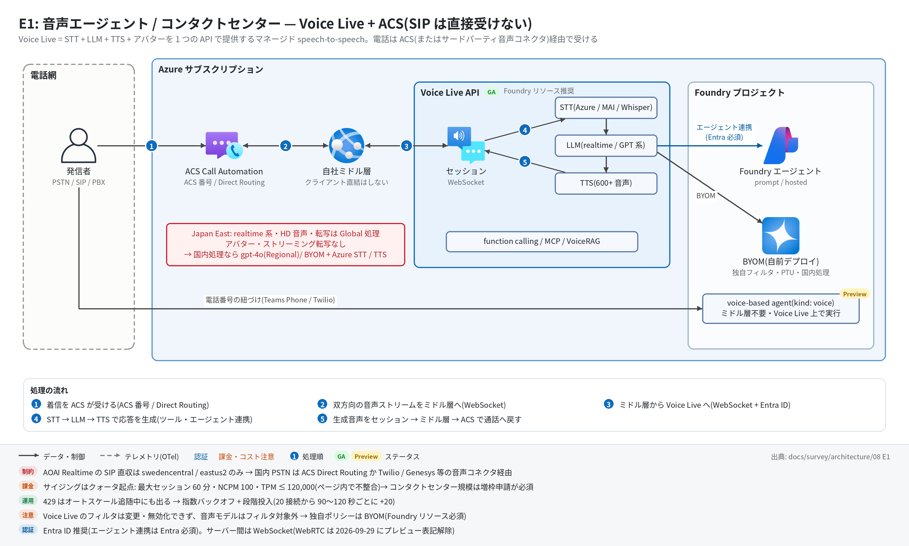
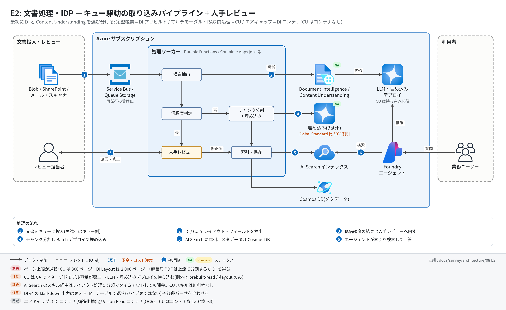
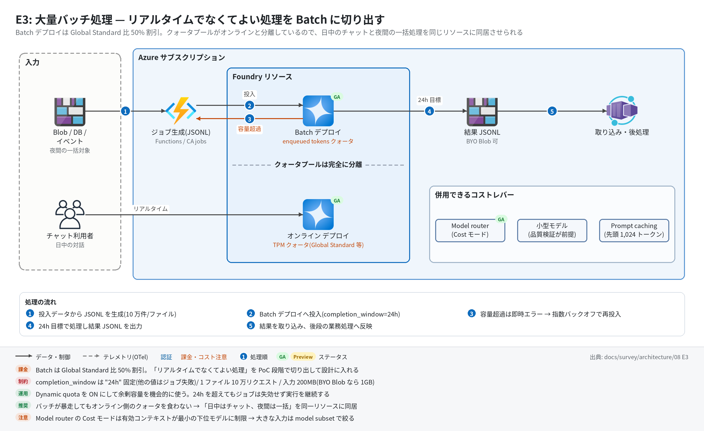
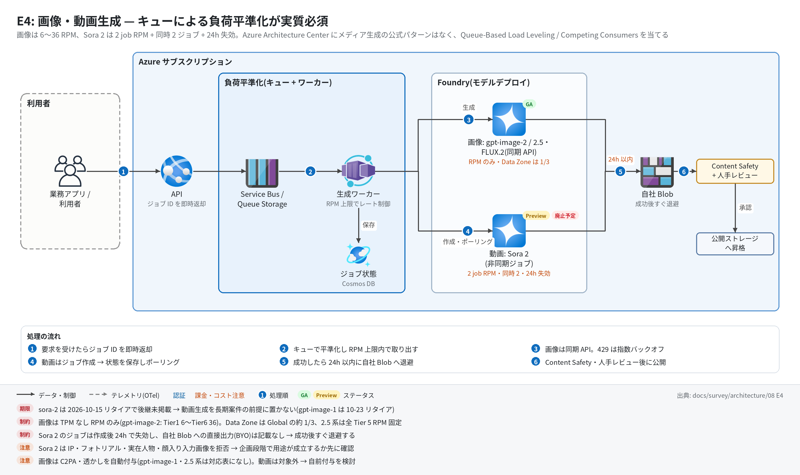
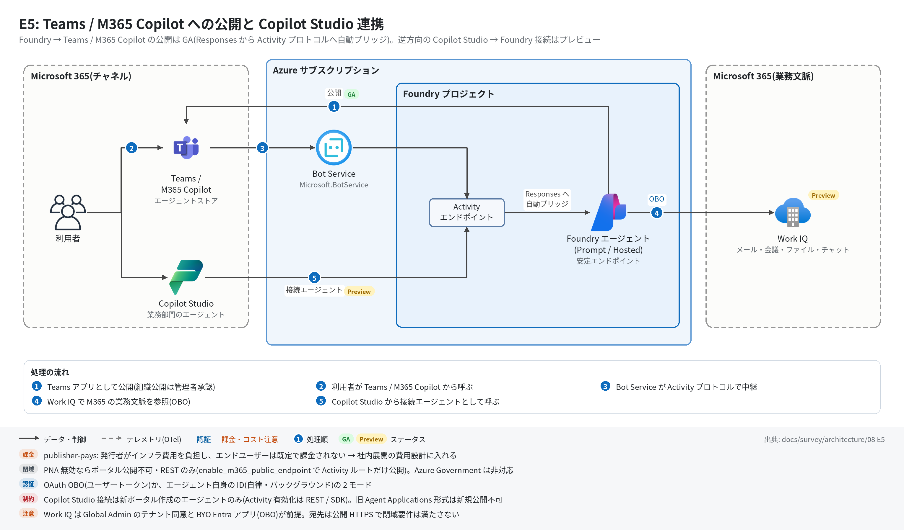
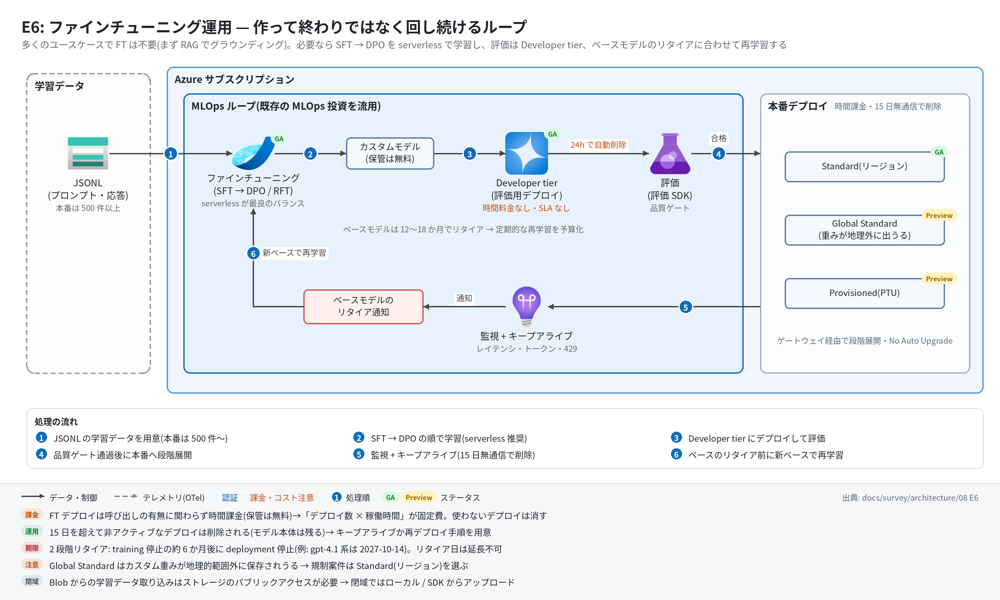

# 08. ユースケース編 E — 音声・文書処理(IDP)・大量バッチ・マルチモーダル・M365 連携

[← アーキテクチャ TOP](./README.md)

> **最終更新:** 2026-07-30(公式ドキュメントとの突合検証で訂正) / 2026-09-26(Voice Live のステータス・モデル・クォータ、voice-based agents(preview)の電話チャネル、CU 上限値、画像/動画モデルのリタイア日と gpt-image-2.5 系、Content provenance 新記事、Work IQ、FT 対応モデルを一次情報で再検証) / 2026-09-29(gpt-realtime-2.1 系が Voice Live 上でも GA 化したこと、`mai-transcribe-2` の明示指定・`phrase_list` 対応を反映)/ 2026-10-06(ラボ実測: Port 12 の Japan East realtime 移行経路・表外設定の受理・ネイティブ音声と決定論フロー、CU usage の新費目 / **Japan East で realtime 系が Global standard 提供**〈「Japan East ではネイティブ speech-to-speech 不可」を訂正〉、Voice Live の WebRTC のプレビュー表記解除、Voice Live 連携 → voice agents の移行ガイドと比較、classic 連携クイックスタートの Deprecated 化、MAI-Transcribe-2-Streaming・MAI-Voice-2.1、料金ティア名 Basic → Standard を反映) / 2026-10-14(差分更新: **Voice Live の regions 表が処理スコープ〈Global / Data zone / Regional〉表記に刷新**され Japan East でも HD voices・mai-transcribe-2 は Global 処理〈日本リージョン表を書き換え〉、`-regional` モデル、テレフォニーの voice agents 誘導、MAI-Transcribe-2-Streaming のリージョン、明日 10-15 の転写モデルのリタイア、TTS アバター Jeff / Lisa の 2026-12 提供終了、voice agents の toolbox・画像入力・料金・観測評価、既定ポリシーの文字起こしモデル除外、DI / CU の選び方〈devblogs〉、Flex processing〈preview〉、Teams / M365 公開の受信経路、ファインチューニングの概要ページ新設・プレビュー OSS・managed compute への LoRA 配置・interactive training と gpt-4.1-nano のリタイア日の訂正)

チャット / RAG / 業務自動化に収まらない類型をまとめる。共通するのは、**Foundry Agent Service の外側にある Foundry Tools(旧 Azure AI Services)やモデル固有の API が主役になる**点で、エージェント中心の設計論がそのままは当てはまらない。

## パターン一覧

| # | パターン | 中核サービス | 決め手になる要件 |
|---|---|---|---|
| E1 | 音声エージェント / コンタクトセンター | Voice Live API + ACS | リアルタイム音声対話 |
| E2 | 文書処理・IDP | Document Intelligence / Content Understanding | 帳票・契約書からの構造化抽出 |
| E3 | 大量バッチ処理 | Batch デプロイ + Model router | 数万〜数百万件の分類・要約 |
| E4 | マルチモーダル生成 | 画像 / 動画モデル | 生成コンテンツの非同期処理と安全性 |
| E5 | M365 / Teams 連携 | 公開フロー + Work IQ | 業務ツール内でエージェントを使わせたい |
| E6 | ファインチューニング運用 | SFT / DPO / RFT + MLOps | 挙動・文体・タスク性能をモデル側で変えたい |

---

## E1. 音声エージェント / コンタクトセンター



### Voice Live API とは

**フルマネージドの speech-to-speech 統合 API。**STT + 生成 AI + TTS + アバターを**単一のインターフェース**で提供する。「STT → LLM → TTS」を自分でつなぐ必要がなく、公式も「**デプロイも管理も不要**」と明記している。

| 構成要素 | 選択肢 |
|---|---|
| STT | Azure speech to text(既定)/ `mai-transcribe`(プレビュー。現在は `mai-transcribe-2` のエイリアス。2026-09-24 以降は `mai-transcribe-2` の明示指定も可、`phrase_list` も両者で有効)/ `whisper-1` / `gpt-4o-transcribe` / `gpt-4o-mini-transcribe` / `gpt-4o-transcribe-diarize`。**2026-10-14 追記:** `mai-transcribe-2-streaming`(プレビュー)も指定可(提供リージョンは mai-transcribe-2 と別で日本なし)。**Azure OpenAI の `gpt-4o-transcribe` / `gpt-4o-mini-transcribe`(各 2025-03-20 版)は明日 2026-10-15 にリタイア**(リタイア表。2025-12-15 版の mini-transcribe は 2027-06-15)だが、voice-live-how-to(2026-10-08 版)の選択肢には残っており Voice Live 側の扱いは記載なし → 転写モデルに指定している構成は既定の Azure speech to text へ寄せる |
| LLM | `gpt-realtime-2.1` / `-2.1-mini` / `-2.1-datazone`(**2026-09-29 に Voice Live 上でも GA**。それまではプレビュー表記)/ `gpt-realtime-1.5` / `gpt-realtime` / `gpt-realtime-mini`(各 `-datazone` 版あり)/ `gpt-4o` 系 / `gpt-4.1` 系 / `gpt-5`〜`gpt-5.4` 系 / `gpt-5.6-terra` / `gpt-5.6-luna` / `phi4-mm-realtime`(プレビュー)/ `azure-realtime`(2026-07-25 GA)。`gpt-5.5` / `gpt-5.4-mini` / `gpt-5.4-nano` は事前デプロイされず BYOM 経由(overview 2026-09-06 版) |
| TTS | 600+ voices・150+ locales、HD voices、MAI-Voice(プレビュー。2026-09-30 に **`MAI-Voice-2.1` / `MAI-Voice-2.1-Flash`** へ刷新 — 23 言語・言語をまたいで同じ声・ゲート制のインスタント音声クローン。Flash は低遅延の対話向け。旧記載 `MAI-Voice-2-Flash`)、Custom Voice(限定アクセス) |
| アバター | standard / custom / **photo avatar**(静止画 1 枚から talking head)。viseme 出力、word 単位タイムスタンプ。**2026-10-14 追記(期限):** 標準アバターのうち **Jeff(全スタイル)と Lisa の 4 スタイル(graceful-sitting / graceful-standing / technical-sitting / technical-standing)は 2026 年 12 月から利用不可**(standard-avatars 2026-10-12 版。月単位の表記)。Harry / Jeff / Lisa / Lori / Max / Meg は実在の俳優ベースで提供は俳優とのライセンス契約に依存と明記 — 固定の UI キャラクターにするならカスタムアバターを検討する。photo avatar の基盤モデル `vasa-2` は preview |
| 会話品質 | ノイズ抑制、エコーキャンセル、**日本語対応のセマンティック VAD**、フィラー除去、barge-in(割り込み)、auto-truncate |
| ツール | function calling(同期 / 非同期)、**MCP**、VoiceRAG パターン |

**2026-10-06 追記(部品・料金の変化):**

- **料金ティア名が Basic → Standard に変わった**(Pro / **Standard** / Lite。`gpt-realtime-2.1-mini` / `gpt-realtime-mini` / `gpt-4o-mini` / `gpt-4.1-mini` / `gpt-5.6-luna` / `gpt-5-mini` が Standard。[voice-live](https://learn.microsoft.com/en-us/azure/ai-services/speech-service/voice-live) 2026-09-29 版)。見積書のティア名を更新する
- **MAI-Transcribe-2-Streaming(プレビュー、2026-09-30)** — 話している最中に中間結果を返し、発話の終わりで確定させるストリーミング STT。接続は OpenAI Realtime 互換の WebSocket か Speech SDK([mai-transcribe-2-streaming](https://learn.microsoft.com/en-us/azure/ai-services/speech-service/mai-transcribe-2-streaming))。Voice Live を使わず **STT → LLM → TTS を自前でつなぐ構成**(国内処理のため非マルチモーダルモデルで組む場合など)の STT 候補になる。言語数(60 言語・自動言語判定)や遅延の数値は Tech Community のブログ(2026-10-01)の値で、Learn では未確認。**2026-10-14 更新:** リージョン表は overview に一本化され(Realtime API / Speech SDK の個別表は削除。前回の不一致は解消)、提供は **Sweden Central / Central US / East US 2 / Southeast Asia の 4 リージョン**(「globally accessible」でこれらにルーティング)、言語表に ja を含む 60 言語。**日本リージョンは引き続きなし**で、Voice Live 経由でも Japan East / West は提供なし → 「国内処理」の STT 候補にはならない
- **AOAI の GPT-Live を WebRTC で使う場合、セッションごとに最低 15 秒分の音声が課金される**(WebSocket は対象外。gpt-live / gpt-live-webrtc 2026-10 更新)。短い問い合わせが多いワークロードの見積もりに効く

### ⚠ ライフサイクル: サーフェスごとに GA / Preview が分かれる(2026-09-26 再検証)

**2026-07-30 時点では GA 一覧表だけを根拠に「プレビュー」と整理したが、これは不正確だった。**一次情報はサーフェスごとに次のように書いている:

| サーフェス | ステータス | 出典 |
|---|---|---|
| **Voice Live API 本体**(WebSocket・SDK 直叩き) | **GA(2025-11)**。API `2026-07-15` が GA で SDK の既定(`2025-10-01` / `2026-04-10` も安定版) | [Speech What's new(Voice Live タブ)](https://learn.microsoft.com/en-us/azure/ai-services/speech-service/releasenotes?pivots=voice-live)(2026-05-22 版、July 2026 節まで記載) |
| Foundry Agent Service 統合・MCP 統合・auto-truncation・proactive messages・テレメトリ | **GA(2026-04、API `2026-04-10`)** | 同上 |
| **Hosted agents × Voice Live** | **GA**(ブログ 2026-09-09「Hosted Agents with Voice Live are also generally available」) | [What's new in Microsoft Foundry: July and August 2026](https://devblogs.microsoft.com/foundry/whats-new-in-microsoft-foundry-july-august-2026/) |
| Foundry ポータルの「Build > Agents — Voice Live」 | **Preview** | [GA 一覧表](https://learn.microsoft.com/en-us/azure/foundry/concepts/general-availability)(ms.date 2026-08-14、2026-09-26 確認) |
| **voice-based agents**(agent kind = `voice`、`VoiceAgents=V1Preview` ヘッダー、電話チャネル) | **Preview** | [limits-quotas-regions](https://learn.microsoft.com/en-us/azure/foundry/agents/concepts/limits-quotas-regions)(2026-09-07 版)/ [configure-voice-agent](https://learn.microsoft.com/en-us/azure/foundry/agents/how-to/configure-voice-agent)(2026-09-25 版) |
| Voice Live × **Agent Service (classic)** 連携 | **Deprecated(2026-08-31)**。クイックスタートは 2026-10-05 に Deprecated 配下へ移動し、新しい「Voice Live with Foundry Agent Service」クイックスタートは冒頭で**新規の音声体験には voice agents(preview)を検討せよ**と案内するようになった | [voice-live-agents-quickstart-classic](https://learn.microsoft.com/en-us/azure/ai-services/speech-service/voice-live-agents-quickstart-classic) / [voice-live-agents-quickstart](https://learn.microsoft.com/en-us/azure/ai-services/speech-service/voice-live-agents-quickstart)(いずれも ms.date 2026-10-04) |

**提案での扱い:** 「Voice Live API を自社ミドル層から WebSocket で呼ぶ」構成は GA として扱える。**Foundry ポータル上のエージェント体験・voice-based agents・電話チャネルに依存する構成は Preview。**GA 一覧表(Foundry 側の最終権威)と Speech 側・ブログの表記が食い違ったままなので、SLA を論点にする案件では Microsoft への個別確認が引き続き必要。

個別機能で明示的にプレビューなのは:

- ~~**WebRTC 接続**(SLA なし・本番非推奨の標準免責文つき。webrtc ページ 2026-04-30 版)~~ → **2026-09-29 版の [voice-live-webrtc](https://learn.microsoft.com/en-us/azure/ai-services/speech-service/voice-live-webrtc) でタイトルの「(Preview)」とプレビュー免責文が外れた**(Speech の What's new・GA 一覧表での裏付けは未確認)
- ~~`gpt-realtime-2.1` 系~~(**2026-09-29 に Voice Live の対応表でも preview ラベルが外れ GA**。リタイア表 2026-09-21 版でも gpt-realtime-2.1 / -mini は GA)、`phi4-mm-realtime`、`mai-transcribe`(`mai-transcribe-2`)、`MAI-Voice-2-Flash`、BYOM の Anthropic プロファイル、評価ハーネス(2026-05)
- ~~auto-truncation~~(2026-04 に GA。2026-07-30 版の記載は誤り)

> 本番設計では **サーバー間(電話・ミドル層経由)は WebSocket**が基本。WebRTC はブラウザー・端末から直接つなぐ構成の選択肢で、2026-09-29 にプレビュー表記が外れたが、SLA を論点にする案件では GA の裏付け(What's new・GA 一覧表)を確認してから採る(本ドキュメントの判断)。

### 接続モデル

| 方式 | 位置づけ |
|---|---|
| **WebSocket(既定・本番向け)** | 「サーバー間統合が容易」と公式に位置づけられている。**フロントから直接ではなく、自社ミドル層を挟む前提** |
| WebRTC(2026-09-29 にプレビュー表記解除) | WS 制御チャネルで SDP 交換。Global standard デプロイのみで最寄りリージョンへ自動ルーティング |
| アバター映像 | WebSocket セッション内で SDP 交換し、音声とは別に WebRTC/ICE で映像配信 |

WebRTC 利用時は **3 チャネル構成**(WS 制御 / WebRTC データチャネル / RTP メディア)になり、アバター設定は side-band 制御では未サポート。

認証は Microsoft Entra ID(推奨)または API キー。**ただしエージェント連携モードは Entra ID 必須。**

### セッション上限とクォータ(サイジングの起点)

| 項目 | 値(Speech リソース Standard S0) |
|---|---|
| 新規接続 / 分(NCPM) | **100**(2026-07-30 時点は 30。quotas-and-limits 2026-09-09 版の表で変更) |
| **最大セッション長** | **60 分**(voice-based agents も最大 60 分。limits-quotas-regions 2026-09-07 版) |
| トークン / 分(TPM) | **≤ 120,000** |
| 換算式 | **TPM = NCPM × 4,000**(NCPM を上げると TPM も自動追随。同ページの例は「30 NCPM × 4,000 = 120,000」のまま) |
| アバター併用時 | 別途 **2 接続/分**、発話中最大 30 分(auto-reconnect で延長可)、アイドル 5 分 |

**⚠ ドキュメント間・ページ内の不整合(2026-09-26 確認):** FAQ(2026-03-31 版)は「100,000 tokens per minute」、[クォータページ](https://learn.microsoft.com/en-us/azure/ai-services/speech-service/speech-services-quotas-and-limits)(2026-09-09 版)は 120,000。さらにクォータページ内でも**表の NCPM = 100 と換算式(100 × 4,000 = 400,000)が TPM ≤ 120,000 と整合しない。****設計時にサポート確認する。**

**コンタクトセンター規模(同時数百コール)では必ず増枠申請が必要。**増枠は専用フォームから「Voice Live API tokens per minute」を選ぶ。**429 はクォータ超過だけでなくオートスケール追随中にも発生する**ため、指数バックオフは必須。公式の推奨負荷パターンは「20 接続から 90〜120 秒ごとに +20、失敗時は 1-2-4-4 分間隔でリトライ」。

### レイテンシ

**Voice Live 固有の SLO / 目標値は公式に見つからなかった。**参照できる数値は以下:

- Azure OpenAI Realtime API の接続方式比較: **WebRTC 約 100ms / WebSocket 約 200ms**(SIP は可変)
- **ガードレール処理は介入点あたり約 50〜100ms 加算**
- エコーキャンセルの前提: 「再生が **2 秒以上**遅延するとエコーキャンセル品質が落ちる」
- つなぎ発話機能(`interim_response`)は `latency_threshold_ms` を超えたら発話を挿入する(サンプル値 100)

### テレフォニー統合(SIP 非対応の回避)

**Voice Live は SIP を直接サポートしない**と FAQ に明記。Architecture Center も「Voice Live API は SIP をサポートしないが、**外部の SIP トランキングソリューションとは連携する**」としている。

**公式に文書化されている接続方法は 3 系統:**

```
 [PSTN / SIP トランク / PBX]
        │  ACS 提供番号 または Direct Routing(SIP)
        ▼
 [Azure Communication Services  Call Automation]
        │  双方向オーディオストリーミング(WebSocket)
        │  16-bit PCM mono 16kHz または 24kHz / 20ms パケット(50fps)
        │  mixed(全参加者ミックス) or unmixed(参加者別・最大 4ch)
        ▼
 [自社ミドル層(サーバー)]
        │  WebSocket
        ▼
 [Voice Live API]  ← STT + LLM + TTS
        │
        └──> 生成音声を ACS へ書き戻して通話へ
```

1. **ACS Call Automation(第一推奨)** — ACS の提供番号を使うか、既存の PSTN キャリア / PBX と **Direct Routing(SIP)** でつなぐ。リファレンス実装として **Call Center Voice Agent Accelerator** が公開されている。
2. **サードパーティ音声コネクタ** — **Twilio Media Streams / Infobip Calls / Genesys AudioHook** が公式に列挙されている。既存コンタクトセンター資産がある場合の現実解。
3. **Voice Live を使わず Azure OpenAI GPT Realtime API の SIP を直接使う** — こちらは **SIP をネイティブサポート**する。着信は Webhook イベントで受け、REST で accept / reject / refer / hangup を制御する。**ただし SIP 対応リージョンは `swedencentral` と `eastus2` のみ**(realtime-audio-sip 2026-09-21 版で再確認)。

**追記(2026-09-26): Foundry の voice-based agents(プレビュー)に電話チャネルが付いた。**agent kind = `voice` のエージェント(`VoiceAgents=V1Preview`、`azure-ai-projects` 2.7.0 以降)は、Foundry ポータルの Channels タブまたは azd の `telephony` バインディングで **Teams Phone extensibility(ACS 経由)または Twilio** の電話番号を紐づけて着信を受けられ、発信は call-job API で行う。ミドル層を自前で書かない 4 つ目の経路だが、**プレビュー**で、バインディングは作成のみ(更新不可)、Teams Phone 経路はプロジェクトと ACS リソースが同一 Entra テナント必須、Twilio 経路は「サポートされるパブリッククラウド環境のみ」。SIP を直接受けるものではない点は変わらない。出典: [Integrate telephony channels with a voice agent](https://learn.microsoft.com/en-us/azure/foundry/agents/how-to/voice-agent-telephony-channels)(2026-09-25 版)/ [Publish and share a voice-based agent](https://learn.microsoft.com/en-us/azure/foundry/agents/how-to/voice-agent-channels-publish)(2026-09-25 版)。なお hosted agent は `invocations_ws`(全二重 WebSocket、フレーム上限 1 MB)で Twilio 等の音声ストリームを自前でブリッジする構成も取れる([build-voice-agent](https://learn.microsoft.com/en-us/azure/foundry/agents/how-to/build-voice-agent) 2026-08-17 版)。

**2026-10-14 更新 — 公式の推奨経路が voice agents 側に移った:** Voice Live のテレフォニーページ([voice-live-telephony](https://learn.microsoft.com/en-us/azure/ai-services/speech-service/voice-live-telephony) 2026-10-08 版。h1 は「Use the Call Center Voice Agent Accelerator」)は冒頭で「**コールセンターは Foundry voice agents(preview)のネイティブ電話連携(Teams Phone extensibility / Twilio)を使え。既存の Voice Live テレフォニー(アクセラレータ利用を含む)も voice agents へ移行せよ**」と案内し、アプリ管理の連携(上の 1・2)は「Voice Live API でアプリ側が電話連携を持つ必要がある場合」の位置付けになった(ACS 提供番号 / Direct Routing〈SIP〉、音声コネクタは Twilio / Infobip / Genesys AudioHook / Sinch / Bandwidth / Vonage)。**ただし推奨先の voice agents は preview のまま**なので、本番の判断(GA の Voice Live API + 自社ミドル層を本番、voice agents は並走評価 — 下の「提案での扱い」)は変えない。新規案件の提案書では「公式の推奨経路は voice agents(preview)、GA で組むならアプリ管理の連携」と両方を書く(本ドキュメントの判断)

> **日本案件での判断:** 国内 PSTN 接続なら ACS Direct Routing か Twilio / Genesys 経由が現実的。**AOAI Realtime の SIP は対応リージョンが北欧・米国のみ**で、音声往復レイテンシとデータ所在の両面で不利になる。Voice Live + ACS なら Voice Live 側を Japan East に置ける(ただし次項のモデル制約あり。**2026-10-14: Japan East に置いても HD 音声・MAI-Transcribe・realtime 系は Global 処理** — 次項)。

### ⚠ 日本リージョンの制約が構成を決める

| 機能 | Japan East | Japan West |
|---|---|---|
| `gpt-realtime` 系・`azure-realtime` のネイティブ speech-to-speech | ~~✗(提供なし)~~ → **`azure-realtime` / `gpt-realtime-2.1` / `gpt-realtime-2.1-mini` が Global**(2026-09-30 版で追加。2026-10-08 版で表記が Global standard → Global。`-datazone` 版・`-regional` 版・`gpt-realtime-1.5` / `gpt-realtime` / `gpt-realtime-mini` は「-」) | -(提供なし) |
| `gpt-4o`(テキスト LLM) | **Regional**(旧表記 Standard〈リージョナル〉) | **Regional**(同) |
| `gpt-4o-mini` / `gpt-4.1` 系 / `gpt-5`〜`gpt-5.4` 系 / `gpt-5.6-terra`・`-luna`(テキスト LLM) | Global(旧表記 Global standard) | Global(`gpt-5.4` は「-」) |
| `phi4-mm-realtime`(プレビュー) | Regional | - |
| HD voices | ~~✗~~ → **Global**(2026-10-08 版の音声機能の処理スコープ表。ローカルに無い場合は HD 対応リージョンへ合成を転送と明記) | ~~✗~~ → **Global** |
| `mai-transcribe-2`(プレビュー。`mai-transcribe` エイリアスも同じ) | **Global** | **Global** |
| `mai-transcribe-2-streaming`(プレビュー) | -(提供なし) | -(提供なし) |
| リアルタイムアバター | **✗**(TTS アバタータブにも日本リージョンなし。2026-10-14 確認) | ✗ |
| **Foundry エージェント連携** | **✅**(2026-10-08 版の Voice Live 表からは Agent support 列が削除) | ~~✗(Voice Live 側の表)~~ → Voice Live 側の列は削除 / **✅**(Agent Service 側の voice-based agents 表)— 下記 |

**2026-10-14 更新 — 表の読み方が「デプロイ種別」から「処理スコープ」に変わった:** [Speech regions(Voice Live タブ)](https://learn.microsoft.com/en-us/azure/ai-services/speech-service/regions?tabs=voice-live)(2026-10-08 版)は、LLM 表のセルを**推論の処理スコープ**(Global / Data zone / Regional)で示し、別に**音声機能(HD voices / mai-transcribe-2 / mai-transcribe-2-streaming)の処理スコープ表**を新設した。ページ冒頭は「Azure Speech は作成リージョンでデータを保存・処理する。**Voice Live は例外で、音声認識・HD 音声合成・LLM 推論がそれぞれ別の処理スコープを持ち、リソースのリージョン外で処理されうる**」と明記している。旧表との読み替えは「Standard → Regional」「Global standard → Global」で、Japan East の LLM の中身は 10-06 の訂正時点と一致する。**変わったのは音声側** — 旧表で ✗ だった HD voices は Global で使え、mai-transcribe-2 も Global。新設の **`gpt-realtime-2.1-regional` / `gpt-realtime-regional`** は表上 Central India のみで、日本リージョンにはない。`azure-speech`(標準の音声認識)と非 HD の標準音声はこの表の対象外で、処理スコープの記載がない(要確認)。

出典: [Speech regions(Voice Live タブ)](https://learn.microsoft.com/en-us/azure/ai-services/speech-service/regions?tabs=voice-live)(2026-09-30 版、2026-10-06 確認。2026-09-09 版では Japan East の realtime 系はすべて「-」)。**⚠ Japan West のエージェント連携は公式 2 ページで食い違う:** Voice Live 側の表は Agent support「-」、Agent Service の [limits-quotas-regions](https://learn.microsoft.com/en-us/azure/foundry/agents/concepts/limits-quotas-regions)(2026-09-07 版)は「Voice-based agents (preview) = Yes」(同ページは「リージョンが Agent Service と選択モデル・チャネルに必要な Voice Live 機能の両方をサポートすること」を条件にしている)。国内 DR で West を使う設計は実測で確認する。(2026-10-14: Voice Live 側の表から Agent support 列が削除されたので、食い違いは「Voice Live 側に記載なし / Agent Service 側 = Yes」になった。実測での確認が要る点は変わらない)

> ~~**Japan East ではネイティブ speech-to-speech が使えない。**~~ → **2026-10-06 訂正: Japan East の Voice Live でも `azure-realtime` / `gpt-realtime-2.1` / `gpt-realtime-2.1-mini` が使える。ただし Global standard(データは任意の Azure リージョンで処理されうる)だけ**で、Data Zone 版(`gpt-realtime-2.1-datazone`)も Japan East には無い。したがって**「日本国内でデータ処理を完結」が要件なら、引き続き非マルチモーダルモデル(`gpt-4o` の Standard か BYOM の自前 Standard デプロイ)+ Azure STT/TTS の構成**になり、レイテンシ特性が変わる(モデル内で音声を直接扱う構成に比べて往復が増える)。Global 処理を許容できるなら、Japan East の Voice Live リソースから realtime 系を選べる。
>
> **[実測] [Port 12 claim-voice-live](../../../labs/maf-ports/ports/claim-voice-live/README.md)(2026-10-06、Japan East):** 移行経路の **`gpt-realtime-2.1-mini` + 転写 `whisper-1` が通過**(スクリプト 39.7 秒、WebSocket・ツールのスモーク 2 passed)。`session.updated` が返す**実効モデル名は `gpt-realtime-2.1-mini-global-standard`** で、Global standard 処理であることを応答から確認できる(国内処理にはならない)。一方、**ドキュメントの表にない組み合わせ(`gpt-realtime-2.1-mini` + `azure-speech` 転写)もエラーにならず受理された — 受理されても動作の保証にはならない**ので、採用する組み合わせは表に載っているものに限り、実効の設定を `session.updated` で確認する。既定の `gpt-4.1-mini`(Voice Live 管理モデル)は 7 月と同じく 3 passed(ただし gpt-4.1-mini は Azure OpenAI のリタイア表で Deprecated、2027-04-14 退役)
>
> さらに **Global standard はデータが任意の Azure リージョンで処理される**ため、データ所在要件がある案件では Japan East の Standard デプロイか Data Zone の検討が必要。**Voice Live のマネージドモデルで日本リージョンが Standard(リージョナル)表記なのは `gpt-4o` のみ**(2026-09-26 確認。ただし gpt-4o はリタイア表 2026-09-21 版で版により 2026-12-09〜2027-04-14 リタイア)で、それ以外の LLM で国内処理を求めるなら BYOM で自分の Standard デプロイを持ち込む構成になる(BYOM は Foundry リソース必須)。なお Speech サービス自体は「リソースのリージョン外でデータを保存・処理しない」と明記されている。**2026-10-14 更新: この原則に Voice Live は当てはまらない**と regions ページ冒頭に明記された(上の表の注記)。**「音声も含めて国内処理」が要件なら、LLM を `gpt-4o`(Regional)か BYOM の国内デプロイにするだけでは足りず、HD 音声と MAI-Transcribe を選ぶとその部分は国外処理になりうる** → 候補は `gpt-4o` または BYOM+`azure-speech` 転写+非 HD の標準 / カスタム音声の組合せで、`azure-speech` と非 HD 音声の処理スコープは表に記載がないので Microsoft に書面で確認する(本ドキュメントの判断)。

### Foundry エージェントとの連携

| 方式 | 指定方法 |
|---|---|
| Foundry agents(new) | SDK の `AgentSessionConfig`(`agent_name` / `project_name` / `agent_version` / `conversation_id` / リソース上書き / 認証 ID) |
| Foundry agents(classic) | WebSocket のクエリで `agent_id` + `project_id` |
| Hosted agents | 同じく `AgentSessionConfig`(Responses プロトコル)/ Invocations プロトコル。**Hosted agents × Voice Live はブログ(2026-09-09)で GA 明言** |
| **voice-based agents(プレビュー、2026-09 追記)** | エージェント定義自体を kind = `voice` にする(`VoiceAgentDefinition`。`model_type` = `managed`〈例: `gpt-realtime-2.1`〉/ `self_deployed`〈BYOM〉、greeting・音声入出力・ツール・`store` を定義に持つ)。`azure-ai-projects` 2.7.0 以降+`VoiceAgents=V1Preview`。会話保存時の音声保持は 60 日([configure-voice-agent](https://learn.microsoft.com/en-us/azure/foundry/agents/how-to/configure-voice-agent) 2026-09-25 版 / limits-quotas-regions) |

### Voice Live 連携 → voice agents への移行(2026-10-06 追加)

公式に移行ガイド [Migrate from Voice Live with Foundry Agent Service to Microsoft Foundry voice agents](https://learn.microsoft.com/en-us/azure/foundry/agents/how-to/migrate-from-voice-live)(preview、ms.date 2026-09-30)が出た。ここでの「Voice Live 連携」は**既存のテキストエージェントに Voice Live をつなぐ構成**、「voice agent」は **`kind: voice` の別エージェント**(音声ランタイムは Voice Live のまま、モデル・指示・音声・ツールをエージェント定義で管理)を指す。**既存のテキストエージェントを voice に変えることはできず、新しい名前で並べて作る**(会話履歴・ツール・接続はコピーされない)。

| 観点 | Voice Live × テキストエージェント(現行の連携) | voice agent(`kind: voice`、preview) |
| --- | --- | --- |
| 使えるモデル | 接続先テキストエージェントが使うテキストモデル | **speech-to-speech(`gpt-realtime` 等)とテキストモデルの両方** |
| モデルの持ち方 | テキストエージェントのモデルデプロイ | 自前デプロイ(`self_deployed`)か**サービス管理モデル(`managed`、デプロイ不要)** |
| 電話 | 自分でテレフォニー事業者とつなぐ(ソリューションアクセラレータあり) | **Teams Phone extensibility / Twilio の組込みテレフォニー**(着信・発信) |
| 通話の振り返り | テキスト側の会話履歴とアプリのログ(割り込み前に発話者が聞いた内容と食い違いうる) | 書き起こし・会話イベント・**録音を opt-in で保存**(録音は既定オフ) |
| 遅延・障害の診断 | テキストモデル部分のトレースのみ(ターン検出・音声入出力は含まれない) | **音声パイプライン全体**(ターン検出・音声入出力・モデル・ツール)をトレース |
| 既存のツール・ナレッジ | テキストエージェント側のものをそのまま使う | テキストエージェントと同等の範囲を voice agent 側で構成し直すか、**既存テキストエージェントをサブエージェントとして呼ぶ**(同一プロジェクト必須・**VNet 分離プロジェクトでは非対応**) |

**移行方式は 3 つ:** (1) モデル駆動の voice agent に作り直す、(2) 既存テキストエージェントをサブエージェントに残す(`subagent_config`)、(3) hosted agent が毎ターンの会話ロジックを持つ(`invocations_ws` の Bridge Protocol 実装が必須。テキストのエンドポイントだけでは不可)。接続先は Voice Live のエンドポイントではなく**プロジェクトエンドポイント**(`wss://…/api/projects/<project>/agents/<name>/endpoint/protocols/voice?api-version=v1` + `Foundry-Features: VoiceAgents=V1Preview` + Entra トークン。API キーはエージェント認証の代わりにならない)。Python は `azure-ai-voicelive` の代わりに `azure-ai-projects[voice]>=2.7.0` の `beta.voice_agents.realtime` を使う。

**提案での扱い(本ドキュメントの判断):** voice agents は**音声パイプラインのトレース・録音・組込みテレフォニー**が揃い、ミドル層の自作を減らせるのが利点。ただし preview のままで(Tech Community「Voice agents in Foundry Agent Service: architecture, trust boundaries, and real-audio latency」2026-10-05 も 2026-09-29 時点で public preview と確認)、**閉域でサブエージェント構成が組めない**・**データ所在はモデル・音声・保存・ツール・テレメトリ・チャネルの各経路で個別に確認が要る**(同記事は「利用者の認可・データ配置・ネットワーク・保持・運用は顧客責任のまま」と整理)。**本番は GA の Voice Live API + 自社ミドル層、voice agents は PoC で並走評価**が当面の安全側。

**2026-10-14 追記 — voice agents(いずれも preview のまま)で設計に効く変化:**

- **toolbox をコードで添付できる**(configure-voice-agent 2026-10-10 版。Python / C# / JS / azd の `tools: - type: toolbox`)。同一プロジェクトの toolbox の版を参照する。**遅延対策として、まず tool search なしで試し、tool search はツールが 10〜15 個を超える大きな toolbox で使う**と明記 — 音声は応答の遅れがそのまま体感品質になるので、ツール数を絞る設計が先
- **画像入力**([send-image-input-voice-agent](https://learn.microsoft.com/en-us/azure/foundry/agents/how-to/send-image-input-voice-agent) 2026-09-30 版):1 ターンで `input_text` + `input_image` を送れる。ブラウザの WebSocket は任意の Authorization ヘッダーを付けられないので**サーバー側の認証プロキシが必須**(トークンを URL に入れない)— ブラウザ直結の構成は取れず、ミドル層は残る
- **料金の考え方**(voice-agent-pricing 2026-10-06 版):`model_type: managed` はエージェント側で課金、`self_deployed` は自前デプロイの課金体系(PTU の容量も再利用可)。トレースに推定コスト属性(`microsoft.foundry.voice.estimated_cost.*`)が載るが**請求記録ではない**(請求は Cost Management)
- **観測と評価**([voice-agent-observability](https://learn.microsoft.com/en-us/azure/foundry/agents/concepts/voice-agent-observability) 2026-09-30 版、preview):1 セッション = 1 トレースで音声認識・合成・VAD の子スパンまで見え、監視は time to first audio(TTFA)中心。**評価は文字起こしベースの標準評価器だけ**で、発音・韻律・雑音・割り込みのタイミングは測れず、会話全体の評価はスケジュール型のみ(イベント起動の継続評価は非対応)→ 音声品質の受入基準は別の手段(人手の試聴・Port 12 のような実測)で持つ
- 自然言語の目的からエージェント定義を生成する経路(`create_from_prompt`、`azure-ai-projects` 2.8.0 以上)も追加された。生成結果はそのまま本番に出さず、定義を Git に落としてから評価にかける(本ドキュメントの判断)

**ネイティブ音声モデルと決定論フロー([実測] [Port 12 claim-voice-live](../../../labs/maf-ports/ports/claim-voice-live/README.md)、2026-10-06):** speech-to-speech の `gpt-realtime-2.1-mini` に切り替えると、**音声出力が約 3.8 倍に増え、エスカレーション判定の後も質問を続けて決定論の「次の質問」から外れた**。保険の受付のように質問順・打ち切り条件が業務ルールで決まる対話は、**決定論のフロー(次に何を聞くか・いつ人に渡すか)をコア側(ミドル層・ワークフロー)に残し、音声モデルには発話だけを任せる**設計が効く(本ドキュメントの判断)。voice agent に会話全体を任せる移行(上表の方式 1)では、この点を受入試験に入れる

**制約(設計に効くもの):**

- **カスタムエージェント使用時は `instructions` を渡せない。**プロンプトはエージェント側のメタデータに持たせる。
- **エージェントモードは Entra ID 認証のみ**(API キー不可)。
- **Azure Speech リソース(非 Foundry リソース)では、Agent Service 連携も BYOM も使えない。**リソース種別の選択が機能を決める。
- **MCP は「モデルモード(phi 系を除く)」と「Foundry(new)エージェント」で使えるが、classic エージェントでは使えない。**API バージョン `2026-04-10` 以降が必須。承認フロー(`require_approval`)は音声で許諾を取る形になる。
- Hosted agent を音声対応にするには、Invocations プロトコルで音声トランスクリプトの入出力を実装し、マニフェストに `voiceLiveCompatible: "true"` を付ける必要がある。

### ⚠ ガードレール — 調整も無効化もできない

FAQ に明記されている:

> **コンテンツフィルタリングは含まれる。**ただし **Voice Live API のコンテンツフィルタリングを変更または無効化することはできない。**カスタムのコンテンツフィルタリングが必要なら **bring-your-own-model 機能を使う。**

カテゴリ・しきい値・音声そのものに適用されるのか(テキスト化後なのか)・注釈が返るのかは、**公式ドキュメントで確認できなかった。**

加えて、Foundry Models 側のコンテンツフィルタ記事には **「Whisper のような音声モデルが処理するプロンプトと完了にはコンテンツフィルタリングシステムが適用されない」**と Important として明記されている。

**2026-10-14 追記:** 既定ガードレールの適用除外は default-safety-policies(新 URL `/azure/foundry/guardrails/default-safety-policies`、2026-10-08 版)で「**transcription(文字起こし)モデル**」と明記され、それ以外の音声モデルには Audio models の既定表(4 カテゴリ Medium+jailbreak+protected material)がある。上の「Whisper のような音声モデル」は文字起こしモデルの意味に読む。

**→ 金融・医療など独自ポリシーが必要な案件は BYOM が前提**(= Foundry リソース必須。Azure Speech リソースでは不可)。BYOM は 3 プロファイル(Azure OpenAI realtime / Azure OpenAI chat completion / Anthropic messages〈プレビュー〉)があり(**2026-10-14 更新: モード表は 4 つ** — `byom-foundry-openai-responses`〈Responses API。GPT-5.4 以降の推奨で、関数ツールを伴う推論はこちら〉が加わった。追加時期は不明)、公式のユースケースとして「**自分の LLM にカスタマイズしたコンテンツセーフティ構成を適用する**」「PTU を使う」「ファインチューン済みモデルを使う」が挙げられている。**BYOM ページは「レイテンシ削減のためフィルタを非同期モードにせよ」と推奨している。**

### E1 のチェックリスト

- [ ] 使うサーフェスのステータスを切り分けたか(**Voice Live API 本体・hosted agents 連携 = GA / ポータルの Agents — Voice Live・voice-based agents・電話チャネル = Preview**。SLA を論点にするなら表記不一致について Microsoft に確認)
- [ ] 接続方式を決めたか(サーバー間は WebSocket。WebRTC は 2026-09-29 にプレビュー表記が外れたが GA の裏付けを確認してから)
- [ ] **Japan East の realtime 系は Global standard のみ**(2026-09-30〜)— 国内処理が要件なら非マルチモーダルモデル(`gpt-4o` Standard / BYOM)+ STT/TTS で組んだか
- [ ] 国内処理が要件なら、**音声側の処理スコープも確認したか**(Japan East でも HD voices・mai-transcribe-2 は Global、mai-transcribe-2-streaming は提供なし。`azure-speech` と非 HD 音声は記載なし → Microsoft に確認。2026-10-14 追加)
- [ ] 転写モデルに `gpt-4o-transcribe` / `gpt-4o-mini-transcribe`(2025-03-20 版、2026-10-15 リタイア)を指定していないか。標準アバターの Jeff / Lisa 4 スタイル(2026-12 提供終了)を使っていないか(2026-10-14 追加)
- [ ] 同時コール数から必要 NCPM を逆算し(TPM = NCPM × 4,000。既定値の表記はページ内で不整合)、増枠申請の要否を判断したか
- [ ] **最大セッション 60 分**を超える通話の扱いを決めたか
- [ ] テレフォニー接続方式(ACS / サードパーティ〈2026-09 に Vonage が一覧に追加〉/ AOAI SIP / voice-based agents の電話チャネル〈プレビュー〉)を選び、リージョンとデータ所在を確認したか(2026-10-14: 公式の推奨経路は voice agents のネイティブ電話連携〈preview〉に変わった。GA で組むならアプリ管理の連携)
- [ ] 既存の Voice Live × テキストエージェント連携を持つなら、voice agents への移行ガイド(preview)の比較で移行の要否を判断したか(classic エージェントとの連携は 2026-08-31 で Deprecated)
- [ ] コンテンツフィルタの調整が必要なら **BYOM 前提**の構成にしたか
- [ ] 429 に対する指数バックオフと段階的な負荷投入を実装したか

---

## E2. 文書処理・IDP(Intelligent Document Processing)

### まず Document Intelligence と Content Understanding の使い分けを決める

**公式は「新しいスキルセットには Content Understanding を使え」と方向を示しつつ、Document Intelligence は廃止ではない**と明記している。

> 既に Document Intelligence を本番で動かしているなら、API・エンドポイント・SDK・課金は変わらない。**移行は不要。**

**公式の選択マトリクス:**

| シナリオ | 推奨 | 理由(公式表現) |
|---|---|---|
| OCR / レイアウト抽出のみ | **CU `prebuilt-read` / `prebuilt-layout`** | 「より低コストでリッチなレイアウト抽出」 |
| **マルチモーダル / RAG 前処理** | **CU プリビルト or カスタム** | 「検索の取り込み、根拠付き要約」 |
| **定型帳票(請求書・領収書・ID・税)** | **DI プリビルトモデル** | 「一般的で構造化された文書テンプレートに対する高精度」 |
| 非構造化(契約・法務) | CU `prebuilt-contract` | 推論 + 推定フィールド |
| ラベルなしカスタム抽出 | CU カスタム(ゼロショット) | 「フィールドを平易な言葉で記述するだけ」 |
| ラベルありカスタム抽出 | DI カスタムモデル | 「わずか 5 件のラベル付きサンプルで」 |
| **オンプレ / 閉域(エアギャップ)** | **DI コンテナ**(構造化抽出)/ **Vision Read OCR コンテナ**(単純 OCR) | **Content Understanding にはコンテナが存在しない** → マルチモーダル文書処理はオンプレ不可。詳細は [07 章 9.3](./07-usecase-regulated-edge.md#9-3-切断コンテナ-エアギャップでの-foundry-tools) |

> **2026-10-14 追記 — 公式ブログの選び方も同じ線引き:** devblogs「Azure Document Intelligence and Azure Content Understanding: a practical guide」(2026-10-07。新機能・ステータス変更なし)は、**要件を満たしている既存 DI ワークロードは移行不要**(API・エンドポイント・課金は別のまま)、**新規クラウドの OCR / Layout は CU の `prebuilt-read` / `prebuilt-layout`**(LLM・埋め込み不要で決定論的、Layout のページ単価が低い)、成熟した prebuilt がある定型帳票は DI prebuilt か CU `2026-06-01-preview`、ラベル付き学習データがある高定型カスタム帳票は DI カスタム、非定型・推論・RAG 前処理・マルチモーダルは CU、**オンプレ / 切断環境は DI コンテナ**、と整理した(agentic mode は preview)。評価は文字列一致でなく業務指標(正規化後の項目精度・人手確認率・STP 率・総コスト)で行えとしている。「決定論 = DI」の切り分けは OCR / Layout には当てはまらない点に注意。なお 2026-10-13 のブログが示す CU 2.0 preview(`2026-06-01-preview`)の Advanced Contextualization の精度・コスト比較は**米国税務帳票の社内ベンチマーク**で、日本の帳票の根拠にはしない

### 上限値の比較(サイジングに直結)

| 項目 | Document Intelligence (S0) | Content Understanding (S0) |
|---|---|---|
| 最大文書サイズ | **500 MB** | 200 MB(PDF/TIFF/画像。非同期) |
| **最大ページ数** | **2,000** | **300**(非同期) |
| Office ファイル | 800 万文字 | **1,000 万文字 / 200 MB**(2026-07-30 時点の「100 万文字」から変更) |
| TXT/HTML/MD/EML 等 | — | **1,000 万文字 / 200 MB**(同「1 MB」から変更。課金は 3,000 文字 = 1 ページ換算) |
| 同期実行(`2026-06-01-preview`) | — | 10 MB / 5 ページ(超過分は先頭 5 ページのみ処理)、Office・テキストは 3 万文字 |
| 音声 | — | 300MB 推奨(最大 1GB)、2 時間推奨(最大 4 時間) |
| 動画 | — | `analyzeBinary` で 200MB / 30 分、URL 指定で 4GB / 2 時間 |
| スループット | 15 TPS(申請で調整可) | 1,000 ページ・画像/分(音声・動画は各 4 時間/分)、操作 3,000/分 |

出典: [DI service-limits](https://learn.microsoft.com/en-us/azure/ai-services/document-intelligence/service-limits)(2026-09-08 版)/ [CU service-limits](https://learn.microsoft.com/en-us/azure/ai-services/content-understanding/service-limits)(2026-09-11 版。API 版ごとの区別はページに無い)。

> **⚠ ページ上限の逆転:** **Content Understanding は 300 ページ、Document Intelligence Layout は 2,000 ページ。**超長尺 PDF は上流で分割するか DI Layout を選ぶ。Content Understanding スキルのトラブルシュートでも「インデックス前にソース文書を小さいファイルに分割せよ」と推奨されている。

**ページ単位課金の換算(DI):** PDF = 1 ページ、**DOCX / HTML = 3,000 文字で 1 ページ単位**、XLSX = 1 ワークシート、PPTX = 1 スライド。

### Content Understanding の GA での破壊的変更(見落とすと詰まる)

API `2025-11-01` で GA(2025 年 11 月)。旧プレビュー版 API(`2024-12-01-preview` / `2025-05-01-preview`)は 2026-07-15 までに廃止済み。**2026-09-26 時点で新しい `2026-06-01-preview`(agentic mode・同期 Read/Layout・署名検出・文書メタデータ等)がパブリックプレビュー**で、GA は引き続き `2025-11-01`(What's new 2026-09-08 版)。

- **Pro モード(クロスファイル推論)と Face API はプレビュー限りで GA に持ち越されなかった。**
- **プレビュー期のマネージド生成モデルキャパシティが廃止された** → **自分の Foundry の LLM デプロイと埋め込みデプロイを持ち込む必要がある**(モデル不要の例外は **`prebuilt-read` / `prebuilt-layout` の 2 つのみ**〈公式 whats-new に明記〉)。
- 専用分類 API が廃止され、アナライザ API の `contentCategories` に統合(カテゴリ上限 50 → 200)。

**課金モデル:** (1) content extraction(文書は 1,000 ページ単位、音声 / 動画は分単位、**画像は無料**)、(2) contextualization(固定: 1,000 トークン/ページ、10 万トークン/時間の音声、100 万トークン/時間の動画)、(3) **LLM / 埋め込みトークンは自分の Foundry デプロイに課金。**コスト倍率は source grounding + confidence で約 2 倍、extractive モードで約 1.5 倍、segmentation で約 2 倍。**ミニモデルで LLM コストを最大 80% 削減できる**と明記されている。**2026-10-06 追記 — [実測] [cu-video-rag](../../../labs/cu-video-rag/README.md)(4 本スモーク):** CU の usage に **`gpt-5.4-mini-cached-input` という費目が新たに出た**(キャッシュ済み入力)。費目を固定した集計コードはこれを単価に当てられず 0 円扱いしていた → **CU のコスト集計は usage の費目一覧を固定せず、未知の費目を検知して止める**。CU の docs・SDK(1.1.0)は 2026-09-29 以降変更なし

### 取り込みパイプラインのアーキテクチャ



```
 [文書投入: Blob / SharePoint / メール / スキャナ]
        │
        ▼
 [キュー(Service Bus / Storage Queue)]  ← バックプレッシャーとリトライの受け皿
        │
        ▼
 [処理ワーカー]
   選択肢: Durable Functions / Container Apps jobs / Logic Apps / AI Search インデクサ
        │
        ├─> [Document Intelligence Layout or Content Understanding]  構造抽出
        ├─> [チャンク分割 + 埋め込み]  ← 埋め込みは Batch デプロイに回すとコスト半減
        └─> [Azure AI Search インデックス] / [Cosmos DB]
        │
        ▼
 [Foundry エージェント]  ← 検索・質問応答
```

**公式リファレンスが 2 つある:**
- **Durable Functions 版**(文書分類):Web アプリ → Blob + Service Bus → Durable Functions(analyze / metadata store / embedding)→ AI Search。注目点は「**Agent Framework にはテキスト分割プリミティブがないため Semantic Kernel の `TextChunker` を使う**」ことと、**埋め込み工程を Batch デプロイ(`GlobalBatch`、24 時間ターンアラウンド)に回してコスト削減する**推奨。
- **Container Apps 版**(マルチモーダル):Container Apps + Queue Storage + Content Understanding + Azure OpenAI + Cosmos DB。**confidence score による人手レビュー分岐**を持つ点が実務的で、公式に「ワークフローが単純 / ビジュアル設計を好む / ローコード寄りチームなら **Logic Apps か Azure Functions に置き換えよ**」と代替案も示されている。

**AI Search のスキルとして組み込む場合の比較:**

| | Document Layout skill | **Content Understanding skill** |
|---|---|---|
| ステータス | 既存パイプライン向け | **GA(2026-04-01)。**セマンティックチャンキングと埋め込み画像・図の AI 説明生成は `2026-05-01-preview` でプレビュー |
| 表・図の出力 | **プレーンテキスト(情報欠落)** | **Markdown** |
| ページ跨ぎの表 | 分断される | **単一単位で抽出** |
| チャンクのページ跨ぎ | 不可 | 可 |
| 無料枠 | インデクサあたり 20 文書/日 | **なし(全文書課金)** |

**両スキル共通の罠:** **レイアウト処理に 5 分以上かかる文書はタイムアウトし、しかも課金される。**

**Markdown 出力の挙動変更(DI v4.0 GA):** **表は HTML テーブルとして出力される**(パイプ表ではない。結合セル・複数行ヘッダー対応のため)。選択マークは Unicode `☒` / `☐`(旧 `:selected:`)。**後段のパーサを書くときにここを間違えやすい。**

### Vision の世代交代に注意

**Azure AI Vision Image Analysis 4.0/3.2 は 2028-09-25 廃止**で、「2026-09-25 までに移行計画を」と記載されている(**この移行計画の目安日は 2026-09-26 時点で経過済み**。廃止はクラウド API に加え接続コンテナ・切断コンテナにも適用と明記 — [migration-options](https://learn.microsoft.com/en-us/azure/ai-services/computer-vision/migration-options) 最終更新 2026-06-11)。公式の移行先は OCR → Document Intelligence、顔 → Face API、埋め込み → Cohere Embed、汎用 → GPT 系 Foundry Models / Content Understanding。**既存の画像解析パイプラインを持つ顧客には、この期限を提示する。**

---

## E3. 大量バッチ処理

**「リアルタイムでなくてよい処理」を切り出すだけでモデルコストが半減する。**PoC 段階でこの切り分けを設計に入れる。

| レバー | 効果 | 注意 |
|---|---|---|
| **Batch デプロイ** | **Global Standard 比 50% 割引**、24 時間目標 | `completion_window` は **`24h` 固定**(他の値を指定するとジョブ失敗)。**enqueued tokens クォータはオンライン系と完全分離** |
| **Flex processing(preview、2026-10-14 追加)** | Global Standard デプロイへの要求単位で `service_tier: "flex"` を指定すると **Standard 比 50% 割引**(キャッシュ入力割引も適用)。専用デプロイ不要・同期応答(Batch API とは別物) | **latency SLA・service SLA なし**(遅延・一時的な容量不足を許容する処理向け)。**Global Standard のみ**なのでデータ処理範囲は任意のリージョン(国内処理要件とは両立しない)。対象は 2026-10-12 版で `gpt-5.6-sol` のみ → **7 モデル**(`gpt-6.1-sol` / `gpt-6-sol` / `gpt-6-luna` / `gpt-6-astra` / `gpt-5.6-sol` / `gpt-5.6-luna` / `gpt-5.6-terra`)に拡大([flex-processing](https://learn.microsoft.com/en-us/azure/foundry/openai/how-to/flex-processing))。24 時間待てない夜間処理・同期 API のまま安くしたい処理で Batch と比べる |
| **Model router(Cost モード)** | 品質 5〜6% 帯で最安モデルを選択 | **有効コンテキストウィンドウが最小の下位モデルに制限される。**大きなコンテキストなら model subset で絞る。**2026-10-14: 既定プールに Fireworks 3 モデル(Microsoft 施設外・US のみ)と Grok が入った**ので、データ所在要件があるなら subset で除外する([07](./07-usecase-regulated-edge.md)) |
| **小型モデル** | gpt-4.1-nano は PTU 効率が gpt-4.1 の約 20 倍 | 品質検証が前提 |
| **Prompt caching** | 共通プレフィックスの再利用 | **先頭 1,024 トークンが完全一致**する設計にする |

**Batch の制限:** 入力ファイル最大 200MB(BYO Blob なら 1GB)、**1 ファイル最大 100,000 リクエスト**、有効期限未設定なら入力ファイル 500 個 / リソース(`expires_after` を設定すると 10,000 個)。24 時間を超えてもジョブは失効せず実行を継続する。

**運用推奨:** **Dynamic quota を ON** にして余剰容量を機会的に利用する。一部リージョンでは `token_limit_exceeded` を即時返す **fail-fast + 指数バックオフ**でジョブをキューイングできる。

**アーキテクチャの骨格:**



```
 [投入: Blob / DB / イベント]
        │
        ▼
 [ジョブ生成(JSONL 作成)] ← Functions / Container Apps jobs
        │
        ▼
 [Batch デプロイに投入] ──> 24h 以内に完了 ──> [結果 JSONL]
        │                                            │
        │ fail-fast + 指数バックオフでリトライ           ▼
        └────────────────────────────────>  [結果取り込み・後処理]
```

**リアルタイム経路との共存:** Batch とオンラインでクォータプールが分離されているため、**バッチが暴走してもリアルタイム側のクォータを食わない。**これは設計上の大きな利点で、「日中はチャット、夜間は一括処理」を同一リソースで安全に同居させられる。

---

## E4. マルチモーダル生成(画像・動画)

### モデルのライフサイクル

| モデル | ステータス |
|---|---|
| **`gpt-image-2.5-sunburst` / `gpt-image-2.5-flare`(2026-09-09 公開、追記)** | **GA**(リタイア 2027-09-09)。image how-to の表で「Generally Available」(限定アクセスの記載なし)。sunburst = 編集精度重視の最上位、flare = 速度・コスト重視。品質は `low`〜`xhigh` / `max` / `auto`、サイズ仕様は gpt-image-2 と同等(2560x1440 超は experimental)。**GlobalStandard のみで全 Tier 5 RPM 固定** |
| **`gpt-image-2`** | **GA。申請不要**(リタイア 2027-10-21) |
| `gpt-image-1.5` / `gpt-image-1` / `gpt-image-1-mini` | **限定アクセス(要申請)。**ライフサイクルは **`gpt-image-1` のみ Preview**(**2026-10-23 リタイア**)。`gpt-image-1.5`(**2026-12-16 リタイア**)と `gpt-image-1-mini`(2027-04-07)は **GA**(リタイア表)。ただし image how-to の比較表は 3 モデルとも「Limited access preview」表記で食い違う |
| `dall-e-3` | **2026-03-04 に廃止済み** |
| `FLUX.2-pro` / `FLUX.2-flex`(Black Forest Labs) | **GA**(model-retirement-schedule の Black Forest Labs 表で Lifecycle = GA)。multi-reference は API のみ(Playground 不可) |
| `MAI-Image-2.5` / `-2.5-Flash` / `-2.5-Pro`(Microsoft) | プレビュー。**2026-10-01 リタイア**(後継未記載)。後続の **`MAI-Image-2.6` / `-2.6-Flash`(プレビュー、2026-07-31 公開)**が MAI image ページ(2026-09-21 版)に追加 |
| **`sora-2`(動画)** | **プレビュー。2025-12-08 版が 2026-10-15 リタイアで、リタイア表に後継の記載なし**(2025-10-06 版は 2026-07-15 リタイア済み)。**動画生成を長期案件の前提に置けない** |
| `sora`(初代、動画) | リタイア表(2026-09-21 版)・retired-models(2026-07-27 版)のいずれにも掲載が無く、video-generation ページも Sora 2 のみ記載(要確認) |

出典: [Model retirement schedule](https://learn.microsoft.com/en-us/azure/foundry/openai/concepts/model-retirement-schedule)(2026-09-21 版)/ [image generation how-to](https://learn.microsoft.com/en-us/azure/foundry/openai/how-to/dall-e)(ms.date 2026-04-17、2026-09-26 取得時点で gpt-image-2.5 系を掲載)/ [quotas-limits](https://learn.microsoft.com/en-us/azure/foundry/openai/quotas-limits)(2026-08-20 版)/ [MAI image models](https://learn.microsoft.com/en-us/azure/foundry/foundry-models/how-to/use-foundry-models-mai-image)(2026-09-21 版)。

### 画像生成 — API は同期。制約はレート制限

**画像生成は同期 API**(`/images/generations`、`/images/edits`)で、非同期ジョブではない。FLUX は Image API に加えてプロバイダ固有 API(`seed` / `safety_tolerance` 等が使える)も利用できる。

| 項目 | `gpt-image-2` | `gpt-image-1.5` / `-1` / `-1-mini` |
|---|---|---|
| サイズ | **任意解像度。**両辺が 16px の倍数、長辺 ≤3,840px(4K)、アスペクト比 ≤3:1、総ピクセル 655,360〜8,294,400 | `1024x1024` / `1024x1536` / `1536x1024` のみ |
| 品質 | `low` / `medium` / `high` | 同左 |
| 出力 | `png`(既定)/ `jpeg`。**GPT-image 系は常に base64 を返す**(`response_format` 非対応) | 同左 |
| 枚数 | `n` は 1〜10。`partial_images` でストリーミング可 | 同左 |
| 編集 | inpainting(マスクは同寸法 PNG、alpha=0 が編集対象)/ variations。入力は PNG/JPG **50MB 未満** | 同左 |
| プロンプト長 | (4,000 文字は dall-e-3 世代の制限。gpt-image 系の上限は現行リファレンスで要確認) | 同左 |

**⚠ 設計上の最大の制約はレート制限。**既定は **9 RPM 前後**しかない。

| モデル / デプロイ種別 | Tier 1 | Tier 3 | Tier 6 |
|---|---|---|---|
| `gpt-image-2` GlobalStandard | 6 | 18 | 36 |
| `gpt-image-2` **DataZoneStandard** | **2** | **6** | **12** |
| `gpt-image-2.5-sunburst` / `-flare` GlobalStandard | **5** | **5** | **5** |
| `gpt-image-1.5` GlobalStandard | 9 | 30 | 90 |
| `gpt-image-1-mini` GlobalStandard | 12 | 54 | 180 |

(quotas-limits 2026-08-20 版、2026-09-26 確認。gpt-image-2.5 系は Tier を上げても 5 RPM のままで、DataZoneStandard の行は無い)

**TPM は設定されず RPM のみ。**しかも **Data Zone デプロイは Global の 1/3 程度**まで落ちる。**データ所在要件と画像生成スループットは正面から衝突する。**

### 動画生成(Sora / Sora 2)— 非同期ジョブ + 24 時間の失効

> **⚠ 2026-09-26 時点の前提:** [video-generation ページ](https://learn.microsoft.com/en-us/azure/foundry/openai/concepts/video-generation)は「Video generation with Sora 2 (preview)」として Sora 2 のみを記載し、**`sora-2`(2025-12-08)は 2026-10-15 リタイアで後継未掲載**(リタイア表 2026-09-21 版)。以下の制約は同ページの記載で変わっていないが、**新規案件で動画生成を組み込むならリタイア後の代替(後継モデルの有無)を先に確認する。**

**API は 2 系統が併記されている**(Azure 独自の jobs API と、OpenAI v1 互換の videos API)。いずれも「ジョブ作成 → ポーリング → コンテンツ取得」の流れ。

```
 POST  .../video/generations/jobs        → {"id":"task_...","status":"queued"}
 GET   .../video/generations/jobs/{id}   → queued → preprocessing → running
                                            → processing → succeeded | failed | cancelled
 GET   .../video/generations/{gid}/content/video → MP4 バイナリ
```

OpenAI 互換側は Create / Get Status / Download / **List** / **Delete** の 5 エンドポイントに加え、`remix` で構図・モーションを再利用できる。生成時間は **1〜5 分。**

**アーキテクチャを支配する制約:**

| 項目 | 値 |
|---|---|
| **同時実行** | **2 ジョブまで**(1 つ終わるまで新規不可) |
| **ジョブ保持** | **作成後 24 時間で失効** |
| **クォータ** | `sora` は 60 RPM、**`sora-2` は 2 job RPM**(動画ジョブ要求のみカウント) |
| 入力 | 画像最大 2 枚(間を補間)、動画 1 本・最大 5 秒 |

**⚠ ドキュメント内に不整合がある。**解像度と尺について「Limitations 節」「API パラメータ表」「トラブルシュート表」の 3 箇所で記述が食い違っている(尺は 1〜20 秒 vs 4/8/12 秒、解像度も列挙が異なる)。**実装前に対象リージョン・デプロイで実測確認する。**

**ストレージ:** 出力は Azure OpenAI 側に保持され、Download で取得、Delete で個別削除する。**BYO Storage(自社 Blob への直接出力)の記載は見つからなかった。ジョブが 24 時間で失効する以上、成功後すぐに自社 Blob へ退避する設計が必須。**

### ⚠ 安全性とプロベナンス — 動画は文書化されていない

**画像には Content Credentials(C2PA)が自動付与される。**

> Azure OpenAI が生成したすべての AI 生成画像には **Content Credentials** が含まれる。これは C2PA のオープン仕様に基づく、改ざん検知可能なコンテンツの来歴開示手段である。

マニフェストには `description: "AI Generated Image"`、`softwareAgent`(`Azure OpenAI DALL-E` または `Azure OpenAI ImageGen`)、生成タイムスタンプが入り、Azure OpenAI に遡る証明書で署名される。追加設定は不要で、検証は contentcredentials.org などで行える。

**2026-07-30 時点の留保 3 つのうち 2 つは、新 Foundry の [Content provenance for Foundry models](https://learn.microsoft.com/en-us/azure/foundry/responsible-ai/content-safety/provenance-disclosure)(2026-09-17 版、What's new 2026-08 号で新規記事)で解消した:**

1. ~~新 Foundry ドキュメントに対応記事が存在しない~~ → **新記事ができた。**手段は **Content Credentials(C2PA)と不可視の電子透かし**の 2 つで、検証用に Content Provenance Detection のサイトと API が提供される。
2. ~~`gpt-image-2` が明示的に列挙されていない~~ → **対応表に `gpt-image-1-mini` / `gpt-image-1.5` / `gpt-image-2` が列挙**された(MAI-Image-2.5 系・FLUX 系・gpt-audio 系・MAI-Voice・Azure AI Speech の TTS も対象)。**ただし `gpt-image-1` と新しい `gpt-image-2.5` 系は表に無く**、モデルごとに C2PA と透かしのどちらが付くかも表からは読めない。
3. **動画は依然として対応表に無い**(記事は「image, audio, video, and text」を対象にすると書くが、表は Image / Audio / Text のみで Sora 系の記載なし)。生成動画の来歴表示が要件なら、**自前で C2PA を付与する検討が必要**な状況は変わらない。

加えて同記事は「来歴情報は編集・再保存・トリミング・フォーマット変換で失われうる」「来歴は信頼性や著作者を証明しない」と限界を明記している。

**コンテンツフィルタリングは入力プロンプトと出力画像の両方に適用される。**「全モデルで入出力フィルタリング」「**未成年のフォトリアリスティック画像を既定でブロック**」と明記され、ブロック時は `error.code: "contentFilter"` が返る。解除は限定アクセス申請経由。

**⚠ 画像入力シナリオではリクエスト単位のガードレール指定が効かない。**「画像入力(chat with images)のシナリオではリクエスト時のガードレール指定が利用できず、既定のガードレールが使われる」と明記されている。

**Sora 2 の RAI 制限は商用ユースケースの大半を排除しうる。**公式に列挙されているのは:

- **IP(知的財産)およびフォトリアリスティックなコンテンツをすべてブロック**
- **18 歳未満の視聴に適した内容のみ**(将来この制限を回避する設定を提供予定)
- **著作権キャラクター・著作権音楽は拒否**
- **実在人物(著名人を含む)は生成不可**
- **人間の顔が写った入力画像は現在拒否**

> **企画段階で先に潰すべき制約。**「自社タレントを起用した動画を生成する」「実写風の製品映像を作る」といった用途は現時点で成立しない。

### アーキテクチャガイダンスは存在しない

**「キュー + ワーカー + Blob + セーフティレビュー」型のメディア生成パイプラインを扱う Azure Architecture Center の公式記事・サンプルは見つからなかった。**最も構造が近いのは「Extract and Map Information from Unstructured Content」(Container Apps + Queue Storage + Blob + Cosmos DB + confidence score による人手レビュー分岐)だが、これは**処理・抽出であって生成ではない。**

**画像 6〜36 RPM / Sora 2 が 2 RPM + 同時 2 ジョブ**という制約下では、汎用パターンである **Queue-Based Load Leveling / Competing Consumers / Background jobs** の適用が実質必須になる。本ドキュメントの構成案:



```
 [API]  ← ユーザー要求を受けて即座にジョブ ID を返す(同期で待たない)
   │
   ▼
 [Service Bus / Queue Storage]  ← Queue-Based Load Leveling
   │
   ▼
 [Container Apps ワーカー]  ← RPM 上限に合わせてレート制限。429 は指数バックオフ
   ├─ 画像: 同期 images/generations
   └─ 動画: jobs API を作成 → 状態を Cosmos DB に永続化 → 外部からポーリング
   │
   ▼  成功時は 24 時間以内に必ず退避
 [Blob Storage]  ← 長期保管
   │
   ▼
 [Content Safety / 人手レビュー] ──> [公開ストレージへ昇格]
```

**Sora 2 の「同時 2 ジョブ・24 時間失効」がスループット設計の支配要因**になる。

---

## E5. M365 / Teams 連携

### エージェントを Teams / M365 Copilot に公開する

**公開フロー自体は GA。**安定エンドポイントを Teams アプリマニフェスト化して M365 / Teams のエージェントストアへ公開する。



| 項目 | 内容 |
|---|---|
| 必要リソース | **Bot Service リソース**(`Microsoft.BotService`) |
| 承認 | 組織公開は **M365 管理者承認** |
| **閉域での制約** | **パブリックネットワーク無効プロジェクトはポータルからの公開が不可・REST のみ。**REST では送信元 IP でフィルタされた公開 Activity Protocol ルート(`enable_m365_public_endpoint`)を有効化する必要がある([publish-copilot](https://learn.microsoft.com/en-us/azure/foundry/agents/how-to/publish-copilot) 2026-09-23 版) |
| Azure Government | **非対応** |
| 旧形式 | 旧 Agent Applications 形式は新規公開不可(フォーマット移行が必要) |
| **呼び出しの認可(2026-10-06 追加)** | **ストアに見えることと呼び出せることは別。**「Just you」/ REST の `publishScope: Shared` で公開したエンドポイントは `BotServiceRbac` で、利用者に **Foundry Agent Consumer** などの呼び出し権限が要る(無いとエージェントは開けても送信時に認可エラー)。テナント全員に使わせるなら `BotServiceTenant` に置き換える(両方は併用不可。置き換えはストアの公開範囲を変えない)([troubleshoot-publish-copilot-authorization](https://learn.microsoft.com/en-us/azure/foundry/agents/how-to/troubleshoot-publish-copilot-authorization) ms.date 2026-09-29) |

**プロトコル:** Teams / M365 チャネル配信には **Activity プロトコル**が使われ、Responses プロトコルから自動ブリッジされる。

**認証は 2 モード:** OAuth 2.0 の **OBO**(ユーザートークンあり)と、**エージェント自身の ID**(自律 / バックグラウンド)。

**課金は publisher-pays**(発行者がインフラ費用を負担し、エンドユーザーは既定で課金されない)。**社内展開のコスト設計で見落としやすい。****2026-10-14 追記(troubleshoot-publish-copilot 2026-10-12 版):** 利用者は Microsoft 365 Copilot ライセンスなしでも Copilot Chat で公開エージェントを使えるが、**SharePoint や Copilot コネクタ等の共有テナントデータにアクセスする利用は従量課金になりうる**と明記 — 「ライセンスがない利用者にも配る」計画では、エージェントがテナントデータに触れるかで費用の出方が変わる。

**公開時の受信経路(2026-10-14 追加、publish-copilot-virtual-network 2026-10-06 版):** 同ページは h1 が「Publish agents to Microsoft Copilot and Microsoft Teams by using the REST API」に変わり、PNA の有無を問わない REST 公開手順として再構成された。**M365 / Teams のチャネル基盤は公衆インターネット経由で Activity Protocol ルートに到達**し、Foundry が送信元 IP を Bot Service / Microsoft 365 の範囲で照合 → チャネルトークン検証 → 認可、の順で通す(送信元 IP の範囲は複数テナントで共用されうるので、IP 制限は多層防御の 1 つにすぎないと明記)。アプリパッケージを事前に取得する `POST .../microsoft365/zip?api-version=v1` があり、PNA 無効でポータル公開が 403 になる場合はこの ZIP を M365 管理センターでアップロードする代替がある。**ゲストユーザーは呼び出せない**(Bot Service の認可スキームはプロジェクトのテナント一致を要求)。→ 閉域案件で Teams 公開を選ぶと、受信経路にインターネットが入ることを顧客と合意する([07 §3](./07-usecase-regulated-edge.md#3-閉域で使えない機能の一覧-設計の出発点))

### Copilot Studio との棲み分け

- **Copilot Studio から Foundry エージェントへの接続はプレビュー**(新 Foundry ポータルで作成されたエージェントのみ。Foundry エージェント側で **Activity プロトコルのエンドポイントを有効化**しておく必要がある — 新規エージェントの既定は Responses と A2A のみで、**有効化は REST / Python SDK からのみ・ポータル不可**。[add-agent-foundry-agent](https://learn.microsoft.com/en-us/microsoft-copilot-studio/add-agent-foundry-agent) 2026-08-26 版)。
- **2026-10-06 追記:** エージェントではなく**ナレッジ層(Foundry IQ の knowledge base)を Copilot Studio につなぐ統合は GA**(Tech Community 2026-10-01、Private Link 対応)。「答えるだけ」の M365 業務エージェントなら、Foundry エージェントを作らずにこの GA 経路で足りるかを先に確認する([04 A5](./04-usecase-chat-rag.md#a5-複数ソース横断・高精度-foundry-iq-agentic-retrieval) / [11 §2](./11-decision-frameworks.md))
- 逆方向(**Foundry → M365 Copilot / Teams の publish)は GA。**
- CAF は SaaS(Copilot Studio)vs PaaS(Foundry)として整理し、ハイブリッド運用も推奨している。ただし「**Low-code SaaS 開発は重いカスタマイズで限界に達し、マネージドプラットフォームへの移行が必要になる**」とも明記。
- **Copilot Studio / Foundry のエージェントセキュリティ機能は Microsoft Agent 365 へ移行中。**

### Work IQ(M365 のコラボレーション文脈を使う)

**成立条件が厳しいので先に確認する:**

- **ステータスはパブリックプレビュー**(ツール型 `work_iq_preview`。[work-iq](https://learn.microsoft.com/en-us/azure/foundry/agents/how-to/tools/work-iq) 2026-09-04 版)
- **ライセンス(2026-09-26 に更新):** Work IQ API(A2A / REST / MCP 経由)は **Copilot Credits による従量課金**でコネクタライセンス不要。**コネクタ経由の M365 ツールは、コネクタによって呼び出しユーザーごとに M365 Copilot ライセンスが必要**(2026-07-30 版の「開発者・エンドユーザー双方に M365 Copilot ライセンス必須」から公式記述が変わった)
- **Entra Global Administrator による Work IQ サービスプリンシパルのプロビジョニングと `WorkIQAgent.Ask` のテナント同意が必須**(1 回限り。PIM での JIT 付与を推奨)
- **BYO Entra アプリ(OBO)のみ**サポート
- **ネットワーク:** BYO VNet のアウトバウンド統合を構成したプロジェクトでは、Work IQ ツール呼び出しはプロジェクト専用の data proxy を経由する(顧客のネットワーク制御が効く)が、**宛先は公開 HTTPS エンドポイント `https://workiq.svc.cloud.microsoft` のまま**で、Private Endpoint(インバウンド)だけでは送信側はプライベートにならない。一方 toolbox-network-isolation の表は Work IQ を「非対応」とする — **「閉域に閉じる」要件は満たさない**と扱う
- **データ所在・コンプライアンス:** M365 からの取得はテナントの権限・レジデンシ構成に従うが、**エンドツーエンドの処理は Copilot の課金構成と Foundry プロジェクトのリージョンにも依存し、Azure のコンプライアンス境界の外で処理されうる**と明記(2026-07-30 版の「M365 テナントの構成に従う」だけでは不十分)
- 接続は A2A プロトコル。Java SDK 非対応

M365 の権限・秘密度ラベル・情報バリアを自動適用し、顧客コンテンツはモデル学習に使われない。

### M365 Agents SDK という選択肢

M365 Copilot / Teams / パートナープラットフォーム / 独自アプリ / Web にまたがるフルスタック・マルチチャネル向け。**Semantic Kernel や MAF をオーケストレータとして内部で使える。**公式の使い分けは「**AI モデルやオーケストレーションを完全に制御したいなら、M365 Agents SDK か Agents Toolkit 経由の Foundry によるプロコード方式を選べ。**」

---

## E6. ファインチューニング / モデルカスタマイズの運用



### まず「本当に必要か」を潰す

**公式の立場は「多くのユースケースでファインチューニングは不要」である。**マルチテナンシー記事に最も明快な形で書かれている。

> **ただしファインチューニングはほとんどのユースケースで必要ない。**通常は Azure OpenAI on your data 機能や別の RAG アプローチでモデルをグラウンディングできる。

一方で「FT は知識を追加できないから知識は RAG で」という定式化は**公式ドキュメントには存在しない。**公式のフレーミングは**相補的**で、むしろ「**FT と検索の組合せ**」を推している。

> **ファインチューニングと検索手法を組み合わせると、モデルが外部知識を統合する能力が向上する。**ファインチューニングは、**取得したデータを効果的に使い、無関係な情報を除外するようモデルを訓練する。**

**FT が有利になる条件(公式の 7 カテゴリ):**

1. **プロンプトエンジニアリングのオーバーヘッド削減** — few-shot を積み上げてプロンプトが長大化しトークン数とレイテンシが増えるケース。「**エッジケースが多数あるシナリオで価値がある**」
2. スタイル・トーンの変更
3. 特定フォーマット / スキーマでの出力生成
4. **ツール利用の強化** — 「多数のツールを列挙するとトークン使用量が増え誤情報につながる。ツールの例で FT すると、**完全なツール定義が無くても**精度と一貫性が上がる」
5. **検索ベース性能の強化**(上記の RAG 併用)
6. 効率最適化(大→小モデルへの知識移転)
7. 蒸留

**前提条件:** 「**数百〜数千件のタスク固有のプロンプト・応答ペア**という、小規模で高品質なデータセットがある場合に適する」。データ量の目安は初期テストで 50〜100 件、本番は 500 件以上。

**⚠ 公式が明記している FT の運用負債:**

> **データが更新されたとき、または更新されたベースモデルがリリースされたときに、ファインチューニングをやり直す必要があるかもしれない。**これには定期的な監視と更新が伴う。

さらにモデルライフサイクル記事にも「**ファインチューン済みモデルから新しいモデルリビジョンへ移るときは、使う前に新バージョンを再度ファインチューニングする必要がある**」と明記されている。**ベースモデルが 12〜18 か月でリタイアする以上、FT は「作って終わり」にならない。**

### 手法の使い分け

| 手法 | 適用条件(公式の表現) |
|---|---|
| **SFT**(教師ありファインチューニング) | 「**問題の解き方が有限**で、特定タスクを教えて精度と簡潔さを高めたい場合に最適」 |
| **RFT**(強化ファインチューニング) | 「**問題の解き方が多数ある場合に最適。**grader がモデルに段階的に報酬を与え推論品質を高める」。例として金融のリスク評価、医療のデータ分析・仮説生成 |
| **DPO**(直接選好最適化) | 報酬モデル不要でバイナリ選好から学習。「計算負荷が軽く高速……アラインメントに同等に効果的でより効率的」。**選好する応答と選好しない応答の両方**を学習データに含める |
| **蒸留** | 独立した手法ではなく **SFT の用途の 1 つ**として記述されている。大きいモデルの出力で小さいモデルを FT する |

**公式のスタッキング推奨:** 「まず **SFT** でユースケースに最適化したモデルを作り、**次に DPO** で応答を自分の選好にアラインさせる。SFT の段階ではデータ品質とタスクの代表性に集中し、DPO の段階で具体的な比較によって応答を調整する。」

**対応モデル(抜粋。新 Foundry の [fine-tuning how-to](https://learn.microsoft.com/en-us/azure/foundry/openai/how-to/fine-tuning) 2026-07-30 版の表。2026-10-14: 表は新設の [Fine-tuning overview](https://learn.microsoft.com/en-us/azure/foundry/fine-tuning/overview) に移った — 下記):** GPT-4.1 / 4.1-mini / 4.1-nano / GPT-4o は SFT + DPO(4.1 と 4o は**ビジョンも対応**)、GPT-4o-mini は SFT のみ、**o4-mini は RFT のみ**、`gpt-5` は RFT(GA だがゲート制・招待制)。OSS は **Ministral-3B / Qwen-32B / Llama-3.3-70B-Instruct / gpt-oss-20b が SFT(GA)**で、Foundry リソースと新ポータルのみ・Global / Data Zone(US)のみ(Standard リージョンと Developer は非対応)。Phi 4 / Mistral Nemo / Mistral Large / NTT tsuzumi-7b は **classic の fine-tuning-overview(2025-12-03 版)にだけ列挙**されている。tsuzumi-7b は **Legacy 扱いで 2026-08-31 がリタイア日(2026-09-26 時点で経過。リタイア表 2026-09-21 版は Legacy 表記のまま)**、後継は tsuzumi2 のため、**新規案件で選ぶべきではない。****ベースモデル側のリタイアにも注意:** gpt-4.1-nano は 2026-10-14、gpt-4o(2024-08-06)・gpt-4o-mini・gpt-4.1 / -mini は 2027-04-14、o4-mini は 2026-11-19 にリタイア(リタイア表 2026-09-21 版。FT 済みモデルのデプロイは下記の別日程)。**2026-10-14 更新: gpt-4.1-nano は 2027-04-14 に戻った**(リタイア表の 3 度目の往復。gpt-4.1 / -mini と同日)。

**2026-10-14 追記 — FT の入口ページと選択肢が変わった:** FT の概要は [`/azure/foundry/fine-tuning/overview`](https://learn.microsoft.com/en-us/azure/foundry/fine-tuning/overview)(ms.date 2026-10-06)として新設され、旧 `openai/concepts/fine-tuning-considerations` はここへ、コスト管理は `/fine-tuning/cost-management`、デプロイは `/fine-tuning/deploy-fine-tuned-models` へ 301。モデル × 方式 × training type(Standard / Data zone〈US のみ〉/ Global / Developer)× 配置先の対応表と Global training のリージョン表(27 リージョン)が 1 か所に集約された。設計に効く変化は 3 つ:

- **プレビューの OSS 4 モデル**(`Muse-Glimmer-30B` / `Qwen3.6-35B-A3B` / `Qwen3.8-27B` / `gpt-oss-120b`):managed SFT・RFT と interactive training に対応するが、**training は Global / Developer のみ**(データ所在の保証なし)、配置は managed compute か Fireworks(PTU)で Serverless 不可
- **配置先が 3 つに**:Serverless に加えて、**managed compute への LoRA アダプタ配置(preview)**— LoRA 対応テンプレートのベースデプロイ 1 つに**最大 8 アダプタ**を別のデプロイ名で載せ、GPU・容量・エンドポイントを共有して**アダプタの追加課金なし**(課金はベースデプロイのアクセラレータ時間。REST `2026-09-15-preview`、外部で作ったアダプタの持ち込みは不可)。**Fireworks への配置**(preview)は PTU のみで、アダプタはベースモデルの全重みコピーにマージされる
- **interactive training(preview・申請制)**:学習ループ(rollout 収集・報酬・更新)を自分の Python で書き、Foundry がサーバーレス GPU でサンプリングと LoRA 更新を行う研究者向けの API(`azure-ai-finetuningsessions` 1.0.0b1)。**11 リージョンで日本は不可**、課金はトークン 4 区分

→ SI 案件の既定は従来どおり managed fine-tuning の Serverless。**OSS を自社の GPU で複数アダプタ運用したい**(部門ごとに文体を変える等)場合に managed compute の LoRA 配置を検討する。ただしプレビューの OSS 4 モデルと interactive training はデータ所在要件のある案件では選びにくいので、Azure OpenAI 系の Standard training と比べて判断する(本ドキュメントの判断)。managed RFT には**ジョブ単位の支出上限**(上限に達すると一時停止し、デプロイ可能なチェックポイントを作る)が入った(cost-management 2026-10-05 版)

**Serverless か Managed compute か:** Serverless は Microsoft 側キャパシティで従量課金、GPU クォータ不要、**OpenAI モデルへの独占的アクセス**。Managed compute はモデル種別が広く高度なカスタマイズが可能だが、**学習・ホスティング両方に自前 VM が必要で、多くの顧客が持っていない高いクォータを要求し、OpenAI モデルを含まない。**公式の結論は「**大半の顧客には serverless が最良のバランス**」。

### ⚠ コスト構造 — 使わなくても課金され、放置すると消える

**2 つのルールが同時に効くので、両方を運用設計に入れる。**

> デプロイした各カスタマイズ済み(ファインチューン済み)モデルは、**chat completions や response API の呼び出しがあるかどうかに関わらず、時間単位のホスティングコストが発生する。**

> **カスタマイズ済みモデルをデプロイした後、デプロイが 15 日を超えて非アクティブのままだと、そのデプロイは削除される。**……**非アクティブなデプロイの削除は、基盤となるカスタマイズ済みモデル自体を削除したり影響を与えたりしない。カスタマイズ済みモデルはいつでも再デプロイできる。**

**含意は 2 つ。**(1) 見積もりでは「**デプロイ数 × 稼働時間**」が固定費になる。学習済みモデルの**保管自体は無料**なので、使わないデプロイは消す。(2) **低頻度利用の本番エンドポイントが 15 日で黙って消える。**キープアライブの定期呼び出しか、明示的な再デプロイ手順を運用に入れる(この対策自体は公式に記載がない)。

**デプロイ種別の使い分け:**

| 種別 | コスト特性 | ステータス |
|---|---|---|
| **Standard** | トークン従量 + 時間ホスティング。**データレジデンシはデプロイリージョン内に限定** | GA |
| **Global Standard** | コスト削減。ただし「**カスタムモデルの重みがリソースの地理的範囲外に一時的に保存される可能性がある**」 | プレビュー |
| **Developer Tier** | **時間ホスティング料が無い。**ただし可用性 SLA なしで「**モデル候補の評価用であり本番用ではない**」。評価用デプロイは **24 時間で自動削除**される(deployment-types に明記。前述の「非アクティブ 15 日で削除」〈未使用 FT デプロイの一般ルール〉とは別) | — |
| **Provisioned Throughput** | レイテンシ重視のエージェント向け。**ベースモデルと同じリージョナル PTU キャパシティを使う**ため既存 PTU クォータを流用できる | プレビュー |

**→ 評価・PoC は Developer Tier(時間課金なし)、本番は Standard / Global Standard / PTU** という切り分けが公式の意図。**Global Standard を選ぶとカスタムモデルの重みが地理的範囲外に出る可能性がある**点は、規制案件では致命的になりうる。

**クロスリージョン / クロスサブスクリプション / クロステナントのデプロイに対応している**(学習したリージョンと別のリージョンへデプロイ可能)。ただし**ポータルはクロスリージョン非対応で SDK / REST が必要。**

### ⚠ 2 段階リタイアと、API のステータス表記のズレ

> **ファインチューン済みモデルは 2 段階でリタイアする: training と deployment。**明示的な記載がない限り、**training のリタイアはベースモデルのリタイア日より早くはならない。**training がリタイアするとファインチューニングには使えなくなるが、**それ以前に学習済みのモデルはデプロイ可能なまま残る。****deployment のリタイア時点で、推論とデプロイはエラーを返す。**

主要モデルの日程は「training は 2027-04〜05 前後(既存顧客のみ延長)、**deployment は約 6 か月後の 2027-10〜11**」という形で並んでいる(リタイア表 2026-09-21 版: gpt-4.1 / -mini / -nano = training 2027-04-14 以降・deployment **2027-10-14**、gpt-4o(2024-08-06)/ gpt-4o-mini = 2027-04-01 以降・**2027-10-01**、o4-mini = 2027-05-19 以降・**2027-11-19**)。**学習停止から推論停止まで約半年のバッファ**がある設計。

**⚠ 自動化を書くときの落とし穴:** Models API のフィールド値がドキュメント / ポータルの用語とズレている。

| ドキュメント上の段階 | API の `lifecycleStatus` |
|---|---|
| Deprecated(**まだ動く**) | **`Deprecating`** |
| Retired(**410 Gone**) | **`Deprecated`** |

さらに **FT 可否の判定には `deprecation.fineTune` フィールドを使う**(推論用の `deprecation.inference` とは別)。ここを取り違えると「まだ使えるモデルを廃止扱いする / 廃止済みを使える扱いする」逆転バグになる。

**リタイア日の延長申請はできない**と明記されている(「Retirement dates aren't extendable.」)。

### パイプラインは「既存の MLOps を使え」が公式回答

**ファインチューニング専用の E2E 参照アーキテクチャは Azure Architecture Center に存在しない。**公式の答えは明快で:

> **基盤モデルのファインチューニングは、データ準備・モデル学習・評価・デプロイといった、従来型の機械学習モデルの学習と論理的に similar なプロセスに従う。これらのプロセスは、スケーラビリティ・再現性・ガバナンスを確保するために、既存の MLOps 投資を使うべきである。**

つまり **MLOps v2 のパイプライン設計 + GenAIOps の評価**をそのまま当てる。ステージごとの公式ガイダンスは:

| ステージ | 要点 |
|---|---|
| DataOps | **再現性とデータバージョニング**により、異なる特徴量データで実験し、モデル性能を比較し、結果を再現できるようにする |
| 実験 | **Azure ML パイプライン**でデータ前処理から学習・評価までのファインチューニングプロセス全体を管理する |
| 評価 | Evaluate Model コンポーネント、または Foundry を使うなら**評価 SDK** に拡張する |
| デプロイ | 学習・検証データは **JSONL** で用意。**ゲートウェイ経由で段階的にロールアウト**し、問題があれば以前のバージョンへロールバックする |
| 監視 | 逸脱・エラー率・処理時間に加え、**レイテンシ・トークン使用量・429 エラー**を追う。**クォータ使用量の監視**も明記 |

**ガバナンス面の公式推奨:** 「自動化コードに**データリネージを組み込んで監査可能性を支える**」「**モデルカタログを維持し、新モデルの発見とカタログ更新を自動化する**」「**モデルは、それを学習させた生データと同程度の機密性で扱う**」。加えてモデルライフサイクル記事は「**本番モデルをテストの機会なく自動的に新バージョンへアップグレードするプラットフォーム機能の使用を避けよ。Azure OpenAI ではデプロイを No Auto Upgrade に設定せよ**」と明記している。

**学習データ取り込みの落とし穴:** Azure Blob Storage から学習データを取り込むには**ストレージアカウントのパブリックネットワークアクセスを有効にする必要がある。**閉域環境ではローカルファイルアップロードか SDK 経由を使う。

**その他の数値制約:** 学習ファイルは 512MB 未満、**JSONL のみ**、UTF-8 with BOM、suffix は 18 文字まで、batch size 最大 256、epochs は `-1` で自動決定。

---

## この章で「公式に確認できなかった」もの

推測で埋めず、確認できなかったことを明示する。

| 項目 | 状況 |
|---|---|
| ~~Voice Live の GA 明文~~ **解決(2026-07-30)→ 再整理(2026-09-26)** | 2026-07-30 は GA 一覧表の「Agents — Voice Live = **Preview**」だけで判断したが、Speech What's new は **Voice Live API 本体を 2025-11 GA、Agent Service 統合を 2026-04 GA** と明記、ブログ(2026-09-09)は **hosted agents × Voice Live を GA** と明言。**サーフェス別の表記不一致(GA 一覧表のみ Preview)は残る**([E1 のライフサイクル節](#ライフサイクル-サーフェスごとに-ga-preview-が分かれる-2026-09-26-再検証)) |
| **Voice Live 固有のレイテンシ SLO** | 数値目標の記載なし。AOAI Realtime の接続方式比較(WebRTC 約 100ms / WebSocket 約 200ms)が唯一の公式の参考値(2026-10-05 の Tech Community 記事が voice agents の 6 構成・300 ターンの実音声レイテンシ測定を公開したが、SLO ではない) |
| **Voice Live のコンテンツフィルタの詳細** | 「含まれる」「変更・無効化不可」は明記。**カテゴリ・しきい値・音声への適用範囲・注釈の返却有無は不明** |
| **Voice Live の TPM / NCPM** | FAQ(2026-03-31 版)が 100,000、クォータページ(2026-09-09 版)が ≤120,000 で不一致のまま。さらにクォータページの NCPM が 30 → **100** に変わり、換算式(TPM = NCPM × 4,000)と表の TPM が整合しなくなった(2026-09-26 確認) |
| **Sora 2 の解像度・尺** | 同一ページ内の 3 箇所で記述が食い違う(2026-09-26 再確認でも同じ)。実測確認が必要。**加えて `sora-2` は 2026-10-15 リタイアで後継未掲載** |
| ~~`gpt-image-2` への C2PA 付与~~ **解決(2026-09-26)** | [Content provenance for Foundry models](https://learn.microsoft.com/en-us/azure/foundry/responsible-ai/content-safety/provenance-disclosure)(2026-09-17 版)の対応表に `gpt-image-2` を列挙。**ただし `gpt-image-1` と `gpt-image-2.5` 系は表に無く**、モデルごとに C2PA / 透かしのどちらが付くかは表から読めない |
| **動画のプロベナンス** | 新記事(2026-09-17 版)も対応表は Image / Audio / Text のみで、Sora 系の記載なし(2026-09-26 確認) |
| ~~新 Foundry での Content Credentials~~ **解決(2026-09-26)** | 新 Foundry に [Content provenance for Foundry models](https://learn.microsoft.com/en-us/azure/foundry/responsible-ai/content-safety/provenance-disclosure)(2026-09-17 版)が新設。C2PA と不可視透かしの 2 方式、検出サイト / API あり。classic の旧記事 URL(`/azure/foundry/openai/concepts/content-credentials`)は引き続き 404 |
| **メディア生成パイプラインの公式アーキテクチャ** | 存在しない。処理・抽出側の記事が最も近いだけ |
| **ファインチューニング専用の E2E 参照アーキテクチャ** | 存在しない。公式の答えは「**既存の MLOps 投資をそのまま使え**」 |
| ~~リソースあたりの FT デプロイ数上限~~ **解決(2026-07-30)** | **10 デプロイ/リソース**([quotas-limits](https://learn.microsoft.com/en-us/azure/foundry/openai/quotas-limits) に明記)。training jobs は 100/リソース、同時実行 3(Developer tier は 5) |
| 新ポータルの fine-tuning 総覧ページ | `/azure/foundry/concepts/fine-tuning-overview` は **404**(2026-09-26 再確認)。総覧は classic 配下にのみ存在し、新ポータル側は複数ページに分散している |
| **Japan West の音声エージェント連携** | Voice Live 側のリージョン表(2026-09-09 版、**2026-09-30 版でも同じ**)は Agent support「-」、Agent Service の limits-quotas-regions(2026-09-07 版)は voice-based agents (preview) = Yes で食い違う(2026-09-26 追加、2026-10-06 再確認でも未解消)。要確認: https://learn.microsoft.com/en-us/azure/ai-services/speech-service/regions?tabs=voice-live |
| **`sora`(初代)の現状** | リタイア表・retired-models のどちらにも掲載なし、video-generation ページは Sora 2 のみ(2026-09-26 追加)。要確認: https://learn.microsoft.com/en-us/azure/foundry/openai/concepts/retired-models |
