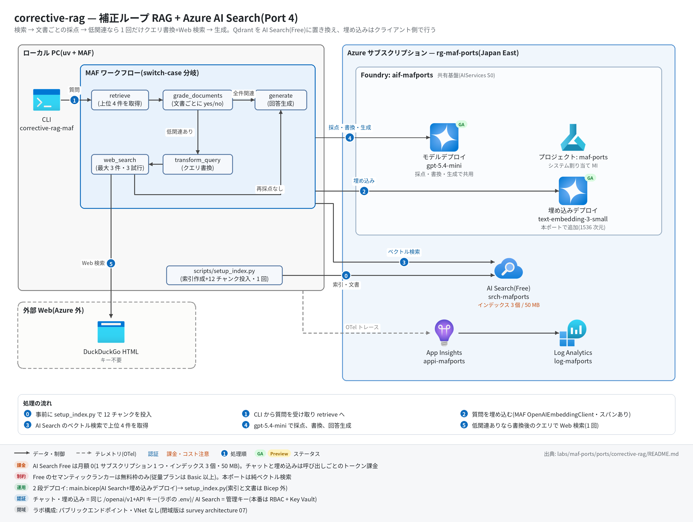

# corrective-rag — 補正ループ RAG + Azure AI Search(Port 4)

元: [`rag_tutorials/corrective_rag`](https://github.com/Shubhamsaboo/awesome-llm-apps/tree/main/rag_tutorials/corrective_rag)(LangChain + LangGraph + Qdrant + Tavily + Streamlit、454 行)

## 元の構成(5行)

- Streamlit で文書 URL/アップロードを受け、tiktoken ベースで分割(500 トークン・重複 100)→ Qdrant(コサイン・1536 次元、埋め込みは OpenAI text-embedding-3-small)へ投入し `as_retriever()`(k=4)で検索
- LangGraph `StateGraph`(state は `{"keys": Dict[str, any]}` の**無型 dict 1 個**): `retrieve → grade_documents → (conditional) → generate | transform_query → web_search → generate → END`
- `grade_documents` は文書ごとに Claude へ `{"score": "yes"/"no"}` の JSON を要求し `re.search(r'\{.*\}')` + `json.loads` で緩くパース。1 件でも "no" なら `run_web_search="Yes"`(文字列フラグ)。採点エラー時は安全側に文書を残す
- `transform_query` が質問を検索最適化クエリへ書換(state の question を**上書き**)→ Tavily 検索(max 3 件・tenacity 3 試行の指数リトライ)。結果は Title/Content 連結の **1 Document** に束ねて追加。失敗・0 件時は文書を変えずに続行
- **補正パスは一方向で最大 1 回**(web_search → generate は無条件エッジ。再採点・再書換のループは存在しない — CRAG 論文のループはこの実装では単発パスに簡略化されている)

## LangGraph → MAF 対応表(本ポートの核心)

| 元(LangGraph) | 移植後(MAF core) | 備考 |
| --- | --- | --- |
| `StateGraph(GraphState)` の共有 dict `{"keys": {...}}` | **エッジごとの型付きメッセージ**: `Retrieval` / `GradeOutcome` / `RewriteOutcome` / `WebSearchOutcome` | 全ノードが読める可変 dict → そのエッジで必要な値だけ運ぶ(学び 1) |
| `add_node("retrieve", retrieve)` | `RetrieveExecutor(id="retrieve")` | retriever は `SupportsRetrieve` protocol 注入(AI Search 実接続はライブのみ) |
| `add_node("grade_documents", ...)` | `GradeExecutor(id="grade_documents")` | 文書ごと逐次採点。`response_format=GradeScore` + lenient フォールバック |
| `add_conditional_edges(grade, decide_to_generate, {...})` | `add_switch_case_edge_group(grade, [Case(needs_web_search), Default])` | `run_web_search == "Yes"`(文字列)→ `GradeOutcome.needs_web_search`(bool) |
| `add_node("transform_query", ...)`(question を上書き) | `TransformQueryExecutor` → `RewriteOutcome(question, original_question)` | 上書きという暗黙の副作用を、書換前後 2 フィールドで明示化 |
| `add_node("web_search", ...)`(Tavily + tenacity) | `WebSearchExecutor`(自前 DDG + `search_with_retry`) | 3 試行・4s/8s 待ちを移植。sleep 注入でオフラインテスト可能 |
| `add_edge("web_search", "generate")`(無条件) | `.add_edge(search, generate)` | Web 結果を再採点しない単発補正を忠実に踏襲 |
| `set_entry_point("retrieve")` / `END` | `WorkflowBuilder(start_executor=retrieve, output_from=[generate])` | |
| `app.stream(inputs)` の step 表示(Streamlit expander) | `workflow.run(q, stream=True)` の intermediate イベント | `DocsRetrieved` / `GradeDecided` / `QueryRewritten` / `WebSearched` |
| `generate` ノード(1 関数で両経路を受ける) | `GenerateExecutor` の **2 handler**(`GradeOutcome` / `WebSearchOutcome`) | 合流ノードは受信型で経路が分かる(dict ではこの区別が消えていた) |

## 移植後の構成



```
                                      ┌─[Default: 全て関連]──────────────────────────▶ generate ─▶ answer
question ─▶ retrieve ─▶ grade_documents┤  (needs_web_search == False)
        (AI Search      (文書ごとに    │
         ベクトル検索)   yes/no 採点)  └─[Case: 低関連あり]─▶ transform_query ─▶ web_search ─▶ generate ─▶ answer
                                                             (クエリ書換)        (DDG・3試行)   (書換後クエリ+
                                                                                               残存文書+Web結果)
```

## 設計判断

### Qdrant → Azure AI Search(**Free SKU**)

- `infra/main.bicep` で `sku: { name: 'free' }` の検索サービスを作成(コスト最小・月額ゼロ)。
- **Free の制約**: インデックス **3 個**まで・ストレージ **50 MB**・レプリカ/パーティション拡張不可・SLA なし・セマンティックランカーは**無料プランの月間枠のみ**(従量の Standard プランは Basic 以上。※2026-09-29 訂正: 初版は「使用不可」と誤記)・長期間使わないと削除され得る(1 サブスクリプションに 1 サービスまで)。本コーパス(12 チャンク。2026-07-31 のライブ時点は 11)には十分。
- **本番との差**: 本番は Basic 以上+**セマンティックランカー**(意味的リランキング)+ハイブリッド検索(BM25+ベクトルの RRF 融合)が定石。本ポートは元実装に合わせた純ベクトル検索だが、`AzureSearchClientAdapter.search` の `search_text=None` に質問文を渡すだけでハイブリッドになる(学び 2)。
- インデックス定義+文書投入は **ARM/Bicep では書けない**(データプレーン API)ため `scripts/setup_index.py` に分離。

### 埋め込み: **クライアント側埋め込み(integrated vectorization なし)を採用**

- インデックスはベクトルフィールド(1536 次元・HNSW)のみ持ち、埋め込みは投入時(setup_index.py)もクエリ時(リトリーバ)もクライアント側で text-embedding-3-small を呼ぶ。呼び出しは MAF の `OpenAIEmbeddingClient`(agent-framework-openai。2026-10-06 に openai SDK 直呼びの自前ラッパー `OpenAIEmbedder` から置き換え)で、チャットと同じ接続情報を使い、`embeddings <model>` の OTel スパンが出る。
- 採用理由: (1) 元実装が同じ構造(LangChain `OpenAIEmbeddings` によるクライアント側埋め込み)で忠実、(2) integrated vectorization はベクトライザ+(取り込み自動化まで含めると)インデクサ/スキルセットの構成が必要で、本ポートの主題(補正ワークフローの移植)から外れる、(3) 埋め込みの呼び出し回数・コストがコードから見えて学習に向く。
- **text-embedding-3-small は共有基盤(shared.bicep)に追加せず**、本ポートの `infra/main.bicep` が共有 Foundry アカウントへデプロイを追加する(`Microsoft.CognitiveServices/accounts/deployments`・GlobalStandard capacity 10)。共有基盤を「全ポート共通の最小構成」に保つための線引き。
- トレードオフ: クエリのたびに埋め込み API を 1 回余計に呼ぶ(レイテンシ+微小コスト)。本番で integrated vectorization(`VectorizableTextQuery`)にすれば検索サービス側が埋め込みを代行し、クライアントは質問文を送るだけになる。

### 補正「ループ」はループしない(元実装に忠実)

元実装の補正パスは transform_query → web_search → generate の一方向 DAG で、再採点・再書換は存在しない。移植も同じトポロジを保ち、**書換・Web 検索は最大 1 回**(`test_single_corrective_pass_no_regrade_or_rerewrite` で固定)。無限ループ防止のカウンタは不要 — グラフ構造そのものが上限。唯一のリトライは Web 検索のトランスポートレベル 3 試行(元 tenacity → `search_with_retry`、待ち 4s/8s も一致)。

### その他

- Web 検索: Tavily(要 API キー)→ キーレス自前 DDG(`search.py` は ports/research-handoff からコピー。出典: ports/trend-analysis)。結果を 1 文書に束ねる形・失敗/0 件時に文書を変えず続行する挙動は元実装どおり
- モデル: claude-sonnet-4-5(temperature=0)→ Foundry の共有デプロイ(gpt-5.4-mini)を 3 役割(採点・書換・生成)で共用。元に system prompt がないため instructions は与えず、PromptTemplate 原文を実行メッセージとして送る
- 元実装の quirk も踏襲: 検索 0 件時は採点ループが回らず Web 検索フラグが立たないまま**空コンテキストで直接生成**される(`test_empty_retrieval_goes_direct_with_empty_context`)。補正すべきかは設計判断だが、移植では「元の挙動の記録」を優先
- Streamlit → CLI(`uv run corrective-rag-maf "question" [--json] [--top-k N]`)。文書取り込み UI は setup_index.py に置換

## 実行

```bash
uv sync --extra dev --extra live
uv run pytest                      # オフライン(ネットワーク不要・42 件)

# --- ライブ(要 共有基盤 + 本ポートの infra デプロイ + ../../.env)---
az deployment group create -g rg-maf-ports -f infra/main.bicep -p baseName=mafports
#   → 出力 searchEndpoint / searchAdminKey を ../../.env の
#     AZURE_SEARCH_ENDPOINT / AZURE_SEARCH_ADMIN_KEY に転記

uv run python scripts/setup_index.py      # インデックス作成+data/*.md 投入(1 回)
uv run corrective-rag-maf "Azure AI Search の Free レベルにはどんな制約がありますか?"
uv run corrective-rag-maf --json "Azure AI Search の Basic レベルは月額いくら?"  # 補正パス期待
uv run pytest -m live                     # ライブスモーク(インデックス存在前提)
```

詳細な実行手順と確認観点は [docs/runbook.md](./docs/runbook.md)(人間用 HTML: `docs/runbook.html`)。

インフラ: 共有基盤(existing 参照)+固有リソース 2 つ — AI Search(Free)と text-embedding-3-small デプロイ。使わない期間はリソースグループごと削除可(インデックスは setup_index.py で再構築できるためステートレス)。

## 評価

`tests/eval_dataset.jsonl`(7 ケース)は各ケースに `expected_route`(direct / corrective)を明記。コーパス内で完結する質問(Free レベル制約、埋め込み次元数)は direct、コーパス外・鮮度依存(現行価格、今週のニュース)は corrective が期待値。直行すると幻覚価格が出る「分岐ミスの実害」ケースと、片側だけコーパスにある境界ケース(Qdrant vs AI Search)を含む。

**groundedness の測り方(次ステップ)**: 本ポートの grader は「検索結果が質問に関連するか」を実行時に測っているが、**最終回答がコンテキストに接地しているか**は別の関心事。`--json` 出力の `documents`(生成に使ったコンテキスト。Web 経由なら web_search 文書を含む)+ `answer` + 質問の 3 つ組を Foundry の **Groundedness 評価器**(azure-ai-projects evals API / azure-ai-evaluation)に渡すと、補正パスの有無で接地性がどう変わるかを比較できる。Retrieval 評価器(取得文書自体の関連性)と併用すると「リトリーバが悪いのか、grader が悪いのか、生成が悪いのか」を切り分けられる。

## 検証結果(2026-07-31)

- オフラインテスト 37 passed / ruff clean / `az bicep build` OK(生成 json は削除)
- ライブスモーク・実デプロイは未実施(呼び出し元で実施)。手順: infra デプロイ → .env 転記 → `setup_index.py` → `pytest -m live`。トレース到達の確認クエリ:

```bash
az monitor app-insights query --app appi-mafports -g rg-maf-ports \
  --analytics-query "dependencies | where timestamp > ago(30m) | summarize count() by name"
```

## 検証結果(2026-07-31 ライブ)

- インフラ: AI Search Free(srch-mafports)+ text-embedding-3-small を共有 Foundry へ追加デプロイ。`setup_index.py --recreate` で 11 チャンク投入
- in-domain 質問: retrieve 4 → grader が 3/4 棄却 → **補正パス発火**(書換+Web 検索 3 件)→ 正答(hosted agent の従量課金)。※採点が厳格で in-domain でも補正パスに入った — 「直行生成」経路はオフラインテストでのみ検証
- out-of-domain 質問: 全棄却 → 書換 → Web 検索 → 誠実な回答(未発表と回答)
- トレース: `executor.process`(retrieve/grade/transform_query/web_search/generate)+ `invoke_agent grader_agent`×6(**文書ごとの採点が個別スパン化**)を App Insights で確認
- 修正: 非同期 azure-search-documents に `aiohttp` が必要(依存へ追加)

## 検証結果(2026-10-06 最新化チェック)

オフライン+ライブ(2026-10-06、共有基盤 `mafp1006`・Japan East。ライブの記録は末尾の「ライブ(2026-10-06)」)。

- **依存更新**(`uv lock --upgrade`): agent-framework-core 1.19.0 → **1.20.0** / agent-framework-openai 1.14.4 → **1.15.0** / openai 3.20.0 → **3.24.0** / azure-identity 1.25.3 → 1.26.0 / azure-search-documents 12.0.0(据え置き。安定版の最新)/ ruff 0.16.9 → 0.16.10。pyproject の下限を `agent-framework-core>=1.20.0` / `agent-framework-openai>=1.15.0` に引き上げ、live extra の `openai>=3.20` は**削除**(下記の改修で openai SDK の直接 import がなくなったため。openai は agent-framework-openai の `openai>=2.25,<4` 経由で 3.24.0 が解決される)。dev extra に `opentelemetry-sdk>=1.39`(スパンの回帰テスト用)を追加
- オフラインテスト **42 passed**(37 → 42。埋め込みの配線テスト 3 件+トレースのサンプリング設定 2 件を追加)/ `-W error::DeprecationWarning` でも 42 passed / `uv run ruff check .` clean / `az bicep build` OK
- **改修: 埋め込みを MAF の `OpenAIEmbeddingClient` に置き換え**(retrieval.py・scripts/setup_index.py)。自前ラッパー `OpenAIEmbedder`(openai SDK の `AsyncOpenAI.embeddings.create` 直呼び)と自前プロトコル `SupportsEmbed` を廃止し、リトリーバは MAF core の `SupportsGetEmbeddings` を受ける形にした。`build_embedding_client(settings)` が `OpenAIEmbeddingClient(model=, api_key=, base_url=)` を返し、クエリ時と投入時(16 件ずつのバッチ・入力順で復元)の両方が同じクライアントを使う。理由:
  1. **自前実装の削減と接続の一本化の明示**: チャット(`OpenAIChatClient`)と同じ引数・同じ接続情報(`FOUNDRY_OPENAI_V1_ENDPOINT`+`FOUNDRY_API_KEY`)で組み立てる形にそろった。`/openai/v1` は OpenAI 互換面なので MAF は `AsyncAzureOpenAI`(`/deployments/{model}/...` にパスを書き換えて 404 になる)ではなく `AsyncOpenAI` を使う — オフラインテストで固定
  2. **埋め込みがトレースに乗る**: MAF の `EmbeddingTelemetryLayer` が `embeddings text-embedding-3-small` スパン(`gen_ai.operation.name=embeddings`・入力トークン数)を出す。旧実装は MAF の計装対象外で、runbook にも「埋め込みはスパンに出ない」と書いていた死角が消える(InMemorySpanExporter のテストで固定)
  3. **埋め込みの実装を差し替えられる**: リトリーバが MAF のプロトコルを受けるので、次項の `FoundryEmbeddingClient` などに `build_embedding_client` の 1 か所で切り替えられる
  - いずれも安定版パッケージ(agent-framework-openai 1.15.0)の API で、experimental 指定はない。HTTP 層だけを差し替えたモックで `POST {endpoint}/openai/v1/embeddings`・`Authorization: Bearer <キー>`・`{"model", "input"}` の送信と応答ベクトルの復元を確認した(openai SDK は既定で `encoding_format: "base64"` を付けて送り、応答を自動で復号する — 旧実装と同じ SDK 経路)
- **簡素化の検討 — Foundry project embeddings は不採用(候補として記録)**: agent-framework-foundry 1.14.0(MAF python-1.20.0)で `FoundryEmbeddingClient(project_endpoint=..., credential=...)` がプロジェクトエンドポイントを受け付けるようになった(PR #8454)。使い捨て venv で HTTP をモックして確かめると、**内部で `AIProjectClient.get_openai_client()` の base_url をアカウントの `https://<account>.openai.azure.com/openai/v1/` に書き換えてから `POST .../embeddings` を送り、トークンのスコープは `https://ai.azure.com/.default`** だった。つまり「プロジェクトエンドポイントで埋め込みが呼べるようになった」のではなく「プロジェクトの URL からアカウント側の URL を導出してくれる」機能で、foundry-probes probe 08 の実測(プロジェクト経由の embeddings は 404)とは矛盾しない。本ポートはもともとチャット・埋め込みとも**アカウントの OpenAI v1+API キーの 1 本**で動いており、採用しても接続情報は減らない(`FOUNDRY_OPENAI_V1_ENDPOINT`+キー → `FOUNDRY_PROJECT_ENDPOINT`+`az login` に置き換わるだけ)。加えて agent-framework-foundry 1.14.0 は `azure-ai-projects>=2.2.0,<2.8.0` と**ベータ版の `azure-ai-inference>=1.0.0b9,<1.0.0b10`** を要求する。チャットも `FoundryChatClient`+Entra ID に寄せてキーレス化する段階で、`build_embedding_client` を差し替えれば移行できる(アカウントの `/openai/v1` が `ai.azure.com` スコープのトークンを受理するか、利用者に要るロールはライブ未確認)
- 不採用(プレリリース): agent-framework-azure-ai-search 1.0.0b261002 の `AzureAISearchContextProvider`(semantic / agentic モード。1.20.0 で `knowledge_source_params` 対応)と同パッケージのベクトルストア(core の `VECTOR_STORES` は experimental)。本ポートは azure-search-documents(GA)を直接使う構成のまま
- **変更不要と判断**: ワークフロー(`WorkflowBuilder` / `add_switch_case_edge_group` / `ChatOptions(response_format=)`)と `OpenAIChatClient(model=, api_key=, base_url=)` は 1.20.0 / 1.15.0 で同じシグネチャ。1.15.0 の「Azure 経由クライアントに OpenAI の Organization / Project ヘッダーを混ぜない」修正は `azure_endpoint` / `credential` を渡す経路が対象で、API キー+`base_url` の本ポートは対象外 / `Microsoft.Search/searchServices@2023-11-01` / text-embedding-3-small v1(GA・リタイア 2028-02-09)と gpt-5.4-mini(GA・リタイア 2027-09-21)— モデル引退表 2026-09-28 版
- **ライブ(2026-10-06、12:01〜12:04Z+トレース確認 13:31〜13:42Z)— 合格**:
  - インフラ: `infra/main.bicep`(デプロイ名 `l2-p4-corrective-rag`)で AI Search **Free** `srch-mafp1006` と text-embedding-3-small(GlobalStandard 10)を **38 秒**で作成。Free の新規作成は Japan East で問題なし
  - `setup_index.py --recreate` **6.2 秒**: `chunked 4 files into 12 chunks` → `embedded with text-embedding-3-small`(MAF の `OpenAIEmbeddingClient` 経由)→ `uploaded 12/12 chunks`。なお新規サービスでも `deleted index: corrective-rag` と出る — azure-search-documents 12.0.0 の `delete_index` は存在しないインデックスでも例外を出さない(runbook の出力例を訂正)
  - Q1「Free レベルの制約」**15.0 秒**: retrieve 4 → 採点 kept 3 / dropped 1 → 補正パス(書換+Web 3 件)→ 訂正後コーパスどおりの回答(インデックス 3 個・50 MB・拡張不可・SLA なし・1 サブスクリプション 1 つ・**セマンティックランカーは無料枠の範囲内**)。2026-07-31 は 4 件中 3 件棄却だったが、今回は 3 件採用 — 採点は 1 件でも no なら補正パスに入るので経路は同じ
  - Q2「Basic の月額」`--json` **12.3 秒**: 4 件とも no → 書換 → Web 3 件 → 「文脈に具体的な金額はない」と誠実に回答(`corrected: true`)
  - `pytest -m live` **1 passed(10.9 秒)**
  - **トレース**: 埋め込みが `embeddings text-embedding-3-small`(617 ms・入力 19 トークン)として **`executor.process retrieve` の配下**に出て、その下に HTTP の `POST /openai/v1/embeddings` が並ぶことを App Insights で確認(改修の狙いどおり)
  - **見つかった問題と修正 — トレースの一部スパンが欠ける**: 12:03Z の実行では `executor.process retrieve` / `grade_documents` と採点 4 件中 1 件の `invoke_agent grader_agent` が App Insights に無かった。原因は **azure-monitor-opentelemetry 1.8.6(2026-02-05)からの既定サンプラー `RateLimitedSampler`(5 スパン/秒)**: 親が 100% で採られた場合、子スパンはその時点のレートで個別に再判定されるため、短時間に多数のスパンを出すワークフローでは**同じトレースの一部だけが落ちる**(ローカルでスパン 87 個を一気に作ると 27 個しか残らないことを再現)。`setup_tracing` で `configure_azure_monitor(..., sampling_ratio=1.0)` を明示して全件送るよう全 6 ポートを修正し、修正後の実行(13:42Z)で `executor.process grade_documents` 1・`invoke_agent grader_agent` 4(= 採点した文書数)・`chat` 6 がすべて届くことを確認。7 月のライブの「採点が文書ごとに個別スパン化」の件数確認も、この既定(当時 1.8.9)の影響を受けていた可能性がある
  - コスト感: Search Free は 0。埋め込み・チャットはトークン従量で数セント未満(12 チャンクの埋め込み+質問 2 問・スモーク 1 回)。検証後に Search(13:24Z)と埋め込みデプロイ(13:35Z)を削除

## 検証結果(2026-09-29 最新化チェック)

- 依存更新(`uv lock --upgrade`): agent-framework-core 1.12.1 → **1.19.0** / agent-framework-openai 1.11.0 → **1.14.4** / openai 2.51.0 → **3.20.0**(HTTP 層が httpx2 に)/ azure-search-documents 12.0.0(据え置き。PyPI 最新)/ azure-monitor-opentelemetry 1.8.9 → 1.8.10 / ruff 0.16.1 → 0.16.9。pyproject の下限を検証した版へ引き上げ(`agent-framework-core>=1.19.0` / `agent-framework-openai>=1.14.4` / live の `azure-search-documents>=12.0`・`openai>=3.20`)
- オフライン **37 passed**(`-W error::DeprecationWarning` でも 37 passed = 非推奨 API の使用なし)/ `uv run ruff check .` clean(`docs/architecture.py` を v2 図〈日本語+処理順バッジ〉に書き直した際に、2026-07-31 の図追加時からあった I001 / RUF100 / ISC004 も解消)/ `az bicep build` OK
- **コード変更なし(API 互換)**: MAF 1.14〜1.19 の [BREAKING](agent middleware の受け口・`SecretString`・MCP / HTTP Cookie・OTel GenAI semconv のモード整理 等)は本ポートの使用面に当たらない。`Agent` / `ChatOptions(response_format=...)` / `WorkflowBuilder`(`add_switch_case_edge_group`・`Case` / `Default`・`intermediate_output_from`)/ `OpenAIChatClient`(Responses API)は同一シグネチャ。スパン名 `executor.process` / `invoke_agent` / `execute_tool` と計装の既定有効も 1.19.0 の `observability.py` で不変を確認
- 実 `Agent`+`OpenAIChatClient`+openai 3.20 の配線を、HTTP 層だけ差し替えたモック(`/openai/v1/responses` の応答を固定)で両経路とも通した: 直行 3 リクエスト / 補正 4 リクエスト、grader は `text.format` に `json_schema`(`GradeScore`・`strict: true`)を送出。`OpenAIEmbedder` も `/openai/v1/embeddings` への送出と応答の復元を同様に確認。azure-search-documents 12.0.0 のデータプレーン既定 api-version は GA の `2026-04-01`
- 変更不要と判断: `Microsoft.Search/searchServices@2023-11-01` は現行も有効な GA 版(最新 GA は 2025-05-01。使うプロパティに差がないため据え置き)/ text-embedding-3-small v1 は GA・リタイア 2028-02-09(モデル引退表 2026-09-21 版)/ gpt-5.4-mini は GA・リタイア 2027-09-21 / OpenAI v1 エンドポイント(`/openai/v1`)+API キーの接続方式は現行どおり
- **訂正(記述とコーパス)**: 「Free はセマンティックランカー不可」は現行ドキュメントと不一致だった — ティア別機能表に「Semantic ranker: Runs on the Free tier but not recommended for large workloads」、課金設定ページに無料プラン「Available on all pricing tiers」/ Standard プラン「Requires the Basic tier or higher」(https://learn.microsoft.com/en-us/azure/search/search-sku-tier ・ https://learn.microsoft.com/en-us/azure/search/semantic-how-to-enable-disable ・ Free の上限は https://learn.microsoft.com/en-us/azure/search/search-limits-quotas-capacity )。README の設計判断・学び 2、`infra/main.bicep` のコメント、コーパス `data/azure-ai-search-vector-tiers.md`、`tests/eval_dataset.jsonl` 1 件目の期待値を訂正した。コーパスは 11 → **12 チャンク**になるため、ライブ再開時は `setup_index.py --recreate` で入れ直す
- 今後の選択肢: Free でもセマンティックランカーの無料枠が使えるので、`AzureSearchClientAdapter.search` に質問文(`search_text`)+`query_type="semantic"`(インデックスに semantic 構成を追加)を足せば「純ベクトル vs ハイブリッド+リランク」をこの構成のまま比較できる(ライブ未検証)
- **ライブ未検証**: 以上はオフライン・静的確認のみ(Azure リソースは削除済み)。再デプロイ時に確認が要るのは、Free SKU の新規作成可否(リージョンの容量制約)、訂正後コーパスでの採点・回答の傾向(2026-07-31 は in-domain 質問でも grader が 3/4 を棄却して補正パスに入った)、openai 3.x 経由の実 Foundry 応答の解釈
- 実行手順と確認観点を [docs/runbook.md](./docs/runbook.md) に新設

## 学び(MAF vs 元構成)

1. **状態管理の差 — LangGraph は「全ノード共有の可変 dict」、MAF は「エッジを流れる型付きメッセージ」。**元コードの state は `{"keys": Dict[str, any]}` で、誰が question を上書きしたか(transform_query)、run_web_search がいつ立つか(grade)、generation がいつ入るか(generate)が**全部読まないと分からない**。MAF 移植では同じ情報が `RewriteOutcome(question, original_question)` のような型に落ち、暗黙の上書きが 2 フィールドの並置として顕在化した。代償は 2 つ: (a) メッセージ dataclass が 4 つ増える、(b) 合流ノード(generate)が経路ごとの handler を持つ必要がある(LangGraph は dict から取るだけなので 1 関数)。**「状態に何が入っているか」をスキーマとして固定したい業務システムでは MAF 型が向き、研究コードのように state の形を頻繁に変える探索フェーズでは LangGraph の dict が速い** — SI の技術選定ではこの開発フェーズの違いが効く。なお LangGraph も TypedDict/Pydantic で state を型付けできる(この元コードが使っていないだけ)ので、正確には「フレームワークの差」半分、「書き手の規律をフレームワークがどれだけ強制するか」の差が半分。MAF はハンドラ引数の型がルーティングに直結するため、無規律な状態共有が**構造的に書きにくい**。
2. **Qdrant → Azure AI Search 置換は「検索コードは楽、周辺の運用設計が本題」。**楽だった点: インデックス定義(HNSW+ベクトルフィールド)は SDK で 30 行、クエリは `VectorizedQuery` 1 個で、LangChain の vectorstore 抽象がなくても困らなかった。element 数 11 の学習コーパスなら Free SKU で足り、月額ゼロで本物のマネージド検索が触れる。難しかった/考えることが増えた点: (a) LangChain `Qdrant.as_retriever()` は**埋め込みの存在自体を隠す**が、素の AI Search では埋め込みモデルのデプロイ(infra)・次元数の一致(setup_index.py とクエリ側)・呼び出しコストが全部自分の設計項目になる。(b) インデックスは ARM 外(データプレーン)なので、Bicep(サービス)+スクリプト(インデックス)の**2 段デプロイ**になり、Qdrant の「コード内で create_collection」より運用の段取りが増える — 引き換えに「インフラとデータの境界」が明確になり、これは本番では利点。(c) SKU 選定が検索品質に直結する(Free のセマンティックランカーは無料枠のみ〈2026-09-29 訂正。初版は「不可」〉。本番の Basic+ハイブリッド+リランカーは、元実装の純コサイン検索より品質の上げ幅が大きい)。**「ベクトル DB の置換」は API の置換ではなく、検索品質・コスト・運用のレバーがどこにあるかの再学習**だった。
3. **「補正ループ」という名前と実装のズレが、グラフを書き直すと露呈する。**CRAG は論文的には「評価→補正を繰り返す」印象を与えるが、この元実装は再採点なしの単発 DAG で、Web 結果は無検証で生成に入る。LangGraph の dict-state だとこのズレは読み流しやすいが、MAF でエッジを 1 本ずつ張り直すと「web_search → generate が無条件」であることを設計判断として書かされる(README にも書いた)。research-handoff の学び 3(宣言と実挙動のズレの洗い出し)と同型で、**移植とは元アプリの本当の制御フローを確定させる作業**。おまけに「検索 0 件だと Web 検索に行かず空コンテキスト生成」という quirk もテストで固定できた — 元の Streamlit 実装ではまず気づけない挙動。
4. **grader の「regex で JSON を拾う」が、response_format+lenient パーサの 3 段構えに正規化できた。**元実装の `re.search(r'\{.*\}')` は素朴だが思想は正しい(LLM は JSON を散文で包む)。MAF では `ChatOptions(response_format=GradeScore)` のネイティブ構造化出力を第 1 経路にし、balanced-slice 抽出→「エラー時は文書を残す」安全側フォールバックまで全経路をオフラインテストで固定した。さらに `score: Literal["yes","no"]` にしたことで、元実装なら黙って no 扱いになる `"maybe"` が明示的にエラー経路(=文書温存)に落ちる。**実行時の自己採点(grader)とオフライン評価(Foundry の Retrieval / Groundedness 評価器)は同じ関心事の実行時/開発時の分担**であり、この対応関係を押さえると RAG の品質改善の議論が整理される(評価セクション参照)。
5. **tenacity のような「デコレータでリトライ」は、そのまま移植せず sleep 注入の関数に開くとテスト資産になる。**`@retry(stop_after_attempt(3), wait_exponential(...))` は 1 行だが、テストで実際に 4 秒待つか mock で時間を偽装するかの二択になりがち。`search_with_retry(fn, query, sleep=...)` に開けば、試行回数・待ち秒列(4s/8s)・最終失敗の伝播をネットワークなしで 3 テストに固定できた。挙動は元と同一で、依存が 1 つ減る。

**2026-10-06 追記**: 学び 2(a) の「素の AI Search では埋め込みが全部自分の設計項目になる」のうち、**呼び出しの部品化と計装は MAF 側で吸収できる**ようになっていた — agent-framework-openai の `OpenAIEmbeddingClient`(MAF core の `SupportsGetEmbeddings` を満たす)に置き換えると、LangChain の `OpenAIEmbeddings` 相当の 1 行の組み立てで、埋め込みも `embeddings <model>` スパンとしてトレースに並ぶ(旧実装は openai SDK 直呼びでトレースに出なかった)。残る設計項目はデプロイ・次元数・投入の段取りで、こちらは変わらない。もう 1 点、MAF 1.20 の「Foundry project embeddings」は名前に反して**プロジェクトの URL からアカウントの `/openai/v1` を導出する設定上の便宜**で、呼び先はアカウントのまま(probe 08 の「プロジェクト経由の embeddings は 404」と整合)。SDK の機能名と実際の呼び先がずれる例として、選定時は「どのエンドポイントに何の認証で飛ぶか」を HTTP レベルで確かめる癖が要る。さらにライブで、**トレースの欠け**という別の落とし穴を踏んだ: azure-monitor-opentelemetry 1.8.6 以降の既定サンプラー(5 スパン/秒のレート制限)は、エージェントのワークフローのような「1 リクエストで数十スパンを一気に出す」処理では同じトレースの一部だけを落とす。トレースを分岐・周回の検証材料に使うなら `sampling_ratio=1.0`(または `OTEL_TRACES_SAMPLER`)を明示する — 本番でも「コスト削減の既定値が監査用のトレースを黙って間引く」ので、観測要件を決める段階で確認すべき項目になる。
