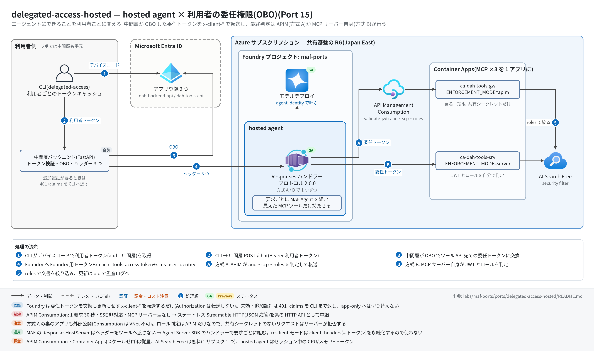

# delegated-access-hosted — hosted agent × 利用者の委任権限で社内文書と基幹 API を使い分ける(Port 15)

元: **なし(新規パターン)**。awesome-llm-apps に対応するアプリはない。Port 11 で「hosted agent に載せる」、Port 14 で「アプリ内ガバナンス」を扱ったのに続き、SI 案件で必ず問われる **「エージェントが社内システムを叩くとき、誰の権限で叩くのか」** を参照実装にした。

**エージェントにできることを利用者ごとに変える。** Foundry の hosted agent が、サインインした利用者の**委任権限**(アプリ管理の OBO + `x-client-*` ヘッダー転送 + `x-ms-user-identity`)で社内リソースにアクセスする。題材は 2 つ:

- **社内文書検索(RAG)**: 文書ごとに閲覧ロール(`allowed_roles`)を持たせ、AI Search のセキュリティフィルターで**利用者に見える文書だけ**を検索結果に出す
- **基幹 API(取引先マスタ)**: 参照は全社員、支払条件の更新は `Suppliers.Write` ロールの利用者だけ

最終判定点は **2 通り実装して比較**する — **方式 A: APIM が判定**(validate-jwt + MCP サーバーごとのロール)/ **方式 B: MCP サーバー自身が判定**(JWT を自分で検証)。

| 利用者(テスト用) | ツール API のアプリロール | 見える MCP サーバー | 同じ質問「与信限度額の見直し頻度は?」 | 「S-1002 の支払条件を 45 日に」 |
| --- | --- | --- | --- | --- |
| 一般社員(employee) | なし(暗黙の `Employee` だけ) | docs / suppliers | 経理内規が検索結果に出ない → 「見つかりませんでした」 | 更新ツール自体が見えない → `MSG_FORBIDDEN` の定型文 |
| 経理担当(finance) | `Suppliers.Write` / `Docs.Finance` | docs / suppliers / supplier-admin | 「与信限度額の設定基準(経理部内規)」を根拠に回答 | 更新される(監査ログに oid・変更前後) |

## 実装前調査の結果(2026-09-30、Learn の生 HTML を curl で確認)

### アプリ管理 OBO + ヘッダー転送([use-on-behalf-of-flow](https://learn.microsoft.com/en-us/azure/foundry/agents/how-to/use-on-behalf-of-flow)、2026-09-28 更新)

- **Foundry はトークンを交換も更新もしない。**中間層(信頼できるバックエンド・機密クライアント)が OBO で下流 API 宛ての委任トークンを取り、`x-client-*` ヘッダー(値は `Bearer` なしの生トークン)で hosted agent に渡す。Foundry は `x-client-*` をコンテナへ転送するだけで、呼び出し元の `Authorization` は**転送しない**
- 1 回の呼び出しに 3 つのヘッダー: `Authorization: Bearer <Foundry 用ワークロードトークン>`(スコープ `https://ai.azure.com/.default`)/ `x-client-<名前>: <委任トークン>` / `x-ms-user-identity: <利用者の Entra oid>`。`x-ms-user-identity` は**トークンではない**(Foundry が利用者を識別し、会話履歴を利用者単位に分ける)。**検証済みの利用者トークンから取り出した oid** を使い、クライアントが送ってきたヘッダーを信用しない
- 前提: コンテナプロトコル **2.0.0** / 中間層のワークロード ID に **Foundry Agent Consumer**(エージェントまたはプロジェクトのスコープ)+ **カスタム data action `Microsoft.CognitiveServices/accounts/AIServices/agents/endpoints/UserIdentityImpersonation/action`**(組み込みロールに含まれない)。**利用者本人には Foundry のロールが要らない**(Foundry を呼ぶのは中間層だけ)
- コンテナ側は `ResponseContext.client_headers`(キーは小文字)で読む。利用者は `get_request_context().user_id` で取る(任意の `x-client-user-id` を信用しない)
- 「トークンを出さない」場所の列挙: プロンプト・モデル入力・リクエスト本文・応答メタデータ・会話履歴・**チェックポイント**・出力・例外・ログ。**バックグラウンド実行やクラッシュ復旧のためにトークン付きヘッダーを永続化しない**。認証失敗は中間層へ返し、**黙って app-only に切り替えない**。条件付きアクセスの claims チャレンジは保持して利用者へ
- 選択表(公式): アプリ管理 OBO は「自前のエージェントコードが下流 API を利用者の委任権限で直接呼ぶ必要があるとき」。対応ツールで足りるなら **Toolbox の認証**、データだけ要るなら **バックエンドが下流 API を呼ぶ**方式、自律処理なら**エージェントのアプリ権限**(委任の失敗時のフォールバックに使うな)

### ヘッダー転送の契約([hosted-agent-contract](https://learn.microsoft.com/en-us/azure/foundry/agents/concepts/hosted-agent-contract)、2026-08-19 更新)

- ゲートウェイがコンテナへ転送するのは許可リストだけ: `x-client-*` / 本文系(`content-type` 等)/ トレース系(`traceparent` 等)/ `user-agent`。**`Authorization`・`Host`・`Cookie`・`x-forwarded-*` は転送しない**
- プロトコル 2.0.0 ではプラットフォームが `x-agent-user-id`(利用者単位のキー)と `x-agent-foundry-call-id` を毎要求に付ける。ローカル実行では来ないので欠落を許容する
- resilient / 長時間実行は**プレビューのオプトイン**(Agent Server SDK の resilient タスク)

### 権限([hosted-agent-permissions](https://learn.microsoft.com/en-us/azure/foundry/agents/concepts/hosted-agent-permissions) #delegate-the-end-user-identity / [rbac-foundry](https://learn.microsoft.com/en-us/azure/foundry/concepts/rbac-foundry))

- `UserIdentityImpersonation/action` を持たずに `x-ms-user-identity` を送ると **403**。以前 `Microsoft.CognitiveServices/*` 経由で付いていた **Foundry User / Foundry Owner にも今は含まれない**。公式のカスタムロール定義(`az role definition create` 形式)を [infra/roles/](./infra/roles/foundry-user-identity-impersonation.json) に置いた
- Foundry Agent Consumer のロール定義 ID は `eed3b665-ab3a-47b6-8f48-c9382fb1dad6`。**Azure portal はアカウントスコープでしか割り当てられない**(プロジェクト / エージェントスコープは CLI・REST)。エージェントスコープの割り当ては「エンドポイントの呼び出し」だけに効く

### Entra ID の OBO([v2-oauth2-on-behalf-of-flow](https://learn.microsoft.com/en-us/entra/identity-platform/v2-oauth2-on-behalf-of-flow))

- OBO は**委任スコープだけ**を使い、アプリロールは**利用者側に付いたまま**(中間層のアプリに付くのではない)→ ツール API の委任トークンの `roles` クレームには**利用者に割り当てたアプリロール**が入る。これを両方式の判定と文書の絞り込みに使う
- OBO は**利用者プリンシパル専用**(app-only トークンを assertion にできない)。中間層は同意画面を出せないので、**同意は事前に**(管理者同意 / `knownClientApplications` + `.default` の結合同意 / `preAuthorizedApplications`)
- 追加認証が必要なら `interaction_required` + `claims` が返る → 中間層は **HTTP 401 + `WWW-Authenticate` にチャレンジを載せて**クライアントへ返し、クライアントは claims 付きで取り直す

### APIM Consumption の制約(validate-jwt / 機能比較 / ゲートウェイ比較 / SSE)

- `validate-jwt` は **Consumption を含む全ゲートウェイ**で使える。`clock-skew` の既定は **0 秒**、OpenID 設定(JWKS)は 1 時間キャッシュ・未知の kid で最短 5 分ごとに再取得
- Consumption は **「MCP サーバー」API 型に非対応**(既存 MCP のパススルー / REST → MCP 変換とも ❌)、**長時間接続(SSE)非対応**、`rate-limit-by-key` 非対応、**1 要求の総所要時間 30 秒**、ポリシー文書 16 KiB、**VNet 統合・静的 IP なし**、**Azure Monitor / Log Analytics のリクエストログなし**(Application Insights 連携は可)、削除すると **48 時間ソフトデリート**
- → MCP は**ステートレス Streamable HTTP + JSON 応答**にし、APIM では**素の HTTP API(`POST /mcp` 1 本)**として中継する(応答本文に触れるとバッファリングで MCP を壊しうる — 公式の注意)

### Toolbox の認証([tool-authentication](https://learn.microsoft.com/en-us/azure/foundry/agents/how-to/tools/tool-authentication)、2026-08-19 更新)= マネージドな代替

- 認証は**接続(connection)の属性**: `none` / `custom-keys` / `project-managed-identity` / `agentic-identity` / **`oauth2`**(利用者が OAuth を完了し、Foundry が資格情報を保存・更新)/ **`user-entra-token`**(利用者を表す宛先別の Entra トークンを Foundry が供給)
- `oauth2` パススルーのエージェントを使う利用者には **少なくとも Foundry Agent Consumer** が要る。**利用者のテナント = プロジェクトのテナント**(クロステナント不可)。初回は利用者ごとの同意リンク
- 「Bring-your-own AI gateway」として APIM を MCP サーバーの前に置く構成も公式の選択肢

## 移植後の構成



```
利用者(CLI: delegated-access)──① デバイスコード(aud = dah-backend-api)──▶ Entra ID
   │② POST /chat  Authorization: Bearer <利用者トークン>
   ▼
中間層バックエンド(FastAPI・ラボでは手元で起動)
   │ 利用者トークンを検証(JwtValidator)→ oid を取り出す
   │③ OBO(MSAL 機密クライアント)→ ツール API(dah-tools-api)宛ての委任トークン(scp Tools.Access, roles)
   │④ POST <hosted agent の Responses URL>
   │     Authorization: Bearer <Foundry 用トークン(中間層の SP の app-only)>
   │     x-client-tools-access-token: <委任トークン>
   │     x-ms-user-identity: <③ の利用者の oid>
   ▼
Foundry hosted agent(方式ごとに 1 つ: delegated-access-apim / delegated-access-server)
   hosting/main.py: ResponsesAgentServerHost + ハンドラー(要求ごと)
     委任トークンが無い → モデルを呼ばずに MSG_REAUTH
     MCP 3 サーバーへ initialize で疎通確認: 200 → 使う / 403 → 隠す / 401 → MSG_REAUTH
     見えたツールだけで MAF Agent を組む(モデル = FoundryChatClient + agent identity)
   │⑤ Authorization: Bearer <委任トークン>
   ├─[方式 A]─▶ APIM(Consumption)validate-jwt ×2(401 / 403)+ x-apim-gateway-secret
   │              └─▶ ca-dah-tools-gw(ENFORCEMENT_MODE=apim: 署名・期限・共有シークレットだけ)
   └─[方式 B]─▶ ca-dah-tools-srv(ENFORCEMENT_MODE=server: aud・scp・roles を自分で判定)
                    /docs/mcp            search_documents   → AI Search(roles で security filter)
                    /suppliers/mcp       list_suppliers / get_supplier
                    /supplier-admin/mcp  update_payment_terms(Suppliers.Write のみ・監査ログ)
```

| 部品 | コード | 担当する判断 |
| --- | --- | --- |
| 契約 | [contracts.py](./src/delegated_access_maf/contracts.py) | ヘッダー名・スコープ・ロール・MCP のパスと必要ロール・定型文。**名前を 1 か所に集める**(どれかがずれると黙って「権限なし」になる) |
| JWT 検証 | [jwt_validation.py](./src/delegated_access_maf/jwt_validation.py) | OpenID 設定 → JWKS → 署名・発行者・宛先・期限・スコープ。中間層とツールサーバーで共用 |
| 中間層 | [backend/](./src/delegated_access_maf/backend/) | 利用者トークンの検証 / OBO / claims チャレンジ → 401 / ヘッダー 3 つ(`x-ms-user-identity` は検証済みトークンから)/ トークンのマスク |
| hosted agent | [agent/](./src/delegated_access_maf/agent/) + [hosting/main.py](./hosting/main.py) | 要求ごとの疎通確認とツールの絞り込み、ミドルウェア 3 つ(マスク / 呼び出し時の 403 → `MSG_FORBIDDEN`・再試行しない / 監査)。方式 C の配線(要求スコープのファクトリ+`FoundryToolbox`)は [agent/toolbox.py](./src/delegated_access_maf/agent/toolbox.py)(2026-10-06・設計メモ) |
| ツールサーバー | [tools_server/](./src/delegated_access_maf/tools_server/) | MCP 3 サーバーを 1 アプリに mount。方式 B の判定、文書の絞り込み、更新の監査。APIM ポリシーのオフライン・エミュレーター |
| インフラ | [infra/](./infra/) | ACR・Container Apps ×2・APIM Consumption(API 3 つ+ポリシー)・AI Search Free(Bicep)/ カスタムロール定義 |
| セットアップ | [scripts/](./scripts/) | Entra のアプリ登録・同意・ロール(`setup_entra.py`)/ ツールサーバー(`deploy_tools_server.sh`)/ hosted agent(`deploy_hosted_agent.py`)。**すべて既定は dry-run** |

## 設計判断

### 1. MCP サーバー 3 つを 1 つのリソース API(dah-tools-api)にまとめ、権限はアプリロールで分ける

MCP サーバーごとにアプリ登録を分けると、中間層は要求ごとに OBO を 3 回行い、3 本の委任トークンを `x-client-*` で送ることになる(トークンの露出面も 3 倍)。本ポートは 1 つのリソース API(スコープ `Tools.Access`)に集約し、**どのサーバー・どの文書を使えるかはアプリロール(`Suppliers.Write` / `Docs.Finance`)で表す**。OBO は 1 回、転送するトークンも 1 本。代わりに「宛先が同じトークンで全サーバーに入れる」ので、**サーバー単位の判定(方式 A の APIM / 方式 B のサーバー)が必須**になる — これが A と B を比べる意味でもある。

### 2. MAF の ResponsesHostServer を使わず、Agent Server SDK のハンドラーで要求ごとに組む

`ResponsesHostServer`(agent-framework-foundry-hosting)はエージェントと MCP ツールを**起動時に 1 回だけ接続**し、リクエストのヘッダーをツールへ渡さない(`_responses.py` を確認)。利用者ごとに違う委任トークンで MCP に行くには、ツールの接続を**要求スコープに閉じ込める**必要がある。`azure.ai.agentserver.responses` の `ResponsesAgentServerHost` にハンドラーを直接登録し、要求ごとに「委任トークンを読む → 疎通確認 → 見えたツールだけで `Agent` を作る」。共有するのはモデル用のチャットクライアント(エージェント自身の ID)だけで、HTTP クライアントも要求ごと(Cookie を持たない・リダイレクトを追わない)。

**2026-10-06 注記:** agent-framework-foundry-hosting 1.0.0b261002(MAF python-1.20.0 と同時、[BREAKING] 再設計)で `ResponsesHostServer` が**要求スコープのファクトリ**(要求ごとに Agent を作る引数なしの callable)を受けるようになり、「起動時に 1 回だけ接続」は解消した。それでも方式 A / B は置き換えない(ソースを読んで判断、テストで固定):

1. ファクトリは**引数を取らない**(`_agent_source.validate_agent_source`)。要求の文脈として公開されているのは `get_request_context()` の `call_id` / `user_id` / `session_id` の 3 つだけで、`x-client-*`(委任トークン)には公開 API で届かない。`prepare_options` フックに渡る `HostedResponseRequest` も `ResponseContext` を非公開属性(`_context`)に持つだけ。届かせるには非公開属性か、ASGI ミドルウェア+contextvar の自前の仕掛けに頼ることになる
2. 応答の `metadata`(`delegated_access_status` / `www_authenticate` 等 — 中間層が 401 + `WWW-Authenticate` に写す契約)を**エージェントから設定する公開の手段がない**
3. 「委任トークンが無ければモデルを呼ばずに定型文」「疎通確認で 401 なら再認証」は、エージェントの外で決まる分岐で、MAF に載せるにはカスタムの `SupportsAgentRun` が要る
4. 置き換わるのは `agent/host.py` のハンドラー約 50 行(保存済み会話の変換 20 行は `history_source="agent_server"` で消える)だが、1〜3 の回避策の分だけむしろ増える
5. foundry-hosting はプレリリースで、今回も BREAKING だった。Agent Server SDK(azure-ai-agentserver-responses 2.2.0)は GA で、`ResponseContext.client_headers` で読む形は公式の use-on-behalf-of-flow が示すやり方そのもの

→ **方式 A / B は Agent Server SDK のまま。**一方、方式 C(toolbox 経由の委任。下の設計メモ)では逆に MAF のホスティングが最短路になる(要求スコープのファクトリ+`FoundryToolbox`+同意リンクの返却を MAF が持つ)。判断は `tests/test_agent_toolbox.py::test_maf_hosting_cannot_hand_client_headers_to_a_request_scoped_factory` で固定し、MAF がヘッダーを渡せるようになったら落ちるようにした。

### 3. 「見えるツール」は事前の疎通確認、「使えるか」は呼び出し時にも判定する(二段)

- **事前**: MCP 3 サーバーに `initialize` を送り、**403 のサーバーのツールはモデルに見せない**(存在を知らなければ呼ぼうとしない。プロンプトで「使うな」と頼むより確実)。401 はトークン無効 → モデルを呼ばずに `MSG_REAUTH` と `WWW-Authenticate` を中間層へ
- **呼び出し時**: 失効やロール剥奪で 403 / 401 が返ったら、ツール結果を `MSG_FORBIDDEN` にして**別の ID で再試行しない**(公式の「黙って app-only に切り替えるな」)
- 判定の結果は Responses の `metadata`(`delegated_access_status` 等)で中間層へ返す。本文は利用者向けの定型文で、機械判定に使わない

### 4. 最終判定点を 2 方式で実装し、同じイメージの 2 アプリとして並べる

ツールサーバーは同じイメージを `ENFORCEMENT_MODE` だけ変えて 2 つ動かす(`ca-dah-tools-srv` = 方式 B、`ca-dah-tools-gw` = 方式 A の APIM 裏)。hosted agent も方式ごとに 1 つ(`delegated-access-apim` / `delegated-access-server`、コンテナの環境変数 `TOOLS_BASE_URL` だけ違う)。**hosted agent の環境変数はバージョンごとに不変**なので、1 つのエージェントで切り替えるより 2 つ並べて中間層の `AGENT_RESPONSES_URL` を差し替える方が、同じ利用者・同じ質問で比較しやすい。方式 A でもサーバーは**署名と期限を再検証**し、文書の絞り込みには委任トークンの `roles` を使う(多層防御。APIM は本文を見ないので絞り込みはできない)。

### 5. 方式 A の迂回を塞ぐ: ゲートウェイ共有シークレット

APIM Consumption は VNet 統合も静的 IP もないため、APIM 裏のアプリ(`ca-dah-tools-gw`)も**インターネットに公開**される。apim モードのサーバーはルートごとのロールを見ないので、何もしなければ**有効な委任トークンを持つ一般社員が Container Apps の URL を直接叩いて `update_payment_terms` を呼べる**(= 方式 A 最大の落とし穴)。本ポートは APIM が Named Value `dah-gateway-secret`(secret)を `x-apim-gateway-secret` ヘッダーで付け(上書き)、apim モードのサーバーは**トークンの検証より先に**定数時間で比較して、欠落・不一致を 403 で拒否する(ログの理由は `gateway_secret_mismatch`)。値は Bicep の `@secure()` パラメーター → Container Apps の secret(`secretRef`)と APIM の secret Named Value にだけ置き、出力にもログにも出さない(APIM の診断ログはヘッダー・本文を記録しない設定。APIM の要求トレースはバックエンドへのヘッダーを含むので、この API では有効にしない)。`deploy_tools_server.sh` は既存値を引き継ぎ、無ければ生成する。

- 残るリスク: 共有シークレットの漏えい(漏れたら誰でも APIM を迂回できる)。定期ローテーション(`deploy_tools_server.sh` は引き継ぐので、ローテーションは Named Value を消すか Bicep を値なしで流す)
- より強い代替: APIM の **マネージド ID トークン**(`authentication-managed-identity` で別ヘッダーに付け、サーバーが宛先と発行元を検証)/ **v2 系 APIM + VNet 統合**で Container Apps を内部イングレスにする / Premium の VNet 注入

### 6. APIM は Consumption、MCP は素の HTTP API で中継する

ラボのコスト規約(使わない期間は RG ごと削除できるステートレス構成・待機コストなし)を優先して Consumption を選んだ。代償は上の調査のとおり(MCP サーバー型なし・SSE なし・30 秒上限)で、**MCP をステートレス + JSON 応答にしたのは APIM Consumption を通すため**でもある。API は MCP サーバーごとに 1 つ(パス = 契約パスから `/mcp` を除いた部分、`POST /mcp` だけ、`subscriptionRequired: false`)。**401(トークン無効)と 403(権限不足)を分けるため validate-jwt を 2 段**にしている(validate-jwt の失敗コードは 1 つしか持てない)。

### 7. Entra: CLI はバックエンドのアプリ登録を公開クライアントとして使う(ラボの簡略化)

`dah-backend-api` に `access_as_user` を公開し、パブリッククライアントフロー(`isFallbackPublicClient`)を有効にして CLI のデバイスコードもこのアプリで受ける。本番ではクライアント(SPA / モバイル / Teams)を別登録にし、`knownClientApplications` + `.default` で結合同意にするのが定石。`Tools.Access` は `type=Admin`(OBO は同意画面を出せない)、`access_as_user` は `type=User`。`setup_entra.py` はアプリを **Graph の upsert(`uniqueName` + `Prefer: create-if-missing`)**で作り、スコープ / ロール ID を名前から決まる UUIDv5 にして**再実行しても差分だけ**にした。

### 8. インフラ: ユーザー割り当て MI・2 アプリ・maxReplicas 1

- Container Apps の ACR pull と AI Search 読み取りは**ユーザー割り当て MI**(システム割り当てだと「アプリ作成 → ロール付与 → pull」の順序問題が出る。公式も UAI を推奨)。AI Search は既定がキー認証のみなので `aadOrApiKey` を明示(Free でも可)
- 取引先マスタはプロセス内メモリなので **maxReplicas 1**(複数レプリカだと更新がレプリカごとに分かれる)。2 アプリは別プロセスなので、**方式 A で更新した値は方式 B から見えない**(比較時の注意)。監査は構造化ログ(`supplier_update` / `mcp_auth`)→ Container Apps のコンソールログ → Log Analytics
- hosted agent の本体はコード zip(REMOTE_BUILD)で ACR を使わない。ACR はツールサーバー用

## 方式 A(APIM で判定)と方式 B(MCP サーバーで判定)の比較

| 観点 | 方式 A: APIM | 方式 B: MCP サーバー |
| --- | --- | --- |
| 判定の置き場所 | ゲートウェイのポリシー XML([infra/apim/policies/](./infra/apim/policies/))。セキュリティ担当が所有できる | サーバーのコード([tools_server/auth.py](./src/delegated_access_maf/tools_server/auth.py) + `contracts.MCP_SERVERS` の `required_roles`) |
| 判定の粒度 | **API(= MCP サーバー)単位**が実用上の限界。ツール単位にはリクエスト本文(JSON-RPC の `tools/call` の name)を読む必要があり、バッファリング・Consumption の 2 MiB 上限・MCP を壊すリスクを負う → **MCP サーバーの分け方がそのまま権限境界**(更新系を supplier-admin に分けた理由) | ツール単位・引数単位(例: 取引先ごとの更新権限・金額上限)まで書ける |
| 再デプロイなしの変更 | ポリシーの差し替え(Bicep / ポータル)だけ。サーバーは無変更 | サーバーの再デプロイ(Container Apps の新リビジョン) |
| レイテンシ | APIM のホップ+validate-jwt ×2(JWKS はキャッシュ)。Consumption はコールドスタートあり(公式の数値なし)。**ライブ実測: 1 問 9.7〜11.9 秒** | ホップなし。サーバー内の JWT 検証のみ。**ライブ実測: 1 問 10.5〜13.7 秒** → 1 問の時間はモデルの推論とツール往復が支配し、**APIM のホップは誤差に埋もれた**(2026-09-30) |
| コスト | APIM Consumption の呼び出し従量(無料枠あり)+ツールサーバー | ツールサーバーだけ |
| 監査・ログ | ゲートウェイの Application Insights リクエストログ(どの API に何番で拒否したか。ヘッダー・本文は記録しない)+サーバーの監査 | サーバーの構造化ログ(`mcp_auth` / `supplier_update`)→ Log Analytics |
| 見えないもの | MCP の中身(どのツールを・どの引数で・何が返ったか)を見ない。文書の絞り込みはできない(サーバーに残る) | ゲートウェイ横断の統制(全 API 共通の方針・レート制限・他チームの API)を持たない。判定ロジックがサーバーごとに散る |
| 迂回耐性 | **バックエンドを APIM 以外から呼べないことが前提**。Consumption はネットワークで塞げない → 共有シークレット(本ラボ)/ MI トークン / v2 + VNet | 判定点 = 実行点なので迂回の概念がない |
| 401 / 403 の作り分け | validate-jwt を 2 段(失敗コードが 1 つのため)+ on-error で `WWW-Authenticate` | サーバーが RFC 6750 どおりに返す |
| 時刻のずれの許容 | `clock-skew` 既定 **0 秒**(ポリシーで明示しない限り) | `JwtValidator` の leeway **60 秒** |
| オフライン検証 | エミュレーターが XML を読んで再現(下記の「証明できないこと」あり) | そのままテストできる |
| 向いている場面 | 複数チーム・複数 API を横断で統制したい / 判定をアプリのリリースから切り離したい | 判定がドメイン知識に依存する / ゲートウェイを置かない構成 |

**実務の結論: 併用。**APIM で「宛先・委任スコープ・サーバー単位のロール」という粗い入口を締め、サーバーで「文書の絞り込み・ドメインの判定・監査」を行う。本ポートの方式 A も、サーバー側が署名と期限を再検証し `roles` で文書を絞る形で、純粋な A ではなく**入口 A + 中身 B**になっている。

## マネージドな代替: Toolbox の OAuth ID パススルー

| 観点 | アプリ管理 OBO + `x-client-*`(本ポート) | Toolbox の `oauth2` / `user-entra-token` |
| --- | --- | --- |
| トークンの取得・更新 | 中間層(MSAL の OBO)。**更新なし** — 長い処理は要求を分けて取り直す | Foundry が取得・保存・更新(`offline_access`) |
| 同意 | 事前の管理者同意(OBO は同意画面を出せない) | 利用者ごとの同意リンク(初回) |
| 利用者の Foundry ロール | **不要**(Foundry を呼ぶのは中間層だけ) | 少なくとも **Foundry Agent Consumer** |
| トークンがコンテナに入るか | **入る**(コンテナのコードが扱う → 中間層とコンテナが同じアプリの信頼境界にあるときだけ) | 入らない(ツール呼び出しは Toolbox 側) |
| 実装量 | 中間層・OBO・ヘッダー 3 つ・マスク・要求ごとのツール組み立て | 接続とツールボックスの定義 |
| 対応範囲 | 任意の API(自前で JWT を検証できれば) | 対応ツールと認証種別に限る。テナント一致が必須。hosted agent × OAuth MCP には未解決の報告あり(casebook P-X20) |
| 監査・統制 | 中間層・APIM・サーバーで自前 | Toolbox のガードレールとトレース。APIM を前段に置く構成も可 |

選定の目安: **下流が Microsoft の対応サービス(Work IQ / Fabric 等)や OAuth 準拠の SaaS なら Toolbox**、**自社 API で判定ロジックと監査を自分で持ちたい・利用者に Foundry ロールを配りたくないならアプリ管理 OBO**。

**2026-10-06 注記:** 2026-09-29〜10-02 の Learn 改訂で、hosted-agents / tool-authentication / toolbox / use-toolbox-hosted-agent に「**MCP などのユーザー委任は toolbox 経由で。MAF の hosted agent では `FoundryToolbox`(Python)/ `AddFoundryToolboxes`(.NET)**」が入った(`FoundryToolbox` が現在の要求の `x-agent-foundry-call-id` を転送し、toolbox のプロキシが呼び出し元を解決する)。一方 use-on-behalf-of-flow(2026-09-26 版)の選択表は変わっておらず、アプリ管理 OBO は「自前のエージェントコードが下流 API を利用者の委任権限で直接呼ぶ必要があるとき」の選択肢として残っている — **既定の推奨が toolbox 側に寄った**と読むのが妥当で、OBO が非推奨になったわけではない。利用者に要る Foundry のロールは tool-authentication / mcp-authentication が「少なくとも Foundry Agent Consumer」、toolbox.md の前提は「OAuth フローの利用者に Foundry User」で食い違う(両論併記・ライブで最小を確かめる)。hosted agent × OAuth MCP の未解決報告(casebook P-X20、[azure-sdk-for-python#46696](https://github.com/Azure/azure-sdk-for-python/issues/46696))は 2026-10-06 時点で open のまま(最終更新 2026-07-01。.NET では toolbox 経由で動いたという報告あり)。本ポートでの比較は次節の設計メモ。

## 方式 C の設計メモ: Toolbox の OAuth ID パススルー(2026-10-06・エージェント側の配線だけ実装、ライブ未検証)

方式 A / B と C の違いは**委任トークンの運び方**で、**判定点(APIM か MCP サーバーか)とは直交する**。C でも判定はツールサーバー(方式 B のコードそのまま)で行い、前段に APIM を置けば A × C にもなる(公式の「Bring-your-own AI gateway」)。

```
利用者(CLI)──① 利用者自身のトークン(aud = https://ai.azure.com)──▶ Foundry の agent エンドポイント
   (中間層・OBO・x-ms-user-identity なし。Foundry が x-agent-user-id / x-agent-foundry-call-id を付ける)
hosted agent(ResponsesHostServer + 要求ごとのファクトリ)
   │② Authorization: Bearer <agent identity のトークン> + x-agent-foundry-call-id(FoundryToolbox が転送)
   ▼
toolbox のコンシューマーエンドポイント({project}/toolboxes/dah-toolbox/mcp)
   │ call ID → 利用者を解決 → 接続(oauth2)に保存された利用者の委任トークン
   │③ Authorization: Bearer <利用者の委任トークン(aud = dah-tools-api, scp Tools.Access, roles)>
   ▼
ツールサーバー(ENFORCEMENT_MODE=server。方式 B と同じ判定)
```

| 観点 | 方式 A / B(アプリ管理 OBO + `x-client-*`) | 方式 C(toolbox の `oauth2` 接続 + `FoundryToolbox`) |
| --- | --- | --- |
| 委任トークンの取得・更新 | 中間層が OBO(MSAL 機密クライアント)。更新なし | Foundry が利用者ごとの OAuth 認可コードフローで取得・保存・更新(`offline_access`) |
| トークンがコンテナに入るか | **入る**(マスクが 7 か所) | **入らない**(コンテナが持つのは call ID だけ) |
| 中間層 | 必須(利用者トークンの検証・OBO・ヘッダー 3 つ) | 不要(利用者が agent エンドポイントを自分のトークンで直接呼ぶ) |
| カスタムロール(`UserIdentityImpersonation`) | 中間層の SP に必要 | 不要(`x-ms-user-identity` を使わない。会話の利用者分離は呼び出し元のトークンで) |
| 利用者の Foundry ロール | 不要 | Foundry Agent Consumer 以上(toolbox.md は Foundry User — 上の注記) |
| 同意 | 事前の管理者同意だけ(OBO は同意画面を出せない) | 利用者ごと・**接続ごと**の同意リンク(応答の `oauth_consent_request.consent_link` / toolbox の `tools/call` エラー `-32006`)。ブラウザでのサインインが要る |
| テナント | (本ラボは同一テナント) | 利用者のテナント = プロジェクトのテナント(クロステナント不可) |
| ツールの見え方の出し分け | エージェントの事前の疎通確認(403 のサーバーを隠す) | toolbox の `tools/list` 次第(未確認 1) |
| 呼び出し時の 403 | エージェントの HTTP トランスポートで捕まえて `MSG_FORBIDDEN` | toolbox がどう返すか未確認(未確認 2) |
| ツール名 | `search_documents` 等 | `{server_label}.{tool}`(`docs.search_documents`) |
| ホスティング | Agent Server SDK(GA)のハンドラー | MAF の `ResponsesHostServer` + 要求スコープのファクトリ(プレリリース)。同意リンクの返却も MAF が持つ |
| 誤りやすい点 | ヘッダー名・スコープ・ロール名の綴り(黙って「権限なし」) | **`FoundryToolbox` を使い回すと 401 / 403 を出さずに別の利用者の権限で動く**(下のテストで再現) |

**実装したもの(オフライン)**: [agent/toolbox.py](./src/delegated_access_maf/agent/toolbox.py)(`ResponsesHostServer(agent=...)` に渡す要求スコープのファクトリ。要求ごとに `FoundryToolbox` と `Agent` を作り、契約の 4 ツールを `{server_label}.{tool}` 名で許可)と [tests/test_agent_toolbox.py](./tests/test_agent_toolbox.py)(4 件。`toolbox` extra が要る)。相手役の toolbox プロキシ(FastMCP)を置き、

- 要求スコープのファクトリ: 一般社員・経理担当の要求がそれぞれ自分の call ID で toolbox に届く。toolbox への `Authorization` はエージェント自身の ID で、利用者のトークンも `x-agent-user-id` も送らない
- **エージェントを 1 つ作って使い回すと、経理担当の要求が一般社員の call ID で toolbox を呼ぶ**(MCP の送信タスクが接続時の contextvars を写し取るため。エラーは出ない)= 公式のトラブル表「401 / 403 は出ないが別ユーザーの ID・権限で動く」の実体を再現した
- `FoundryToolbox` は Toolboxes が GA(GA 一覧表)になった今も `Foundry-Features: Toolboxes=V1Preview` を必ず付ける(GA と SDK のプレビュー卒業は同期しない — Port 11 の Routines と同じ)

**ツールサーバーはそのまま使えるか**: 判定(server モード)は `aud`(ツール API の appId)/ `iss`(v2)/ `scp` の `Tools.Access` / `roles` だけを見て、トークンを取ったクライアント(`azp`)を見ない。Foundry の OAuth 接続(Entra v2 の authorize / token エンドポイント、スコープ `api://<tools>/Tools.Access offline_access`)で取った利用者のトークンも同じ形(`roles` には利用者に割り当てたアプリロール)になるので、**判定はそのまま通る見込み**。変更が要りそうなのは 2 点: (1) 一般社員の supplier-admin は `initialize` で 403 にしている → toolbox は全ソースをまとめて列挙するので、**1 つの 403 で一般社員の toolbox 全体が失敗する恐れ**(未確認 1)。その場合は「`tools/list` はロールで絞って 200、`tools/call` で 403」のモードを足す (2) `azp` の許可リスト(OAuth 接続のクライアントだけを受ける)を足すと多層防御になる。

**残りの準備(未実装 — 今回は行わない。次の実験候補)**: 2026-10-06 の判断で、C の残りの実装は見送った。`FoundryToolbox` が agent-framework-foundry-hosting(プレリリース)にしかなく、利用者 × 接続ごとのブラウザ同意が要るため、今回の目的(GA 機能による簡素化)の範囲を超える。**着手条件: `FoundryToolbox` の stable 化、または同意を自動化できる手段の整備**。着手するときの段取り:

1. Entra: OAuth 接続用のクライアント(`dah-backend-api` を流用するか新規)。Web のリダイレクト URI に「接続を作った後に Foundry が示す redirect URL」を追加(接続を作るまで値が分からないので 2 段)、委任権限 `Tools.Access` + `offline_access`(管理者同意は既存の E5 の範囲)、クライアントシークレット
2. プロジェクト接続 3 つ(docs / suppliers / supplier-admin。**OAuth の範囲は接続ごと**なので同意も 3 回): `azd ai connection create dah-docs --kind remote-tool --target <TOOLS_BASE_URL_SERVER>/docs/mcp --auth-type oauth2 --authorization-url https://login.microsoftonline.com/<tenant>/oauth2/v2.0/authorize --token-url .../token --client-id ... --client-secret ... --scopes "api://<tools>/Tools.Access offline_access"`(refresh URL は token URL と同じ)
3. toolbox: `project.toolboxes.create_version(name="dah-toolbox", tools=[MCPToolboxTool(server_label="docs", server_url=..., require_approval="never", project_connection_id=...), ...])`(azure-ai-projects 2.7 の GA API。最初の版が既定版になる)
4. hosted agent: エントリポイント(`ResponsesHostServer(build_toolbox_agent_factory(...))`)と requirements(foundry-hosting + agentserver-responses `<2.3` — Port 11 と同じ pip のプレ版混入対策)、`deploy_hosted_agent.py --mode toolbox`(環境変数は `TOOLBOX_NAME`。`FOUNDRY_` 接頭辞はプラットフォームの予約)
5. RBAC: テスト用ユーザー 2 人に Foundry Agent Consumer(エージェントかプロジェクトのスコープ)。hosted agent の agent identity が toolbox を呼べること
6. CLI: 中間層を通さず、利用者自身のトークン(`https://ai.azure.com/.default`)で agent の Responses を呼ぶ(最小はテスト用ユーザーごとに `AZURE_CONFIG_DIR` を分けた `az login --use-device-code` → `AzureCliCredential`)。応答の `oauth_consent_request` の `consent_link` を表示 → ブラウザで同意 → `previous_response_id` 付きで再送(`store=true` 必須)。CLI を MAF の `FoundryAgent` / `FoundryChatClient` で書くなら**ストリーミングで受ける** — 非ストリーミング経路は `oauth_consent_request` を捨てて空の応答になる([agent-framework#8975](https://github.com/microsoft/agent-framework/issues/8975)、2026-10-06 時点で open。casebook P-H26)。openai SDK で生の `output` を読むなら影響しない
7. 規模の見積もり: コード 400〜600 行+テスト。管理者作業は A2(カスタムロール)・A4 と中間層まわりが消え、「リダイレクト URI」「接続 3 つ」「toolbox」「利用者 2 人の Agent Consumer」が増える

**ライブで確かめること**(未確認の番号は上の表と対応): (1) 一般社員の `tools/list` — supplier-admin の 403 で toolbox 全体が失敗するか、そのソースだけ消えるか (2) `tools/call` の 403 / 401 が toolbox 経由でエージェントにどう見えるか(JSON-RPC エラーか、ツール結果の本文か)(3) 同意の単位(接続ごとに 3 回か)と、同意前の初回応答の形(MAF が接続時の同意エラーを `oauth_consent_request` にして返すか)、同意後の再開 (4) ドット入りのツール名をモデル API が受け付けるか(MAF は MCP の名前の `.` を残す)(5) 利用者の最小ロール(Agent Consumer か Foundry User か)と agent identity のロール (6) 会話の利用者分離(他人の response ID が 404 になるか)(7) P-X20 の未解決報告と japaneast での展開状況 (8) toolbox 経由のツール結果がプラットフォーム側のスパンにどう残るか。**1・3・7 で詰まると C の前提が崩れる**ので最初に確かめる。

## 落とし穴(実装中に確認したもの)

1. **`ResponsesHostServer` はリクエストのヘッダーをツールへ渡さない**(エージェントと MCP ツールを起動時に 1 回だけ接続)→ 利用者ごとの資格情報が要るツールでは使えない。Agent Server SDK のハンドラーに降りる(設計判断 2)。※2026-10-06: foundry-hosting b261002 で要求スコープのファクトリが入り「起動時に 1 回」は解消したが、ファクトリは引数なしでヘッダーは依然渡らない(設計判断 2 の注記)
2. **resilient / durable background モードは `client_headers` を永続化する**(`azure/ai/agentserver/responses/hosting/_resilient_input.py`: 復旧後のハンドラーが同じメタデータを見られるよう保存する仕様)= **委任トークンがディスクに残る**。本ポートは有効化を検出したら起動を拒否する。公式の「トークン付きヘッダーを復旧用に永続化するな」と直結
3. **mcp 1.30 は `tools/call` の HTTP 401 / 403 をツール結果ではなく「死んだセッション」(`anyio.ClosedResourceError`)にする** → MAF の MCP ツールからは原因が見えない。エージェントの HTTP トランスポートで 401 / 403 を捕まえて `MSG_FORBIDDEN` / `MSG_REAUTH` に写す
4. **FastMCP の DNS リバインディング保護が APIM / Container Apps の Host ヘッダーで 421 を返す** → 保護を無効化(認証はトークンで行う)
5. **APIM の `clock-skew` 既定は 0 秒、サーバー側は 60 秒** — 同じトークンが方式 A では 401、方式 B では通る境界がある
6. **APIM Consumption: SSE 非対応・1 要求 30 秒・MCP サーバー型なし** → ステートレス + JSON 応答の素の HTTP API で中継。エージェントの `MCP_TIMEOUT_SECONDS`(既定 30)も合わせる。ツールサーバーがスケールゼロから起きる時間も 30 秒に含まれる(`toolsMinReplicas=1` で回避)
7. **方式 A の迂回**(設計判断 5)。エミュレーターのテストは緑でも、ネットワーク上の迂回は証明できない
8. **`x-ms-user-identity` の権限はどの組み込みロールにも入っていない**(Foundry User / Owner からも外れた)。カスタムロールが要る = **Azure の RBAC 管理者の作業が 1 つ増える**。公式のカスタムロール例は割り当て可能スコープにアカウント(リソース)を書くが、RBAC の一般規則は「管理グループ / サブスクリプション / リソースグループ」なので、本ポートは **RG** にした(割り当て自体はプロジェクトスコープ)
9. **カスタムロール名はテナント内で一意** → 検証環境ごとに衝突する。`setup_entra.py` は名前に RG 名を付ける
10. **GenAI のメッセージ内容のトレース記録は SDK 既定で「記録する」** → 利用者ごとに見えた文書の中身やツール引数が App Insights に残る。`OTEL_INSTRUMENTATION_GENAI_CAPTURE_MESSAGE_CONTENT=false` を既定にした(hosting/main.py)。**ただしこれはコンテナ側だけの設定で、Foundry のプラットフォーム側(Responses API)のスパンは会話の中身を記録する**(ライブで確認 — 下の「検証結果(2026-09-30 ライブ)」の 5。App Insights の構成の選び方は [architecture 09 §3.6](../../../../docs/survey/architecture/09-operations.md#36-トレースに会話の中身を残すかhosted-agent-の選定基準))
11. **AI Search は既定でキー認証のみ**(RBAC のトークンは黙って拒否される)→ `authOptions.aadOrApiKey`。Free は 1 サブスクリプション 1 つ(corrective-rag と同居不可 → `searchSku=basic`)・50 MB・長期間未使用で削除されうる
12. **トークン付きの要求でリダイレクトを追わない**(公式)。中間層 → エージェント、エージェント → MCP の HTTP クライアントは `follow_redirects=False`。ツールサーバーは契約パス(`/docs/mcp` 等)をリダイレクトなしで受ける(APIM はバックエンドの `Location` をそのまま返すので、追うと APIM を迂回する)
13. **APIM は削除後 48 時間ソフトデリート**(同じ RG 名で作り直すと同名で衝突 → `az apim deletedservice purge`)/ **ACR Tasks は無料クレジットのサブスクリプションで一時停止中**(`deploy_tools_server.sh --local-build`)

### APIM エミュレーターでは証明できないこと

[tools_server/apim_emulator.py](./src/delegated_access_maf/tools_server/apim_emulator.py) はポリシー XML そのものを読んで判定を再現する(XML を書き換えればテストの結果も変わる)が、次はライブでしか確かめられない:

- 実際の APIM がこの XML を受け付けるか(スキーマ・Named Values の解決・Bicep の `rawxml`)
- C# のポリシー式の評価(条件式は `context.LastError.PolicyId == "x"` の 1 パターンだけを文字列として解釈)
- 実 Entra トークンでのクレーム照合の細部(`scp` の区切り文字、`roles` 配列の扱い)と APIM 独自の既定値(`clock-skew` 0 秒、OpenID 設定のキャッシュ 1 時間・再取得 5 分)
- 上位スコープ(グローバル・製品)のポリシー、サブスクリプションキー、レート制限
- ネットワーク経路: バックエンドを APIM 以外から呼べないこと
- 応答ヘッダー・本文の細部、レイテンシ、Consumption のコールドスタート

## 実行

詳細な手順・管理者作業の一覧・確認観点は [docs/runbook.md](./docs/runbook.md)(人間用 HTML: `docs/runbook.html`)。

```bash
uv sync --extra dev --extra hosting --extra search --extra toolbox   # toolbox = 方式 C の配線テスト
uv run pytest                      # オフライン(ネットワーク不要・243 件)
uv run ruff check .

# --- ライブ(すべて既定は dry-run。表示を確かめてから --apply)---
uv run python scripts/setup_entra.py --employee-upn <社員> --finance-upn <経理> \
    --resource-group <rg> --base-name <baseName>                 # Entra + Foundry のロール
scripts/deploy_tools_server.sh --resource-group <rg> --base-name <baseName> \
    --apim-publisher-email <mail>                                  # ACR ビルド + Bicep(ACA ×2・APIM・AI Search)
uv run python scripts/setup_index.py                               # 文書を AI Search へ
uv run python scripts/deploy_hosted_agent.py --mode apim --tools-base-url <apimGatewayUrl>
uv run python scripts/deploy_hosted_agent.py --mode server --tools-base-url <toolsServerUrl>

uv run python -m delegated_access_maf.backend.main                 # 中間層(:8000)
uv run delegated-access login --user employee                      # 別ターミナル
uv run delegated-access ask --user employee "与信限度額の見直し頻度は?"
```

**コスト注意**: APIM Consumption・Container Apps(スケールゼロ)・hosted agent(アクティブセッション中)・モデルは従量、AI Search Free と ACR Basic は置いておくだけで課金されるもの / されないものが混在する(runbook §5.5)。検証後は RG ごと削除し、Entra のアプリ登録とカスタムロールも消す(runbook §8)。

## 検証結果(2026-09-30 オフライン)

- オフラインテスト **239 passed**(うち部品をまたぐ結合 12 件+評価データセット 17 件+会話継続の分離 2 件)/ `ruff check .` clean / `az bicep build`(infra/main.bicep)OK・`az bicep lint` 警告なし

## 検証結果(2026-09-30 ライブ)

japaneast の検証用 RG に共有基盤(`infra/shared.bicep`)とポート固有リソースを作り、**新規に作ったテスト用ユーザー 2 人**(一般社員・経理担当)で方式 A / B の hosted agent をそれぞれ呼んだ。モデルは gpt-5.4-mini(Global Standard)。検証後に RG・論理削除された Foundry / APIM・Entra のアプリ登録 2 つ・カスタムロール・テストユーザーをすべて削除した。

1. **権限による出し分けは方式 A / B とも期待どおり**(runbook §6 の確認観点をすべて満たした)

   | 利用者 | 見える MCP サーバー | 「与信限度額の見直し頻度は?」 | 「S-1002 の支払条件を 45 日に」 | 「S-1001 を 90 日に」(中小受託取引の対象先) |
   | --- | --- | --- | --- | --- |
   | 一般社員 | docs / suppliers(supplier-admin は事前の疎通確認で 403 → 非表示) | 経理内規が検索結果に出ず「見つかりませんでした」 | 更新ツールが見えず `MSG_FORBIDDEN` の定型文。取引先の参照は可 | (同上) |
   | 経理担当 | docs / suppliers / supplier-admin | 「与信限度額の設定基準(経理部内規)」を根拠に回答 | 更新され、監査ログに**経理担当の oid**(トークンの `oid` = Entra のユーザー ID)と変更前後 | 権限はあるが業務ルール(対象先は 60 日以内)で拒否。権限エラーとは別の文言 |

2. **方式 A の迂回と 401 の作り分け**: ゲートウェイ用アプリ(`TOOLS_AUTH_MODE=apim`)をシークレットなしで直接呼ぶと **403**。APIM にトークンなし・不正なトークンを送ると **401 + on-error で付けた `WWW-Authenticate`**(方式 B のサーバーを直接トークンなしで呼んでも 401 `invalid_token`)。APIM のリクエストログは supplier-admin の 403 が 5 件(一般社員の疎通確認)、docs / supplier-admin の 401 が各 1 件(意図的な不正トークン)、残りは 200 / 202。**ポリシー XML は Bicep の `rawxml` でそのまま受け付けられ**、Named Values も解決された(エミュレーターで証明できなかった項目の一部を解消)
3. **レイテンシ**: 方式 A 9.7〜11.9 秒 / 方式 B 10.5〜13.7 秒(経理担当の同じ参照の質問を方式ごとに 3 回、CLI で計測。`uv run` の起動込み)。**差は推論のばらつきに埋もれた**。判定点の選定にレイテンシは効かない
4. **会話の利用者分離**: 同じ利用者が `previous_response_id` で続けると 200。**別の利用者の response ID を渡すと Foundry が 404** を返す(`x-ms-user-identity` による分離が効いている)。同じ利用者でも、**方式 B の hosted agent で作った response ID を方式 A の agent で続けようとすると 404** だった(会話は agent ごとにも分かれる)。なお、**同じ agent の版更新をまたぐ場合は 404 にならず会話は続く**(応答する版は起動中なら旧版・休止明けに新版 — [foundry-probes probe 10](../../../foundry-probes/probes/10-hosted-version-continuity/NOTES.md))。当初は中間層がこれを 502 にしていたので、**404 `conversation_not_found`** に写すよう修正し、ライブで再確認した
5. **トレースに会話の中身が残る(要注意)**: App Insights の 1,704 レコードに JWT 形式の文字列は **0 件**(マスクは効いている)。一方、**プラットフォーム側のロール `responsesapi` のスパン**(`chat gpt-5.4-mini-…` 41 件・`invoke_agent delegated-access-apim:1` 24 件・`invoke_agent delegated-access-server:1` 17 件)は `gen_ai.input.messages` / `gen_ai.output.messages` に**ツール結果を含む会話全文**を記録していた。経理担当にしか見えない文書 ID(`fin-credit-limit`)がスパン 4 件(2 / 1 / 1)に出現した(日本語は `\u` エスケープ)。**コンテナの `OTEL_INSTRUMENTATION_GENAI_CAPTURE_MESSAGE_CONTENT=false` はプラットフォーム側の記録を止めない** → 権限で絞った中身が、App Insights を読める人(運用者)には全部見える。公式([trace-data](https://learn.microsoft.com/en-us/azure/foundry/observability/concepts/trace-data) / [deploy-hosted-agent](https://learn.microsoft.com/en-us/azure/foundry/agents/how-to/deploy-hosted-agent))と突き合わせると、プロジェクトへの App Insights の**接続**が「プラットフォーム側トレースの有効化」と「同じ接続文字列のコンテナへの注入(コンテナのログも自動で同じ先へ送られる)」を同時に起こし、止める手段は**接続の解除だけ**(サーバー側の中身だけを止める設定はない)。→ **設計の最初に「中身を残してよいか・誰が読めるか」を決め、App Insights を 1 つに集約 / 2 つに分離(接続先 = 中身入りで閲覧者を絞る、別の App Insights = コンテナのログで運用)/ 接続しない、から選ぶ。**判断基準は [architecture 09 §3.6](../../../../docs/survey/architecture/09-operations.md#36-トレースに会話の中身を残すかhosted-agent-の選定基準)。案 2・案 3 は未実測
6. **デプロイで踏んだもの**(いずれも修正・手順化済み):
   - 共有基盤の再構築で、プロジェクト作成とモデルデプロイが並列に走り **RequestConflict**(「Another operation is in progress」)。再実行しても同じ組が並列になるため毎回失敗 → `shared.bicep` でモデルデプロイを接続の後に固定
   - hosted agent の作成に**デプロイ実行者の Foundry User**(アカウントスコープ)が要る(`agents/write` の不足で拒否)。付与後、反映まで約 5 分
   - デバイスコードのサインインは 15 分で失効する → CLI のメッセージを「もう一度 login を」に改善
7. **ライブでも未確認のまま残るもの**: 条件付きアクセス(MFA)による claims チャレンジ(Entra ID P1 が要る)/ 呼び出し中の委任トークン失効(既定の寿命は 60〜90 分で、今回の検証時間内には起きない)。どちらもオフラインのテストでは経路を固定済み

## 検証結果(2026-10-06 最新化チェック)

**オフラインのみ(243 passed)。ライブ再実施は保留** — Entra 側の作成(アプリ登録・テスト用ユーザー)と権限付与(管理者同意・アプリロール・カスタムロール)を伴うため、利用者の判断待ち。Azure・Entra のリソースは 2026-09-30 に削除済み。

- **依存更新**(`uv lock --upgrade`): agent-framework-core 1.19.0 → **1.20.0** / agent-framework-openai 1.14.4 → 1.15.0 / agent-framework-foundry 1.13.1 → **1.14.0** / azure-ai-projects 2.6.1 → **2.7.0**(agent-framework-foundry 1.14 の上限 `<2.8.0` 内の最新。2.8.0 は使えない)/ openai 3.20.0 → 3.24.0 / azure-identity 1.25.3 → 1.26.0 / fastapi 0.141.1 → 0.142.2。azure-ai-agentserver-core / -responses は 2.2.0、mcp は 1.30.0 のまま(MAF 1.20 も `mcp<2`)。新設の `toolbox` extra で agent-framework-foundry-hosting **1.0.0b261002** / azure-ai-agentserver-invocations 1.2.0 を追加(方式 A / B のコンテナには入れない)。pyproject の下限と `hosting/requirements.txt` を実テスト版へ
- オフラインテスト **243 passed**(239 → 243: 方式 C の配線とホスティング層の判断 4)/ `ruff check .` clean / `az bicep build`(infra/main.bicep)OK(変更なし)
- **コンテナ依存の解決**: REMOTE_BUILD と同じ pip で `pip install --dry-run --report -r hosting/requirements.txt` を解決し、uv.lock と全パッケージ一致(agentserver-responses 2.2.0)を確認した。Port 11 で見つかったプレ版の混入(foundry-hosting の `>=2.2.0b1` が pip のプレ版を解禁 → responses 2.3.0b2)は、方式 A / B のコンテナが foundry-hosting を入れないので起きない。`toolbox` extra には Port 11 と同じ上限 `<2.3` を付けた
- **MAF 1.20 の変更の影響**: core の「承認と MCP ランタイム文脈の堅牢化(セッションに紐づかないローカル承認は失敗側に倒す)」は、MCP ツールを `approval_mode="never_require"` で作っているので影響なし(既存 239 件がそのまま緑)。`static_headers`(1.19 で入った要求単位のヘッダー)も変わらず
- **改修 1 — テスト用モデルのストリーミング対応**: MAF のホスティング層は要求の `stream` に関係なく内側のエージェントをストリーミングで回すため、`tests/caller_fakes.py` の `ScriptedChatClient` がストリーミングにも答えるようにした(既存テストの挙動は同じ)
- **改修 2 — 方式 C のエージェント側の配線とテスト**(上の「方式 C の設計メモ」)
- **簡素化の評価**:
  - **(a) ホスティング層を MAF に置き換えるか → 不採用**(設計判断 2 の 2026-10-06 注記)。foundry-hosting b261002 の要求スコープのファクトリは引数なしで、`x-client-*` に公開 API で届かず、応答の `metadata` も設定できない。置き換えてもコードは減らず、プレリリースへの依存が増える。判断はテストで固定
  - **(b) 方式 C を比較対象に加えるか → 加えるべき。実装はエージェント側の配線とテストまでで止め、残りは次の実験候補**(着手条件: `FoundryToolbox` の stable 化、または同意を自動化できる手段の整備)。公式の既定の推奨が toolbox に寄ったので、A / B を選ぶ理由を C と比べて説明できる必要がある。C はトークンがコンテナに入らず、中間層・カスタムロールが消える一方、利用者ごと・接続ごとのブラウザ同意、利用者への Foundry ロール、テナント一致、toolbox 経由のエラーとツールの見え方(未確認)という別のコストを持つ。ライブの可否と手順は runbook §5.6
- **トレースの再測定(予定)**: 2026-09-30 のライブで見た「プラットフォーム側の `responsesapi` スパンに会話全文」は、GenAI の機微な属性(`gen_ai.input.messages` 等 7 つ)の値を専用テーブル `AppGenAIContent` だけに振り分ける既定化(移行日 2026-09-30 以降に取り込んだデータから。既存テーブルには値の代わりにポインターが残る。テーブルを Protected にすれば Privileged Monitoring Data Reader だけが読める — [traces-sensitive-content](https://learn.microsoft.com/en-us/azure/foundry/observability/how-to/traces-sensitive-content)、preview)の**移行日当日の測定**だった。ただし 2026-10-06 の別の実測(クライアント側の計装・早期フラグ未登録 — [architecture 09 §3.6](../../../../docs/survey/architecture/09-operations.md#36-トレースに会話の中身を残すかhosted-agent-の選定基準))では本文が従来テーブルと `AppGenAIContent` に**二重書き**で、公式の記述どおりにはなっていない。次のライブで、プラットフォーム側の `responsesapi` スパンの値が `AppDependencies` に残るか `AppGenAIContent` だけに入るかを KQL で確かめ、09 §3.6 の再測定表 (a)〜(d) を埋める(runbook §7)。従来テーブルに本文が残らなければ「同じ App Insights のまま中身だけ保護テーブルに隔離」(09 §3.6 の案 4)が成立する
- **ライブで確かめること(再実施を決めたとき)**: 方式 A / B の再現(依存更新後)と上記のトレースの再測定(プラットフォーム側スパンの振り分けは Port 11 の 2026-10-06 ライブで確認した — [Port 11 README](../hn-briefing-hosted/README.md#検証結果2026-10-06-ライブ))/ 方式 C に着手した場合は設計メモの未確認 1〜8 / 前回からの未確認(条件付きアクセスの claims チャレンジ・呼び出し中のトークン失効・ロール剥奪・カスタムロールなし — runbook §6 #4・#6〜#8)

## 学び(MAF/Foundry と委任アクセス)

1. **「エージェントの権限 = 利用者の権限」は Foundry の機能ではなく、部品間の契約で作るもの。**Foundry が肩代わりするのは `x-client-*` の転送と、`x-ms-user-identity` による利用者の識別(会話履歴の分離)だけで、トークンの取得・同意・更新・失効時の再認証・下流の判定はすべてアプリ側に残る。部品(CLI・中間層・hosted agent・APIM・MCP サーバー)がヘッダー名・スコープ・ロール名だけでつながり、**どれか 1 つの綴りがずれると例外ではなく「権限なし」として黙って動く**ので、名前を [contracts.py](./src/delegated_access_maf/contracts.py) に集め、Bicep・ポリシー・`.env.example` との一致までテストで固定した。
2. **MAF のホスティング層は「起動時に 1 回つなぐ」前提で、利用者ごとの資格情報を持つツールと相性が悪い。**Port 11 で「60 行で hosted 化できた」`ResponsesHostServer` は、ツールが要求ごとに違うトークンを要る瞬間に使えなくなり、Agent Server SDK のハンドラーに降りて「要求ごとに Agent を組む」ことになった。**hosted 化の摩擦はツールの出所で決まる**(Port 11 の学び)に加えて、**ツールの資格情報が誰のものか**でも決まる — エージェント自身の ID なら既定のホスティングでよく、利用者の委任なら要求スコープの設計が要る。※2026-10-06: MAF のホスティング層は要求スコープのファクトリを持つようになったが、境界は「**プラットフォームの文脈(call ID・利用者 ID)は渡すが、アプリが運ぶ資格情報(`x-client-*`)は渡さない**」に引かれた。これは公式が toolbox 経由の委任(call ID を転送し、利用者の解決とトークンの保管をプラットフォームに任せる)を推すのと同じ向きで、MAF の素直な道は toolbox、トークン転送は SDK に降りる道、という分担になった。
3. **判定点をゲートウェイに置くと、「ネットワーク上の迂回」を別途塞ぐ仕事が生まれる。**方式 A はポリシーの差し替えだけで権限を変えられる一方、APIM Consumption は VNet も静的 IP も持たないので、バックエンドは公開されたままになる。共有シークレットで塞いだが、これは「APIM を置けば安全」ではなく「APIM しか通れないことを別の手段で保証して初めて安全」という話で、SKU 選定(Consumption / v2 / Premium)がそのままセキュリティ設計の選択肢になる。また APIM は本文を見ないので、**MCP サーバーの分け方が権限境界になる**(更新系を別サーバーに切り出す設計がゲートウェイ方式の前提条件)。
4. **hosted 化でトークンの露出面が増える。**委任トークンがコンテナに入るため、プロンプト・ツール引数・ツール結果・ログ・例外・トレース(GenAI のメッセージ記録)・永続化(resilient モード)の**7 か所**でマスクまたは不使用を保証する必要があった。公式が「バックエンドとコンテナが同じアプリの信頼境界にあるときだけ使え」「データだけ要るならバックエンドが下流 API を呼べ」と書く理由が実装してみて分かる — **トークン転送は最後の選択肢**で、Toolbox で足りるならそちらが安い。ライブではもう 1 つ、**Foundry のプラットフォーム側のトレースが会話全文(ツール結果を含む)を記録する**ことが分かった。トークンはアプリ側で守り切れても、**権限で絞った中身は App Insights の閲覧者に見える** — 委任アクセスの設計は「誰が下流を叩けるか」だけでなく「誰がトレースを読めるか」まで含めて閉じる必要がある。※2026-10-06: 方式 C ではこの 7 か所がほぼ消える(コンテナに入るのは call ID だけ)代わりに、**`FoundryToolbox` を要求ごとに作るか使い回すか**の 1 点を誤ると、401 / 403 を出さずに別の利用者の権限で動く(オフラインで再現)。露出面がコードの各所から「接続の寿命」1 か所に移る — 減るが、誤ったときに静かに壊れる点は同じなので、公式が言うとおり 2 人の利用者での出し分け試験が受入れの必須項目になる。
5. **SI 案件のリードタイムはコードではなく管理者作業に出る。**必要な管理者作業は Entra(アプリ登録 2 つ・管理者同意 3 件・アプリロール割り当て)と Azure RBAC(カスタムロール作成・ロール割り当て 2 件・ACR / Search の MI ロール)にまたがり、**顧客側の担当ロールが最低 3 種類**(アプリケーション管理者系・RBAC 管理者系・サブスクリプションの共同作成者)に分かれる。`setup_entra.py` を「既定 dry-run で全 Graph / ARM 呼び出しを表示する」形にしたのは、この一覧をそのまま顧客の申請書に貼れるようにするため。
