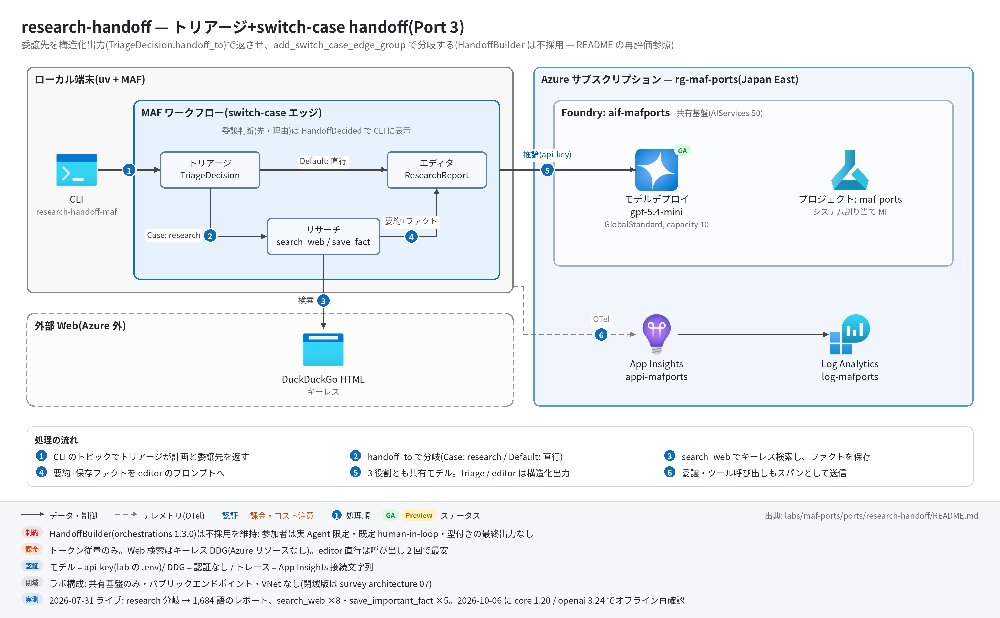

# research-handoff — handoff/トリアージ型(Port 3)

元: [`starter_ai_agents/openai_research_agent`](https://github.com/Shubhamsaboo/awesome-llm-apps/tree/main/starter_ai_agents/openai_research_agent)(OpenAI Agents SDK + Streamlit、331行)

## 元の構成(5行)

- triage_agent(`output_type=ResearchPlan` + `handoffs=[handoff(research), handoff(editor)]`)が計画を立て、**SDK が自動生成する handoff ツール呼び出しで LLM 自身が委譲先を選ぶ**
- research_agent は `WebSearchTool`(OpenAI ホスト実行)+ `save_important_fact`(Streamlit session_state へ保存)で検索・要約(300語以内)
- editor_agent(`output_type=ResearchReport`)は `Runner.run(editor, triage_result.to_input_list())` と**手続きで**呼ばれ、会話履歴全体から長文レポートを生成 — つまり 2 段目の「handoff」は宣言だけで実際は手動実行
- `output_type` と `handoffs` の競合対策として `hasattr(final_output, 'topic')` の fallback あり(handoff 発火時は final_output が ResearchPlan でなくなる)
- UI は Streamlit(進捗・ファクト・レポートのタブ表示)、`trace()` で OpenAI 側トレーシング

## MAF の handoff サポート調査(本ポートの核心)

installed package(agent-framework-core 1.10 / 1.12)を調査した結論:

- **core の `_workflows/` に handoff の first-class API はない**。`grep -ri handoff` でヒットするのはイベント種別 `"handoff_sent"` の定義など参照のみ
- `agent_framework.orchestrations` 名前空間に `HandoffBuilder` / `HandoffAgentExecutor` 等があるが、これは**別パッケージ `agent-framework-orchestrations`(PyPI、調査時点 1.0.1)への lazy re-export** で、未インストールなら ModuleNotFoundError になる
- `HandoffBuilder`(1.0.1 の `_handoff.py`)の実装: 参加者の `Agent` を clone して **合成ツール `handoff_to_<target_id>` を注入**し、`_AutoHandoffMiddleware` がその呼び出しを **short-circuit(実行せず合成結果を返す)** してルーティング信号にする。グラフは全結線(メッシュ)で、アクティブなエージェントが応答を全員に broadcast。**既定は human-in-loop**(handoff しない応答のたびに `request_info` でユーザー入力を要求)で、`with_autonomous_mode` で自律継続に切替。OpenAI Agents SDK の `handoff()` と同じ「LLM がツール呼び出しで委譲先を選ぶ」思想

本ポートで HandoffBuilder を**採用しなかった**理由:

1. 参加者は実 `Agent` インスタンス限定(clone・ツール注入・middleware が前提。protocol 実装の scripted fake は participants にできない)→ **PORTING.md §4 のオフラインテスト必須要件と両立しない**
2. 会話型(human-in-loop / 自律ループ)の semantics が、元アプリの**一発完結パイプライン**(topic → 計画 → 検索 → レポート)には過剰で合わない — 元アプリ自身、2 段目の handoff を手動 `Runner.run` で代替していた
3. core 外の追加依存(1.0.x)になる

代わりに**トリアージの構造化出力(`TriageDecision.handoff_to`)+ core の `add_switch_case_edge_group`(Case / Default)**で表現した。表現力の差は「学び 1」参照。

### 再評価(2026-09-29、agent-framework-core 1.19.0 / agent-framework-orchestrations 1.2.0)

wheel のソース(`agent_framework_orchestrations/_handoff.py`)を読み、スクラッチ環境で実 `Agent` 3 体+`/openai/v1/responses` のモック(`handoff_to_<name>` ツール呼び出しを台本化)で HandoffBuilder を動かして確かめた結論: **不採用判断は維持**(ポートは書き換えない)。

| 当初の理由 | 1.2.0 での実態 | 判定 |
| --- | --- | --- |
| 1. 参加者は実 `Agent` 限定で scripted fake を使えない | 変わらず。protocol 実装を渡すと `TypeError: Participants must be Agent instances`(docstring も「`SupportsAgentRun` 実装は非対応。clone・ツール注入・middleware が要るため」と明記)。さらに **全参加者に `require_per_service_call_history_persistence=True` が必須**になった(未設定だと `build()` が ValueError)。ただし「オフラインテスト不能」は言い過ぎだった: 実 `Agent` + モックのチャットクライアント(HTTP)なら handoff 経路をオフラインで完走できる。正確には **ScriptedAgent パターンが使えず、テストの台本が「LLM のツール呼び出し JSON」レベルまで下がる** | 維持(表現を修正) |
| 2. 会話型の semantics が一発パイプラインに合わない | 変わらず。既定は human-in-loop で、最後の editor が handoff せずに応答すると `request_info(HandoffAgentUserRequest)` を出して `IDLE_WITH_PENDING_REQUESTS` で止まる(実測)。一発完結には `with_autonomous_mode()` + `with_termination_condition()` が要る。出力は各エージェントの `AgentResponse` がそのまま `output` イベントになり型付きの最終成果物はない。clone 時に `allow_multiple_tool_calls=False` が強制され、research の並列ツール呼び出しも直列化される | 維持 |
| 3. core 外の追加依存(1.0.x) | 1.2.0 で **Development Status: Production/Stable**、`agent-framework-core>=1.19.0,<2` に追従。成熟度の懸念は薄れたが、追加パッケージであること・core と版を揃える運用が要ることは同じ | 弱まった |

core 1.19 にも handoff の first-class API はない(`agent_framework.orchestrations` は引き続き別パッケージへの lazy re-export)。委譲先を事前に列挙できる本ポートでは switch-case の方が素直、という「学び 1」の整理はそのまま有効。HandoffBuilder を実際に組んで主実装と比べた記録は Port 7 の [HandoffBuilder 比較](../game-design-team/README.md#handoffbuilder-比較agent-framework-orchestrations)。

### 再評価(2026-10-06、agent-framework-core 1.20.0 / agent-framework-orchestrations 1.3.0)

1.2.0 → 1.3.0 の `_handoff.py` の差分を読み、Port 7 の HandoffBuilder 変種を同じ HTTP モックで 1.2.0 / 1.3.0 の両方で流して比べた結論: **不採用判断は維持**。上の表の 3 点(実 `Agent` 限定・`require_per_service_call_history_persistence=True` 必須・one-shot には `with_autonomous_mode()`+`with_termination_condition()` が要る)はどれも変わっていない。1.3.0 の変更は 2 つ:

- **`enable_return_to_previous(False)`(新設。既定は従来どおり True)**: human-in-loop で `request_info` に返ってきたユーザー応答を、応答を求めたエージェントでなく**開始エージェントへ戻す**。開始エージェント=トリアージにすると「ユーザーが何か言うたびにトリアージが委譲先を選び直す」ハブ型になり、元アプリの triage_agent を**会話型**で再現する場合の自然な形が 1 行で書けるようになった。ただし本ポートは一発完結のパイプラインでユーザー応答のターン自体がないため効かない(学び 1 の「列挙できない会話なら handoff 基盤」側の材料が増えた、という位置付け)
- **生成した handoff ツールの検証**: ルーティングは「自動 handoff middleware が実際に横取りした `handoff_to_*` 呼び出し(`call_id` 一致)」の結果に限られ、ほかの関数結果が `{"handoff_to": ...}` の形をしていても委譲先にならない(`call_id` が無いと `RuntimeError`)。参加者が context provider を持つ場合は横取り middleware を provider が足す middleware より**後ろ(内側)**に置くようになり、provider 側のポリシーも handoff 呼び出しを検査・遮断できる(Agent の `middleware=` に直接渡した middleware は 1.2.0 でも横取りより外側だった)。ガバナンス層(Port 14 のような middleware)を context provider 経由で配る構成と handoff を併用するときの穴が塞がった形で、本ポートの判断には影響しない

core 1.20 にも handoff の first-class API はない(`agent_framework.orchestrations` は引き続き別パッケージへの lazy re-export)。

## 移植後の構成



```
                  ┌─[handoff_to == "research"]─▶ Research ──▶ Editor ─▶ ResearchHandoffResult
topic ─▶ Triage ──┤   (search_web +                (要約+facts を
         (構造化出力)  save_important_fact)          プロンプトで受領)
                  └─[Default("editor" 直行)]──────▶ Editor
```

- 3 役割を MAF `Agent`(gpt-5.4-mini on Foundry)にし、handoff は `TriageDecision`(plan + handoff_to + reason)の構造化出力+ switch-case エッジに置換。editor 直行分岐は元の `handoffs=[research, editor]` の editor 宣言に対応
- 元の `output_type=` は `ChatOptions(response_format=...)` で再現(`ResearchPlan` / `ResearchReport` は元の Pydantic モデルをそのまま移植)。パースは `.value` 優先+lenient JSON 抽出フォールバック(agentic-search-maf から移植)
- `WebSearchTool` → 自前 `search_web`(キーレス DDG。trend-analysis の search.py/tools.py をコピー)/ `save_important_fact` → クロージャ束縛の `FactStore`(session_state という暗黙の共有メモリを型付きストアに置換)
- 元アプリのフォールバック 2 種を踏襲: トリアージのパース失敗 → 既定計画で research 続行 / レポートのパース失敗 → 生テキストをそのまま本文に
- Streamlit → CLI(`uv run research-handoff-maf "topic" [--show-facts] [--json]`)
- トレース: `configure_azure_monitor` + agent-framework 既定計装で App Insights へ(委譲判断は `HandoffDecided` の intermediate イベントにも出す)
- テスト: オフライン 31 件(トリアージ両分岐・handoff 先が受け取るコンテキスト・構造化出力 3 経路・fallback 2 種・ツール・実 Agent 配線)+ ライブスモーク(`pytest -m live`)

## 実行

```bash
uv sync --extra dev --extra live
uv run pytest                 # オフライン(ネットワーク不要)
uv run research-handoff-maf "best affordable espresso machines for a French press upgrader"   # 要 ../../.env
uv run research-handoff-maf --show-facts --json "..." # ファクト含む全出力
uv run pytest -m live         # ライブスモーク
```

詳細な実行手順と確認観点は [docs/runbook.md](./docs/runbook.md)(人間用 HTML: `docs/runbook.html`)。

インフラ: 共有基盤のみで動作(`infra/main.bicep` は existing 参照+出力のみ)。

評価: `tests/eval_dataset.jsonl` は各ケースに `expected_route`(research / editor)を明記。鮮度依存トピック(価格・規制動向)は research、教科書的知識(TCP/UDP、TPS)は editor が期待値。editor 直行なら幻覚価格が出る「分岐ミスの実害」ケースと、どちらでも書ける境界ケースを含む。

## 検証結果(2026-10-06 ライブ)

共有基盤(rg-maf-ports / japaneast・gpt-5.4-mini 容量 100・App Insights `appi-mafp1006`)で runbook §5〜§7 を実施(`OTEL_SERVICE_NAME` で `cloud_RoleName` を分けて集計)。

- **ライブスモーク**: `uv run pytest -m live` 1 passed(38.2 秒。strict の構造化出力 TriageDecision / ResearchReport が実モデルで通る)
- **分岐の妥当性(§6 #1〜#3)**: `tests/eval_dataset.jsonl` の 6 トピックを `--json` で順に実行し、**6/6 が `expected_route` と一致**(research 4・editor 2)。所要は research 経由 33.7〜41.2 秒、editor 直行 20.8〜24.3 秒。triage の `reason` は「価格・規制・旅行は鮮度依存」「TCP/UDP・TPS は安定した知識」と期待どおりの言い分
- **editor 直行(#2)**: `research_md: null`・`facts: []`。Sources は TCP/UDP が 0 件、TPS は「外部 Web ソースは使っていない」旨の 1 行で、**架空の URL は出なかった**
- **handoff 先のコンテキスト(#4)**: research 経由 4 回でファクト 2〜5 件を保存し、ファクトの出典 URL はすべてレポートの Sources に反映(例: 4/4、5/5)
- **構造化出力(#5)**: outline 7〜10 項目・`word_count` 1,439〜1,878。ただし `word_count` はモデルの自己申告で、本文の実語数(2,120〜2,935 語)より 3〜4 割少ない — 数値フィールドをモデルに数えさせると当てにならない(必要ならコード側で数える)
- **fallback(#6)**: 6 回とも発生せず(`reason` に fallback なし)
- **トレース(#7)**: 6 回分で `invoke_agent` triage_agent 6 / research_agent 4 / editor_agent 6、`execute_tool search_web` 22(うち 4 件は DuckDuckGo の HTTP 202 で失敗 — Port 1 と同じ断続的なレート制限。ほかのクエリで補われ完走)・`save_important_fact` 14、`edge_group.process SwitchCaseEdgeGroup` 6
- **コスト(#8)**: editor の出力が平均 3,614 トークンで最大、research の入力が平均 7,727 トークン(検索結果の取り込み)、editor 直行は `chat` 2 回で最安
- **修正**: azure-monitor-opentelemetry の既定サンプラー(rate-limited 5 spans/秒)でトレースが欠ける問題を Port 1 で見つけたため、`observability.py` で `sampling_ratio=1.0` を明示した(詳細は Port 1 の検証結果 2026-10-06 ライブ)

## 検証結果(2026-10-06 最新化チェック)

- **依存更新**(`uv lock --upgrade`): agent-framework-core 1.19.0 → **1.20.0** / agent-framework-openai 1.14.4 → **1.15.0** / openai 3.20.0 → **3.24.0** / azure-identity 1.25.3 → 1.26.0 / msgspec 0.21.1 → 0.22.0(推移依存)/ ruff 0.16.9 → 0.16.10。core 1.20 の新しい推移依存として `regex` が入る。pyproject の下限を検証版(`agent-framework-core>=1.20` / `agent-framework-openai>=1.15`)に引き上げ
- オフライン **31 passed**(`-W error::DeprecationWarning` でも同じ)/ `uv run ruff check .` clean
- **コード改修なし**(オフライン確認の時点。その後のライブ検証で `observability.py` にサンプリング設定を追加 — 上の「検証結果(2026-10-06 ライブ)」)。追加確認として、実 `Agent` + `OpenAIChatClient` を `/openai/v1/responses` のモックに向けて両分岐をリポジトリ外のスクラッチで完走させた: research 経由 = 4 リクエスト(triage → research ×2〈`search_web` / `save_important_fact` の function_call 往復で FactStore にファクトが入る〉→ editor)、editor 直行 = 2 リクエスト。triage / editor は `text.format = json_schema`(`name: TriageDecision` / `ResearchReport`、`strict: true`)で送られ、`.value` で検証済みインスタンスが取れる。スパンは `invoke_agent` / `execute_tool` / `edge_group.process SwitchCaseEdgeGroup`
- 変更不要と判断した点(1.20 の switch-case の挙動変化): **`add_switch_case_edge_group` の条件関数が例外を投げたとき、1.19 までは警告ログだけ出して次の Case → `Default` へ流れていた**(壊れた条件が「静かに editor 直行」になる)が、1.20 では例外が呼び出し元へ伝播する(誤ルーティングでなく失敗として見える)。本ポートの条件は `getattr(outcome, "handoff_to", None) == "research"` で例外を投げないため影響なし。条件関数に属性アクセスや外部呼び出しを書く場合は 1.20 以降この違いが効く
- 同じく変更不要: openai 1.15 の Azure 経路ヘッダー修正は `azure_endpoint=` 経路の話で、本ポートは `base_url` 経路
- HandoffBuilder(agent-framework-orchestrations 1.3.0)の再評価: 不採用判断を維持(上の「再評価(2026-10-06)」節)
- 構成図(`docs/architecture.png`)の版表記を core 1.20 / openai 3.24 / orchestrations 1.3.0 に更新して再生成
- ライブ: 上の「検証結果(2026-10-06 ライブ)」(スモーク・確認観点・トレース)

## 検証結果(2026-09-29 最新化チェック)

- **依存更新**(`uv lock --upgrade`): agent-framework-core 1.12.1 → **1.19.0** / agent-framework-openai 1.11.0 → **1.14.4** / openai 2.51.0 → **3.20.0** / pydantic 2.13.4 → 2.13.5 / azure-monitor-opentelemetry 1.8.9 → 1.8.10。pyproject の下限を検証版に引き上げ
- オフライン **31 passed**(DeprecationWarning なし)/ ruff clean(`uv run ruff check .`。旧図スクリプトの既存指摘は図の v2 化で解消)/ `az bicep build` OK
- 構成図(`docs/architecture.png`)を v2 スタイル(日本語ラベル・処理順バッジ・処理の流れパネル・タグ付き注記)に描き直し、内容を現行実装(core 1.19 / openai 3.x・api-key・スパン名)に合わせた
- **コード改修なし**(`workflow.py` の docstring の確認版表記のみ更新)。`Case` / `Default` / `add_switch_case_edge_group`、`Agent(default_options=ChatOptions(response_format=...))` は 1.19 でも同じ。追加確認として、実 `Agent` + `OpenAIChatClient` を `/openai/v1/responses` のモックに向けて両分岐(research 経由 / editor 直行)をリポジトリ外のスクラッチで完走させ、triage / editor のリクエストが `text.format = json_schema`(`name: TriageDecision`、`strict: true`)で送られること、research の `search_web` / `save_important_fact` の function_call 往復で FactStore にファクトが入ることを確認。スパンは `invoke_agent` / `execute_tool` / `edge_group.process SwitchCaseEdgeGroup` が出る
- HandoffBuilder(agent-framework-orchestrations 1.2.0)の再評価: 不採用判断を維持(上の「再評価」節)
- 変更不要と判断した点: v1 エンドポイントと api-key 認証は現行 docs どおり / gpt-5.4-mini は 2027-09-21 まで GA / MAF 1.14→1.19 の破壊的変更は本ポートの使用 API に該当なし
- **ライブ未検証**: openai 3.x 経由の実 Foundry 呼び出し(特に構造化出力の strict スキーマが実モデルで通るか)と App Insights 着信(Azure リソース削除済み)。手順は [docs/runbook.md](./docs/runbook.md)

## 検証結果(2026-07-31)

- オフラインテスト 31 passed / ruff clean / `az bicep build` OK(生成 json は削除)
- ライブスモークとトレース到達確認は未実施(呼び出し元で実施)。確認クエリ:

```bash
az monitor app-insights query --app appi-mafports -g rg-maf-ports \
  --analytics-query "dependencies | where timestamp > ago(30m) | summarize count() by name"
```


**ライブスモーク(2026-07-31):** triage→research handoff(理由付き)→ editor 構造化レポート 1,684 語で完走。トレース: `invoke_agent`×3、`execute_tool search_web`×8、`save_important_fact`×5 を App Insights で確認。

## 学び(MAF vs 元構成)

1. **handoff の表現力差 — 「LLM の自由裁量によるツール呼び出し」vs「型付きルーティングデータ+エッジ条件」。**OpenAI Agents SDK の handoff は `handoffs=[handoff(agent)]` の 1 行で、会話履歴の引き継ぎも SDK が暗黙に行う。MAF core で同じことをすると、(a) 委譲判断を構造化出力のフィールドに落とす、(b) エッジ条件で分岐する、(c) handoff 先に渡すコンテキストをプロンプトとして自分で組み立てる、の 3 点が**全部明示的な設計判断になる**。行数は増えるが、「トリアージがなぜそう判断したか(reason)」「handoff 先が何を受け取るか」がデータとして残り、オフラインテストで両分岐・受け渡し内容・fallback を決定的にアサートできた。元 SDK の handoff はこのどれもテストしづらい(LLM の裁量なので)。一方で「会話の途中で任意のタイミングで委譲」のような動的パターンは、条件付きエッジでは事前に列挙した分岐しか書けず、HandoffBuilder(または元 SDK)が本質的に有利。**SI の技術選定では「委譲先が事前に列挙できる業務フローか、列挙できない会話か」が分水嶺**になる。
2. **MAF の first-class handoff は core でなく別パッケージ、しかも「会話型」に振っている。**`agent-framework-orchestrations` の HandoffBuilder は合成ツール+middleware short-circuit という元 SDK と同じ機構だが、既定 human-in-loop・全結線 broadcast・checkpoint 対応と、カスタマーサポート的な**長寿命会話**を主眼に設計されている。元アプリのような一発パイプラインに被せると「request_info で止まる/autonomous mode の turn 制御」など余計な面が付いてくる。「handoff」という同じ語が SDK ごとに別のワークロードを指している好例で、機能名の一致だけで移植先を決めると事故る。
3. **`output_type` と handoff の競合という元アプリのバグ級の癖が、グラフ化で構造的に消えた。**元コードの `hasattr(final_output, 'topic')` fallback は「triage が handoff すると final_output が ResearchPlan でなくなる」ことへの対症療法。移植では計画と委譲判断を 1 つの構造化出力(TriageDecision)に同居させたので競合自体が存在しない。そもそも元アプリの editor 段は宣言上 handoff・実際は手動 `Runner.run` であり、**移植とは「宣言と実挙動のズレを洗い出して本当の制御フローを決め直す作業**だと実感した。
4. **response_format(ネイティブ構造化出力)は Foundry 経由でそのまま効くが、lenient フォールバックは保険として残す価値がある。**`ChatOptions(response_format=PydanticModel)` で `.value` に検証済みインスタンスが入る(agentic-search-maf で実証済みのパターン)。ただしプロバイダ差・散文包み・Literal 逸脱(handoff_to に未知値)があり得るため、`.value` 優先+抽出フォールバック+既定計画 fallback の 3 段構えにし、全経路をオフラインテストで固定した。
5. **Streamlit session_state という「UI がエージェントの記憶を持つ」構造は、そのままでは移植できない。**`save_important_fact` は st.session_state に書き込み、UI がポーリング表示していた。CLI 化では FactStore(クロージャ束縛)+型付きメッセージ(ResearchFindings.facts)+最終結果への同梱に分解した。ツールの副作用が UI 状態に依存するアプリは、見た目の行数以上に移植コストがかかる — SI の見積り観点では「ツールがどこに書き込んでいるか」を最初に確認すべき。
