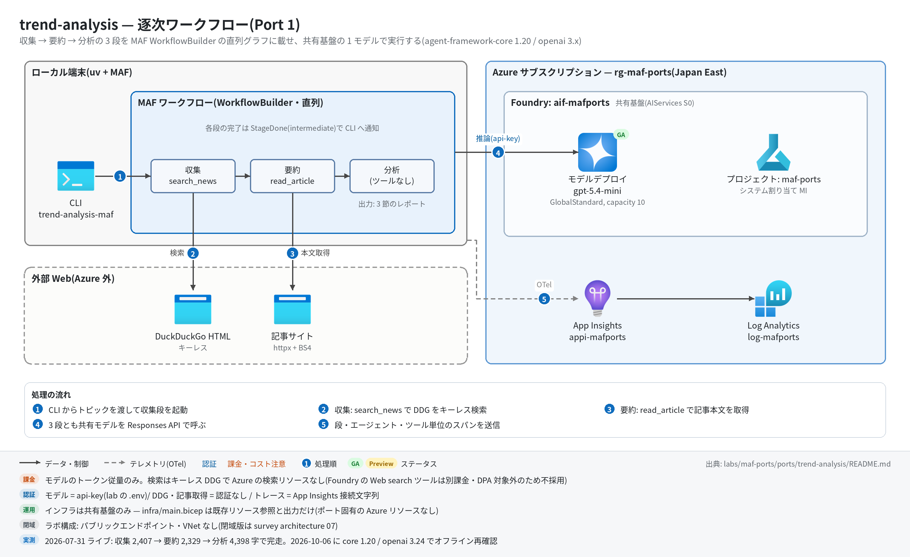

# trend-analysis — 逐次ワークフロー最小形(Port 1)

元: [`starter_ai_agents/ai_startup_trend_analysis_agent`](https://github.com/Shubhamsaboo/awesome-llm-apps/tree/main/starter_ai_agents/ai_startup_trend_analysis_agent)(Agno + Gemini 2.5 Flash + Streamlit、78行)

## 元の構成(5行)

- Streamlit のボタンハンドラ内で 3 つの Agno `Agent` を**手続き的に直列実行**(news_collector → summary_writer → trend_analyzer)
- news_collector は `DuckDuckGoTools`、summary_writer は `Newspaper4kTools`(記事本文読取)を持つ
- モデルは全役割 Gemini 2.5 Flash(API キーを UI から入力)
- 段間の受け渡しは f-string でプロンプトに前段出力を埋め込むだけ
- エラー処理は try/except 一括、観測性なし

## 移植後の構成



```
topic ──▶ CollectorExecutor ──▶ SummarizerExecutor ──▶ AnalyzerExecutor ──▶ TrendReport
          (search_news tool)     (read_article tool)     (ツールなし)
```

- 3 役割を MAF `Agent`(gpt-5.4-mini on Foundry)にし、直列実行を `WorkflowBuilder` のグラフに昇格
- `DuckDuckGoTools` → 自前 `search_news`(キーレス DDG HTML、agentic-search-maf から移植)/ `Newspaper4kTools` → 自前 `read_article`(httpx + BS4)
- Streamlit → CLI(`uv run trend-analysis-maf "topic" [--json]`)
- トレース: `configure_azure_monitor` + agent-framework 既定計装で App Insights へ(エージェント実行・ツール呼び出しがスパンになる)
- テスト: オフライン 9 件(ScriptedAgent + httpx.MockTransport)+ ライブスモーク(`pytest -m live`)

## 実行

```bash
uv sync --extra dev --extra live
uv run pytest                 # オフライン(ネットワーク不要)
uv run trend-analysis-maf "AI coding agents for enterprises"   # 要 ../../.env
uv run pytest -m live         # ライブスモーク
```

詳細な実行手順と確認観点は [docs/runbook.md](./docs/runbook.md)(人間用 HTML: `docs/runbook.html`)。

インフラ: 共有基盤のみで動作(`infra/main.bicep` は existing 参照+出力のみ)。

## 検証結果(2026-10-06 ライブ)

共有基盤(rg-maf-ports / japaneast・gpt-5.4-mini GlobalStandard 容量 100・App Insights `appi-mafp1006`)で runbook §5〜§7 を実施。トレースは他ポートと混ざらないよう `OTEL_SERVICE_NAME` で `cloud_RoleName` を分けて集計した。

- **ライブスモーク**: `uv run pytest -m live` 1 passed(26.8 秒)
- **正常系(§6 #1・#2)**: `trend-analysis-maf --json "AI coding agents for enterprises"` が 30.5 秒で完走。収集 3,170 → 要約 3,461 → 分析 4,477 字、分析は `## Emerging trends` / `## Startup opportunities` / `## Risks & unknowns` の 3 節。収集の URL 10 件のうち 5 件が要約に引き継がれた(段間の受け渡しが効いている)
- **ツール呼び出し(#3)**: `execute_tool search_news` 3 件・`read_article` **8 件**(runbook の目安 3〜5 件より多い。要約役が記事を多めに読んだ)
- **設定不足(#4)**: `FOUNDRY_API_KEY=` で終了コード 2・期待どおりのメッセージ
- **検索の失敗(#5)を実地で観察**: DuckDuckGo が断続的に **HTTP 202**(ボット対策のレート制限)を返し、5 回の CLI 実行のうち 3 回は search_news が全件失敗した。ツール例外(`SearchError: duckduckgo returned HTTP 202`。App Insights の `AppExceptions` に記録)はモデルに `Error: Function failed.` として返り、収集役は「ニュース検索が使えない」と述べて約 300 字で終了、ワークフロー自体は終了コード 0 で完走し、分析役は根拠のない一般論の 3 節(約 3,600 字)を書いた。**落ちない代わりに中身が空のレポートが正常終了扱いになる** — 外部検索を自前で持つ構成の運用リスクで、本番なら「収集結果に URL が 0 件なら失敗にする」ガードが要る(本ポートは未実装・学び 2 の補足)
- **トレース(#6)**: 1 回分で `workflow.run` 1・`executor.process` collector / summarizer / analyzer 各 1・`invoke_agent` news_collector / summary_writer / trend_analyzer 各 1・`chat gpt-5.4-mini` 6・`execute_tool` search_news 3 / read_article 8・`edge_group.process` 3・`message.send` 2(サンプリング修正後)
- **コスト(#7)**: 1 回 = `chat` 6 回・入力 14,567 / 出力 2,657 トークン。入力の 8 割は要約役(記事本文 11,962 トークン)
- **問題と修正(トレースの欠落)**: 最初の CLI 実行(12:06Z)では `workflow.run`・`executor.process collector`・`invoke_agent news_collector` などが App Insights に**届かなかった**(同じトレースの `execute_tool` やほかの段は届いている)。原因は azure-monitor-opentelemetry 1.8.x(1.8.9 も同じ)の**既定サンプラーが rate-limited(5 spans/秒)**であること — ワークフロー開始直後のスパンの山が間引かれる。`OTEL_TRACES_SAMPLER=always_on` で全スパンが揃うことを確かめたうえで、`observability.py` で `configure_azure_monitor(..., sampling_ratio=1.0)` を明示した(修正後の実行はすべて欠落なし)。7 月のライブで欠落に気付かなかったのは、スパンの山がたまたま閾値内だったため

## 検証結果(2026-10-06 最新化チェック)

- **依存更新**(`uv lock --upgrade`): agent-framework-core 1.19.0 → **1.20.0** / agent-framework-openai 1.14.4 → **1.15.0** / openai 3.20.0 → **3.24.0** / azure-identity 1.25.3 → 1.26.0 / msgspec 0.21.1 → 0.22.0(推移依存)/ ruff 0.16.9 → 0.16.10。core 1.20 の新しい推移依存として `regex` が入る。pyproject の下限を検証版(`agent-framework-core>=1.20` / `agent-framework-openai>=1.15`)に引き上げ
- オフライン **9 passed**(`-W error::DeprecationWarning` でも同じ)/ `uv run ruff check .` clean
- **コード改修なし**(オフライン確認の時点。その後のライブ検証で `observability.py` にサンプリング設定を追加 — 上の「検証結果(2026-10-06 ライブ)」)。追加確認として、実 `Agent` + `OpenAIChatClient` を `/openai/v1/responses` のモック(openai 3.x の HTTP 層 httpx2 で差し替え)に向けて 3 段+ツール 2 種をリポジトリ外のスクラッチで完走させた。リクエストは 5 回(収集 2・要約 2・分析 1)、ツールスキーマ(`search_news` の `query` 必須・`max_results` 既定 5)と `function_call_output` の往復は 1.19 と同じ。スパンも `invoke_agent` ×3・`execute_tool` ×2・`executor.process` ×3・`chat gpt-5.4-mini` ×5・`workflow.run` で不変
- 変更不要と判断した点: MAF 1.20 の主な変更(承認・MCP 実行文脈の堅牢化、response-stream gates、foundry-hosting の [BREAKING] 再設計)は本ポートの使用面(`Agent` / `WorkflowBuilder` の `add_edge` / `OpenAIChatClient`)に当たらない / agent-framework-openai 1.15 の「Azure 経路に OpenAI の組織・プロジェクトヘッダーを混ぜない」修正は `azure_endpoint=` 経路の話で、本ポートは `base_url=<resource>/openai/v1` の OpenAI 互換経路(api-key は `Authorization: Bearer` で送られる — モックで確認、従来どおり)
- 簡素化の検討: GA 機能・新 API で減らせる自前実装はなかった(本ポートは core の直列グラフと素の関数ツールだけで組んでいる)。検索層の判断(学び 2)は今回再調査していない
- 構成図(`docs/architecture.png`)の版表記を core 1.20 / openai 3.24 に更新して再生成
- ライブ: 上の「検証結果(2026-10-06 ライブ)」(スモーク・確認観点・トレース)

## 検証結果(2026-09-29 最新化チェック)

- **依存更新**(`uv lock --upgrade`): agent-framework-core 1.12.1 → **1.19.0** / agent-framework-openai 1.11.0 → **1.14.4** / openai 2.51.0 → **3.20.0** / azure-monitor-opentelemetry 1.8.9 → 1.8.10。pyproject の下限を検証版(core>=1.19・openai 連携>=1.14.4・azure-monitor>=1.8.10)に引き上げ
- オフライン **9 passed**(DeprecationWarning なし)/ ruff clean(`uv run ruff check .`。旧図スクリプトの既存指摘は図の v2 化で解消)/ `az bicep build` OK
- 構成図(`docs/architecture.png`)を v2 スタイル(日本語ラベル・処理順バッジ・処理の流れパネル・タグ付き注記)に描き直し、内容を現行実装(core 1.19 / openai 3.x・api-key・スパン名)に合わせた
- **コード改修なし**。追加確認として、実 `Agent` + `OpenAIChatClient` を `/openai/v1/responses` のモック(openai 3.x の HTTP 層 httpx2 の MockTransport)に向けて 3 段+ツール 2 種(search_news / read_article の function_call 往復)をリポジトリ外のスクラッチで完走させ、要求形(`instructions` / `tools` / `function_call_output`)とツールスキーマ推論が 1.19 でも変わらないことを確認。インメモリ OTel で `invoke_agent` ×3・`execute_tool` ×2・`executor.process` ×3・`chat gpt-5.4-mini` ×5・`workflow.run` のスパンが出ることも確認
- 変更不要と判断した点: openai 3.x は HTTP 層が httpx → httpx2 に変わったが、本ポートは OpenAI クライアントに独自 `http_client` を渡しておらず(自前ツールの httpx は別系統)影響なし / v1 エンドポイント(`<resource>.openai.azure.com/openai/v1`、api-version 不要)は現行 docs どおり / gpt-5.4-mini は 2027-09-21 まで GA / MAF 1.14→1.19 の破壊的変更(agent middleware のシーケンス化・`SecretString` の非 str 化・MCP の Cookie 既定など)は本ポートの使用 API に該当なし / Bicep の `accounts@2025-06-01` は公式 00-basic サンプルと同版(新しい GA もあるが使う機能に差がない)
- **ライブ未検証**: openai 3.x 経由の実 Foundry 呼び出しと App Insights 着信(Azure リソース削除済み)。再デプロイ時は [docs/runbook.md](./docs/runbook.md) §5〜§7 で確認する

## 検証結果(2026-07-31)

- オフラインテスト 9 passed / ライブスモーク完走(collect 2,407 → summarize 2,329 → analysis 4,398 chars)
- トレース: App Insights に dependencies として着信を確認(確認クエリは下記)

```bash
az monitor app-insights query --app appi-mafports -g rg-maf-ports \
  --analytics-query "dependencies | where timestamp > ago(30m) | summarize count() by name"
```

## 学び(MAF vs 元構成)

1. **手続き直列 → グラフ化のコストはほぼゼロ、得るものは観測性と進捗イベント。**元の 3 行の `run()` 呼び出しは Executor 3 つ+エッジ 2 本になり行数は増えるが、`stream=True` の intermediate イベントで進捗が構造化され、トレースもノード単位で切れる。この規模だと「グラフにする価値は観測性のため」と言い切れる。
2. **Agno のツール同梱文化 vs MAF の「ツールは素の callable」。**`DuckDuckGoTools()` の1行に相当するものが MAF にはなく自前実装(約60行)が要る。ただしクロージャで httpx を束縛すれば `MockTransport` でテスト可能になり、**テスト容易性は自前ツールの方が上**。Foundry の Web search ツール(Agent Service 組み込み)は DPA 対象外・別課金のため既定にしなかった — SI では「検索をどの層で持つか」が契約論点になることを実感できる。
3. **`from __future__ import annotations` とツールスキーマ推論の相性に注意。**アノテーションが文字列化されるため、スキーマ推論やテストは `get_type_hints` 前提で書く必要がある(MAF 1.10 は対応済みだが、テストで `__annotations__` を直接見ると罠)。
4. **トレース配線は2行**(`configure_azure_monitor` + 既定計装)。元アプリに観測性を足す場合の Agno + Langfuse 等の構成より明確に楽で、「Foundry に載せる動機として観測性が最初に効く」という docs/survey の仮説と一致した。 ※2026-10-06: azure-monitor-opentelemetry 1.8.x の既定サンプラーは rate-limited(5 spans/秒)で、ワークフロー開始直後のスパンが間引かれてトレースが歯抜けになった(ライブで実測)。検証用途では `sampling_ratio=1.0` を明示する 3 行目が要る — 「2 行で済む」のは送信までで、何が残るかはサンプリング設定次第。
5. **モデル差し替えは設定のみ**(Gemini → gpt-5.4-mini)。プロンプトは原文をほぼ流用して動作。マルチモデル比較は Port 2(mixture_of_agents)で扱う。
